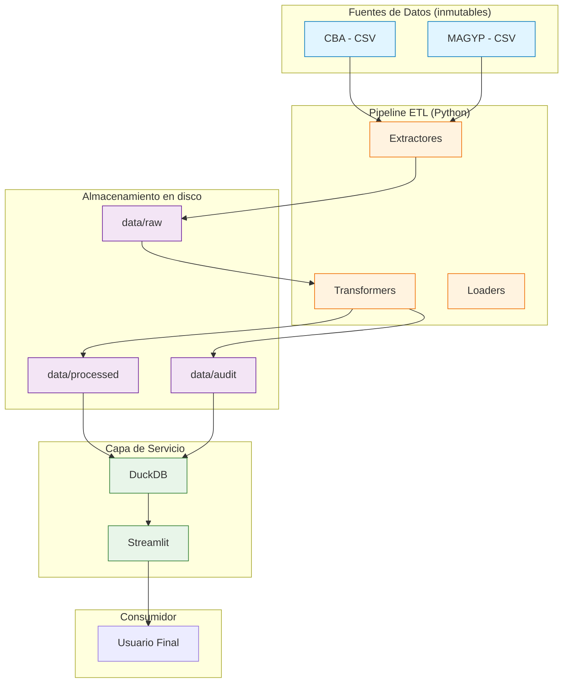
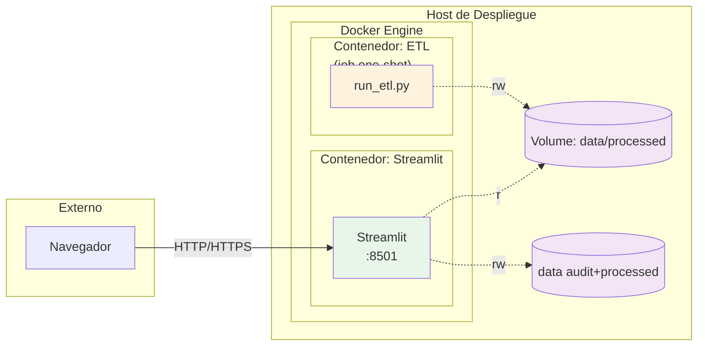

# ETL Biomasa Residual Agrícola

Pipeline ETL para estimación de biomasa residual agrícola en Argentina
a partir de fuentes oficiales, con dashboard interactivo **SQL-first**
sobre DuckDB.

[](https://www.python.org/)
[](https://docs.docker.com/compose/)
[](https://duckdb.org/)
[](https://streamlit.io/)
[](LICENSE)

---

## Tabla de contenidos

- [Descripción](#descripción)
- [Arquitectura](#arquitectura)
- [Flujo del pipeline](#flujo-del-pipeline)
- [Estructura del proyecto](#estructura-del-proyecto)
- [Stack tecnológico](#stack-tecnológico)
- [Instalación](#instalación)
- [Uso](#uso)
- [Despliegue con Docker](#despliegue-con-docker)
- [Dashboard con Streamlit](#dashboard-con-streamlit)
- [Tests](#tests)
- [Decisiones metodológicas](#decisiones-metodológicas)

---

## Descripción

Este proyecto implementa un pipeline ETL que integra dos fuentes oficiales
de datos agrícolas de Argentina y calcula la **biomasa residual** generada
por los principales cultivos extensivos a nivel departamental.

La biomasa residual (en materia seca) se estima como:

$$
\text{Biomasa Residual} = \text{Producción} \times \text{MS} \times \text{FR}
$$

donde MS es la fracción de materia seca del producto cosechado (la
producción se informa a humedad comercial o en fresco),

donde el factor de residuo se deriva del índice de cosecha:

$$
\text{FR} = \frac{1 - \text{IC}}{\text{IC}}
$$

El residuo **recuperable** (50 % por defecto) se convierte a energía con
un gasificador APL PP30 y se valoriza bajo balance neto (Ley 27.424). Los
resultados energéticos y económicos se expresan **por año**, como
promedio de las últimas 5 campañas completas. Ver
[`REPORTE_CAMBIOS.md`](REPORTE_CAMBIOS.md) para el detalle metodológico.

Los resultados se exponen mediante un **dashboard Streamlit** multipágina
que lee directamente los archivos Parquet generados por el pipeline
(vía DuckDB).

**Fuentes**:
- Bolsa de Cereales de Córdoba (CBA).
- Estimaciones Agrícolas del Ministerio de Agricultura, Ganadería y Pesca
  de la Nación (MAGYP).

---

## Arquitectura

Vista de alto nivel del sistema:



---

## Flujo del pipeline


---

## Estructura del proyecto

```
proyecto-biomasa/
├── config/                    Configuración YAML
│   ├── paths.yaml
│   └── logging.yaml
├── data/                      Datos
│   ├── raw/                   Fuentes primarias inmutables
│   ├── reference/             Tablas de referencia (IC/FR)
│   ├── interim/               Intermedios regenerables
│   ├── processed/             Parquet curado
│   └── audit/                 Artefactos de auditoría
├── docs/                      Documentación metodológica
├── etl/                       Código del pipeline
│   ├── extractors/
│   ├── reference/
│   ├── transformers/
│   ├── loaders/
│   └── pipelines/
├── notebooks/                 Análisis exploratorio
├── dashboard/                 App Streamlit (Resumen / Exploración / Auditoría)
│   ├── init.sql               SQL de inicialización (vistas)
│   └── dashboards/            Archivos .dashboard.sql
├── tests/                     Suite de tests
├── Dockerfile                 Imagen del pipeline ETL
├── docker-compose.yml         Orquestación (ETL + Shaper)
├── Makefile
└── pyproject.toml
```

---

## Stack tecnológico

| Capa | Tecnología |
|------|-----------|
| Lenguaje | Python 3.11+ |
| Procesamiento | pandas, numpy |
| Almacenamiento | Parquet (pyarrow) |
| Motor de consulta | DuckDB |
| Dashboard | Streamlit + DuckDB |
| Configuración | PyYAML |
| Testing | pytest |
| Linting | ruff, mypy |
| Despliegue | Docker, Docker Compose |

---

## Instalación

### Local (desarrollo)

```bash
git clone <repo-url>
cd proyecto-biomasa

python -m venv .venv
source .venv/bin/activate    # Linux/Mac
# .venv\Scripts\activate     # Windows

make install-dev
```

### Con Docker (producción)

```bash
make docker-build
make docker-etl
make docker-up
```

---

## Uso

### Ejecutar el pipeline ETL

```bash
# Local
make etl

# Sin descargar fuentes ni tarifas (usa lo último en disco)
python -m etl.pipelines.run_etl --skip-extract --skip-tarifas

# Con Docker (job one-shot)
make docker-etl
```

Genera:
- `data/processed/biomasa_validos.parquet` — dataset curado por campaña
  (biomasa, residuo recuperable, kWh, ARS).
- `data/processed/potencial_energetico_anual.parquet` — potencial
  energético y económico anual (período de referencia).
- `data/reference/YYYYMMDDHHMMSS_tarifas.json` — tarifas de las 28
  distribuidoras del país extraídas de los cuadros tarifarios, con origen
  por campo (`estado_campos`).
- `data/reference/tarifas_historial.csv` — historial de cuadros tarifarios
  procesados (vigencia, valores, documento, SHA-256). Backfill desde 2025:
  `python -m etl.extractors.scrape_tarifas --historial --desde 2025-01`.
- `data/reference/cuadros_manuales/<CÓDIGO>/` — cuadros descargados a mano
  (PDF/XLSX/ZIP) para distribuidoras cuya fuente bloquea la descarga
  automática (EPEC, ESJ, SPSE, DPE). El extractor los procesa como
  cualquier otro cuadro. EPE (Santa Fe) requiere habilitar el dominio
  `epe.santafe.gov.ar` (sin `www`), de donde se bajan sus cuadros.
- `data/audit/descartados_reconciliacion.parquet` — auditoría.
- `data/audit/discrepancias_cba_vs_magyp.parquet` — discrepancias.

---

## Despliegue con Docker

### Arquitectura de despliegue



### Comandos principales

| Comando | Descripción |
|---------|-------------|
| `make docker-build` | Construye la imagen del ETL |
| `make docker-up` / `docker compose up -d --build` | Levanta worker + scheduler + dashboard |
| `make docker-down` | Detiene y elimina los contenedores |
| `make docker-logs` | Sigue los logs del dashboard |
| `make docker-etl` | Ejecuta el pipeline ETL como job |
| `make docker-clean` | Elimina imágenes y volúmenes |

### Flujo típico

```bash
# 1. Construir imagen del ETL
make docker-build

# 2. Ejecutar el ETL para generar Parquet
make docker-etl

# 3. Levantar dashboard Streamlit
make docker-up
```

Acceder al dashboard en `http://localhost:8501`[reference:3].

### Variables de entorno

| Variable | Default | Descripción |
|----------|---------|-------------|
| `LOG_LEVEL` | `INFO` | Nivel de logging |
| `DASHBOARD_PORT` | `8501` | Puerto del dashboard Streamlit |

---

## Dashboard con Streamlit

Dashboard multipágina Streamlit de solo lectura sobre Parquet. Los dashboards son
archivos `.dashboard.sql` versionables en git[reference:4].

### Inicialización

El archivo `dashboard/` se ejecuta al arrancar el contenedor y
crea las vistas sobre los Parquet:

```sql
CREATE OR REPLACE VIEW biomasa AS
SELECT * FROM read_parquet('/data/processed/biomasa_validos.parquet');
```

DuckDB lee Parquet directamente sin necesidad de importación previa[reference:5].

### Desarrollo local de dashboards

```bash
make install-dashboard    # instala streamlit vía pip
make dashboard        # shaper dev (watch mode)
```

El comando `shaper dev` levanta un preview en el navegador con
hot-reload de los archivos `.dashboard.sql`[reference:6].

### Crear un dashboard

1. Crear `dashboard/pages/mi_dashboard.dashboard.sql`.
2. Escribir consultas SQL contra las vistas (`biomasa`, `descartados`).
3. `shaper dev` detecta el archivo y muestra preview.
4. Commit y deploy vía CI/CD o `shaper` CLI.

---


## Programación del ETL (sin Make, Windows incluido)

El scraper/pipeline corre **dentro de Docker** según el cron definido en:

```text
config/schedule.ini
```

Ahí se edita la línea `schedule = ...` (formato cron de 5 campos). Zona horaria: variable `TZ` (por defecto `America/Argentina/Buenos_Aires` en compose / `.env`).

### Arranque del stack (PowerShell + Docker Desktop)

```powershell
# Primera vez / siempre que cambie el código de la imagen
.\scripts\Start-Stack.ps1

# O equivalente:
docker compose up -d --build
```

Servicios que quedan arriba:

| Servicio | Rol |
|----------|-----|
| `etl_worker` | Contenedor permanente del ETL |
| `scheduler` | Ofelia: dispara el ETL según `config/schedule.ini` |
| `dashboard` | Streamlit en http://localhost:8501 |

Tras cambiar el cron:

```powershell
docker compose restart scheduler
```

### Ejecución manual del ETL (una vez, sin esperar al cron)

```powershell
.\scripts\Run-Etl.ps1                       # en Docker; inicia Docker Desktop si está apagado
.\scripts\Run-Etl.ps1 -Local                # sin Docker, con el Python del .venv
.\scripts\Run-Etl.ps1 -Local -SkipExtract   # reusa los raw ya descargados
# o:
docker compose --profile etl run --rm etl_pipeline
```

Si aparece `open //./pipe/dockerDesktopLinuxEngine: The system cannot find
the file specified`, el motor de Docker no está corriendo: abrí Docker
Desktop (el script lo intenta solo y espera hasta 3 minutos) o usá `-Local`.

### Detener todo

```powershell
.\scripts\Stop-Stack.ps1
# o:
docker compose down
```

No se requiere `make` en Windows.


## Tests

```bash
make test
make test-cov
pytest tests/test_crop_consolidation.py -v
```

---

## Decisiones metodológicas

Ver [`docs/decision_log.md`](docs/decision_log.md):

- **POL-CROP-001**: consolidación de `X total` vs componentes.
- **POL-SOURCE-001**: reconciliación por mayor producción.
- **POL-MISSING-001**: gestión de valores faltantes en biomasa.