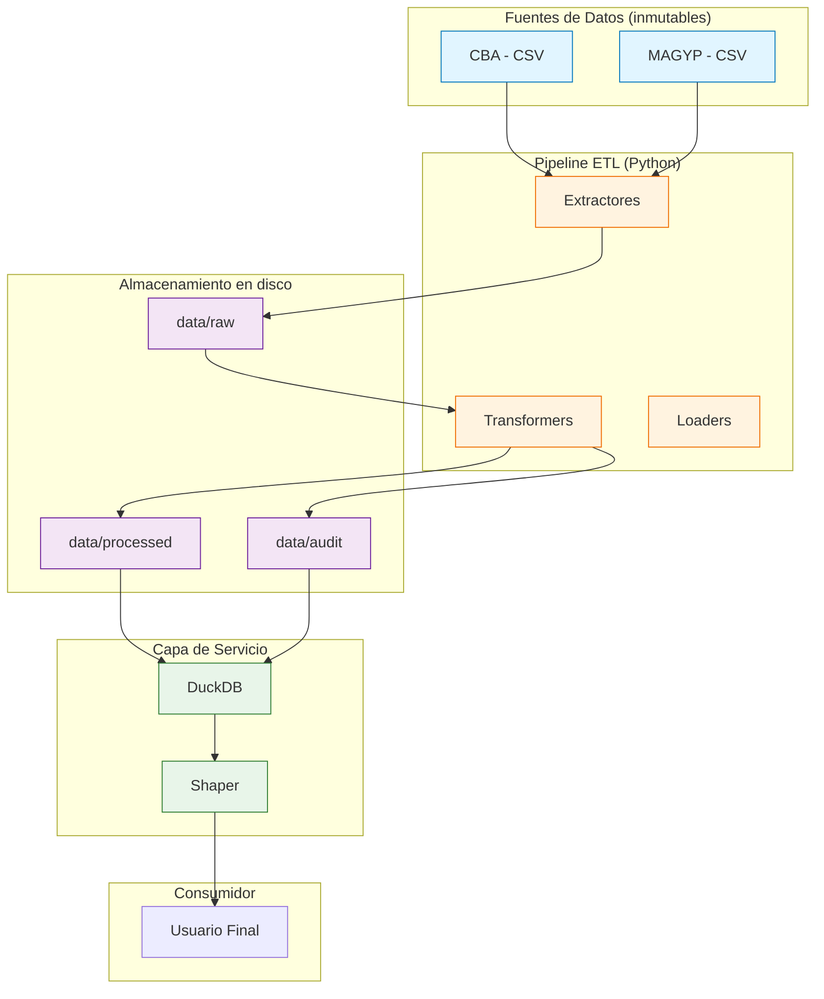
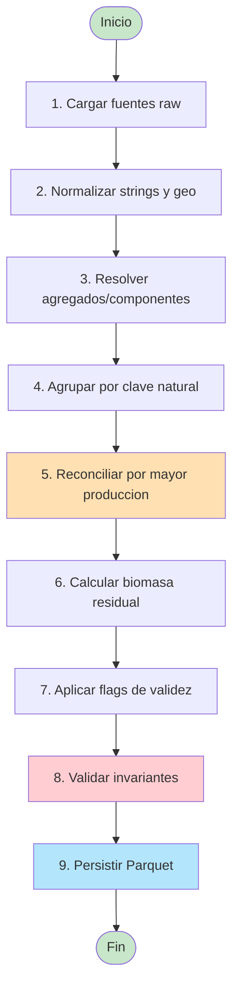

# ETL Biomasa Residual Agrícola

Pipeline ETL para estimación de biomasa residual agrícola en Argentina
a partir de fuentes oficiales, con dashboard interactivo **SQL-first**
sobre DuckDB.

[](https://www.python.org/)
[](https://docs.docker.com/compose/)
[](https://duckdb.org/)
[](https://taleshape.com/shaper/)
[](LICENSE)

---

## Tabla de contenidos

- [Descripción](#descripción)
- [Arquitectura](#arquitectura)
- [Flujo del pipeline](#flujo-del-pipeline)
- [Estructura del proyecto](#estructura-del-proyecto)
- [Stack tecnológico](#stack-tecnológico)
- [Instalación](#instalación)
- [Uso](#uso)
- [Despliegue con Docker](#despliegue-con-docker)
- [Dashboard con Shaper](#dashboard-con-shaper)
- [Tests](#tests)
- [Decisiones metodológicas](#decisiones-metodológicas)

---

## Descripción

Este proyecto implementa un pipeline ETL que integra dos fuentes oficiales
de datos agrícolas de Argentina y calcula la **biomasa residual** generada
por los principales cultivos extensivos a nivel departamental.

La biomasa residual se estima como:

$$
\text{Biomasa Residual} = \text{Producción} \times \text{FR}
$$

donde el factor de residuo se deriva del índice de cosecha:

$$
\text{FR} = \frac{1 - \text{IC}}{\text{IC}}
$$

Los resultados se exponen mediante **Shaper**, un dashboard SQL-first
sobre DuckDB que lee directamente los archivos Parquet generados por
el pipeline.

**Fuentes**:
- Bolsa de Cereales de Córdoba (CBA).
- Estimaciones Agrícolas del Ministerio de Agricultura, Ganadería y Pesca
  de la Nación (MAGYP).

---

## Arquitectura

Vista de alto nivel del sistema:



---

## Flujo del pipeline



---

## Estructura del proyecto

```
proyecto-biomasa/
├── config/                    Configuración YAML
│   ├── paths.yaml
│   └── logging.yaml
├── data/                      Datos
│   ├── raw/                   Fuentes primarias inmutables
│   ├── reference/             Tablas de referencia (IC/FR)
│   ├── interim/               Intermedios regenerables
│   ├── processed/             Parquet curado
│   └── audit/                 Artefactos de auditoría
├── docs/                      Documentación metodológica
├── etl/                       Código del pipeline
│   ├── extractors/
│   ├── reference/
│   ├── transformers/
│   ├── loaders/
│   └── pipelines/
├── notebooks/                 Análisis exploratorio
├── shaper/                    Configuración del dashboard
│   ├── init.sql               SQL de inicialización (vistas)
│   └── dashboards/            Archivos .dashboard.sql
├── tests/                     Suite de tests
├── Dockerfile                 Imagen del pipeline ETL
├── docker-compose.yml         Orquestación (ETL + Shaper)
├── Makefile
├── pyproject.toml
└── requirements.txt
```

---

## Stack tecnológico

| Capa | Tecnología |
|------|-----------|
| Lenguaje | Python 3.11+ |
| Procesamiento | pandas, numpy |
| Almacenamiento | Parquet (pyarrow) |
| Motor de consulta | DuckDB |
| Dashboard | Shaper (SQL-first) |
| Configuración | PyYAML |
| Testing | pytest |
| Linting | ruff, mypy |
| Despliegue | Docker, Docker Compose |

---

## Instalación

### Local (desarrollo)

```bash
git clone <repo-url>
cd proyecto-biomasa

python -m venv .venv
source .venv/bin/activate    # Linux/Mac
# .venv\Scripts\activate     # Windows

make install-dev
```

### Con Docker (producción)

```bash
make docker-build
make docker-etl
make docker-up
```

---

## Uso

### Ejecutar el pipeline ETL

```bash
# Local
make etl

# Con Docker (job one-shot)
make docker-etl
```

Genera:
- `data/processed/biomasa_validos.parquet` — dataset curado.
- `data/audit/descartados_reconciliacion.parquet` — auditoría.
- `data/audit/discrepancias_cba_vs_magyp.parquet` — discrepancias.

---

## Despliegue con Docker

### Arquitectura de despliegue


### Comandos principales

| Comando | Descripción |
|---------|-------------|
| `make docker-build` | Construye la imagen del ETL |
| `make docker-up` | Levanta Shaper en background |
| `make docker-down` | Detiene y elimina los contenedores |
| `make docker-logs` | Sigue los logs de Shaper |
| `make docker-etl` | Ejecuta el pipeline ETL como job |
| `make docker-clean` | Elimina imágenes y volúmenes |

### Flujo típico

```bash
# 1. Construir imagen del ETL
make docker-build

# 2. Ejecutar el ETL para generar Parquet
make docker-etl

# 3. Levantar Shaper
make docker-up
```

Acceder al dashboard en `http://localhost:5454`[reference:3].

### Variables de entorno

| Variable | Default | Descripción |
|----------|---------|-------------|
| `LOG_LEVEL` | `INFO` | Nivel de logging |
| `SHAPER_PORT` | `5454` | Puerto del dashboard |

---

## Dashboard con Shaper

Shaper es un dashboard **SQL-first** sobre DuckDB. Los dashboards son
archivos `.dashboard.sql` versionables en git[reference:4].

### Inicialización

El archivo `shaper/init.sql` se ejecuta al arrancar el contenedor y
crea las vistas sobre los Parquet:

```sql
CREATE OR REPLACE VIEW biomasa AS
SELECT * FROM read_parquet('/data/processed/biomasa_validos.parquet');
```

DuckDB lee Parquet directamente sin necesidad de importación previa[reference:5].

### Desarrollo local de dashboards

```bash
make install-shaper    # instala shaper-bin vía pip
make shaper-dev        # shaper dev (watch mode)
```

El comando `shaper dev` levanta un preview en el navegador con
hot-reload de los archivos `.dashboard.sql`[reference:6].

### Crear un dashboard

1. Crear `shaper/dashboards/mi_dashboard.dashboard.sql`.
2. Escribir consultas SQL contra las vistas (`biomasa`, `descartados`).
3. `shaper dev` detecta el archivo y muestra preview.
4. Commit y deploy vía CI/CD o `shaper` CLI.

---

## Tests

```bash
make test
make test-cov
pytest tests/test_crop_consolidation.py -v
```

---

## Decisiones metodológicas

Ver [`docs/decision_log.md`](docs/decision_log.md):

- **POL-CROP-001**: consolidación de `X total` vs componentes.
- **POL-SOURCE-001**: reconciliación por mayor producción.
- **POL-MISSING-001**: gestión de valores faltantes en biomasa.