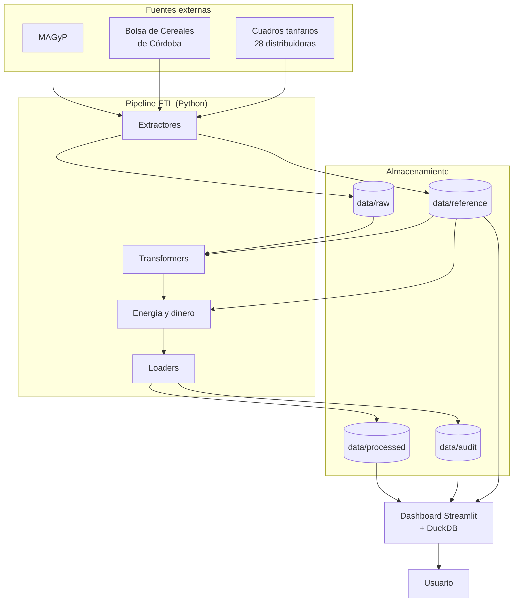
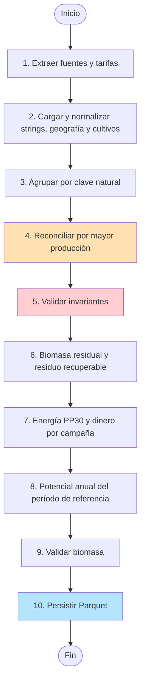
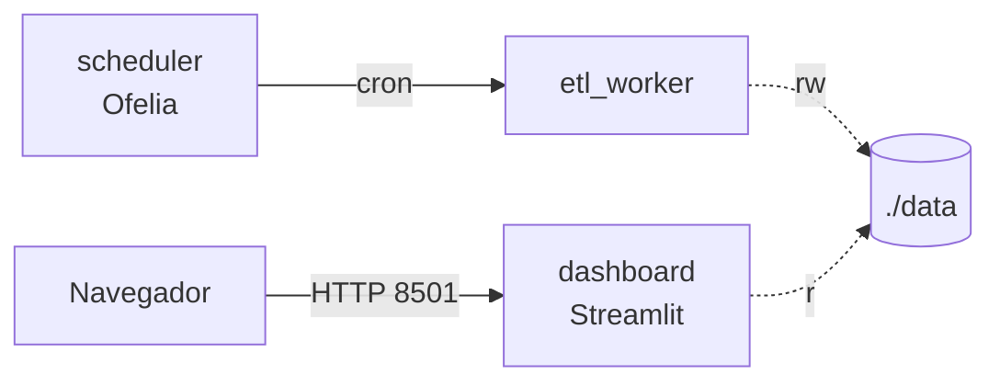

# ETL Biomasa Residual Agrícola

Pipeline ETL que estima la **biomasa residual agrícola** de Argentina por
departamento, la convierte en **energía eléctrica** generable con
gasificadores APL PP30 y la valoriza en **dinero** con las tarifas
eléctricas vigentes de cada distribuidora. Incluye un dashboard
Streamlit sobre los Parquet del pipeline (vía DuckDB).

[](https://www.python.org/)
[](https://docs.docker.com/compose/)
[](https://duckdb.org/)
[](https://streamlit.io/)

---

## Tabla de contenidos

- [Descripción](#descripción)
- [Arquitectura](#arquitectura)
- [Flujo del pipeline](#flujo-del-pipeline)
- [Estructura del proyecto](#estructura-del-proyecto)
- [Stack tecnológico](#stack-tecnológico)
- [Instalación](#instalación)
- [Uso](#uso)
- [Tarifas eléctricas](#tarifas-eléctricas)
- [Dashboard](#dashboard)
- [Despliegue con Docker](#despliegue-con-docker)
- [Programación del ETL](#programación-del-etl-sin-make-windows-incluido)
- [Dominios necesarios](#dominios-necesarios)
- [Tests y controles de calidad](#tests-y-controles-de-calidad)
- [Decisiones metodológicas](#decisiones-metodológicas)

---

## Descripción

El pipeline integra dos fuentes oficiales de producción agrícola por
departamento y calcula la biomasa residual en **materia seca**:

$$
\text{Biomasa residual} = \text{Producción} \times \text{MS} \times \text{FR},
\qquad \text{FR} = \frac{1 - \text{IC}}{\text{IC}}
$$

donde MS es la fracción de materia seca del producto cosechado (la
producción se informa a humedad comercial) e IC el índice de cosecha del
cultivo (`data/reference/ic_fr.csv`).

Sobre esa biomasa:

1. **Residuo recuperable**: 50 % del residuo (el resto queda en el lote).
2. **Energía**: el residuo, llevado a humedad operativa (12 %), alimenta
   gasificadores PP30 de 25 kW con un consumo específico de 1,1 kg/kWh.
3. **Dinero** (balance neto, Ley 27.424): 60 % de la energía se
   autoconsume y ahorra la tarifa de compra; 40 % se inyecta a la red a la
   tarifa de inyección. Es **beneficio bruto**: no descuenta inversión,
   operación ni recolección y flete del rastrojo.

Energía y dinero se expresan **por año**, como promedio de las 5 últimas
campañas completas. El detalle de la metodología y de cada corrección
está en [`REPORTE_CAMBIOS.md`](REPORTE_CAMBIOS.md).

**Fuentes**:
- Estimaciones Agrícolas del Ministerio de Agricultura, Ganadería y Pesca
  de la Nación (MAGyP).
- Bolsa de Cereales de Córdoba (CBA).
- Cuadros tarifarios de las 28 distribuidoras eléctricas del país
  (Secretaría de Energía, entes reguladores y sitios de las distribuidoras).

Ver [`docs/data_sources.md`](docs/data_sources.md).

---

## Arquitectura



Más diagramas en [`docs/`](docs/): arquitectura detallada, despliegue,
flujo de datos, ciclo de vida de los artefactos, modelo de datos y
secuencia del dashboard.

---

## Flujo del pipeline



---

## Estructura del proyecto

```
SYNGAS-OPTIMIA-HV/
├── config/                    paths.yaml, logging.yml, schedule.ini (cron)
├── data/
│   ├── raw/                   Descargas versionadas YYYYMMDDHHMMSS_*.csv
│   ├── reference/             ic_fr.csv, *_tarifas.json, tarifas_historial.csv,
│   │                          cuadros_manuales/
│   ├── processed/             biomasa_validos.parquet, potencial_energetico_anual.parquet
│   └── audit/                 descartados y discrepancias entre fuentes
├── docs/                      Fuentes, decisiones metodológicas y diagramas
├── etl/
│   ├── extractors/            MAGyP, Bolsa de Córdoba, tarifas (scraper + parser)
│   ├── reference/             Registro de distribuidoras
│   ├── transformers/          Limpieza, geografía, reconciliación, biomasa,
│   │                          período de referencia, energía y dinero
│   ├── loaders/               Parquet e historial de tarifas
│   └── pipelines/run_etl.py   Orquestación
├── dashboard/
│   ├── app.py                 Punto de entrada y navegación
│   ├── data_loader.py         Carga (DuckDB), agregaciones y claves geográficas
│   ├── charts.py              Mapas y barras compartidos
│   ├── vistas/                Inicio, Resumen, Energía, Dinero, Exploración, Auditoría
│   └── geo/                   Polígonos GADM 4.1 (provincias y departamentos)
├── notebooks/main.ipynb       Análisis completo paso a paso
├── scripts/                   PowerShell: Start-Stack, Run-Etl, Stop-Stack
├── tests/
├── Dockerfile                 Imagen única para ETL y dashboard
├── docker-compose.yml         etl_worker, etl_pipeline, scheduler, dashboard
├── Makefile
└── pyproject.toml
```

---

## Stack tecnológico

| Capa | Tecnología |
|------|-----------|
| Lenguaje | Python 3.11+ |
| Procesamiento | pandas, numpy |
| Descarga y parseo | httpx, BeautifulSoup, pypdf, openpyxl, xlrd |
| Almacenamiento | Parquet (pyarrow), CSV, JSON |
| Motor de consulta | DuckDB |
| Dashboard | Streamlit + Plotly |
| Testing / calidad | pytest, ruff, mypy |
| Despliegue | Docker, Docker Compose, Ofelia (cron) |

---

## Instalación

### Local (desarrollo)

```bash
git clone https://github.com/marcoeferro/SYNGAS-OPTIMIA-HV.git
cd SYNGAS-OPTIMIA-HV

python -m venv .venv
source .venv/bin/activate    # Linux/Mac
# .venv\Scripts\activate     # Windows

pip install -e ".[dev]"      # o: make install-dev
```

### Con Docker

```bash
docker compose up -d --build   # o: make docker-up
```

---

## Uso

### Ejecutar el pipeline ETL

```bash
make etl                                                   # completo
python -m etl.pipelines.run_etl --skip-extract --skip-tarifas  # usa lo último en disco
make docker-etl                                            # en Docker (job one-shot)
```

Genera:
- `data/processed/biomasa_validos.parquet`: dataset curado por campaña
  (biomasa, residuo recuperable, kWh, tarifas y ARS por registro).
- `data/processed/potencial_energetico_anual.parquet`: potencial
  energético y económico anual del período de referencia.
- `data/reference/YYYYMMDDHHMMSS_tarifas.json`: tarifas por distribuidora,
  con vigencia, documento de origen y estado de cada campo.
- `data/reference/tarifas_historial.csv`: historial de cuadros tarifarios.
- `data/audit/descartados_reconciliacion.parquet` y
  `data/audit/discrepancias_cba_vs_magyp.parquet`: auditoría.

Si una fuente falla:

1. Cada pedido HTTP se reintenta ante 429/500/502/503/504 y cortes de red,
   con backoff exponencial (2, 4, 8… s, hasta 6 intentos) o el tiempo que
   indique `Retry-After` (`etl/extractors/http_retry.py`). SharePoint, por
   ejemplo, responde 503 cuando limita pedidos aunque el archivo exista.
2. Si aun así falla, el pipeline sigue con las demás fuentes y al final
   hace una segunda pasada sobre las que fallaron (después de 60 s).
3. Si vuelve a fallar, usa el último archivo descargado de esa fuente y
   lo registra en el log.

---

## Tarifas eléctricas

`etl/extractors/scrape_tarifas.py` recorre las 28 distribuidoras de
`etl/reference/distribuidoras.py`, descarga los cuadros (PDF, XLSX, ZIP)
y extrae la tarifa con `etl/extractors/tariff_parser.py`:

- **Compra**: medianas o grandes demandas en baja tensión (< 300 kW),
  banda horaria "Resto", sin impuestos, del cuadro pleno vigente.
- **Inyección**: precio publicado para usuarios-generadores; donde falta
  se estima como compra × ratio observado y se marca como estimado.

```bash
python -m etl.extractors.scrape_tarifas                       # vigentes
python -m etl.extractors.scrape_tarifas --solo EPE EDESAL     # sólo algunas
python -m etl.extractors.scrape_tarifas --historial --desde 2025-01  # backfill
```

Para fuentes que bloquean la descarga automática, se puede dejar el
cuadro bajado a mano en `data/reference/cuadros_manuales/<CÓDIGO>/`
(p.ej. `EPEC/cuadro_tarifario_2026_09.pdf`); se procesa como cualquier
otro cuadro.

Estado al 2026-10: 22 distribuidoras con tarifa extraída, EJESA con el
valor anterior y 5 sin dato (EPEC, ESJ, SPSE, DPE, EDET). El detalle y
los motivos están en `REPORTE_CAMBIOS.md`.

---

## Dashboard

```bash
make dashboard            # streamlit run dashboard/app.py
```

Abrir `http://localhost:8501`. Páginas:

| Página | Contenido |
|--------|-----------|
| **Inicio** | Qué se calcula y de dónde salen los datos |
| **Resumen** | KPIs, rankings y mapas por provincia y departamento; selector biomasa / energía / dinero |
| **Energía** | Energía generable, equipos PP30, autoconsumo vs. inyección, mapas y parámetros |
| **Dinero** | Beneficio bruto, mapas, tarifas por distribuidora e historial de tarifas |
| **Exploración** | Filtros cruzados, series por campaña y tabla descargable |
| **Auditoría de datos** | Descartados, discrepancias entre fuentes, estado de tarifas, cobertura de mapas y campañas incompletas |

Notas:
- Las páginas están en `dashboard/vistas/` y se registran en
  `dashboard/app.py` (`st.navigation`). Para agregar una página, crear el
  archivo en `vistas/` y sumarlo a la lista de `app.py`. No usar una
  carpeta `pages/`: Streamlit activa el modo multipágina anterior y las
  páginas dejan de pasar por `app.py`.
- Los mapas usan los polígonos GADM 4.1 de `dashboard/geo/` y la
  cartografía base de Plotly, que el navegador descarga de `cdn.plot.ly`.
- Los datos se leen de `data/processed`, `data/audit` y `data/reference`;
  ejecutar el ETL antes de abrir el dashboard. El dashboard detecta cuando
  el ETL reescribe un archivo (no hace falta reiniciarlo); en **Inicio →
  Archivos de datos** se ve la fecha de cada uno.
- Si una página dice que el archivo "fue generado por una versión anterior
  del ETL" o que falta el potencial anual, el ETL corrió con código viejo.
  En Docker el código del ETL está dentro de la imagen: reconstruirla con
  `docker compose build etl_pipeline` antes de correrlo
  (`.\scripts\Run-Etl.ps1` y `make docker-etl` ya lo hacen).

---

## Despliegue con Docker



| Comando | Descripción |
|---------|-------------|
| `make docker-build` | Construye la imagen (ETL + dashboard) |
| `make docker-up` / `docker compose up -d --build` | Levanta worker + scheduler + dashboard |
| `make docker-down` | Detiene y elimina los contenedores |
| `make docker-logs` | Sigue los logs del dashboard |
| `make docker-etl` | Ejecuta el pipeline ETL como job |
| `make docker-clean` | Elimina imágenes y volúmenes |

| Variable | Default | Descripción |
|----------|---------|-------------|
| `LOG_LEVEL` | `INFO` | Nivel de logging |
| `DASHBOARD_PORT` | `8501` | Puerto del dashboard |
| `TZ` | `America/Argentina/Buenos_Aires` | Zona horaria del cron |
| `EPE_API_KEY` | clave pública del sitio de EPE | Reemplaza la clave de la API de descargas de EPE si cambia |

---

## Programación del ETL (sin Make, Windows incluido)

El pipeline corre **dentro de Docker** según el cron de
`config/schedule.ini` (línea `schedule = ...`, formato de Ofelia con
**segundos** al principio: `0 0 6 * * *` = todos los días a las 06:00).
Zona horaria: variable `TZ`.

### Arranque del stack (PowerShell + Docker Desktop)

```powershell
.\scripts\Start-Stack.ps1      # o: docker compose up -d --build
```

| Servicio | Rol |
|----------|-----|
| `etl_worker` | Contenedor permanente del ETL |
| `scheduler` | Ofelia: dispara el ETL según `config/schedule.ini` |
| `dashboard` | Streamlit en http://localhost:8501 |

Tras cambiar el cron: `docker compose restart scheduler`.

### Ejecución manual del ETL

```powershell
.\scripts\Run-Etl.ps1                       # en Docker; inicia Docker Desktop si está apagado
.\scripts\Run-Etl.ps1 -Local                # sin Docker, con el Python del .venv
.\scripts\Run-Etl.ps1 -Local -SkipExtract   # reusa los raw ya descargados
# o:
docker compose --profile etl run --rm etl_pipeline
```

Si aparece `open //./pipe/dockerDesktopLinuxEngine: The system cannot find
the file specified`, el motor de Docker no está corriendo: abrir Docker
Desktop (el script lo intenta solo y espera hasta 3 minutos) o usar `-Local`.

### Detener todo

```powershell
.\scripts\Stop-Stack.ps1       # o: docker compose down
```

---

## Dominios necesarios

El ETL necesita salida a Internet hacia:

| Dominio | Uso |
|---------|-----|
| `datosestimaciones.magyp.gob.ar` | Estimaciones agrícolas |
| `bccba.sharepoint.com`, `*.sharepoint.com` | Bolsa de Cereales de Córdoba |
| `www.argentina.gob.ar`, `www.energia.gob.ar` | Portal nacional de cuadros tarifarios |
| `oceba.gba.gov.ar` | EDEN, EDEA, EDES, EDELAP |
| `www.epe.santafe.gov.ar`, `epe.santafe.gov.ar` | EPE (página y API de descargas) |
| Sitios de distribuidoras y entes: `www.edenor.com`, `www.edesur.com.ar`, `www.edeaweb.com.ar`, `www.ecsapem.com.ar`, `www.secheep.gob.ar`, `www.epec.com.ar`, `www.dpec.com.ar`, `www.enersa.com.ar`, `recursosyenergia.com.ar`, `www.ejesa.com.ar`, `susepu.jujuy.gob.ar`, `www.edelar.com.ar`, `www.edemsa.com`, `epremendoza.gob.ar`, `energia.misiones.gob.ar`, `www.energiademisiones.com.ar`, `www.epen.gov.ar`, `www.edersa.com.ar`, `www.eprern.gov.ar`, `www.edesa.com.ar`, `oficinavirtualedesal.com.ar`, `epresanjuan.gob.ar`, `spse.ar`, `www.edese.com.ar`, `www.dpe.com.ar`, `www.edetsa.com`, `epre.gov.ar` | Fuentes propias de tarifas |
| Opcionales: `ersep.cba.gov.ar`, `energiasanjuan.com.ar`, `spse.gob.ar` | Hoy fuera de la lista; podrían cubrir EPEC, ESJ y SPSE |

El navegador que abre el dashboard necesita `cdn.plot.ly` para los mapas.

---

## Tests y controles de calidad

Hay dos tipos de verificación, con objetivos distintos:

| | Tests (`tests/`) | Controles de datos (en el ETL) |
|---|---|---|
| Qué verifican | Que el **código** hace lo que debe | Que los **datos** de cada corrida tienen sentido |
| Con qué datos | Casos fijos (fragmentos de documentos reales) | Los datos recién descargados |
| Cuándo corren | En CI en cada push a `main` y en cada PR; a mano con `make test` | En cada ejecución del ETL |

```bash
make test                 # pytest tests/ -v
pytest tests/test_tariff_parser.py -v
```

`tests/conftest.py` tiene fixtures compartidas que pytest inyecta solo.

**CI** (`.github/workflows/ci.yml`): corre pytest y los errores reales de
lint (`ruff --select E9,F`) en cada PR y push a `main`. Si cambian
`Dockerfile`, `pyproject.toml` o `.dockerignore`, también construye la
imagen y prueba que el ETL y el dashboard importen dentro de ella.

**Controles de datos del ETL**:
- `validar_reconciliacion` y `validar_biomasa` cortan el ETL si se rompe
  un invariante (p.ej. una clave con dos fuentes después de reconciliar).
- `etl/transformers/data_checks.py` compara contra la corrida anterior y
  genera **alertas**:
  - salto de tarifa de más de 50 % respecto del cuadro anterior de la
    distribuidora;
  - cambio de más de 20 % en la energía o el dinero totales;
  - cambio de más de 50 % en la energía de una provincia relevante.

  Las alertas van al log y a `data/audit/alertas_calidad.parquet`, y el
  dashboard las muestra en *Auditoría de datos → Alertas de calidad*. Con
  `--estricto` el ETL no publica datos nuevos mientras haya alertas:

  ```bash
  python -m etl.pipelines.run_etl --estricto
  ```

---

## Decisiones metodológicas

Ver [`docs/decision_log.md`](docs/decision_log.md):

- **POL-CROP-001**: consolidación de `X total` vs componentes.
- **POL-SOURCE-001**: reconciliación por mayor producción.
- **POL-MISSING-001**: gestión de valores faltantes en biomasa.
- **POL-GEO-001**: alias de departamento entre fuentes.
- **POL-PERIOD-001**: período de referencia anual.
- **POL-ENERGY-001**: conversión a energía (PP30).
- **POL-TARIFF-001** y **POL-TARIFF-002**: tarifa de compra representativa
  y tarifa de inyección faltante.
