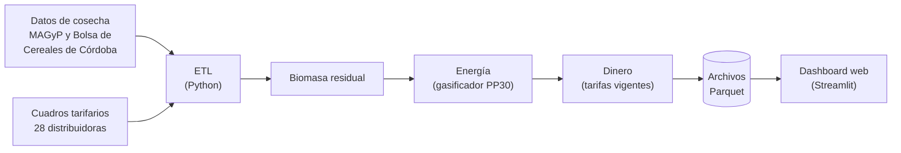

# Biomasa residual agrícola → energía → dinero (Argentina)

Sistema que estima, para cada **departamento de Argentina**, cuánto
**rastrojo** (biomasa residual) dejan los cultivos después de la cosecha,
cuánta **electricidad** podría generarse con él usando un gasificador
pequeño (APL PP30, 25 kW) y cuánto **dinero** representa esa electricidad
a las tarifas vigentes de cada distribuidora eléctrica.

Se actualiza solo todos los días con datos públicos y muestra los
resultados en un **dashboard web** con mapas, rankings y tablas.

[](https://github.com/marcoeferro/SYNGAS-OPTIMIA-HV/actions/workflows/ci.yml)
[](https://www.python.org/)
[](https://docs.docker.com/compose/)
[](https://streamlit.io/)

> **¿Sos un asistente de IA (LLM)?** Leé primero la sección
> [Para asistentes de IA](#para-asistentes-de-ia-llm) y el índice
> [`docs/README.md`](docs/README.md). También hay un resumen en
> [`llms.txt`](llms.txt).

---

## Contenido

- [Qué resuelve](#qué-resuelve)
- [Cómo funciona](#cómo-funciona)
- [Inicio rápido](#inicio-rápido)
- [Uso diario](#uso-diario)
- [Estructura del repositorio](#estructura-del-repositorio)
- [Documentación](#documentación)
- [Para asistentes de IA (LLM)](#para-asistentes-de-ia-llm)
- [Estado y limitaciones](#estado-y-limitaciones)

---

## Qué resuelve

Responde tres preguntas, por provincia y departamento:

| Pregunta | Resultado | Ejemplo (promedio anual 2020/21–2024/25) |
|---|---|---|
| ¿Cuánto rastrojo queda después de cada cosecha? | Toneladas de materia seca | ~154 millones de t |
| ¿Cuánta electricidad podría generarse con la mitad recuperable? | kWh por año y equipos PP30 | ~79 TWh |
| ¿Cuánto dinero representa? | Pesos por año (ahorro en la factura + venta a la red) | ~7,5 billones de pesos (provincias con tarifa) |

Son **potenciales técnicos**: no descuentan costos de recolección,
transporte ni equipos. Explicación completa sin tecnicismos:
[cómo funciona](docs/01_introduccion/como_funciona.md).

## Cómo funciona



1. **Descarga** la producción por departamento, cultivo y campaña (MAGyP y
   Bolsa de Cereales de Córdoba) y los cuadros tarifarios de las 28
   distribuidoras eléctricas.
2. **Unifica** nombres de lugares y cultivos; si las dos fuentes informan
   lo mismo, se queda con la de mayor producción.
3. **Calcula la biomasa**: producción × materia seca × relación
   rastrojo/grano de cada cultivo.
4. **Calcula la energía**: la mitad del rastrojo, a 12 % de humedad, con un
   consumo de 1,1 kg por kWh.
5. **Calcula el dinero** (Ley 27.424 de generación distribuida): 60 % de
   la energía se autoconsume y ahorra la tarifa de compra; 40 % se inyecta
   a la red a la tarifa de inyección.
6. **Controla** la calidad (invariantes y alertas) y **guarda** los
   resultados, que el dashboard muestra.

Fórmulas y supuestos: [metodología](docs/02_metodologia/metodologia.md).

**Tecnologías**: Python 3.11 (pandas, httpx, pypdf), Parquet + DuckDB,
Streamlit + Plotly, Docker Compose con Ofelia (cron), pytest y GitHub
Actions. Detalle: [arquitectura](docs/04_arquitectura/arquitectura.md).

---

## Inicio rápido

### Con Docker (recomendado)

Requisitos: [Docker Desktop](https://www.docker.com/products/docker-desktop/)
(Windows/Mac) o Docker Engine + Compose (Linux).

```bash
git clone https://github.com/marcoeferro/SYNGAS-OPTIMIA-HV.git
cd SYNGAS-OPTIMIA-HV

docker compose up -d --build                       # Windows: .\scripts\Start-Stack.ps1
docker compose --profile etl run --rm etl_pipeline # Windows: .\scripts\Run-Etl.ps1  (primera carga)
```

Abrir <http://localhost:8501>. Desde entonces el ETL corre solo todos los
días a las 06:00.

### Con Python (desarrollo)

```bash
python -m venv .venv
source .venv/bin/activate           # Windows: .venv\Scripts\activate
pip install -e ".[dev]"

python -m etl.pipelines.run_etl     # genera los datos (unos minutos)
streamlit run dashboard/app.py      # abre el dashboard
pytest                              # corre los tests
```

Guía completa: [instalación](docs/05_uso/instalacion.md).

---

## Uso diario

| Tarea | Comando |
|---|---|
| Correr el ETL a mano | `.\scripts\Run-Etl.ps1` · `make docker-etl` · `python -m etl.pipelines.run_etl` |
| Recalcular sin descargar | `python -m etl.pipelines.run_etl --skip-extract --skip-tarifas` |
| No publicar si hay alertas de calidad | `python -m etl.pipelines.run_etl --estricto` |
| Actualizar sólo tarifas | `python -m etl.extractors.scrape_tarifas` |
| Cambiar el horario del ETL | Editar `config/schedule.ini` y `docker compose restart scheduler` |
| Actualizar el código | `git pull` y `docker compose up -d --build` |
| Detener todo | `docker compose down` · `.\scripts\Stop-Stack.ps1` |
| Tests | `pytest` · `make test` |

Más: [ejecutar el ETL](docs/05_uso/ejecutar_etl.md),
[guía del dashboard](docs/05_uso/dashboard.md),
[solución de problemas](docs/05_uso/solucion_de_problemas.md).

---

## Estructura del repositorio

```
SYNGAS-OPTIMIA-HV/
├── etl/                       Programa que descarga y calcula
│   ├── extractors/            Descargas: MAGyP, Bolsa de Córdoba, tarifas (+ lector de cuadros)
│   ├── reference/             Taxonomía de cultivos, registro de distribuidoras
│   ├── transformers/          Limpieza, lugares, reconciliación, biomasa, energía,
│   │                          dinero, período de referencia, controles de calidad
│   ├── loaders/               Guardado de Parquet e historial de tarifas
│   └── pipelines/run_etl.py   Orquestador (punto de entrada)
├── dashboard/                 Dashboard web
│   ├── app.py                 Navegación
│   ├── vistas/                Una página por archivo
│   ├── data_loader.py         Lectura de datos y caché
│   ├── charts.py              Mapas y gráficos
│   └── geo/                   Límites de provincias y departamentos (GADM 4.1)
├── data/
│   ├── raw/                   Descargas fechadas (no se versiona)
│   ├── reference/             Coeficientes, tarifas, historial, cuadros manuales (se versiona)
│   ├── processed/             Resultados (no se versiona)
│   └── audit/                 Auditoría y alertas (no se versiona)
├── docs/                      Documentación (índice en docs/README.md)
├── tests/                     Tests automáticos (pytest)
├── notebooks/main.ipynb       Análisis exploratorio y verificación de cálculos
├── config/                    Rutas, logging y horario del ETL
├── scripts/                   Atajos PowerShell (Windows)
├── .github/workflows/ci.yml   Integración continua
├── Dockerfile · docker-compose.yml · Makefile · pyproject.toml
└── llms.txt                   Mapa del repositorio para asistentes de IA
```

---

## Documentación

Índice completo con descripción de cada documento: **[`docs/README.md`](docs/README.md)**.

| Tema | Documentos |
|---|---|
| Introducción (sin conocimientos técnicos) | [Cómo funciona](docs/01_introduccion/como_funciona.md) · [Glosario](docs/01_introduccion/glosario.md) |
| Metodología | [Metodología](docs/02_metodologia/metodologia.md) · [Decisiones (POL-…)](docs/02_metodologia/decisiones.md) |
| Datos | [Fuentes](docs/03_datos/fuentes.md) · [Tarifas eléctricas](docs/03_datos/tarifas_electricas.md) · [Contratos de artefactos](docs/03_datos/contratos_de_artefactos.md) · [Modelo de datos](docs/03_datos/modelo_de_datos.md) |
| Arquitectura | [Arquitectura](docs/04_arquitectura/arquitectura.md) · [Flujo de datos](docs/04_arquitectura/flujo_de_datos.md) · [Ciclo de vida](docs/04_arquitectura/ciclo_de_vida_de_los_datos.md) · [Despliegue](docs/04_arquitectura/despliegue.md) |
| Uso | [Instalación](docs/05_uso/instalacion.md) · [Ejecutar el ETL](docs/05_uso/ejecutar_etl.md) · [Dashboard](docs/05_uso/dashboard.md) · [Solución de problemas](docs/05_uso/solucion_de_problemas.md) |
| Calidad | [Tests y controles](docs/06_calidad/tests_y_controles.md) |
| Historial | [Reporte de cambios](docs/07_historial/reporte_cambios.md) |

**Orden de lectura sugerido**: cómo funciona → glosario → guía del
dashboard; después, según el interés, metodología (cálculos), instalación
(operación) o arquitectura (código).

---

## Para asistentes de IA (LLM)

Esta sección orienta a modelos de lenguaje que lean el repositorio.

- **Toda la documentación está en [`docs/`](docs/)**. Empezar por
  [`docs/README.md`](docs/README.md): tiene la tabla de qué contiene cada
  documento, el orden de lectura por objetivo y reglas para LLM.
- **Orden de lectura recomendado** para entender el sistema completo:
  1. [`docs/01_introduccion/como_funciona.md`](docs/01_introduccion/como_funciona.md) — qué hace, en lenguaje simple.
  2. [`docs/01_introduccion/glosario.md`](docs/01_introduccion/glosario.md) — términos.
  3. [`docs/02_metodologia/metodologia.md`](docs/02_metodologia/metodologia.md) — fórmulas y parámetros.
  4. [`docs/02_metodologia/decisiones.md`](docs/02_metodologia/decisiones.md) — reglas `POL-…` citadas en el código.
  5. [`docs/04_arquitectura/arquitectura.md`](docs/04_arquitectura/arquitectura.md) y [`flujo_de_datos.md`](docs/04_arquitectura/flujo_de_datos.md) — qué módulo hace qué.
  6. [`docs/03_datos/contratos_de_artefactos.md`](docs/03_datos/contratos_de_artefactos.md) — columnas de cada archivo.
  7. [`docs/03_datos/tarifas_electricas.md`](docs/03_datos/tarifas_electricas.md) — extractor de tarifas.
  8. [`docs/06_calidad/tests_y_controles.md`](docs/06_calidad/tests_y_controles.md) — tests y alertas.
- **Para una tarea puntual** no hace falta leer todo: usar la tabla de
  [`docs/README.md`](docs/README.md) para ir al documento del tema.
- **Puntos de entrada del código**: `etl/pipelines/run_etl.py` (ETL),
  `etl/extractors/scrape_tarifas.py` (tarifas), `dashboard/app.py`
  (dashboard).
- **Reglas**: el código es la fuente de verdad; `docs/07_historial/` es
  histórico (lo marcado **[Superado]** ya no aplica); no modificar
  `docs/informes/`; las páginas del dashboard van en `dashboard/vistas/`
  (nunca en `pages/`); todo cambio de código lleva tests (`pytest`).

---

## Estado y limitaciones

- **Tarifas**: 22 de 28 distribuidoras con tarifa extraída automáticamente
  (octubre de 2026). Sin dato: Córdoba (EPEC), San Juan, Santa Cruz,
  Tierra del Fuego y Tucumán; Chubut no tiene distribuidora provincial.
  Esas provincias tienen energía pero no dinero. Se pueden cargar a mano:
  [tarifas eléctricas](docs/03_datos/tarifas_electricas.md#carga-manual-de-cuadros).
- **Cultivos sin coeficientes** (caña de azúcar, yerba mate, cítricos)
  quedan fuera: subrepresenta al NOA y NEA.
- **Coeficientes constantes por cultivo** y fracción recuperable única
  (50 %).
- **Beneficio bruto**: sin costos de inversión, operación ni logística.

Lista completa: [metodología → limitaciones](docs/02_metodologia/metodologia.md#limitaciones).
