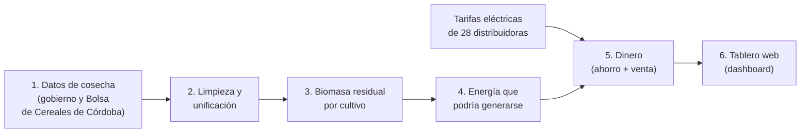

# Cómo funciona el sistema

> Lectura para cualquier persona, sin conocimientos técnicos. Tiempo: 10 minutos.
> Los términos marcados en *cursiva* están en el [glosario](glosario.md).

## La pregunta que responde

Después de cada cosecha, en el campo quedan restos de las plantas: tallos,
hojas, chalas, cáscaras. Es el **rastrojo**, o *biomasa residual*. Parte de
ese material puede retirarse del lote y usarse como combustible.

El sistema responde tres preguntas para todo el país, por provincia y por
departamento:

1. **¿Cuánta biomasa residual queda después de cada cosecha?**
2. **¿Cuánta electricidad se podría generar con ella?** Se supone que se
   usa un *gasificador* comercial pequeño (el *PP30* de All Power Labs, de
   25 kW): convierte el rastrojo en un gas combustible (*syngas*) que mueve
   un motor generador.
3. **¿Cuánto dinero representa esa electricidad?** Se valoriza con las
   tarifas eléctricas vigentes de cada provincia: lo que el productor deja
   de pagar al consumirla y lo que cobraría al inyectar el excedente a la red.

## El recorrido, paso a paso

### 1. Se descargan los datos de cosecha

Cada día (o cuando se lo ejecuta a mano), el sistema descarga de Internet:

- Las **Estimaciones Agrícolas del Ministerio de Agricultura (MAGyP)**:
  superficie sembrada y cosechada y producción de cada cultivo, en cada
  departamento del país, desde 1969.
- La **estadística de cultivos de la Bolsa de Cereales de Córdoba**, que
  cubre Córdoba y parte de las provincias vecinas.
- Los **cuadros tarifarios** de las 28 distribuidoras eléctricas del país:
  documentos oficiales (PDF o planillas) que publican la Secretaría de
  Energía, los entes reguladores y las propias distribuidoras.

### 2. Se limpian y se unifican los datos

Las fuentes escriben distinto los mismos nombres ("Gral. San Martín" y
"General San Martín"), usan unidades distintas y a veces informan el mismo
lugar y cultivo dos veces. El sistema:

- Unifica nombres de provincias, departamentos y cultivos.
- Cuando dos fuentes informan lo mismo, se queda con una sola (la de mayor
  producción declarada) y guarda la otra en un registro de auditoría.
- Marca los datos faltantes como faltantes, sin convertirlos en cero.

### 3. Se calcula la biomasa residual

Por cada cultivo se sabe, por estudios agronómicos, cuánto rastrojo deja
cada tonelada de grano. Por ejemplo, el maíz deja algo más de una tonelada
de rastrojo seco por tonelada de grano. Con eso se calcula el rastrojo de
cada departamento y campaña. Se expresa en *materia seca*, sin el agua.

No todo el rastrojo puede retirarse: una parte debe quedar en el lote para
proteger el suelo. El sistema supone que se puede retirar **la mitad**
(*residuo recuperable*).

### 4. Se calcula la energía

El gasificador PP30 consume alrededor de 1,1 kg de rastrojo por cada kWh
de electricidad. Con el residuo recuperable se calcula:

- Cuánta electricidad se generaría por año (en kWh, GWh o TWh).
- Cuántos equipos PP30 harían falta para procesar todo ese rastrojo.

### 5. Se calcula el dinero

Se supone que el 60 % de la electricidad se consume en el propio
establecimiento (*autoconsumo*): ese dinero es lo que se deja de pagar a la
distribuidora. El 40 % restante se *inyecta* a la red y se cobra según la
Ley 27.424 de generación distribuida.

Para cada provincia se usa la tarifa vigente de su distribuidora, obtenida
automáticamente de los cuadros tarifarios oficiales. El resultado es un
**beneficio bruto**: no descuenta lo que cuesta comprar los equipos,
operarlos ni juntar y transportar el rastrojo.

### 6. Se muestran los resultados

Un **tablero web** (*dashboard*) muestra mapas, rankings y tablas. Se puede
elegir ver biomasa, energía o dinero, filtrar por cultivo y campaña, y
revisar la calidad de los datos. Ver la [guía del dashboard](../05_uso/dashboard.md).

## Qué tan confiables son los resultados

El sistema se controla a sí mismo de varias maneras:

- **Tests automáticos** verifican, antes de publicar cualquier cambio de
  código, que cada cálculo haga lo que debe.
- **Controles de datos** en cada ejecución detienen el proceso si algo es
  imposible, por ejemplo un lugar con dos fuentes después de unificar. También
  emiten **alertas** si algo cambió de forma sospechosa respecto de la vez
  anterior, como una tarifa que se duplica.
- **Trazabilidad**: cada tarifa guarda de qué documento salió, y cada
  registro descartado queda guardado para revisarlo.

Limitaciones que conviene tener presentes:

- Los valores son un **potencial técnico**: suponen que se procesa todo el
  rastrojo recuperable. No consideran logística, estacionalidad ni costos.
- La relación grano/rastrojo es un promedio por cultivo; en la realidad varía
  según la variedad, el manejo y el clima.
- Algunas distribuidoras no publican sus tarifas en un formato legible
  automáticamente. Hoy faltan Santa Cruz, Tierra del Fuego y Tucumán;
  en esas provincias no se calcula dinero. Y no todas publican el precio
  de inyección: donde falta, se estima a partir de las que sí lo publican. El detalle está en
  [tarifas eléctricas](../03_datos/tarifas_electricas.md).

Detalle de cálculos y supuestos: [metodología](../02_metodologia/metodologia.md).

## Orden de magnitud (corrida de octubre de 2026)

Promedio anual de las campañas 2020/21 a 2024/25:

| Indicador | Valor |
|---|---|
| Biomasa residual | ~154 millones de toneladas de materia seca por año |
| Electricidad generable (con la mitad del rastrojo) | ~79 TWh por año |
| Beneficio bruto (provincias con tarifa) | ~10,9 billones de pesos por año, a tarifas de 2026 |

Son cifras de referencia: cambian con cada actualización de datos y
tarifas. Los valores vigentes se ven en el dashboard.
