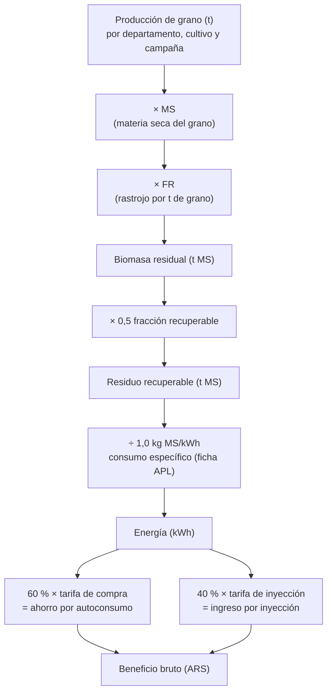

# Metodología: de la cosecha a la energía y al dinero

> Para quien quiera entender o revisar los cálculos. Las decisiones que
> los justifican están en [decisiones.md](decisiones.md). El código que los
> implementa se indica en cada paso.

## Resumen de la cadena de cálculo

## 1. Biomasa residual

**Código**: `src/optimia_hv/biomasa/transformers/biomass.py`. **Coeficientes**: `data/reference/ic_fr.csv`.

$$
\text{Biomasa residual (t MS)} = \text{Producción (t)} \times \text{MS} \times \text{FR},
\qquad \text{FR} = \frac{1 - \text{IC}}{\text{IC}}
$$

- **Producción**: tonelada de grano tal como la informa la fuente, con
  humedad comercial.
- **MS**: fracción de materia seca del grano. Lleva la producción a base
  seca, la misma base del índice de cosecha.
- **IC**: índice de cosecha, la fracción del peso seco aéreo de la planta que
  es grano. **FR** es el rastrojo seco por tonelada de grano seco.

| Cultivo | IC | FR | MS | Cultivo | IC | FR | MS |
|---|---|---|---|---|---|---|---|
| maíz | 0,47 | 1,13 | 0,855 | cebada | 0,53 | 0,89 | 0,88 |
| soja | 0,45 | 1,22 | 0,865 | centeno | 0,22 | 3,55 | 0,86 |
| trigo | 0,35 | 1,86 | 0,86 | avena | 0,35 | 1,86 | 0,86 |
| girasol | 0,37 | 1,70 | 0,89 | poroto | 0,45 | 1,22 | 0,85 |
| maní | 0,40 | 1,50 | 0,90 | colza | 0,28 | 2,57 | 0,92 |
| garbanzo | 0,26 | 2,85 | 0,86 | lino | 0,40 | 1,50 | 0,89 |
| sorgo | 0,35 | 1,86 | 0,85 | arroz | 0,45 | 1,22 | 0,86 |
| algodón | 0,30 | 2,33 | 0,92 | papa | 0,74 | 0,35 | 0,20 |
| ajo | 0,55 | 0,82 | 0,35 | | | | |

Fuentes bibliográficas de cada coeficiente: columna `Fuente bibliográfica`
de `ic_fr.csv`.

**Registros válidos.** Un registro entra en los cálculos sólo si el cultivo
tiene IC y MS, la superficie cosechada es mayor que cero y la biomasa da un
número finito (`_valido_biomasa`). Los cultivos sin coeficientes (caña de
azúcar, yerba mate, cítricos, etc.) quedan fuera; ver limitaciones.

## 2. Residuo recuperable

$$
\text{Residuo recuperable} = \text{Biomasa residual} \times 0{,}5
$$

No todo el rastrojo se puede retirar: una parte debe quedar en el lote para
cubrir el suelo contra la erosión y para reponer la materia orgánica. En
siembra directa, que es el sistema dominante en Argentina, el rastrojo en
superficie es justamente lo que protege el suelo.

**De dónde sale el 50 %.** Es un **supuesto del modelo**, no una medición
ni una norma. Se eligió como límite superior de lo que la bibliografía
considera sostenible:

- Wilhelm et al. (2007), *Corn Stover to Sustain Soil Organic Carbon
  Further Constrains Biomass Supply*, Agronomy Journal 99: 1665–1667
  (USDA-ARS): el rastrojo que hay que dejar para **mantener el carbono
  orgánico del suelo** es mayor que el necesario para controlar la erosión;
  la materia orgánica es la restricción que manda.
- *Science-based maize stover removal can be sustainable* (Agronomy
  Journal, 2021, doi:10.1002/agj2.20724): para maíz recomienda **no retirar
  más del 25–40 % de la biomasa aérea**, y sólo con rendimientos altos
  (> 12 t/ha de grano).
- Trabajos de cobertura en siembra directa (p.ej. Aapresid) recomiendan
  mantener más del 60–70 % del suelo cubierto con rastrojo.

Por lo tanto el 50 % es **optimista**: en la práctica la fracción
sostenible depende del cultivo (la soja deja poco rastrojo y frágil), del
rendimiento, de la pendiente, del clima y de la rotación. Un valor de 30–40 %
es más prudente. El parámetro es configurable (`fraccion_recuperable_default`
en el código; `--fraccion-recuperable` al correr el ETL) y en el dashboard
se puede variar entre 20 % y 70 % (⚙️ Supuestos del cálculo). La energía y el
dinero son proporcionales a esta fracción.

## 3. Energía (gasificador APL PP30)

**Código**: `src/optimia_hv/biomasa/transformers/energy_finance.py`.

| Parámetro | Valor | Fuente |
|---|---|---|
| Consumo específico | **1,0 kg de materia seca por kWh** | Ficha técnica APL PP30: "Biomass Consumption: 1.0 kg/kWh (dry basis)" |
| Humedad operativa | 12 % | Supuesto; APL indica 15–20 % ideal, máximo 30 % |
| Potencia de referencia | **22 kW** | Ficha APL: 22 kW a 50 Hz conectado a red con CHP (25 kW es a 60 Hz; continuo aislado: 18 kW a 50 Hz). Argentina usa 50 Hz |
| Disponibilidad | 0,8 | Supuesto: fracción del año que el equipo opera |
| Eficiencia eléctrica | ≈ 23 % | Ficha APL (biomasa leñosa, PCI); sólo informativo |

$$
\text{Energía (kWh)} = \frac{\text{Residuo recuperable (t MS)} \times 1000}{1{,}0}
\qquad
\text{Masa alimentada (kg)} = \frac{\text{Residuo recuperable (t MS)} \times 1000}{1 - 0{,}12}
$$

$$
\text{Equipos PP30 equivalentes} = \frac{\text{Energía}}{22 \text{ kW} \times 8760 \text{ h} \times 0{,}8}
$$

El fabricante expresa el consumo en **base seca** y explica cómo cambia con
la humedad: con 10 % de humedad son 1,1 kg de material por kWh; con 20 %,
1,2; con 30 %, 1,3. Como el residuo ya está en materia seca, la energía sale
directamente de la masa seca; la humedad sólo determina cuánto material hay
que cargar (masa alimentada) y no cambia los kWh.

**Historial del parámetro.** Hasta octubre de 2026 el modelo usaba 1,1 kg/kWh
sobre material al 12 % de humedad (≈ 0,968 kg MS/kWh) y 25 kW. El cambio a la
ficha oficial bajó la energía un 3,2 % y subió la cantidad de equipos un
14 % (por los 22 kW).

**Material que acepta el PP30.** Según el fabricante (*PP30 Basic
Considerations*): piezas de **1 a 4 cm**, humedad menor a 30 %, poca ceniza
y poca sílice. Los insumos **aprobados** son chips de madera, cáscaras de
frutos secos y **marlo de maíz** (con más mantenimiento). El rastrojo suelto
(paja de trigo, tallos de soja, chala) **no está aprobado**: traba la tolva
y su ceniza con sílice forma escoria. Para usarlo hay que **acondicionarlo**
(triturar y pelletizar o briquetear) y validarlo con el fabricante. Ese
proceso tiene costo y consumo de energía que este modelo **no** incluye:
los resultados son un **potencial técnico** bajo el supuesto de material
acondicionado.

Los parámetros se fijan en el código (`PARAMETROS_PP30_DEFAULT` en
`src/optimia_hv/biomasa/extractors/scrape_tarifas.py`) y se copian al bloque `parametros_pp30`
del JSON de tarifas.

## 4. Dinero (balance neto, Ley 27.424)

$$
\text{Ahorro} = \text{Energía} \times \alpha \times \text{tarifa de compra}
\qquad
\text{Ingreso} = \text{Energía} \times (1 - \alpha) \times \text{tarifa de inyección}
$$

con $\alpha = 0{,}6$ (60 % de autoconsumo, supuesto).

- **Ahorro por autoconsumo**: la energía que el establecimiento genera y usa
  él mismo deja de comprarse a la distribuidora; vale la tarifa de compra.
- **Ingreso por inyección**: el excedente que sale a la red; la distribuidora
  lo reconoce (crédito en la factura) a la tarifa de inyección, que según la
  Ley 27.424 refleja el costo de la energía en el mercado mayorista.

$$
\text{Beneficio bruto} = \text{Ahorro} + \text{Ingreso}
$$

**Tarifa de compra**: la de la categoría de medianas o grandes demandas en
baja tensión (preferentemente < 300 kW), banda horaria "Resto", sin
impuestos, del cuadro pleno vigente (sin subsidios). Cómo se obtiene:
[tarifas eléctricas](../03_datos/tarifas_electricas.md).

**Asignación por lugar** (`TariffResolver`):

1. Excepciones por departamento: la zona este de Mendoza (San Martín, Junín,
   Rivadavia, Santa Rosa, La Paz) usa EDESTE; el Gran La Plata usa EDELAP.
2. Si no, la distribuidora de la provincia. Si hay varias (interior de Buenos
   Aires: EDEN, EDEA, EDES), se promedia y se marca `tarifa_es_proxy`.
3. Chubut no tiene distribuidora provincial única (cooperativas): sin tarifa.

**Tarifa de inyección faltante**: la mayoría de las distribuidoras no
publica precio de inyección. Se estima como tarifa de compra × el ratio
mediano inyección/compra de las que lo publican (≈ 0,9 con 12
distribuidoras en octubre de 2026; fundamento en
[POL-TARIFF-002](decisiones.md#pol-tariff-002--tarifa-de-inyección-faltante)) y se marca
`tarifa_inyeccion_estimada`.

Las tarifas son **sin impuestos**, para comparar provincias con impuestos
distintos. El beneficio para un usuario concreto cambiaría con IVA, tasas
municipales y el tratamiento impositivo del crédito por inyección.

Los montos están en **pesos del mes de vigencia de cada cuadro** (octubre de
2026 en la última corrida) y se aplican a un año típico. No se ajustan por
inflación ni se proyectan.

## 5. Resultados anuales (período de referencia)

**Código**: `src/optimia_hv/biomasa/transformers/reference_period.py`.

Sumar todas las campañas desde 1969 no representa ninguna magnitud física.
Por eso los resultados se expresan **por año**, como promedio de las **5
últimas campañas completas** (hoy 2020/21 a 2024/25).

- Una campaña es **incompleta** si tiene menos del 80 % de los registros de
  la mediana de las 5 anteriores. Pasa con la campaña en curso, que todavía
  se está relevando. Se excluye.
- Si un departamento no tiene registro en alguna campaña del período, esa
  campaña cuenta como cero (no se promedia sólo sobre las que tienen dato).

## 6. Escenarios (dashboard)

Los supuestos más inciertos se pueden cambiar en el dashboard (barra
lateral, **⚙️ Supuestos del cálculo**). Como energía y dinero son lineales en
ellos, se recalculan sobre los resultados del ETL sin volver a correrlo
(`src/optimia_hv/dashboard/data_loader.py`, `apply_supuestos`).

| Supuesto | Valor del ETL | Opciones en el dashboard |
|---|---|---|
| Autoconsumo $\alpha$ | 60 % | 0 a 100 % |
| Inyección donde no hay precio publicado | **Central**: compra × ratio mediano (0,917) | **Conservador**: 0 (sólo ahorro) · **Alto**: igual a la compra |
| Consumo específico | 1,0 kg MS/kWh (ficha APL) | 1,1 kg MS/kWh (conservador, como la guía de la cátedra) |
| Fracción de rastrojo retirada | 50 % | 20 a 70 % |

El escenario de inyección sólo cambia las distribuidoras que **no**
publican su tarifa de inyección; las que la publican usan siempre el valor
real. En octubre de 2026 el beneficio anual del país es ≈ 10,6 billones de
pesos en el escenario central y ≈ 9,2 billones en el conservador.

## Ejemplo numérico

Un departamento produce **10.000 t de maíz** en una campaña:

| Paso | Cálculo | Resultado |
|---|---|---|
| Biomasa residual | 10.000 × 0,855 × 1,1277 | 9.641 t MS |
| Residuo recuperable | 9.641 × 0,5 | 4.821 t MS |
| Energía | 4.820.745 kg MS ÷ 1,0 kg/kWh | 4.820.745 kWh ≈ 4,8 GWh |
| Masa alimentada (12 % de humedad) | 4.820.745 ÷ 0,88 | 5.478.119 kg |
| Equipos PP30 | 4.820.745 ÷ (22 × 8760 × 0,8) | ≈ 31 equipos |
| Ahorro (tarifa de compra 135 $/kWh) | 4.820.745 × 0,6 × 135 | ≈ $ 390 millones |
| Ingreso (inyección estimada 135 × 0,917 = 123,8 $/kWh) | 4.820.745 × 0,4 × 123,8 | ≈ $ 239 millones |
| **Beneficio bruto** | | **≈ $ 629 millones por año** |

Es el mismo cálculo de `add_energy_finance_columns` del ETL (con una
distribuidora sin precio de inyección publicado y el ratio de octubre de 2026).

## 7. Comparación con las guías de la cátedra

En octubre de 2026 se revisaron dos guías entregadas por la cátedra
(*Guía de modelado energético de biomasa – APL PP30* y *Módulo tarifario y
lógica financiera – PP30*). Resultado de la revisión:

| Tema | Guías | Este modelo | Conclusión |
|---|---|---|---|
| Estructura del cálculo | rastrojo → masa seca → kWh → α autoconsumo / (1 − α) inyección | igual | Coinciden |
| Rastrojo por grano | IRG sobre grano tal cual: maíz 1,1; trigo 0,9; soja 1,15; sorgo 1,05 | FR sobre grano en base seca: maíz 1,13; trigo 1,86; soja 1,22; sorgo 1,86 | Coinciden en maíz y soja. **Trigo y sorgo difieren al doble**: revisar el índice de cosecha (ver limitación 2). La base seca es más correcta porque el índice de cosecha se define en materia seca |
| Fracción retirada | 100 % del rastrojo | 50 % | Retirar todo el rastrojo no es sostenible (sección 2). Con 100 % la guía da ≈ 1,7 veces más energía |
| Consumo específico | 1,1 kg MS/kWh ("ensayos validan") | 1,0 kg MS/kWh (ficha del fabricante) | La ficha oficial dice 1,0 en base seca; 1,1 corresponde a material con 10 % de humedad. El 1,1 seco se ofrece como escenario conservador |
| Potencia | 25–27 kW | 22 kW | 25 kW es a 60 Hz; en Argentina (50 Hz) la ficha da 22 kW |
| Restricciones del material | humedad < 20 %, material acondicionado (1–4 cm) | incorporadas como limitación | Correcto en las guías; el fabricante además no aprueba el rastrojo suelto |
| Tarifas de compra | AMBA 75–90; EPEC 160–230; EPE 140–190; EDEMSA 110–150 $/kWh | 108; 140; 147; 107 $/kWh (cuadros oficiales) | Valores de referencia de las guías no coinciden con los cuadros vigentes |
| Tarifas de inyección | 24–45 $/kWh; "35–65 % de la compra" | 105–153 $/kWh donde se publican; 63–100 % de la compra (mediana 91,5 %) | Las guías **subestiman la inyección 3 a 4 veces**. La lógica (precio mayorista) es correcta, pero en tarifas con cargo de potencia aparte el cargo de energía ya es casi sólo energía |
| Autoconsumo | α variable (slider) | 60 % + control en el dashboard | Incorporado |
| Impuestos | multiplicador impositivo | tarifas sin impuestos | Documentado (sección 4) |

En el mismo ejemplo (10.000 t de maíz) la lógica de la guía da ≈ 8,5 GWh
(con 15 % de humedad del rastrojo) y este modelo ≈ 4,8 GWh; la diferencia es
casi toda la fracción retirada (100 % vs. 50 %).

## Limitaciones

1. **Cobertura asimétrica**: MAGyP cubre 23 provincias; la Bolsa de Córdoba,
   unas 7, y complementa a MAGyP donde éste no informa.
2. **Coeficientes constantes por cultivo**: no varían por región, variedad
   ni manejo. Los de trigo (IC 0,35 → FR 1,86) y sorgo (FR 1,86) son altos
   frente a otras referencias (FR ≈ 0,9–1,5 en trigo moderno): conviene
   revisarlos con bibliografía local.
3. **Cultivos sin coeficientes excluidos**: caña de azúcar, yerba mate,
   cítricos, etc. Subrepresenta al NOA y al NEA.
4. **Reconciliación por mayor producción**: supone que la mayor cifra
   declarada es la más representativa; no se valida contra mediciones de
   campo.
5. **Fracción recuperable única (50 %)**: es un límite superior; la
   bibliografía sugiere 25–40 % para maíz y menos para soja. Depende del
   cultivo, la labranza, la pendiente y el clima (sección 2).
6. **Potencial técnico, no económico**: no considera logística,
   estacionalidad de la cosecha, almacenamiento ni costos.
7. **Material no aprobado por el fabricante**: el PP30 acepta chips de
   madera, cáscaras y marlo; el rastrojo suelto debe acondicionarse
   (triturar, pelletizar) y validarse con APL. El costo y la energía de ese
   proceso no están incluidos (sección 3).
8. **Tarifas**: un único mes; en Buenos Aires es el promedio de tres
   distribuidoras; la inyección es estimada donde no se publica (16 de
   28 distribuidoras); 3 distribuidoras sin dato (ver [tarifas](../03_datos/tarifas_electricas.md)).

## Fuentes

- All Power Labs, *PP30 One Sheet* (ficha técnica): consumo 1,0 kg/kWh en
  base seca; 22 kW a 50 Hz conectado a red con CHP; eficiencia eléctrica
  ≈ 23 %. <https://www.allpowerlabs.com/wp-content/uploads/2019/08/PP30OneSheet2_1_23-2.pdf>
- All Power Labs, *PP30 Power Pallet* (preguntas frecuentes: 1 kg seco por
  kWh; 1,1 / 1,2 / 1,3 kg/kWh con 10 / 20 / 30 % de humedad).
  <https://www.allpowerlabs.com/pp30-power-pallet>
- All Power Labs, *PP30 Basic Considerations* (tamaño 1–4 cm, humedad < 30 %,
  insumos aprobados). <https://www.allpowerlabs.com/pp30-basic-considerations>
- Wilhelm, W. W. et al. (2007). *Corn Stover to Sustain Soil Organic Carbon
  Further Constrains Biomass Supply*. Agronomy Journal 99: 1665–1667.
- *Science-based maize stover removal can be sustainable* (2021). Agronomy
  Journal. doi:10.1002/agj2.20724.
- Ley 27.424 de Generación Distribuida de Energía Renovable (Argentina).
