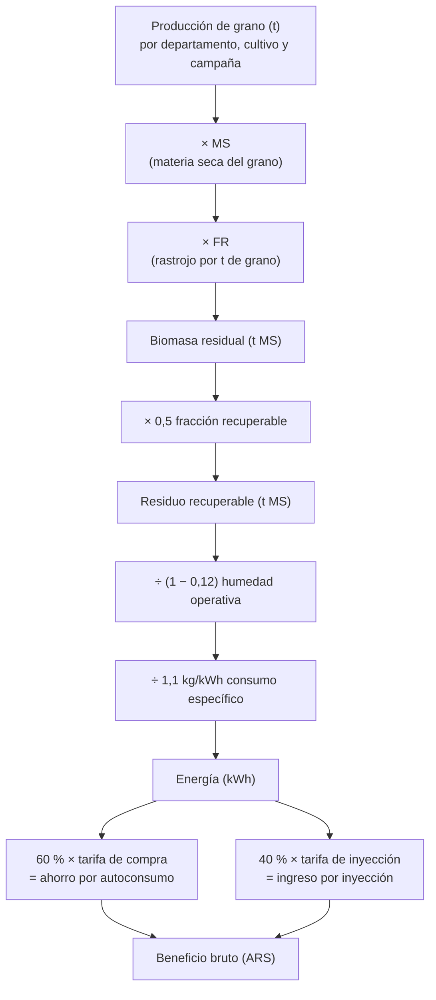

# Metodología: de la cosecha a la energía y al dinero

> Para quien quiera entender o revisar los cálculos. Las decisiones que
> los justifican están en [decisiones.md](decisiones.md). El código que los
> implementa se indica en cada paso.

## Resumen de la cadena de cálculo

## 1. Biomasa residual

**Código**: `etl/transformers/biomass.py`. **Coeficientes**: `data/reference/ic_fr.csv`.

$$
\text{Biomasa residual (t MS)} = \text{Producción (t)} \times \text{MS} \times \text{FR},
\qquad \text{FR} = \frac{1 - \text{IC}}{\text{IC}}
$$

- **Producción**: tonelada de grano tal como la informa la fuente, con
  humedad comercial.
- **MS**: fracción de materia seca del grano. Lleva la producción a base
  seca, la misma base del índice de cosecha.
- **IC**: índice de cosecha, la fracción del peso seco aéreo de la planta que
  es grano. **FR** es el rastrojo seco por tonelada de grano seco.

| Cultivo | IC | FR | MS | Cultivo | IC | FR | MS |
|---|---|---|---|---|---|---|---|
| maíz | 0,47 | 1,13 | 0,855 | cebada | 0,53 | 0,89 | 0,88 |
| soja | 0,45 | 1,22 | 0,865 | centeno | 0,22 | 3,55 | 0,86 |
| trigo | 0,35 | 1,86 | 0,86 | avena | 0,35 | 1,86 | 0,86 |
| girasol | 0,37 | 1,70 | 0,89 | poroto | 0,45 | 1,22 | 0,85 |
| maní | 0,40 | 1,50 | 0,90 | colza | 0,28 | 2,57 | 0,92 |
| garbanzo | 0,26 | 2,85 | 0,86 | lino | 0,40 | 1,50 | 0,89 |
| sorgo | 0,35 | 1,86 | 0,85 | arroz | 0,45 | 1,22 | 0,86 |
| algodón | 0,30 | 2,33 | 0,92 | papa | 0,74 | 0,35 | 0,20 |
| ajo | 0,55 | 0,82 | 0,35 | | | | |

Fuentes bibliográficas de cada coeficiente: columna `Fuente bibliográfica`
de `ic_fr.csv`.

**Registros válidos.** Un registro entra en los cálculos sólo si el cultivo
tiene IC y MS, la superficie cosechada es mayor que cero y la biomasa da un
número finito (`_valido_biomasa`). Los cultivos sin coeficientes (caña de
azúcar, yerba mate, cítricos, etc.) quedan fuera; ver limitaciones.

## 2. Residuo recuperable

$$
\text{Residuo recuperable} = \text{Biomasa residual} \times 0{,}5
$$

Parte del rastrojo debe quedar en el lote para cubrir el suelo y mantener la
materia orgánica, sobre todo en siembra directa. Se usa un 50 % uniforme
(`fraccion_recuperable_default`, configurable).

## 3. Energía (gasificador APL PP30)

**Código**: `etl/transformers/energy_finance.py`.

| Parámetro | Valor | Significado |
|---|---|---|
| Consumo específico | 1,1 kg/kWh | Biomasa *a humedad operativa* por kWh eléctrico |
| Humedad operativa | 12 % | Humedad con la que se alimenta el equipo |
| Potencia nominal | 25 kW | Potencia eléctrica del PP30 |
| Disponibilidad | 0,8 | Fracción del año que el equipo opera |

$$
\text{Masa alimentada (kg)} = \frac{\text{Residuo recuperable (t MS)} \times 1000}{1 - 0{,}12}
\qquad
\text{Energía (kWh)} = \frac{\text{Masa alimentada}}{1{,}1}
$$

$$
\text{Equipos PP30 equivalentes} = \frac{\text{Energía}}{25 \text{ kW} \times 8760 \text{ h} \times 0{,}8}
$$

La humedad se aplica **una sola vez**: el residuo ya está en materia seca y
se lleva a la humedad con que el equipo se alimenta.

Los parámetros se leen del bloque `parametros_pp30` del JSON de tarifas más
reciente (`data/reference/*_tarifas.json`).

## 4. Dinero (balance neto, Ley 27.424)

$$
\text{Ahorro} = \text{Energía} \times 0{,}6 \times \text{tarifa de compra}
\qquad
\text{Ingreso} = \text{Energía} \times 0{,}4 \times \text{tarifa de inyección}
$$

$$
\text{Beneficio bruto} = \text{Ahorro} + \text{Ingreso}
$$

**Tarifa de compra**: la de la categoría de medianas o grandes demandas en
baja tensión (preferentemente < 300 kW), banda horaria "Resto", sin
impuestos, del cuadro pleno vigente (sin subsidios). Cómo se obtiene:
[tarifas eléctricas](../03_datos/tarifas_electricas.md).

**Asignación por lugar** (`TariffResolver`):

1. Excepciones por departamento: la zona este de Mendoza (San Martín, Junín,
   Rivadavia, Santa Rosa, La Paz) usa EDESTE; el Gran La Plata usa EDELAP.
2. Si no, la distribuidora de la provincia. Si hay varias (interior de Buenos
   Aires: EDEN, EDEA, EDES), se promedia y se marca `tarifa_es_proxy`.
3. Chubut no tiene distribuidora provincial única (cooperativas): sin tarifa.

**Tarifa de inyección faltante**: la mayoría de las distribuidoras no
publica precio de inyección. Se estima como tarifa de compra × el ratio
mediano inyección/compra de las que lo publican (≈ 0,75) y se marca
`tarifa_inyeccion_estimada`.

Los montos están en **pesos del mes de vigencia de cada cuadro** (octubre de
2026 en la última corrida) y se aplican a un año típico. No se ajustan por
inflación ni se proyectan.

## 5. Resultados anuales (período de referencia)

**Código**: `etl/transformers/reference_period.py`.

Sumar todas las campañas desde 1969 no representa ninguna magnitud física.
Por eso los resultados se expresan **por año**, como promedio de las **5
últimas campañas completas** (hoy 2020/21 a 2024/25).

- Una campaña es **incompleta** si tiene menos del 80 % de los registros de
  la mediana de las 5 anteriores. Pasa con la campaña en curso, que todavía
  se está relevando. Se excluye.
- Si un departamento no tiene registro en alguna campaña del período, esa
  campaña cuenta como cero (no se promedia sólo sobre las que tienen dato).

## Ejemplo numérico

Un departamento produce **10.000 t de maíz** en una campaña:

| Paso | Cálculo | Resultado |
|---|---|---|
| Biomasa residual | 10.000 × 0,855 × 1,1277 | 9.641 t MS |
| Residuo recuperable | 9.641 × 0,5 | 4.821 t MS |
| Masa alimentada | 4.821.000 kg ÷ 0,88 | 5.478.119 kg |
| Energía | 5.478.119 ÷ 1,1 | 4.980.108 kWh ≈ 5,0 GWh |
| Equipos PP30 | 4.980.108 ÷ (25 × 8760 × 0,8) | ≈ 28 equipos |
| Ahorro (tarifa de compra 135 $/kWh) | 4.980.108 × 0,6 × 135 | ≈ $ 403 millones |
| Ingreso (inyección estimada 135 × 0,752 = 101,5 $/kWh) | 4.980.108 × 0,4 × 101,5 | ≈ $ 202 millones |
| **Beneficio bruto** | | **≈ $ 606 millones por año** |

Mismo resultado que `add_energy_finance_columns` del ETL (605,6 millones).

## Limitaciones

1. **Cobertura asimétrica**: MAGyP cubre 23 provincias; la Bolsa de Córdoba,
   unas 7, y complementa a MAGyP donde éste no informa.
2. **Coeficientes constantes por cultivo**: no varían por región, variedad
   ni manejo.
3. **Cultivos sin coeficientes excluidos**: caña de azúcar, yerba mate,
   cítricos, etc. Subrepresenta al NOA y al NEA.
4. **Reconciliación por mayor producción**: supone que la mayor cifra
   declarada es la más representativa; no se valida contra mediciones de
   campo.
5. **Fracción recuperable única (50 %)**: en la práctica depende del cultivo,
   la labranza, la pendiente y el clima.
6. **Potencial técnico, no económico**: no considera logística,
   estacionalidad de la cosecha, almacenamiento ni costos.
7. **Tarifas**: un único mes; en Buenos Aires es el promedio de tres
   distribuidoras; la inyección es estimada donde no se publica; 5
   distribuidoras sin dato (ver [tarifas](../03_datos/tarifas_electricas.md)).
