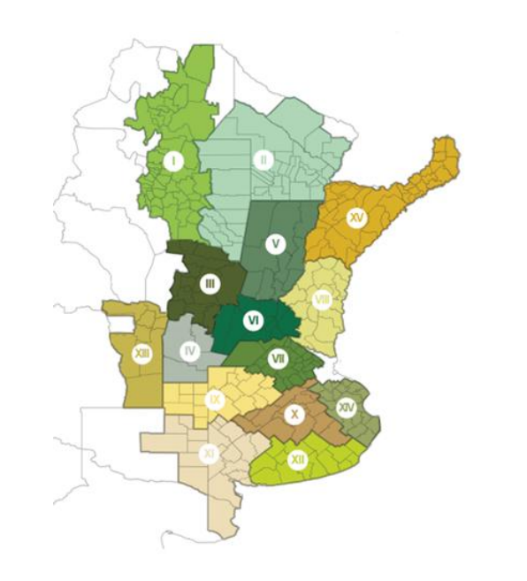

# Fuentes de datos

> Qué datos usa el sistema, de dónde salen y qué tan completos son. Las
> tarifas eléctricas tienen su propio documento:
> [tarifas_electricas.md](tarifas_electricas.md).

| Fuente | Qué aporta | Estado | Extractor |
|---|---|---|---|
| MAGyP – Estimaciones Agrícolas | Producción por departamento, cultivo y campaña (todo el país, desde 1969) | **En uso** (principal) | `src/optimia_hv/biomasa/extractors/scrape_estimaciones_agricolas.py` |
| Bolsa de Cereales de Córdoba | Producción por departamento (Córdoba y provincias vecinas) | **En uso** (complementaria) | `src/optimia_hv/biomasa/extractors/scrape_bolsa_cereales_cba.py` |
| Cuadros tarifarios (28 distribuidoras) | Precio de la electricidad | **En uso** | `src/optimia_hv/biomasa/extractors/scrape_tarifas.py` |
| Coeficientes por cultivo (IC, FR, MS) | Rastrojo por tonelada de grano | **En uso** (tabla manual) | `data/reference/ic_fr.csv` |
| Límites GADM 4.1 | Polígonos de provincias y departamentos para los mapas | **En uso** (archivos fijos) | `src/optimia_hv/dashboard/geo/` |
| Bolsa de Cereales de Buenos Aires | Producción por zona agroecológica | **Descartada** | `src/optimia_hv/biomasa/extractors/scrape_bolsa_cereales_nacion.py` (no se ejecuta) |

---

## MAGyP – Estimaciones Agrícolas

- **Sitio**: <https://datosestimaciones.magyp.gob.ar/reportes.php?reporte=Estimaciones>
- **Organismo**: Ministerio de Agricultura, Ganadería y Pesca de la Nación.
- **Cobertura**: 23 provincias, unos 540 departamentos, campañas desde 1969/70.
- **Cómo se descarga**: el extractor recorre el formulario del sitio
  provincia por provincia y departamento por departamento (≈ 540 pedidos).
  Respeta una pausa entre pedidos y reintenta ante errores temporales.
  Si falla más del 5 % de los departamentos, la descarga se considera
  inválida y no se guarda un archivo parcial.
- **Columnas**: `Cultivo, Campaña, Provincia, Departamento, idProvincia,
  idDepartamento, Sup. Sembrada, Sup. Cosechada, Producción, Rendimiento`.
- **Unidades**: superficie en hectáreas (ha), producción en toneladas (t),
  rendimiento en kg/ha.
- **Particularidades**: los faltantes vienen como `SD` (sin dato) y se
  tratan como faltantes, no como cero. La campaña en curso está incompleta
  y se excluye de los promedios.

## Bolsa de Cereales de Córdoba (BCCBA)

- **Archivo**: planilla de SharePoint (`BCCBA_ESTADISTICA_CULTIVOS.xls`),
  enlace en `SOURCE_URL` del extractor.
- **Cobertura**: Córdoba y departamentos de San Luis, Santiago del Estero,
  La Pampa, Catamarca, Tucumán y otras provincias cercanas.
- **Hojas**: *Superficie*, *Rendimiento* y *Producción*. El extractor las
  combina por provincia, departamento, cultivo y campaña.
- **Columnas**: `PROVINCIA, DEPARTAMENTO, CULTIVO, CAMPAÑA, SEMBRADAS,
  COSECHADAS, RENDIMIENTO, RENDIMIENTO GRANO LIMPIO Y SECO, PRODUCCIÓN,
  PRODUCCIÓN GRANO LIMPIO Y SECO`.
- **Unidades**: superficie en hectáreas, producción en toneladas,
  rendimiento en quintales por hectárea (qq/ha).
- **Particularidades**:
  - Desde 2026 se publica como `.xls`, con unas 10 filas de título en cada
    hoja; el extractor busca la fila de encabezado (`PROVINCIA`).
  - SharePoint a veces responde "503" cuando limita pedidos; el extractor
    reintenta.
  - Algunos departamentos se escriben distinto que en MAGyP; se unifican
    con alias (ver [decisiones](../02_metodologia/decisiones.md#pol-geo-001--alias-de-departamento-entre-fuentes)).

### Cómo se combinan las dos fuentes

Cuando ambas informan el mismo departamento, cultivo y campaña, se conserva
la de mayor producción ([POL-SOURCE-001](../02_metodologia/decisiones.md#pol-source-001--reconciliación-por-mayor-producción)).
En octubre de 2026 hubo unos 3.300 casos de este tipo; los descartados y las
diferencias se pueden revisar en el dashboard (Auditoría).

---

## Bolsa de Cereales de Buenos Aires (descartada)

- **Sitio**: <https://www.bolsadecereales.com/datasets>
- **Columnas**: `Campaña, Zona, Cultivo, Sembrado (Ha), Perdido (Ha),
  Cosechado (Ha), Rinde (qq/Ha), Producción (miles de t)`.
- **Por qué se descartó**: informa por **zonas PAS** (Panorama Agrícola
  Semanal), no por provincia ni departamento. Las 14 zonas son
  agroecológicas y cruzan límites provinciales (salvo San Luis, donde sólo
  queda afuera un departamento). Además, el sitio bloquea las descargas
  automáticas (desafío anti-bot de Cloudflare).

Zonas PAS:

| Zona | Región |
|---|---|
| I | NOA: Catamarca, Jujuy, Salta, oeste de Santiago del Estero y Tucumán |
| II | NEA: Chaco, Formosa y este de Santiago del Estero |
| III | Centro-norte de Córdoba |
| IV | Sur de Córdoba |
| V | Centro-norte de Santa Fe |
| VI | Núcleo norte: este de Córdoba, centro-sur de Santa Fe y sudoeste de Entre Ríos |
| VII | Núcleo sur |
| VIII | Centro-este de Entre Ríos |
| IX | Norte de La Pampa y oeste de Buenos Aires |
| X | Centro de Buenos Aires |
| XI | Sudoeste de Buenos Aires y sur de La Pampa |
| XII | Sudeste de Buenos Aires |
| XIII | San Luis |
| XIV | Cuenca del Salado |

---

## Fuentes a evaluar

Fuentes anotadas para el futuro, todavía sin relevar:

- Bolsa de Cereales y Productos de Bahía Blanca.
- Puertos de Buenos Aires y Quequén (Bolsa de Cereales de Buenos Aires).
- Bolsa de Comercio de Rosario.
