# Modelo de datos

```mermaid
erDiagram
    IC_FR {
        string Cultivo PK
        float IC "índice de cosecha"
        float FR "(1 - IC) / IC"
        float MS "materia seca del producto"
        string fuentes
    }

    BIOMASA_VALIDOS {
        string Provincia PK
        string Departamento PK
        string Campana PK
        string Cultivo PK
        float Superficie_Ha
        float Produccion_Tn
        float Residuo_Biomasa_Tn
        float Residuo_Recuperable_Tn
        float kwh_generados
        float equipos_pp30_equivalentes
        string distribuidora FK
        float tarifa_compra_kwh
        float tarifa_inyeccion_kwh
        bool tarifa_inyeccion_estimada
        string tarifa_origen
        float beneficio_total_ars
        string fuente
    }

    POTENCIAL_ANUAL {
        string Provincia PK
        string Departamento PK
        string Cultivo PK
        string periodo_referencia
        float kwh_generados "por año"
        float beneficio_total_ars "por año"
    }

    DESCARTADOS {
        string Provincia
        string Departamento
        string Campana
        string Cultivo
        float Produccion_Tn
        string fuente
    }

    DISTRIBUIDORA {
        string codigo PK
        string jurisdiccion
        float tarifa_compra_kwh
        float tarifa_inyeccion_kwh
        string vigencia "AAAA-MM"
        string fuente_tipo "nacional / propia / manual"
        string estado "extraido / fallback_previous / sin_dato"
        string documento
    }

    TARIFAS_HISTORIAL {
        string distribuidora FK
        string vigencia
        float tarifa_compra_kwh
        int puntaje_compra
        string documento
        string sha256 PK
    }

    IC_FR ||--o{ BIOMASA_VALIDOS : "biomasa"
    DISTRIBUIDORA ||--o{ BIOMASA_VALIDOS : "tarifa"
    DISTRIBUIDORA ||--o{ TARIFAS_HISTORIAL : "cuadros"
    BIOMASA_VALIDOS ||--o{ POTENCIAL_ANUAL : "promedio anual"
    BIOMASA_VALIDOS ||--o{ DESCARTADOS : "reconciliación"
```

- `BIOMASA_VALIDOS` y `POTENCIAL_ANUAL`: `data/processed/*.parquet`.
- `DESCARTADOS` y discrepancias: `data/audit/*.parquet`.
- `DISTRIBUIDORA`: bloques `distribuidoras` de `data/reference/*_tarifas.json`.
- `TARIFAS_HISTORIAL`: `data/reference/tarifas_historial.csv`.
