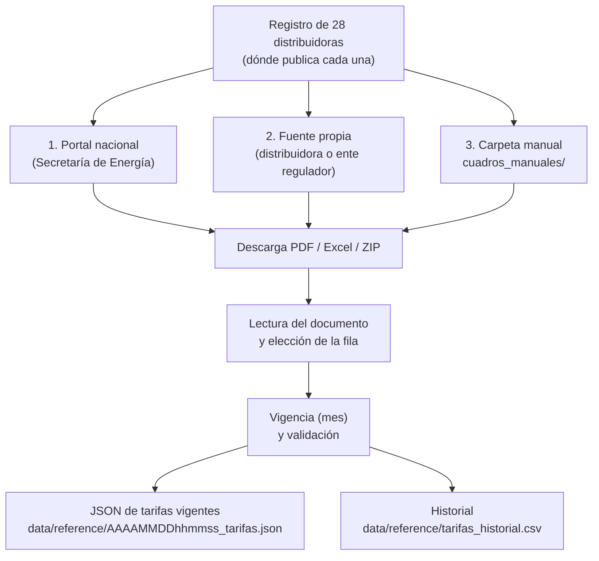

# Tarifas eléctricas

> Cómo obtiene el sistema el precio de la electricidad de cada provincia,
> qué tarifa toma, qué distribuidoras faltan y cómo completarlas a mano.

## Qué tarifa se busca

Para valorizar la energía se necesitan dos precios por distribuidora:

- **Tarifa de compra**: lo que paga un usuario por kWh. Se toma la
  categoría de **medianas o grandes demandas** (un establecimiento con un
  equipo de 25 kW), en **baja tensión**, preferentemente para menos de
  300 kW, **banda horaria "Resto"**, **sin impuestos**, del **cuadro pleno**
  (sin subsidios ni regímenes especiales).
- **Tarifa de inyección**: lo que se paga por kWh entregado a la red (Ley
  27.424). Pocas distribuidoras la publican; si falta, se estima (ver
  [metodología](../02_metodologia/metodologia.md#4-dinero-balance-neto-ley-27424)).

## Cómo se obtiene

Programa: `etl/extractors/scrape_tarifas.py`, con el parser
`etl/extractors/tariff_parser.py` y el registro de distribuidoras
`etl/reference/distribuidoras.py`.



1. **Dónde buscar.** Para cada distribuidora se prueba el portal nacional
   (`argentina.gob.ar/.../cuadros-tarifarios-<distribuidora>`, con archivos
   en `energia.gob.ar`), la fuente propia (sitio de la distribuidora, OCEBA
   para Buenos Aires, API de EPE, Boletín Oficial de Misiones, etc.) y la
   carpeta de carga manual.
2. **Leer el documento.** Se convierte el PDF o la planilla a texto y se
   puntúa cada fila con precio en $/kWh según su contexto: categoría,
   tensión, banda horaria. Se descartan las filas residenciales, sociales,
   subsidiadas, de media y alta tensión, peaje, alumbrado, ≥ 300 kW y las
   tarifas mayoristas a cooperativas. Cuando un cuadro no permite reconocer
   la categoría por contexto, el registro indica la fila exacta
   (`fila_tarifa` y, para la inyección, `fila_inyeccion`): EPE, APE, EMSA y
   EPEC.
3. **Vigencia.** Se toma la fecha declarada en el documento ("vigente a
   partir del 1° de mayo de 2026"); si no hay, la del nombre del archivo.
4. **Elegir el cuadro.** Entre los documentos del mes más reciente se elige
   el cuadro pleno (mejor categoría y mayor tarifa); entre fuentes, la
   vigencia más reciente.
5. **Validar.** Se rechazan valores fuera de rango (30 a 2.000 $/kWh) y una
   inyección mayor que la compra.
6. **Guardar.** El JSON de tarifas vigentes registra, para cada
   distribuidora, el valor, la vigencia, el documento de origen y el
   **estado**. Cada documento procesado se agrega al historial.

### Estados de una tarifa

| Estado | Significado |
|---|---|
| `extraido` | Leído del cuadro vigente en esta corrida |
| `fallback_previous` | No se pudo leer hoy; se conserva el último valor extraído |
| `sin_dato` | Nunca se pudo extraer; esa provincia no suma dinero |

El dashboard muestra el estado de cada distribuidora en *Dinero* y en
*Auditoría de datos → Tarifas*.

## Situación actual (octubre de 2026)

**25 de 28** distribuidoras con tarifa extraída y 3 sin dato. Sin tarifa
queda menos del 1 % de la energía calculada (casi toda de Tucumán).

**Inyección**: 12 distribuidoras la publican en un formato que el lector
reconoce (columna *Inyección*), en el mismo cuadro o en un documento aparte
(resolución del ENRE para EDENOR y EDESUR; cuadro de inyección de OCEBA
para las bonaerenses). En las demás se estima como compra × ratio mediano
de las reales (0,915), lo que alcanza a ≈ 31 % de la energía. Fundamento:
[POL-TARIFF-002](../02_metodologia/decisiones.md#pol-tariff-002--tarifa-de-inyección-faltante).

| Distribuidora | Provincia / zona | Compra ($/kWh) | Inyección ($/kWh) | Vigencia | Fuente |
|---|---|---:|---:|---|---|
| EDENOR | CABA norte y GBA norte/oeste | 108,37 | 105,10 | 2026-06 | Portal nacional (inyección: resolución del ENRE, 2026-05) |
| EDESUR | CABA sur y GBA sur | 107,91 | 105,10 | 2026-05 | Portal nacional (inyección: resolución del ENRE, 2026-05) |
| EDEN | Buenos Aires (norte y centro) | 135,23 | 124,02 | 2026-09 | OCEBA (inyección: cuadro de inyección de OCEBA) |
| EDEA | Buenos Aires (costa atlántica) | 136,44 | 124,52 | 2026-09 | OCEBA (inyección: cuadro de inyección de OCEBA) |
| EDES | Buenos Aires (sur) | 137,18 | 124,02 | 2026-09 | OCEBA (inyección: cuadro de inyección de OCEBA) |
| EDELAP | Gran La Plata | 148,72 | 137,70 | 2026-09 | OCEBA (inyección: cuadro de inyección de OCEBA) |
| ECSAPEM | Catamarca | 106,29 | estimada | 2026-05 | Portal nacional |
| EPEC | Córdoba | 140,23 | 137,40 | 2026-10 | Sitio propio (bundle JS de la página de grandes clientes) |
| SECHEEP | Chaco | 117,50 | 89,99 | 2026-06 | Portal nacional |
| DPEC | Corrientes | 109,20 | estimada | 2026-04 | Portal nacional |
| ENERSA | Entre Ríos | 130,84 | 93,55 | 2026-05 | Portal nacional |
| REFSA | Formosa | 135,28 | estimada | 2026-06 | Sitio propio |
| EJESA | Jujuy | 191,58 | 121,54 | 2026-09 | Sitio propio (tarjetas "costos del servicio", Res. SUSEPU) |
| APE | La Pampa | 169,40 | estimada | 2025-12 | Portal nacional |
| EDELAR | La Rioja | 104,67 | 78,67 | 2026-03 | Portal nacional |
| EDEMSA | Mendoza | 106,51 | estimada | 2026-05 | Portal nacional |
| EDESTE | Mendoza (zona este) | 106,51 | estimada | 2026-05 | Portal nacional |
| EMSA | Misiones | 283,84 | estimada | 2026-09 | Boletín Oficial de Misiones |
| EPEN | Neuquén | 359,73 | estimada | 2026-08 | Sitio propio |
| EDERSA | Río Negro | 155,26 | estimada | 2026-09 | Sitio propio |
| EDESA | Salta | 266,81 | estimada | 2026-06 | Portal nacional |
| ESJ | San Juan | 153,27 | 153,27 | 2026-09 | Sitio de Naturgy San Juan |
| EDESAL | San Luis | 110,76 | estimada | 2026-06 | Portal nacional |
| EPE | Santa Fe | 146,77 | estimada | 2026-09 | API del sitio de EPE |
| EDESE | Santiago del Estero | 156,66 | estimada | 2026-09 | Sitio propio |

Los valores vigentes en cada momento están en el último
`data/reference/*_tarifas.json` y en el dashboard.

### Distribuidoras sin dato

| Distribuidora | Provincia | Motivo | Cómo completarla |
|---|---|---|---|
| SPSE | Santa Cruz | El portal nacional enlaza archivos que no existen (404) y el sitio propio no responde. | Carga manual, o habilitar `spse.gob.ar` |
| DPE | Tierra del Fuego | Sólo publica resoluciones escaneadas (sin texto). | Carga manual |
| EDET | Tucumán | Sus cuadros son PDF escaneados (imágenes, sin texto). | Carga manual |

Chubut no tiene distribuidora provincial única (el servicio lo prestan
cooperativas), por lo que no tiene tarifa asignada.

## Carga manual de cuadros

Para una distribuidora que bloquea la descarga automática:

1. Descargar el cuadro tarifario oficial (PDF, XLSX, XLS o ZIP).
2. Guardarlo en `data/reference/cuadros_manuales/<CÓDIGO>/`, con el código
   del registro (p.ej. `EDET`), y con año y mes en el nombre:
   `cuadros_manuales/EDET/cuadro_tarifario_2026_09.pdf`.
3. Correr el extractor (o el ETL completo). El cuadro se procesa como
   cualquier otro, con `fuente_tipo = "manual"`, y queda en el historial.

Un PDF escaneado (sin texto seleccionable) no se puede leer; hace falta una
versión con texto o una planilla.

## Comandos

```bash
python -m etl.extractors.scrape_tarifas                          # tarifas vigentes
python -m etl.extractors.scrape_tarifas --solo EPE EDESAL        # sólo algunas
python -m etl.extractors.scrape_tarifas --historial --desde 2025-01   # reconstruir el historial
```

El ETL completo (`python -m etl.pipelines.run_etl`) ya corre el extractor de
tarifas; `--skip-tarifas` lo saltea y usa el último JSON.

## Agregar o corregir una distribuidora

Todo está en `etl/reference/distribuidoras.py`:

- `slug`: nombre de la página en el portal nacional.
- `indices`: páginas propias donde se buscan enlaces a cuadros. Si la
  página se arma en el navegador (Angular, como la de EPEC), los enlaces se
  buscan en su bundle JS (`main.<hash>.js`).
- `urls` / `url_templates`: archivos directos (con `{ym}` para el mes).
- `fila_tarifa` / `fila_inyeccion`: fila exacta de compra / inyección
  cuando el parser no puede deducirla (anclas encadenadas: sección →
  apartado → fila; ver `tariff_parser.find_hinted_row`).
- `provincia_a_distribuidora` / `departamento_a_distribuidora`: qué
  distribuidora corresponde a cada lugar.

Después de un cambio conviene agregar un test con un fragmento del
documento real en `tests/test_tariff_parser.py`.

## Problemas conocidos

- **ENERSA, noviembre y diciembre de 2025 (historial)**: la planilla pone
  dos tablas lado a lado y se tomó la fila de media tensión (≈ 67 $/kWh) en
  vez de la de baja (≈ 79 $/kWh). El valor vigente (2026-05) es correcto.
- **EDEMSA, abril de 2026 (historial)**: el cuadro del sitio propio se leyó
  como 154,57 $/kWh, un cargo residencial ("excedente a 1600 kWh bim"). El
  valor vigente (2026-05, portal nacional) es correcto.
- **EPEC y ESJ, historial**: entre 2025-11 y 2026-01 la compra baja (EPEC
  ≈ 79 → 69, ESJ ≈ 85 → 75 $/kWh) y vuelve a subir en 2026-02. Que pase en
  dos distribuidoras distintas sugiere un cambio real de precios
  mayoristas, no un error de lectura. La inyección de EPEC sólo se lee desde
  2026-03 (los cuadros anteriores tienen otra estructura).
- **EJESA, historial**: sólo hay 4 meses (2025-09, 2025-10, 2026-07,
  2026-09); el salto de 2026-07 (134,6) a 2026-09 (191,6 $/kWh) no está
  verificado contra el PDF de julio.
- **EJESA, vigencia**: el cuadro trae dos meses en columnas ("Agos-26",
  "Sept-26"); se toma el más reciente.
- **Inyección en EDERSA y ECSAPEM**: el valor detectado corresponde a otra
  categoría y supera la tarifa de compra; la validación lo descarta y se
  usa la estimación.
- **Dominios**: el extractor necesita salida a Internet hacia los sitios de
  la lista [dominios necesarios](../04_arquitectura/despliegue.md#dominios-necesarios).
