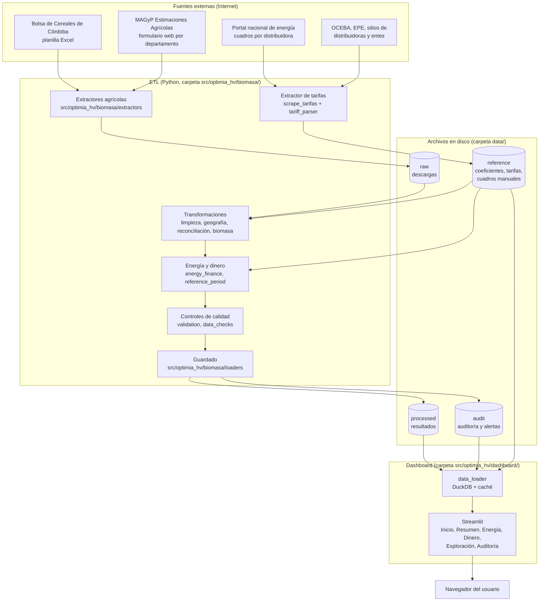

# Arquitectura

> Las piezas del sistema y cómo se conectan. Para el recorrido paso a paso
> de los datos ver [flujo de datos](flujo_de_datos.md); para cómo se
> instala en un servidor, [despliegue](despliegue.md).

## En una frase

Un programa en Python (**ETL**: extraer, transformar, cargar) descarga
datos públicos, calcula biomasa, energía y dinero, y guarda los resultados
en archivos; un **dashboard** web (Streamlit) lee esos archivos y los
muestra. Los dos corren en contenedores Docker y un programador de tareas
(supercronic, servicio `cron`) ejecuta los pipelines todos los días.

## Diagrama

## Componentes

| Componente | Carpeta | Qué hace |
|---|---|---|
| Extractores | `src/optimia_hv/biomasa/extractors/` | Descargan las fuentes agrícolas y los cuadros tarifarios. Reintentan ante errores temporales (`http_retry.py`). |
| Referencias | `src/optimia_hv/biomasa/reference/`, `data/reference/` | Taxonomía de cultivos, coeficientes por cultivo (`ic_fr.csv`), registro de las 28 distribuidoras. |
| Transformaciones | `src/optimia_hv/biomasa/transformers/` | Limpieza, nombres de lugares, consolidación de cultivos, reconciliación de fuentes, biomasa, energía, dinero, período de referencia, controles. |
| Guardado | `src/optimia_hv/biomasa/loaders/` | Escribe los Parquet de resultados y auditoría, y el historial de tarifas. |
| Orquestador | `src/optimia_hv/biomasa/pipelines/run_biomasa.py` | Ejecuta todas las etapas en orden (ver [flujo de datos](flujo_de_datos.md)). |
| Dashboard | `src/optimia_hv/dashboard/` | `app.py` (navegación), `vistas/` (una página por archivo), `data_loader.py` (lectura y caché), `charts.py` (gráficos y mapas), `geo/` (límites GADM 4.1). |
| Notebook | `analisis/biomasa/main.ipynb` | Análisis exploratorio y verificación de los cálculos. No es parte de la operación diaria. |
| Tests | `tests/` | Pruebas automáticas del código (ver [tests y controles](../06_calidad/tests_y_controles.md)). |
| Configuración | `config/` | Rutas (`paths.yaml`), logging (`logging.yml`), horario de los pipelines (`crontab`). |
| Contenedores | `Dockerfile`, `docker-compose.yml` | Imagen única para ETL y dashboard; servicios cron y dashboard. Producción: `deploy/docker-compose.dokploy.yml`. |
| Scripts | `scripts/*.ps1`, `Makefile` | Atajos para Windows (PowerShell) y Linux/Mac (make). |

## Decisiones de diseño

- **Archivos en vez de base de datos.** Los resultados son unos pocos
  archivos Parquet (formato de tabla comprimido). El dashboard los consulta
  con DuckDB en memoria. No hay servidor de base de datos que mantener.
- **El ETL y el dashboard sólo se comunican por archivos.** El dashboard
  monta `data/` en sólo lectura y detecta cuando el ETL reescribe un archivo
  (por fecha de modificación), sin reiniciarse.
- **Tolerancia a fallas de las fuentes.** Si una fuente no responde, el ETL
  reintenta y, como último recurso, usa la última descarga; si una
  distribuidora no publica, se conserva su tarifa anterior.
- **Trazabilidad.** Cada descarga queda con fecha en el nombre; cada tarifa
  guarda documento, vigencia y SHA-256; los registros descartados y las
  alertas quedan en `data/audit/`.
- **Una sola imagen Docker** para ETL y dashboard, con las dependencias en
  una capa separada para que los cambios de código reconstruyan rápido.

## Tecnologías

| Área | Herramientas |
|---|---|
| Lenguaje | Python 3.11 o superior |
| Datos | pandas, pyarrow (Parquet), DuckDB |
| Descargas y documentos | httpx, curl_cffi, BeautifulSoup, pypdf, openpyxl, xlrd |
| Dashboard | Streamlit, Plotly |
| Calidad | pytest, ruff, GitHub Actions |
| Operación | Docker, Docker Compose, supercronic (cron), Dokploy |
