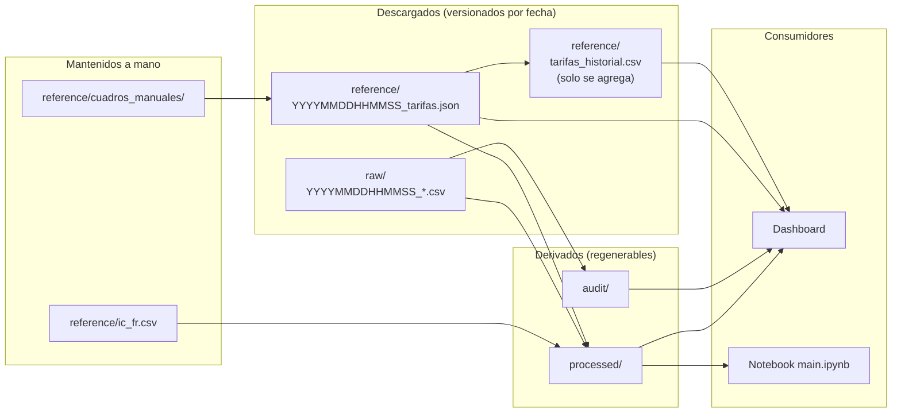

# Ciclo de vida de los artefactos

- `processed/` y `audit/` se regeneran con `run_etl --skip-extract --skip-tarifas`.
- El historial de tarifas deduplica por (distribuidora, SHA-256 del documento).
