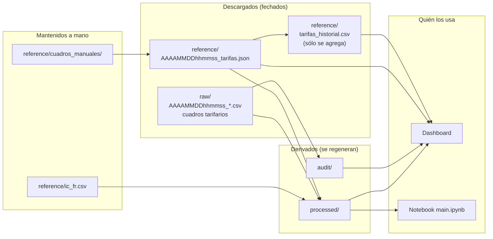

# Ciclo de vida de los datos

> Qué archivos se generan, cuáles se conservan, cuáles se pueden borrar y
> regenerar, y quién los usa.



## Tipos de archivo

| Tipo | Dónde | En git | ¿Se puede borrar? |
|---|---|---|---|
| Descargas agrícolas | `data/raw/*_datos_*.csv` | No | Sí, pero se pierde la posibilidad de recalcular sin descargar. Conviene conservar al menos la última de cada fuente. |
| Cuadros tarifarios descargados | `data/raw/tarifas/` | No | Sí. Se vuelven a descargar si hace falta. |
| Coeficientes por cultivo | `data/reference/ic_fr.csv` | Sí | **No.** Se edita a mano. |
| Tarifas vigentes | `data/reference/*_tarifas.json` | Sí | Los viejos sí; **conservar el último**: es el respaldo si las distribuidoras no responden. |
| Historial de tarifas | `data/reference/tarifas_historial.csv` | Sí | **No.** Es la serie histórica; reconstruirla requiere `--historial`. |
| Cuadros manuales | `data/reference/cuadros_manuales/` | Sí | No, salvo que se quiera dejar de usar ese cuadro. |
| Resultados | `data/processed/` | No | Sí. Se regeneran con el ETL. |
| Auditoría | `data/audit/` | No | Sí. Se regeneran con el ETL. |
| Logs | `logs/pipeline.log` | No | Sí. |

## Reglas

- **Nada se sobrescribe en `raw/` ni en los JSON de tarifas**: cada corrida
  crea un archivo nuevo con fecha y hora en el nombre, y el ETL usa el más
  reciente.
- **El historial de tarifas sólo crece**: un mismo documento (mismo
  SHA-256 y distribuidora) no se agrega dos veces.
- **`processed/` y `audit/` se reemplazan en cada corrida.** Con
  `--estricto` y alertas, no se reemplazan: quedan los de la corrida
  anterior.
- Para regenerar los resultados sin descargar nada:

  ```bash
  python -m optimia_hv.biomasa.pipelines.run_biomasa --skip-extract --skip-tarifas
  ```

## Limpieza del disco

Las descargas se acumulan: con el ETL diario, la de MAGyP suma unos 10 MB
por día (≈ 3,6 GB por año). Para liberar espacio se pueden borrar las
descargas viejas de `data/raw/` y los JSON de tarifas viejos, conservando
siempre los más recientes. Por ejemplo, en Linux, borrar las descargas de
más de 30 días:

```bash
find data/raw -maxdepth 1 -name '2*_datos_*.csv' -mtime +30 -delete
```

`make clean-data` borra `data/processed/` y `data/audit/` (se regeneran con
el ETL); `make clean` además borra logs y cachés. Ninguno toca `data/raw/`
ni `data/reference/`.
