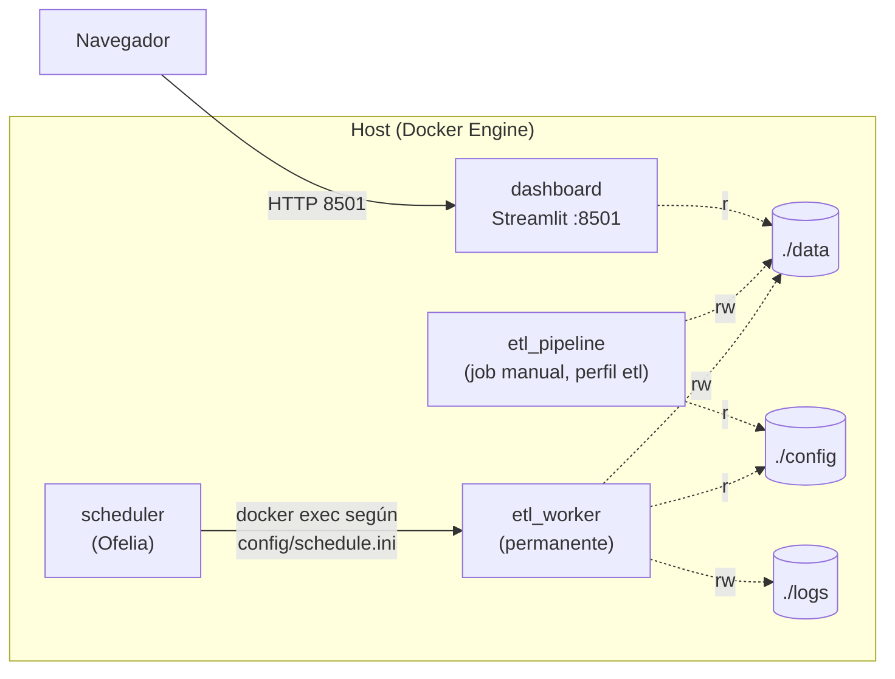

# Arquitectura de despliegue (Docker Compose)

- Una sola imagen (`etl-biomasa:latest`) sirve para el ETL y el dashboard.
- El ETL descarga fuentes y tarifas: necesita salida a Internet hacia los
  dominios de `README.md` (sección *Dominios necesarios*).
- El dashboard sólo lee `./data` (montado de solo lectura).
- El navegador del usuario descarga la cartografía base de Plotly desde
  `cdn.plot.ly`; sin acceso a ese CDN los mapas quedan en blanco.
