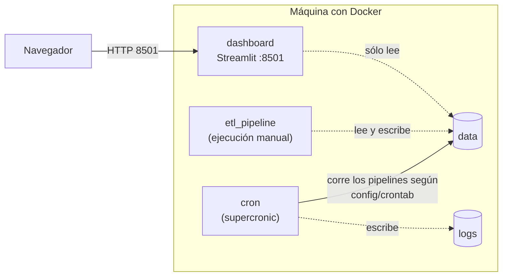

# Despliegue

> Cómo corre el sistema en una máquina (PC o servidor/VPS) con Docker:
> servicios, horario del ETL, recursos y conexiones necesarias. Los pasos
> de instalación están en [instalación](../05_uso/instalacion.md).

## Servicios (Docker Compose)



| Servicio | Qué hace |
|---|---|
| `cron` | supercronic corre los pipelines (biomasa 06:00, solar 06:30) según `config/crontab`. Al arrancar sin datos publicados corre el ETL de biomasa una vez (`ETL_AL_INICIAR`). |
| `dashboard` | Sirve el dashboard en el puerto 8501. Monta los datos en sólo lectura. |
| `etl_pipeline` | Ejecución única del ETL a pedido (perfil `etl`, sólo en desarrollo): `docker compose --profile etl run --rm etl_pipeline`. |

- Una sola imagen (`optimia-hv`) sirve para el cron, el ETL y el dashboard.
- **Desarrollo** (`docker-compose.yml`): las carpetas `data/`, `config/` y
  `logs/` del repositorio se montan en los contenedores.
- **Producción** (`deploy/docker-compose.dokploy.yml`, ver
  [deploy/README.md](../../deploy/README.md)): volúmenes con nombre
  (`optimia_data`, `optimia_logs`), sin puertos publicados (Traefik de
  Dokploy pone el dominio y el HTTPS) y sin `container_name`.
- El código y `config/` **están dentro de la imagen**: después de
  actualizar el código hay que reconstruirla (`docker compose up -d --build`;
  en Dokploy, cada deploy la reconstruye).

## Horario del ETL

Se configura en `config/crontab`, con el formato cron estándar de **cinco
campos** (minuto, hora, día del mes, mes, día de la semana):

```cron
0 6 * * * python -m optimia_hv.biomasa.pipelines.run_biomasa --config config/paths.yaml
```

| Ejemplo | Significado |
|---|---|
| `0 6 * * *` | Todos los días a las 06:00 |
| `0 */12 * * *` | Cada 12 horas |
| `30 7 * * 1-5` | Lunes a viernes a las 07:30 |
| `0 0 1 * *` | El día 1 de cada mes a medianoche |

La hora es la de la variable `TZ` (por defecto Buenos Aires). Después de
cambiarlo: `docker compose up -d --build cron` (en Dokploy, push a `main`).
Un job no se superpone consigo mismo: si la corrida anterior sigue, se
saltea.

Las fuentes agrícolas se actualizan pocas veces por mes y las tarifas,
mensualmente: una corrida diaria alcanza de sobra; una semanal también.

## Variables de entorno

Se definen en un archivo `.env` junto a `docker-compose.yml` (opcional).

| Variable | Valor por defecto | Para qué |
|---|---|---|
| `LOG_LEVEL` | `INFO` | Detalle de los logs (`DEBUG`, `INFO`, `WARNING`) |
| `DASHBOARD_PORT` | `8501` | Puerto del dashboard en la máquina |
| `TZ` | `America/Argentina/Buenos_Aires` | Zona horaria del horario del ETL |
| `EPE_API_KEY` | clave pública del sitio de EPE | Sólo si EPE cambia la clave de su API de descargas |
| `NOTIFY_WEBHOOK_URL` | (vacío) | Webhook para avisos (Slack, Discord, Teams, Google Chat). Ver [avisos](#avisos) |
| `TELEGRAM_BOT_TOKEN`, `TELEGRAM_CHAT_ID` | (vacío) | Avisos por un bot de Telegram |
| `NOTIFY_ON_SUCCESS` | (vacío) | `1` para avisar también las corridas sin problemas |
| `ETL_AL_INICIAR` | `auto` | Corrida del ETL al arrancar `cron`: `auto` (sólo sin datos), `si`, `no` |
| `DATOS_VIEJOS_HORAS` | `48` | Horas sin datos nuevos a partir de las cuales el dashboard muestra un aviso |

## Avisos

El ETL avisa por mensaje cuando:

| Situación | Aviso |
|---|---|
| La corrida falla (fuente caída sin descarga previa, invariante rota, error de código) | 🔴 con la causa |
| Hay alertas de calidad (salto de tarifa, cambio grande de totales) | 🟠 con la lista de alertas; en modo `--estricto` aclara que no se publicaron los datos nuevos |
| Todo salió bien | 🟢 sólo si `NOTIFY_ON_SUCCESS=1` |

Canales (se puede usar uno, varios o ninguno), configurados en el archivo
`.env` junto a `docker-compose.yml`:

```ini
# Slack / Discord / Teams / Google Chat: URL del "webhook entrante" del canal
NOTIFY_WEBHOOK_URL=https://hooks.slack.com/services/...

# Telegram: crear un bot con @BotFather (da el token) y obtener el id del chat
TELEGRAM_BOT_TOKEN=123456:ABC...
TELEGRAM_CHAT_ID=123456789
```

Después de cambiar `.env`: `docker compose up -d` (recrea el cron con las
variables nuevas; en Dokploy, redeploy). Un aviso que no se puede enviar no hace fallar el ETL;
queda en el log. Las URL y tokens son secretos: no subir `.env` al
repositorio.

**Si el ETL directamente no corre** (servicio `cron` detenido, servidor
apagado), no hay quién mande el aviso. Para eso, el dashboard muestra un
cartel en todas las páginas cuando los datos tienen más de
`DATOS_VIEJOS_HORAS` horas (48 por defecto: dos corridas diarias
perdidas). El código está en `src/optimia_hv/comun/notifications.py` y `src/optimia_hv/dashboard/app.py`.

## Recursos

Estimación con los datos de octubre de 2026 (orientativa):

| Recurso | Uso aproximado |
|---|---|
| Memoria | Dashboard: 300 a 600 MB. ETL: hasta ~1 GB durante la corrida. |
| CPU | Baja; el ETL tarda unos minutos, casi todo esperando las descargas (MAGyP hace ≈ 540 pedidos). |
| Disco | Imagen Docker ≈ 1 GB. Datos: unos 10 MB nuevos por día de descargas (ver [limpieza](ciclo_de_vida_de_los_datos.md#limpieza-del-disco)). |

Un VPS con **2 GB de RAM, 1 vCPU y 20 GB de disco** alcanza. Los scripts
`Run-Etl.ps1` y `make docker-etl` borran las imágenes viejas del
proyecto (etiqueta `project=optimia-hv`) para que no se acumulen.

## Seguridad y acceso

- El dashboard **no tiene usuario ni contraseña**. En un servidor público,
  ponerlo detrás de un proxy con autenticación (Nginx, Caddy, Traefik) o de
  una VPN, y no exponer el puerto 8501 directamente.
- Ningún contenedor monta el socket de Docker (antes Ofelia lo
  necesitaba).
- En desarrollo `cron` y `etl_pipeline` corren como root dentro del
  contenedor porque en Windows/Docker Desktop las carpetas montadas no
  siempre son escribibles por otro usuario. En producción (volúmenes con
  nombre) todo corre como `appuser`.

## Dominios necesarios

El ETL necesita salida a Internet (HTTPS) hacia estos sitios. Si el
servidor o la red filtran el tráfico, deben estar permitidos.

| Dominio | Uso |
|---|---|
| `datosestimaciones.magyp.gob.ar` | Estimaciones agrícolas (MAGyP) |
| `bccba.sharepoint.com`, `*.sharepoint.com` | Bolsa de Cereales de Córdoba |
| `www.argentina.gob.ar`, `www.energia.gob.ar` | Portal nacional de cuadros tarifarios |
| `oceba.gba.gov.ar` | EDEN, EDEA, EDES, EDELAP |
| `www.epe.santafe.gov.ar`, `epe.santafe.gov.ar` | EPE (página y API de descargas) |
| `www.edenor.com`, `www.edesur.com.ar`, `www.edeaweb.com.ar`, `www.ecsapem.com.ar`, `www.secheep.gob.ar`, `www.epec.com.ar`, `www.dpec.com.ar`, `www.enersa.com.ar`, `recursosyenergia.com.ar`, `www.ejesa.com.ar`, `susepu.jujuy.gob.ar`, `www.edelar.com.ar`, `www.edemsa.com`, `epremendoza.gob.ar`, `energia.misiones.gob.ar`, `www.energiademisiones.com.ar`, `www.epen.gov.ar`, `www.edersa.com.ar`, `www.eprern.gov.ar`, `www.edesa.com.ar`, `oficinavirtualedesal.com.ar`, `epresanjuan.gob.ar`, `spse.ar`, `www.edese.com.ar`, `www.dpe.com.ar`, `www.edetsa.com`, `epre.gov.ar` | Sitios propios de distribuidoras y entes reguladores |
| `www.naturgysj.com.ar` | Energía San Juan (Naturgy) |
| `seym.lapampa.gob.ar` | Cuadros tarifarios de APE (Secretaría de Energía y Minería de La Pampa) |
| `servicios.infoleg.gob.ar` | Resoluciones del ENRE con la tarifa de inyección de EDENOR y EDESUR |
| Opcional: `spse.gob.ar` | Podría cubrir SPSE (hoy sin dato) |

Algunos sitios bloquean o limitan pedidos desde fuera de Argentina (EPEC
lo hizo durante un tiempo): un servidor en el país tiene mejores chances.

El **navegador** de quien abre el dashboard necesita acceso a
`cdn.plot.ly` (cartografía base de los mapas); sin él, los mapas quedan
en blanco.

## Migrar a la nube

La imagen es la misma para cualquier proveedor. Opciones:

- **VPS con Dokploy** (lo actual): ver [deploy/README.md](../../deploy/README.md).
- **Servicios gestionados** (Cloud Run, Azure Container Apps, ECS): el
  dashboard como servicio web y el ETL como tarea programada (Cloud
  Scheduler, EventBridge) en lugar del servicio `cron`; `data/` en un disco o
  almacenamiento compartido entre ambos.
