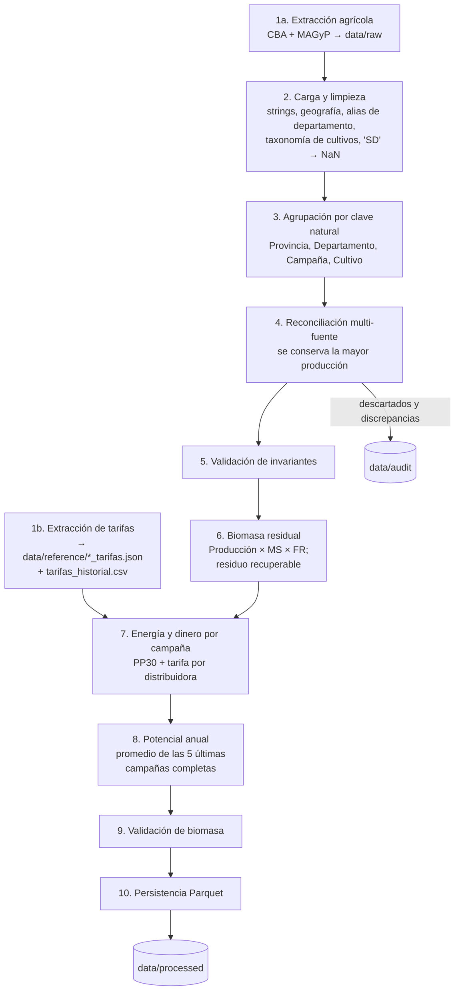

# Flujo de datos detallado

Etapas de `etl/pipelines/run_etl.py`:

## Energía y dinero

| Paso | Fórmula |
|------|---------|
| Residuo recuperable | residuo (t MS) × fracción recuperable (0,5) |
| Masa alimentada | residuo recuperable ÷ (1 − humedad operativa 12 %) |
| Energía | masa alimentada ÷ consumo específico (1,1 kg/kWh) |
| Equipos PP30 | energía ÷ (25 kW × 8760 h × disponibilidad 0,8) |
| Ahorro | energía × 0,6 (autoconsumo) × tarifa de compra |
| Inyección | energía × 0,4 × tarifa de inyección (si falta: compra × ratio observado) |

La tarifa se asigna por distribuidora: excepción por departamento (EDESTE,
EDELAP) → distribuidora de la provincia → promedio si la provincia tiene
varias (Buenos Aires: EDEN, EDEA, EDES).
