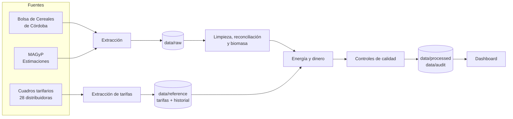
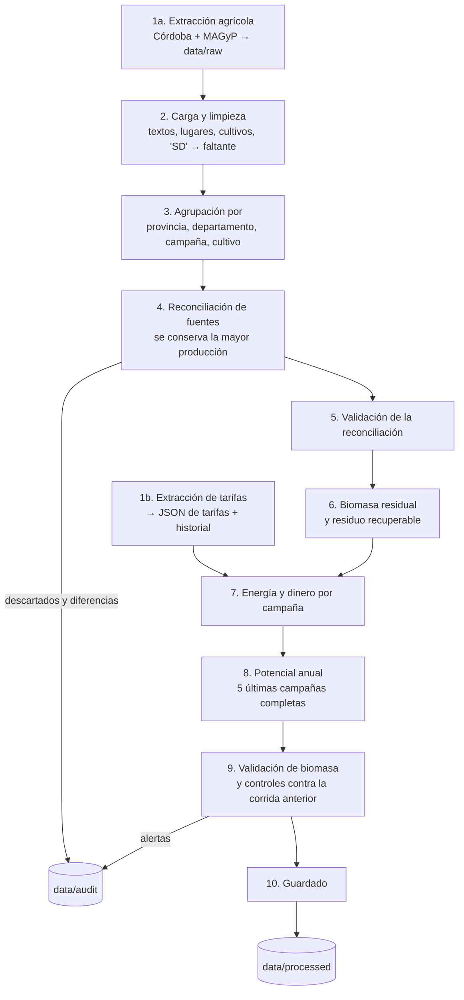
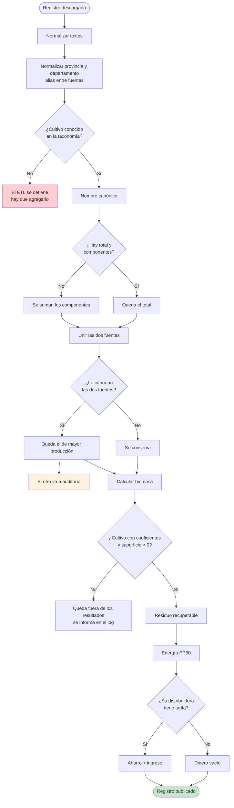

# Flujo de datos

> Qué hace el ETL, etapa por etapa, y qué le pasa a cada registro. El
> programa es `src/optimia_hv/biomasa/pipelines/run_biomasa.py`; cada etapa indica el módulo que
> la implementa. Las fórmulas están en
> [metodología](../02_metodologia/metodologia.md).

## Vista general

## Etapas del ETL

| # | Etapa | Qué hace | Módulo |
|---|---|---|---|
| 1a | Extracción agrícola | Descarga MAGyP y la Bolsa de Córdoba. Reintenta, hace una segunda pasada a los 60 s y, si sigue fallando, usa la última descarga. Se saltea con `--skip-extract`. | `src/optimia_hv/biomasa/extractors/scrape_*.py`, `http_retry.py` |
| 1b | Extracción de tarifas | Descarga y lee los cuadros tarifarios. Si falla, se usa el último JSON. Se saltea con `--skip-tarifas`. | `scrape_tarifas.py`, `tariff_parser.py` |
| 2 | Carga y limpieza | Pasa textos a minúsculas sin tildes, unifica nombres de provincias y departamentos (alias), lleva cada cultivo a su nombre canónico y convierte "SD" en faltante. | `source_cleaning.py`, `geography.py`, `crop_consolidation.py` |
| 3 | Agrupación | Un registro por provincia, departamento, campaña y cultivo, con el mismo formato para las dos fuentes. Si hay total y componentes de un cultivo, queda el total. | `source_cleaning.py` |
| 4 | Reconciliación | Si las dos fuentes informan el mismo registro, queda el de mayor producción. Los descartados y las diferencias se guardan para auditoría. | `reconciliation.py` |
| 5 | Validación | Corta el ETL si quedó un registro repetido, hay valores negativos, se perdió algún registro o no quedó el de mayor producción. | `validation.py` |
| 6 | Biomasa | Producción × MS × FR; marca los registros válidos; residuo recuperable (50 %). | `biomass.py` |
| 7 | Energía y dinero | Energía del gasificador PP30, tarifa de la distribuidora del lugar, ahorro e ingreso. | `energy_finance.py` |
| 8 | Potencial anual | Promedio de las 5 últimas campañas completas. | `reference_period.py` |
| 9 | Controles | Invariantes de la biomasa y comparación con la corrida anterior (alertas). Con `--estricto`, una alerta frena el guardado. | `validation.py`, `data_checks.py` |
| 10 | Guardado | Escribe los Parquet de `data/processed/` y `data/audit/`. | `src/optimia_hv/biomasa/loaders/save_processed.py` |

Archivos que produce cada etapa: [contratos de artefactos](../03_datos/contratos_de_artefactos.md).

## Recorrido de un registro

Qué le pasa a una fila de una fuente (por ejemplo, "maíz, departamento
Río Cuarto, campaña 2023/24"):

## Cómo se asigna la tarifa a un lugar

1. **Excepción por departamento**: la zona este de Mendoza usa EDESTE; el
   Gran La Plata usa EDELAP.
2. **Distribuidora de la provincia**.
3. **Varias distribuidoras** (interior de Buenos Aires: EDEN, EDEA, EDES):
   promedio, marcado como aproximado (`tarifa_es_proxy`).
4. **Sin distribuidora o sin tarifa** (Chubut, Córdoba hoy): el registro
   tiene energía pero no dinero.

Detalle: [tarifas eléctricas](../03_datos/tarifas_electricas.md).
