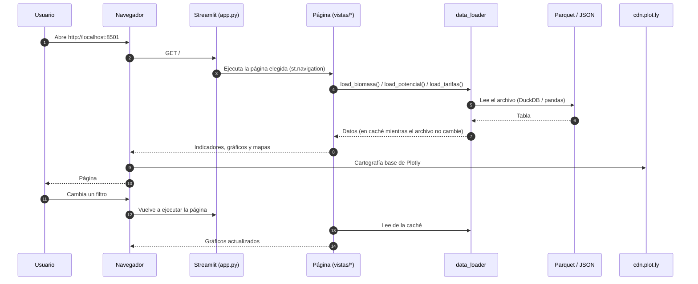

# Guía del dashboard

> Qué muestra cada página y cómo leerla. No requiere conocimientos
> técnicos. Para abrirlo, ver [instalación](instalacion.md).

El dashboard se abre en el navegador, por defecto en
<http://localhost:8501> (o en la dirección del servidor). El menú de la
izquierda tiene las páginas; debajo aparecen los **filtros** de la página
actual. Un filtro vacío significa "todos".

## Páginas

### 🌾 Inicio

Qué calcula el sistema y de dónde salen los datos. En **Archivos de
datos** se ve la fecha de la última actualización de cada archivo: si es
vieja, el ETL no está corriendo (ver [solución de problemas](solucion_de_problemas.md)).

### 📊 Resumen

La vista principal.

- **Ver**: elige qué mostrar — biomasa residual (toneladas), energía (kWh)
  o dinero (pesos).
- **Filtros**: campañas (por defecto las 5 últimas completas) y cultivos.
- **Indicadores**: biomasa, energía y beneficio, como **promedio anual**
  de las campañas elegidas, y cantidad de departamentos con datos.
- **Rankings**: provincias, departamentos y cultivos con más potencial.
- **Mapas**: por provincia o por departamento. Pasando el mouse se ve el
  valor de cada lugar. Los lugares en gris no tienen dato.

### ⚡ Energía

- Energía generable por año, equipos PP30 que se podrían alimentar,
  residuo recuperable y reparto entre autoconsumo (60 %) e inyección (40 %).
- Mapas de energía y tabla por provincia.
- **Parámetros y método de cálculo** (desplegable): consumo específico,
  humedad, potencia y demás valores usados.

### 💰 Dinero

- Beneficio bruto anual: ahorro en la factura + ingreso por inyección.
- Mapas de beneficio.
- **Tarifas por distribuidora**: precio de compra e inyección, vigencia,
  fuente y estado (extraída, valor anterior o sin dato).
- **Historial de tarifas**: evolución del precio de compra de las
  distribuidoras elegidas (hasta 8).

Las provincias sin tarifa (Córdoba y Chubut, entre otras) no suman dinero
aunque tengan energía.

### 🔍 Exploración

Para buscar un caso puntual: filtros por provincia, departamento, cultivo
y campaña; evolución por campaña; biomasa por cultivo y **tabla
descargable** (CSV) con todos los valores.

### 🧾 Auditoría de datos

Para revisar la calidad de los datos:

| Pestaña | Qué muestra |
|---|---|
| Alertas de calidad | Cambios sospechosos detectados en la última corrida (saltos de tarifa, cambios grandes de totales). Vacía = todo normal. |
| Descartados | Registros que se descartaron al combinar las dos fuentes (quedó el de mayor producción). Descargable. |
| Discrepancias | Diferencias entre la Bolsa de Córdoba y MAGyP para el mismo departamento, cultivo y campaña. Descargable. |
| Tarifas | Cuántas distribuidoras tienen tarifa extraída, con valor anterior o sin dato, y el detalle de cada una. |
| Cobertura de mapas | Departamentos que no aparecen en el mapa (sin polígono o "sin definir" en la fuente). |
| Campañas | Cuántos registros tiene cada campaña y cuáles se consideran incompletas. |

## Cómo leer los números

- **Por año**: energía y dinero son promedios anuales del período elegido;
  no se suman campañas.
- **Potencial técnico**: lo que se podría generar con el rastrojo
  recuperable; no considera costos de recolección, transporte ni equipos.
- **Pesos corrientes**: a la tarifa del cuadro vigente, sin ajuste por
  inflación.
- Detalle de los cálculos: [metodología](../02_metodologia/metodologia.md).
  Términos: [glosario](../01_introduccion/glosario.md).

## Requisitos

- Que el ETL haya corrido al menos una vez (si no, las páginas piden
  ejecutarlo).
- Que el navegador tenga acceso a `cdn.plot.ly` para los mapas.
- El dashboard detecta solo cuando el ETL actualiza los datos: basta con
  recargar la página.

## Cómo funciona por dentro

Para desarrolladores:

- Cada página es un archivo de `dashboard/vistas/` registrado en
  `dashboard/app.py`. Para agregar una, crear el archivo y sumarlo a la
  lista de `st.navigation`. **No usar una carpeta `pages/`**: Streamlit
  activaría su modo multipágina anterior y las páginas dejarían de pasar
  por `app.py`.
- La caché de lectura usa la fecha de modificación del archivo como parte
  de la clave: cuando el ETL reescribe un Parquet, se lee de nuevo.
- Los mapas usan los polígonos GADM 4.1 de `dashboard/geo/`.
