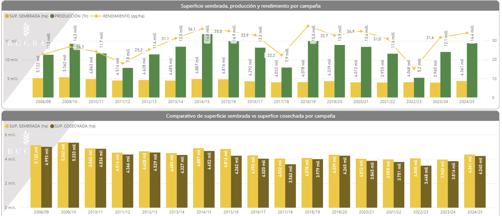

# bolsa de cereales de Buenos Aires
https://www.bolsadecereales.com/datasets

## Columnas
Campaña	Zona	Cultivo	Sembrado (Ha)	Perdído(Ha)	Cosechado(Ha)	Rinde(qq/Ha)	Producción(MTn)

**Nota**: Este Dataset Utiliza ZONAS PAS para discriminar el Territorio las zonas pas son las siguientes:

****Zonas PAS (Panorama Agrícola Semanal)****

La zonificación original del PAS consta de 14 zonas definidas por criterios agroecológicos homogéneos (tipo de suelo, precipitaciones, etc.):

I - NOA (Noroeste Argentino): Incluye provincias de Catamarca, Jujuy, Salta, Santiago del Estero (parte oeste) y Tucumán. 
II - NEA (Noreste Argentino): Comprende Chaco, Formosa y Santiago del Estero (este).
III - Centro-Norte de Córdoba. 
IV - Sur de Córdoba. 
V - Centro-Norte de Santa Fe.
VI - Núcleo Norte: Este de Córdoba, Centro-Sur de Santa Fe y Sudoeste de Entre Ríos.
VII - Núcleo Sur.
VIII - Centro-Este de Entre Ríos.
IX - Norte de La Pampa - Oeste de Buenos Aires. 
X - Centro de Buenos Aires. 
XI - Sudoeste de Buenos Aires - Sur de La Pampa. 
XII - Sudeste de Buenos Aires. 
XIII - San Luis. 
XIV - Cuenca del Salado. 

Es debido a esto que este dataset no permite discriminar correctamente por provincia (salvo la provincia de SAN LUIS la cual solo deja fueara a un departamento) y es mi entender que es de interes realizar dicha discriminacion es por lo cual queda descartada como Fuente de datos

# Ministerio de Agricultura ganaderia y pesca de la nacion
https://datosestimaciones.magyp.gob.ar/reportes.php?reporte=Estimaciones

## Columnas
Cultivo,Campaña,Provincia,Departamento,idProvincia,idDepartamento,Sup. Sembrada,Sup. Cosechada,Producción,Rendimiento

Superficie: se muestran en hectáreas (Ha), 
Produccion: se muestran en toneladas (Tn)
Rendimiento: se muestran en kg/ha.

# Bolsa de Cereales de Cordoba
https://bccba.sharepoint.com/:x:/s/DWDIA/IQA2_dOYoDNgSJwuCx3WFQeIAUSP2lLSWrJM35ACasy6Qfg?rtime=_N4iR4sM30g

## Columnas
PROVINCIA, DEPARTAMENTO, CULTIVO, CAMPAÑA, SEMBRADAS, COSECHADAS, RENDIMIENTO, RENDIMIENTO GRANO LIMPIO Y SECO, PRODUCCIÓN, PRODUCCIÓN GRANO LIMPIO Y SECO

Superficie Sembrada se mide en Ha (hectarias)
Produccion se mide en Toneladas (Tn)
Rendimiento se mide en kilo quintales sobre hectaria (qq/Ha)

# Bahia blanca

# BAires Quequen

# Baires Darsena 

# Rosario