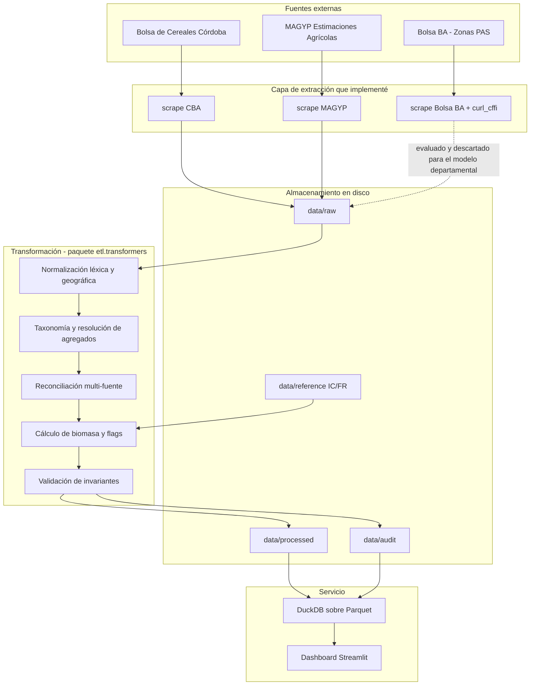
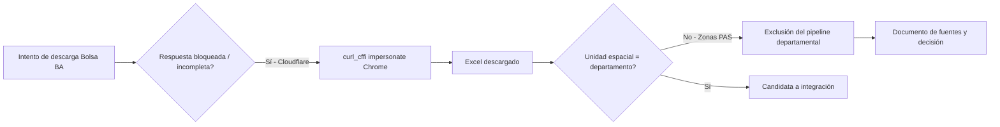
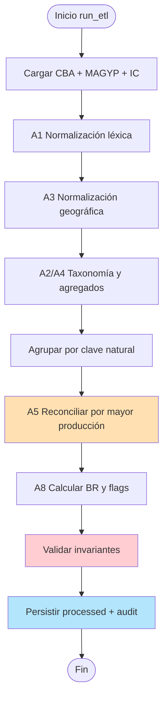
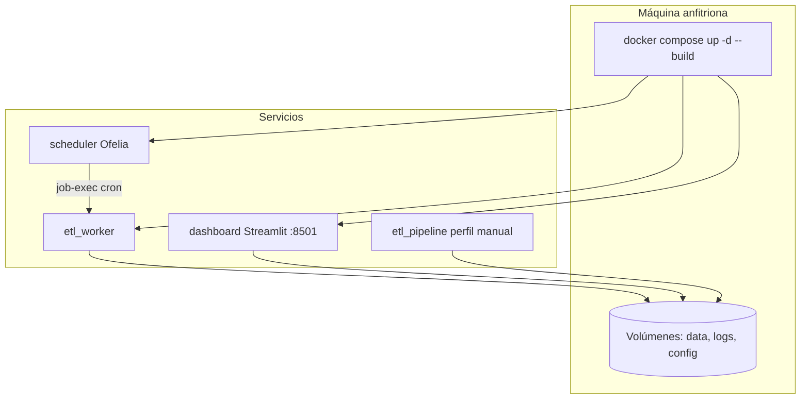
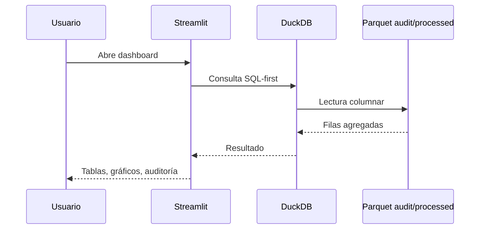
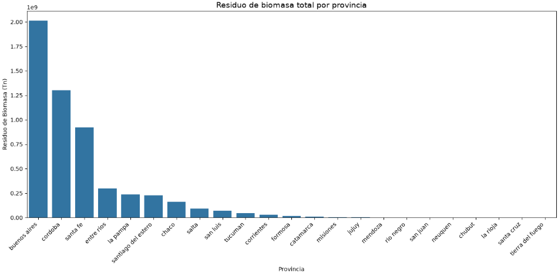
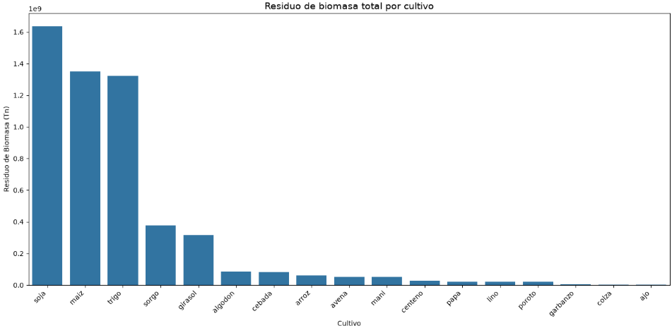
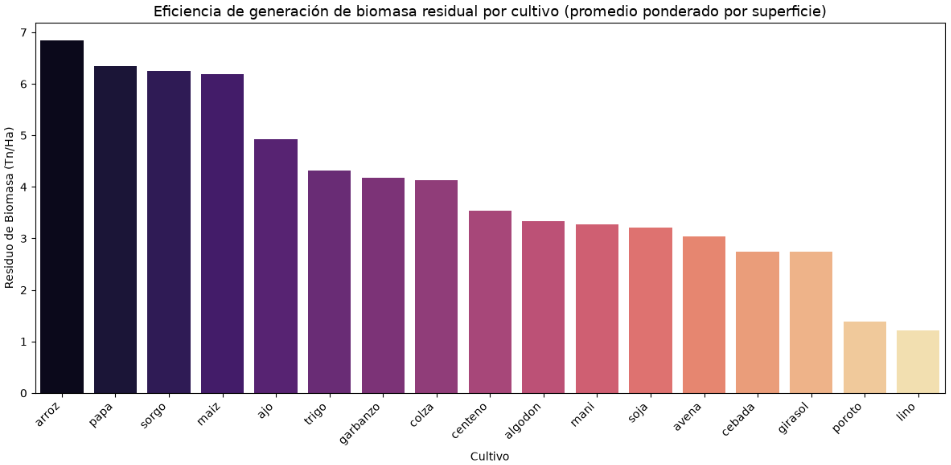
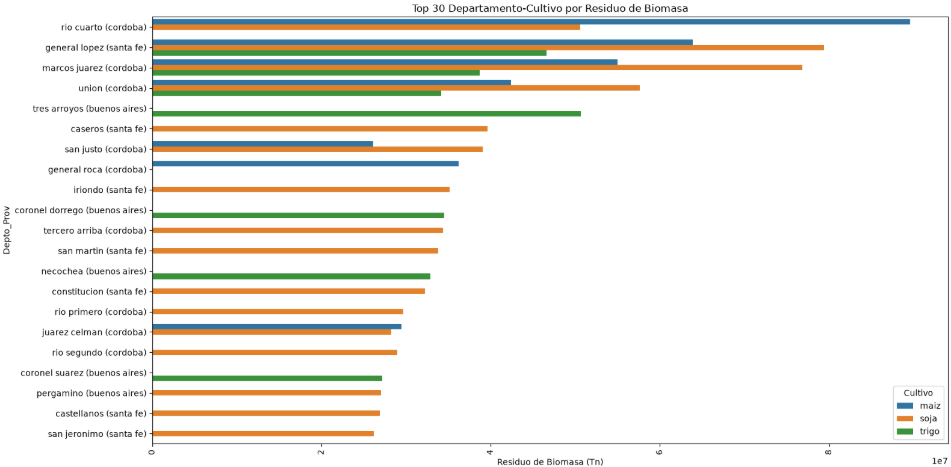
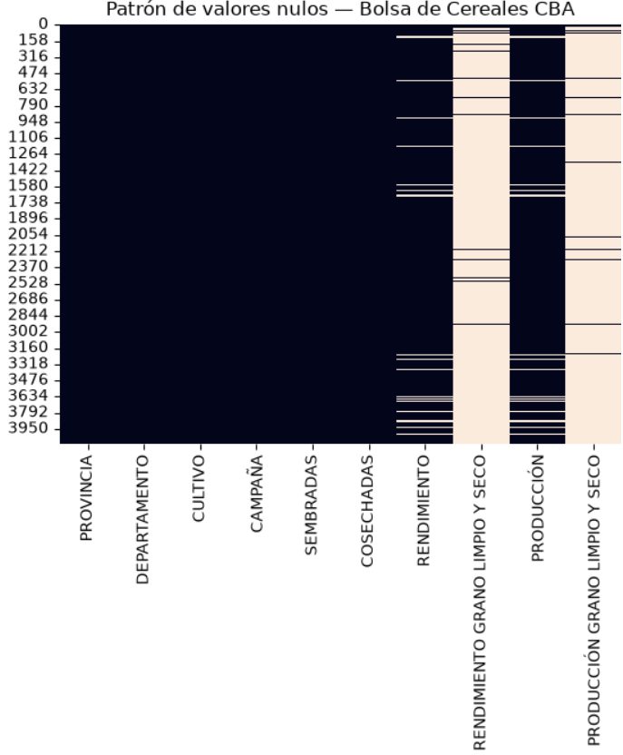

# Informe técnico de avance — OPTIMIA-HV

**Desarrollo de un pipeline ETL para la estimación de biomasa residual agrícola a escala departamental en Argentina**

| Campo | Valor |
|--------|--------|
| **Autor** | Marco Ferro |
| **Institución** | Universidad Nacional de Villa Mercedes (UNVM) |
| **Carrera** | Ingeniería en Sistemas de Información |
| **Proyecto / Tesis** | OPTIMIA-HV |
| **Tipo de documento** | Informe de avance de proyecto |

---

## Resumen

En el marco de mi tesis OPTIMIA-HV desarrollé un sistema de extracción, transformación, carga y visualización orientado a estimar la biomasa residual generada por cultivos extensivos en Argentina a granularidad departamental. El trabajo comprende: (i) extractores HTTP contra portales oficiales, incluyendo la superación de protecciones Cloudflare mediante *browser impersonation*; (ii) un pipeline de transformación con normalización léxica y geográfica, taxonomía de cultivos, reconciliación multi-fuente y cálculo de residuo a partir del índice de cosecha; (iii) contenedorización con Docker Compose (worker ETL, scheduler Ofelia y dashboard Streamlit); y (iv) persistencia auditable en Parquet.

Descarté la serie de la Bolsa de Cereales de Buenos Aires porque utiliza zonas PAS, incompatibles con la clave provincia–departamento. Sobre el conjunto válido obtuve cobertura de **23 provincias**, **411 departamentos** y **17 cultivos con índice de cosecha documentado**, reteniendo el **82,22 %** de los registros y el **87,59 %** de la producción declarada, que concentran el **97,53 %** del residuo estimado.

---

## 1. Introducción y motivación del desarrollo

El problema de investigación es cuantificar biomasa residual agrícola (rastrojos y restos de cosecha) a partir de estadísticas oficiales de producción, con resolución espacial suficiente para análisis departamental. Adopté el modelo:

$$
BR = P \times FR, \qquad FR = \frac{1 - IC}{IC}
$$

donde $P$ es la producción de grano y $IC$ el índice de cosecha. Esta relación es la vía habitual cuando no se dispone de mediciones directas de residuo a la misma escala.

Mi aporte de ingeniería no se limita a aplicar la fórmula: diseñé e implementé el software que **obtiene** los datos, **homogeneiza** nomenclaturas divergentes, **evita doble conteo**, **documenta descartes** y **expone** resultados de forma reproducible. El presente informe describe ese proceso de desarrollo, los obstáculos que encontré y las soluciones que implementé.

---

## 2. Visión general del sistema que construí

Organicé el código en un paquete Python instalable (`etl`) con extractores, transformadores, loaders y un entrypoint (`etl.pipelines.run_etl`), más un dashboard Streamlit multipágina y orquestación Docker.

---

## 3. Extracción de datos: problemas y soluciones

### 3.1 Portal MAGYP

Implementé un extractor que consulta el portal de Estimaciones Agrícolas: obtiene el período disponible, el catálogo de provincias y departamentos, y luego itera combinaciones provincia–departamento para consolidar superficie sembrada/cosechada, producción y rendimiento. Utilicé `httpx` con reintentos ante códigos 429/5xx, demora entre solicitudes y cabeceras de cliente de navegador.

**Problema.** El volumen de llamadas secuenciales es alto; sin control de tasa el servidor responde con errores transitorios.

**Solución que apliqué.** Reintentos con *backoff*, `REQUEST_RATE_DELAY` configurable y consolidación final en un único CSV bajo `data/raw/`.

### 3.2 Bolsa de Cereales de Córdoba

Desarrollé la descarga y normalización de columnas hacia un CSV con provincia, departamento, cultivo, campaña, superficies, rendimientos y producciones. Esta fuente ya discrimina por departamento, por lo que es compatible con MAGYP.

### 3.3 Bolsa de Cereales de Buenos Aires y Cloudflare

Intenté incorporar también la serie nacional de la Bolsa de Cereales de Buenos Aires. El endpoint de descarga está protegido de forma que una petición HTTP “simple” (biblioteca estándar o cliente sin huella de navegador) es bloqueada o no devuelve el archivo útil.

**Problema destacado.** La protección tipo **Cloudflare** (desafíos TLS / huella de cliente) impide obtener el binario con clientes HTTP convencionales.

**Solución que implementé.** En el extractor correspondiente utilicé **`curl_cffi`**, el *wrapper* de Python sobre curl-impersonate, con `impersonate="chrome110"`. De ese modo la solicitud reproduce características TLS/HTTP de Chrome y la descarga completa el Excel. El código centraliza URL, timeout e impersonación en constantes y valida el código HTTP 200 antes de escribir el archivo.

### 3.4 Decisión de diseño: exclusión de la serie PAS

Aunque logré descargar la serie de Bolsa BA, **no la integré al modelo departamental**. El dataset organiza el territorio en **zonas PAS** (catorce zonas agroecológicas del Panorama Agrícola Semanal: NOA, NEA, núcleos, sudeste bonaerense, etc.). Esas zonas **no coinciden** con la división administrativa provincia–departamento: varias cruzan provincias o agrupan departamentos distintos. Integrarlas habría exigido una desagregación espacial arbitraria, incompatible con la clave natural que usé para reconciliar MAGYP y CBA.

La exclusión es, por tanto, una decisión de **calidad espacial del modelo**, no un fracaso de la extracción. Conservé el extractor para trazabilidad y para eventuales análisis a escala PAS fuera del alcance departamental de la tesis.

---

## 4. Transformación: problemas de calidad y código que escribí

Tras inspeccionar las fuentes retenidas, identifiqué problemas recurrentes de integración de datos y los resolví con módulos dedicados bajo `etl.transformers`.

### 4.1 Hallazgos que motivaron el diseño

| Código | Problema observado | Consecuencia si no se trata |
|--------|--------------------|-----------------------------|
| H1 | MAGYP cubre 23 provincias; CBA, 7; intersección parcial | Doble conteo en claves solapadas |
| H2 | Capitalización y espacios distintos en nombres de cultivo | Falsos no-matches |
| H3 | Coexistencia de `Soja total` y `Soja 1ra`/`2da` (y análogos) | Doble conteo interno |
| H4 | Abreviaturas y puntuación en departamentos (`GRAL PEDERNERA` vs `GENERAL PEDERNERA`) | Rotura de clave geográfica |
| H5 | Columnas CBA de grano limpio/seco con cobertura ~5 % | Ruido si se tratan como variable principal |
| H6 | Columnas numéricas MAGYP almacenadas como texto | Imposibilidad de sumar/reconciliar |
| H7 | Solo 17 cultivos con IC en la tabla de referencia | Cultivos sin coeficiente no admiten $BR$ |

### 4.2 Normalización léxica (`string_utils`)

Implementé una función determinística e idempotente: Unicode NFKD, eliminación de diacríticos, minúsculas y colapso de espacios. Sin este paso, el *join* entre fuentes falla por diferencias puramente ortográficas. La normalización previa al *record linkage* es una práctica reconocida en resolución de entidades.

### 4.3 Normalización geográfica (`geography`)

Añadí un pipeline de limpieza de topónimos: normalización léxica, eliminación de puntos, diccionario de abreviaturas y alias. El objetivo fue alinear la nomenclatura departamental de CBA con la de MAGYP.

### 4.4 Taxonomía y agregados (`crop_consolidation`, `crop_taxonomy`)

Definí una taxonomía canónica declarativa (agregado vs componentes). La política **POL-CROP-001** que codifiqué establece: si en una clave coexisten agregado y componentes, **prevalece el agregado**; si no hay agregado, se conservan y suman los componentes. Evité colapsar entidades biológicamente distintas (p. ej. trigo y trigo candeal).

### 4.5 Reconciliación multi-fuente (`reconciliation`)

Implementé **POL-SOURCE-001**: en claves `(Provincia, Departamento, Campaña, Cultivo)` con más de un registro, retengo el de **mayor producción declarada** y persisto los descartados en auditoría. En ausencia de *ground truth*, la regla es explícita, reproducible y auditable; la literatura de estadísticas agrícolas enfatiza la necesidad de procedimientos formales de reconciliación entre colecciones.

### 4.6 Biomasa residual y validez (`biomass`)

Fusioné la tabla de referencia IC/FR, calculé $BR = P \times FR$, invalidé infinitos y generé flags (`_tiene_ic`, `_valido_biomasa`, etc.). **Prohibí** un `dropna` global: el filtro es por flag, de modo que puedo medir qué fracción del universo queda fuera del análisis y por qué (**POL-MISSING-001**).

### 4.7 Validación (`validation`)

Codifiqué chequeos de invariantes post-reconciliación (unicidad de clave, procedencia de fuente, no negatividad de magnitudes relevantes) y los ejecuto antes de persistir.

---

## 5. Contenerización con Docker: por qué y cómo la usé

### 5.1 Motivación

Necesitaba:

1. **Reproducibilidad** del entorno Python (mismas dependencias en desarrollo y en ejecución programada).
2. **Separación de responsabilidades**: pipeline ETL, programación horaria y dashboard.
3. **Ejecución en Windows y Linux** sin depender de Make como único mecanismo (incluí scripts PowerShell y `docker compose`).
4. **Zona horaria** `America/Argentina/Buenos_Aires` para el cron y los logs.

### 5.2 Diseño que implementé

Construí una **imagen única** (`Dockerfile` multi-stage sobre `python:3.11-slim`): etapa *builder* genera wheels; etapa *runtime* instala dependencias y el paquete local para que `import etl.*` sea estable. El `CMD` por defecto ejecuta el pipeline ETL.

En `docker-compose.yml` definí:

| Servicio | Rol |
|----------|-----|
| **etl_worker** | Contenedor permanente (`sleep infinity`) donde el scheduler dispara el comando ETL; monta `data/`, `config/`, `logs/` |
| **etl_pipeline** | Perfil one-shot para corridas manuales |
| **scheduler** | Imagen Ofelia; lee `config/schedule.ini` (cron, p. ej. diario 06:00) y ejecuta el ETL dentro de `biomasa_etl_worker` vía Docker socket |
| **dashboard** | Mismo image; override de comando a Streamlit en el puerto 8501; datos en solo lectura |

**Detalle operativo que resolví.** En Docker Desktop (Windows) los *bind mounts* de `./data` y `./logs` a menudo no son escribibles por el usuario no-root de la imagen; por eso documenté y configuré `user: "0:0"` en los servicios ETL que deben escribir artefactos, manteniendo la imagen usable también para el dashboard.

---

## 6. Carga, auditoría y visualización

### 6.1 Persistencia

El loader escribe:

- datasets curados en la capa procesada;
- auditoría: discrepancias CBA vs MAGYP, registros descartados en reconciliación y `biomasa_validos.parquet`.

Así puedo reconstruir *por qué* se retuvo o se descartó cada fila.

### 6.2 Dashboard

Implementé un dashboard Streamlit multipágina (Resumen, Exploración, Auditoría) que consulta los Parquet vía DuckDB, sin reprocesar el ETL en cada interacción. Incluí geoJSON departamental/provincial para vistas espaciales cuando corresponde.

---

## 7. Resultados cuantitativos del pipeline

Sobre el subconjunto marcado como válido para biomasa:

| Criterio | Valor |
|----------|--------|
| Registros válidos | 121 604 (82,22 %) |
| Registros no válidos (principalmente sin IC) | 26 299 (17,78 %) |
| Producción retenida | 87,59 % del total declarado en el universo integrado |
| Residuo de biomasa concentrado en válidos | 97,53 % |
| Provincias | 23 |
| Departamentos | 411 |
| Cultivos canónicos con IC | 17 |

**Cultivos excluidos del cálculo de $BR$** por falta de IC en la tabla de referencia: alpiste, arveja, banana, caña de azúcar, cártamo, cebolla, jojoba, lenteja, limón, mandarina, mijo, naranja, pomelo, té, trigo candeal, tung, yerba mate.

**Figura 1.**  Residuo de biomasa total por provincia.  
**Figura 2.**  Residuo de biomasa total por cultivo.  
**Figura 3.**  Eficiencia de residuo (Tn/Ha) por cultivo, ponderada por superficie.  
**Figura 4.**  Top 30 combinaciones departamento–cultivo por residuo.  
**Figura 5.**  Patrón de nulos en la fuente CBA (columnas de cobertura marginal).

---

## 8. Limitaciones que asumo explícitamente

1. **IC constante por cultivo**, sin ajuste por rendimiento, genotipo o región; la literatura indica que el HI puede variar con el nivel de rendimiento.
2. **Subrepresentación posible de NOA/NEA** al excluir cultivos sin IC (caña, yerba mate, cítricos, etc.).
3. **Reconciliación por máxima producción** no validada contra mediciones de campo independientes.
4. **Serie PAS** excluida del modelo departamental pese a haber resuelto su descarga.
5. Este documento es un **avance provisorio de tesis**, no un informe oficial ni una publicación arbitrada.

---

## 9. Conclusiones del avance

En este tramo de OPTIMIA-HV construí de extremo a extremo el software necesario para estimar biomasa residual departamental a partir de fuentes oficiales compatibles: extractores (incluido el bypass de Cloudflare con `curl_cffi`), transformaciones con políticas documentadas, validación, persistencia auditable, contenedores Docker con programación Ofelia y dashboard Streamlit. El principal conflicto espacial —zonas PAS versus provincia/departamento— lo resolví excluyendo la serie incompatible del modelo, no forzando un emparejamiento artificial. El pipeline queda reproducible y preparado para iterar coeficientes IC, ampliar cobertura de cultivos y profundizar el análisis espacial en etapas posteriores de la tesis.

---

## 10. Referencias

1. Fan, J., McConkey, B., Janzen, H., Townley-Smith, L., & Wang, H. Línea de trabajo sobre relaciones harvest index–rendimiento para estimar residuo aéreo. *Field Crops Research*. https://www.sciencedirect.com/science/article/pii/S0378429016306840  

2. Desarrollos sobre *residue-to-product ratio* (RPR) y equivalencia $RPR = (1-HI)/HI$ (Scarlat y trabajos posteriores de modelado empírico a escala amplia).  

3. Trabajos de *gazetteer matching* / resolución de entidades geográficas (*record linkage* de topónimos entre catálogos).  

4. Lineamientos FAO y documentos técnicos sobre **reconciliación** de series de censos y encuestas agrícolas ante discrepancias de cobertura o definición.
