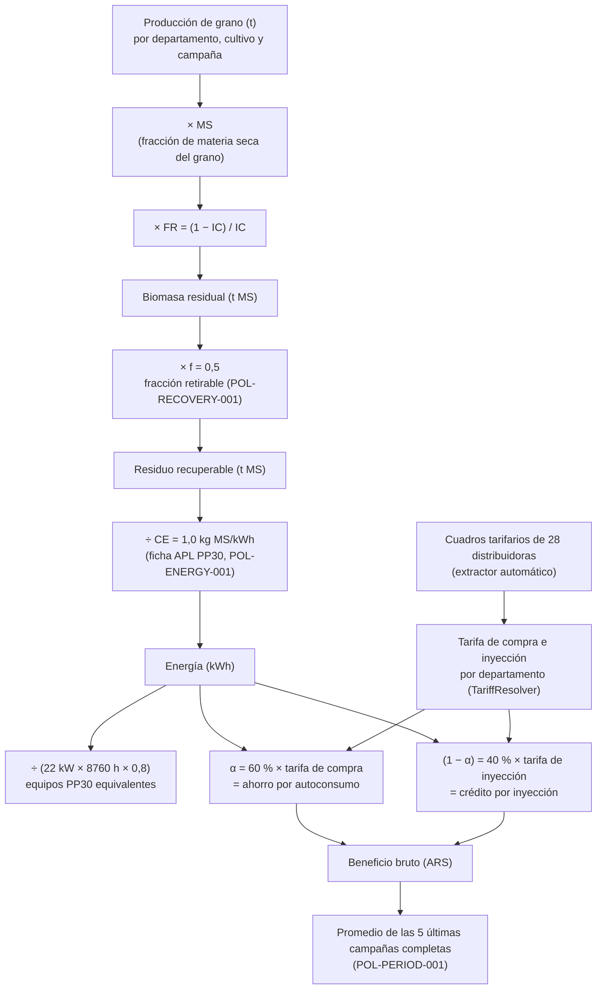
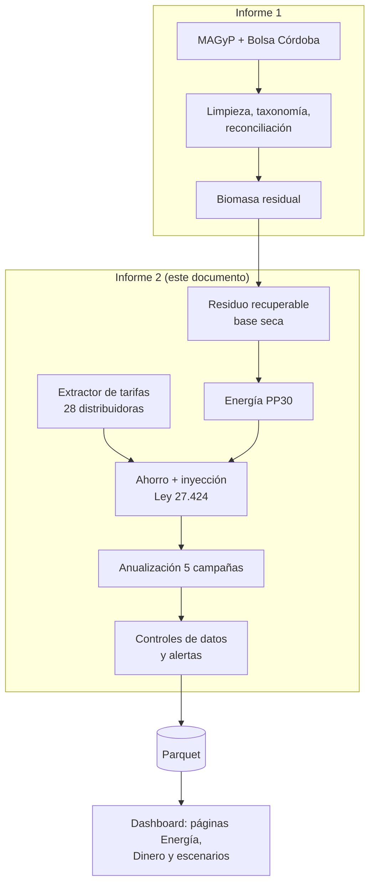
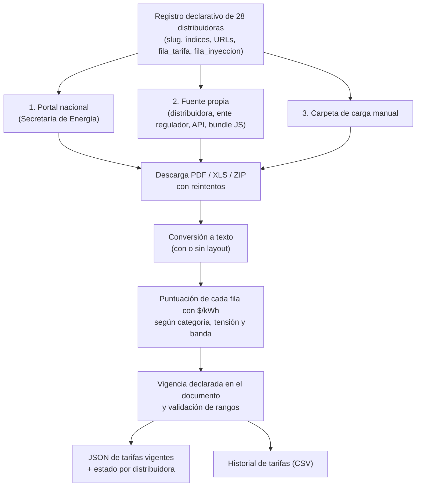
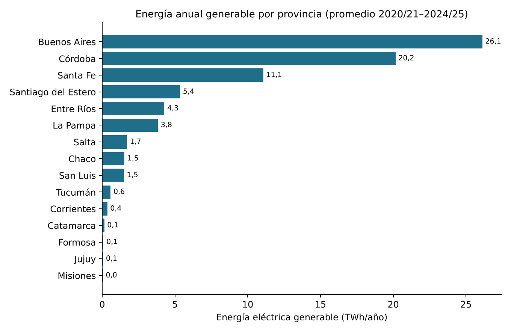
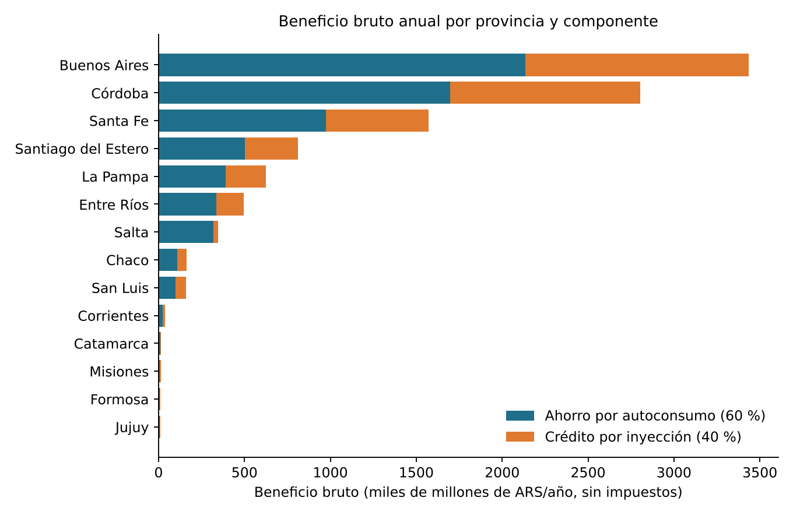
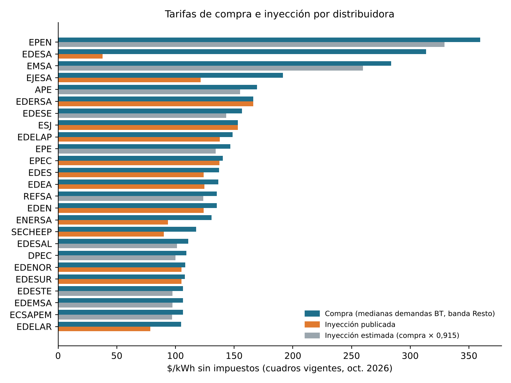
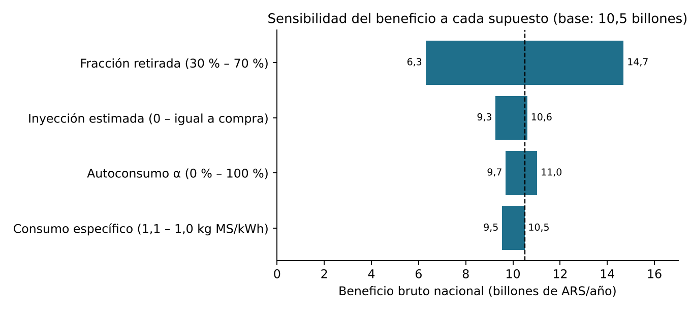
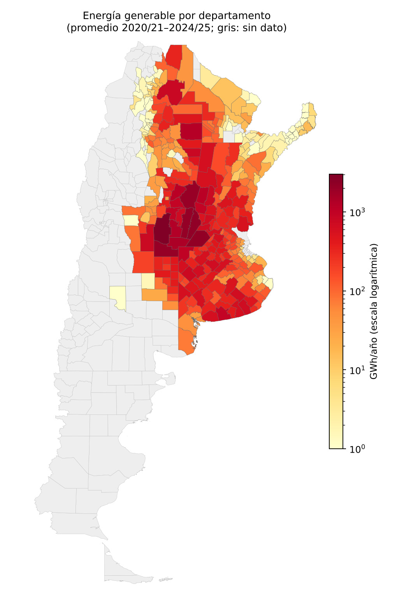
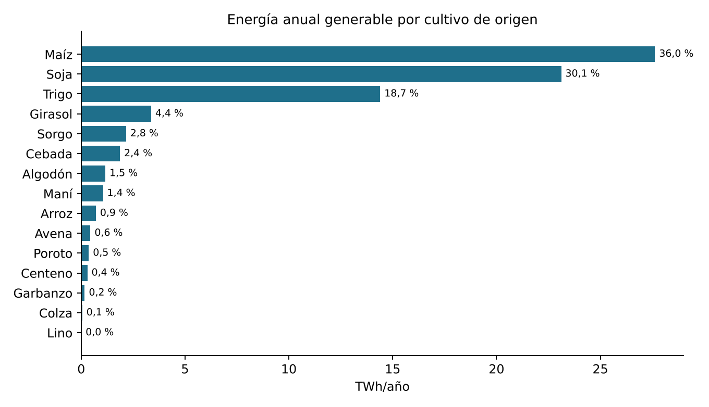

# Informe técnico de avance — OPTIMIA-HV

**Del residuo agrícola a la energía eléctrica y su valor económico: modelo energético del gasificador APL PP30 y valorización tarifaria bajo la Ley 27.424 a escala departamental en Argentina**

| Campo | Valor |
|--------|--------|
| **Autor** | Marco Ferro |
| **Institución** | Universidad Nacional de Villa Mercedes (UNVM) |
| **Carrera** | Ingeniería en Sistemas de Información |
| **Proyecto / Tesis** | OPTIMIA-HV |
| **Tipo de documento** | Informe de avance de proyecto (N.º 2) |
| **Fecha de corte de datos** | Octubre de 2026 |
| **Fe de erratas** | 27 de octubre de 2026 (ver al final del documento) |

---

## Resumen

En el primer informe de avance describí el pipeline ETL que estima la biomasa residual agrícola por departamento a partir de estadísticas oficiales. En este segundo tramo de la tesis OPTIMIA-HV extendí el sistema para responder dos preguntas nuevas: **cuánta electricidad podría generarse** con ese residuo y **cuánto dinero representa**. El trabajo comprende: (i) la corrección del residuo a base seca y la definición de una fracción de retiro sostenible; (ii) un modelo energético basado en la ficha técnica del gasificador de lecho descendente APL PP30 (1,0 kg de materia seca por kWh; 22 kW a 50 Hz); (iii) un modelo económico de balance neto conforme a la Ley 27.424 de generación distribuida, que separa ahorro por autoconsumo e ingreso por inyección; (iv) un extractor automático de los cuadros tarifarios de las 28 distribuidoras eléctricas del país, con lectura de PDF, planillas y sitios web heterogéneos; (v) la anualización de los resultados sobre un período de referencia de cinco campañas; y (vi) un análisis de sensibilidad interactivo en el dashboard.

Para el período 2020/21–2024/25 el modelo estima un potencial técnico de **153,6 millones de toneladas de materia seca de rastrojo por año**, de las cuales se consideran retirables **76,8 Mt**, equivalentes a **76,8 TWh/año** de electricidad (del orden del 55 % de la demanda eléctrica nacional) y a un **beneficio bruto de ≈ 10,5 billones de pesos por año** a tarifas sin impuestos de octubre de 2026. El supuesto más influyente es la fracción de rastrojo que se retira del lote: entre 30 % y 70 % el beneficio varía entre 6,3 y 14,7 billones de pesos. Todas las decisiones metodológicas están codificadas (`POL-…`), justificadas con bibliografía y son auditables en el código.

---

## 1. Introducción y motivación del desarrollo

### 1.1 Continuidad con el informe anterior

El Informe 1 cerró con una tabla de biomasa residual por departamento, cultivo y campaña, calculada con el modelo $BR = P \times FR$, con $FR = (1-IC)/IC$. Ese resultado es una cantidad física (toneladas de rastrojo) que, por sí sola, no responde la pregunta que motiva la tesis: **¿vale la pena convertir ese residuo en energía, dónde y cuánto representaría?** Para responderla hace falta recorrer dos pasos más: una conversión técnica (de toneladas a kWh) y una conversión económica (de kWh a pesos).

### 1.2 Qué tipo de "potencial" se calcula

La literatura de evaluación de recursos bioenergéticos distingue varios niveles de potencial, cada uno contenido en el anterior (Batidzirai, Smeets y Faaij, 2012; Lopez et al., 2012):

| Nivel | Definición | ¿Lo calcula este modelo? |
|---|---|---|
| **Teórico** | Toda la biomasa residual producida | Sí: biomasa residual (Informe 1, ahora en base seca) |
| **Técnico** | Lo que puede retirarse y convertirse con una tecnología dada, respetando restricciones ambientales | Sí: residuo recuperable × consumo específico del PP30 |
| **Económico** | La parte del técnico que es rentable considerando costos | **No** (sólo el beneficio bruto; ver §12) |
| **De mercado / implementación** | Lo que efectivamente se instalaría considerando políticas, barreras y adopción | No |

Elegí deliberadamente calcular el **potencial técnico** y un **beneficio bruto** asociado. Lopez et al. (2012) señalan que el potencial técnico es una cota superior que sirve para comparar regiones y priorizar, pero que no considera restricciones económicas; Batidzirai et al. (2012) muestran que la mayor fuente de dispersión entre estudios de potencial es la falta de explicitación de supuestos. Por eso cada supuesto de este informe está declarado, justificado y es modificable.

### 1.3 Antecedentes en Argentina

El antecedente oficial más cercano es el estudio WISDOM Argentina de la FAO (2009), elaborado a pedido del Gobierno nacional con colaboración del INTA, que dio origen al programa PROBIOMASA y que fue actualizado en 2020 (FAO, 2020). WISDOM es un balance espacial oferta–demanda de biomasa con fines dendroenergéticos (principalmente leña y residuos forestales y agroindustriales). Mi aporte se diferencia en tres aspectos: (a) trabaja a **escala departamental y por campaña**, con datos de cosecha que se actualizan automáticamente; (b) lleva el cálculo hasta **energía eléctrica con una tecnología concreta y comercial**; y (c) **valoriza la energía con las tarifas eléctricas vigentes de cada distribuidora**, obtenidas automáticamente de los cuadros oficiales.

### 1.4 Preguntas que responde este tramo

1. ¿Cuánta electricidad podría generarse con el rastrojo retirable de cada departamento?
2. ¿Cuántos gasificadores de pequeña escala harían falta para procesarlo?
3. ¿Cuánto dinero representa esa electricidad para un productor, según el lugar donde está?
4. ¿Qué tan sensibles son esos resultados a los supuestos más inciertos?

---

## 2. Visión general de la cadena de cálculo

Organicé el cálculo como una cadena de transformaciones lineales sobre cada registro (departamento × cultivo × campaña). La linealidad es una decisión de diseño: permite recalcular escenarios en el dashboard sin volver a correr el ETL (§9) y hace que la contribución de cada supuesto sea transparente.

**Figura A.** Cadena de cálculo de energía y dinero implementada en `etl/transformers/` (`biomass.py`, `energy_finance.py`, `reference_period.py`).

El sistema completo, con la etapa nueva resaltada, queda así:

**Figura B.** Ubicación de los módulos nuevos dentro del pipeline.

---

## 3. Del residuo teórico al residuo recuperable

### 3.1 Corrección a base seca

**Problema detectado.** En la versión del Informe 1 calculaba $BR = P \times FR$ con la producción tal como la informa la fuente. Pero las estadísticas informan el grano **con humedad comercial** (≈ 13–15 % según el cultivo), mientras que el índice de cosecha se define como cociente de **pesos secos** (grano seco / biomasa aérea seca) (Hay, 1995; Unkovich, Baldock y Forbes, 2010). Mezclar ambas bases sobreestima el residuo en la proporción del agua del grano.

**Solución que implementé.** Agregué a la tabla de referencia `data/reference/ic_fr.csv` la columna **MS** (fracción de materia seca del producto cosechado) con su fuente, y reescribí el cálculo:

$$
\text{Biomasa residual (t MS)} = P \times MS \times FR, \qquad FR = \frac{1-IC}{IC}
$$

Para los granos tomé la humedad base de comercialización (p. ej. maíz 14,5 % → MS = 0,855; soja 13,5 % → MS = 0,865); para papa y ajo, que se informan en fresco, el contenido típico de materia seca del órgano cosechado (0,20 y 0,35). Además, $FR$ se **recalcula siempre desde IC** al cargar la tabla, porque un FR persistido podía quedar desincronizado si se editaba IC a mano (`etl/reference/load_ic.py`).

**Justificación.** Trabajar en materia seca es la convención de los estudios de residuos agrícolas con fines energéticos (Lal, 2005; Scarlat, Martinov y Dallemand, 2010) y es, además, la base en la que el fabricante del gasificador expresa su consumo específico (§4.3). Así la cadena completa queda en una única base física coherente.

### 3.2 Fracción de rastrojo retirable (POL-RECOVERY-001)

$$
\text{Residuo recuperable (t MS)} = \text{Biomasa residual} \times f, \qquad f = 0{,}5
$$

**Por qué no se retira todo.** El rastrojo cumple funciones agronómicas que no pueden ignorarse: protege el suelo de la erosión hídrica y eólica, conserva humedad y repone carbono orgánico. En Argentina el problema es especialmente relevante porque la **siembra directa** —el sistema dominante— depende justamente de mantener el suelo cubierto con rastrojo. La revisión de Blanco-Canqui y Lal (2009) concluye que el retiro de residuos deteriora las propiedades físicas, químicas y biológicas del suelo superficial y que los umbrales de retiro deben evaluarse por tipo de suelo. Wilhelm et al. (2004, 2007) muestran que la cantidad de rastrojo necesaria para **mantener el carbono orgánico del suelo** es mayor que la necesaria para controlar la erosión, por lo que la materia orgánica es la restricción que manda.

**De dónde sale el 50 %.** Es un **supuesto explícito del modelo**, no una medición. Lo elegí como **límite superior** de lo que la bibliografía considera sostenible, por tres razones:

- Estudios de cuenca para maíz recomiendan no retirar más de 25–40 % de la biomasa aérea, y sólo con rendimientos altos (Agronomy Journal, 2021).
- Las recomendaciones de cobertura para siembra directa (p. ej. Aapresid) piden mantener más del 60–70 % del suelo cubierto.
- Scarlat et al. (2010), en la evaluación de residuos de la Unión Europea, también aplican tasas de retiro sostenible por cultivo en lugar de usar el residuo total.

Al tratarse de una cota superior, el resultado debe leerse como **optimista**. Un valor de 30–40 % es más prudente; por eso el parámetro es configurable (`--fraccion-recuperable` en el ETL) y el dashboard permite variarlo entre 20 % y 70 %. Como la energía y el dinero son proporcionales a $f$, este es el supuesto de mayor peso del modelo (§9).

**Decisión de diseño.** Preferí un único $f$ global, declarado y modificable, a una tabla de $f$ por cultivo y región que hoy no podría respaldar con datos locales. Es una simplificación que dejo registrada como limitación (§11) y como línea de trabajo futuro.

---

## 4. Conversión a energía: el gasificador APL PP30

### 4.1 Por qué gasificación

Para convertir residuos sólidos en electricidad a pequeña escala hay tres rutas principales: combustión directa con ciclo de vapor, digestión anaeróbica y gasificación. Descarté las otras dos por los siguientes motivos:

- La **combustión con ciclo de vapor** tiene eficiencias eléctricas bajas por debajo del megavatio y requiere escala de planta (McKendry, 2002a).
- La **digestión anaeróbica** es adecuada para sustratos húmedos y fácilmente degradables (efluentes, estiércol, silajes); el rastrojo lignocelulósico seco tiene baja biodegradabilidad sin pretratamiento.
- La **gasificación de lecho descendente (*downdraft*)** acoplada a un motor de combustión interna es la ruta establecida para biomasa seca a escala de decenas de kilovatios, porque produce un gas con bajo contenido de alquitranes apto para motores (Reed y Das, 1988; Basu, 2018; McKendry, 2002b).

### 4.2 Por qué el PP30 y no un modelo genérico

Podría haber usado una eficiencia de conversión genérica de la literatura (p. ej. "20–25 % sobre el poder calorífico inferior"). Preferí anclar el cálculo en **un equipo comercial concreto**, el *Power Pallet* PP30 de All Power Labs, por cuatro razones:

1. **Trazabilidad**: cada parámetro tiene una fuente verificable (la ficha técnica del fabricante) en lugar de un rango bibliográfico.
2. **Escala coherente con el problema**: 20–25 kW es la escala de un establecimiento agropecuario, que es el usuario-generador típico de la Ley 27.424 (§5).
3. **Interpretabilidad**: permite expresar el resultado también como "cantidad de equipos", una magnitud que un decisor entiende.
4. **Continuidad con la cátedra**: las guías de trabajo provistas por la cátedra se basan en este equipo, lo que permitió contrastar ambos modelos (§10).

### 4.3 Consumo específico (POL-ENERGY-001)

$$
\text{Energía (kWh)} = \frac{\text{Residuo recuperable (t MS)} \times 1000}{CE}, \qquad CE = 1{,}0 \ \text{kg MS/kWh}
$$

El consumo específico es el parámetro que transforma masa en energía. La ficha técnica del PP30 indica **"Biomass consumption: 1.0 kg/kWh (dry basis)"** y el fabricante explica cómo cambia con la humedad del material: 1,1 kg/kWh con 10 % de humedad, 1,2 con 20 % y 1,3 con 30 % (All Power Labs, s.f.-a, s.f.-b).

**Problema que encontré.** La versión anterior del modelo —y la guía de la cátedra— usaban 1,1 kg/kWh aplicado sobre material al 12 % de humedad. Eso mezclaba dos bases: el 1,1 del fabricante corresponde a material *tal cual* con 10 % de humedad, no a materia seca.

**Solución.** Como el residuo ya está en base seca (§3.1), uso directamente el valor seco del fabricante. La humedad operativa (12 %) se usa sólo para calcular cuánta masa hay que **cargar** al equipo, y no cambia los kWh:

$$
\text{Masa alimentada (kg)} = \frac{\text{Residuo recuperable (t MS)} \times 1000}{1 - H/100}
$$

El cambio redujo la energía calculada un 3,2 %. Para no perder la comparabilidad con la guía, el valor 1,1 kg MS/kWh quedó disponible como **escenario conservador** en el dashboard. El código conserva compatibilidad con archivos de configuración viejos que sólo traen el consumo *tal cual*: lo convierte a base seca con $CE_{seco} = CE \times (1 - H/100)$.

Como control de verosimilitud, 1 kg de materia seca de residuo agrícola tiene un poder calorífico inferior del orden de 4–5 kWh térmicos (Jenkins et al., 1998; Vassilev et al., 2010). Producir 1 kWh eléctrico con 1 kg implica entonces una eficiencia global de ≈ 20–25 %, consistente con la eficiencia eléctrica de ≈ 23 % que declara el fabricante y con los valores típicos de sistemas gasificador–motor de esta escala (Basu, 2018).

### 4.4 Potencia de referencia y equipos equivalentes

$$
\text{Equipos PP30 equivalentes} = \frac{\text{Energía anual (kWh)}}{P \times 8760 \ \text{h} \times D}, \qquad P = 22 \ \text{kW}, \ D = 0{,}8
$$

- **Potencia**: la ficha indica 25 kW a 60 Hz y **22 kW a 50 Hz** conectado a red con cogeneración. Argentina opera a 50 Hz, por lo que corresponde 22 kW. Este cambio (antes usaba 25 kW) subió la cantidad de equipos un 14 %.
- **Disponibilidad ($D$ = 0,8)**: fracción del año que el equipo opera. Es un **supuesto**: descuenta paradas por mantenimiento —que en gasificadores incluyen limpieza de cenizas y alquitranes— y por falta de material. Es menor que los factores de capacidad que se reportan para grandes centrales de biomasa (IRENA, 2012), lo cual es razonable para un equipo pequeño operado en un establecimiento rural.
- El indicador **sólo tiene sentido sobre cantidades anuales**, por eso se calcula después de la anualización (§7).

### 4.5 Restricción del material: el rastrojo debe acondicionarse

Al revisar la documentación del fabricante (*PP30 Basic Considerations*) encontré una restricción que condiciona la interpretación de todo el resultado: el PP30 acepta piezas de **1 a 4 cm**, humedad menor a 30 % y bajo contenido de ceniza y sílice. Los insumos **aprobados** son chips de madera, cáscaras de frutos secos y **marlo de maíz**. El **rastrojo suelto no está aprobado**: es de baja densidad, traba la tolva y su ceniza rica en sílice y álcalis forma escoria a las temperaturas de la zona de oxidación (Jenkins et al., 1998; Vassilev et al., 2010).

Para usarlo hay que **densificarlo** (triturar y pelletizar o briquetear), práctica estándar para convertir residuos agrícolas en un combustible uniforme (Tumuluru et al., 2011), y validarlo con el fabricante. Ese proceso tiene un costo y un consumo energético que el modelo **no** descuenta. En consecuencia, los resultados son un **potencial técnico bajo el supuesto de material acondicionado**, y así lo declaro en el dashboard y en la documentación. Además, el código emite una alerta si se configura una humedad operativa mayor al 20 %, umbral a partir del cual aumenta el riesgo de alquitranes.

---

## 5. Valorización económica: balance neto bajo la Ley 27.424

### 5.1 Marco normativo

La **Ley 27.424** (2017), *Régimen de Fomento a la Generación Distribuida de Energía Renovable Integrada a la Red Eléctrica Pública*, permite a un usuario de la red generar energía renovable para su autoconsumo e **inyectar los excedentes** a la red de distribución. Su reglamentación (Decreto 986/2018 y Resolución SGE 314/2018 y modificatorias) establece que:

- el distribuidor debe **publicar en sus cuadros tarifarios el precio de reconocimiento de la energía inyectada**, bajo fiscalización del ente regulador;
- la factura se calcula como el **neto** entre el valor de la energía demandada y el de la inyectada, **antes de impuestos**;
- el distribuidor no puede agregar cargos adicionales sobre la inyección.

Los entes reguladores fijan el precio de inyección en función del **precio que el distribuidor paga por la energía en el Mercado Eléctrico Mayorista** (más transporte y pérdidas reconocidas), sin el valor agregado de distribución; así lo hacen, por ejemplo, el ENRE para EDENOR y EDESUR (Resolución ENRE 490/2021) y el ERSeP de Córdoba (Resolución General 57/2022).

La biomasa es una fuente renovable alcanzada por el régimen, por lo que un establecimiento agropecuario con un PP30 conectado a la red encaja en la figura de **usuario-generador**.

### 5.2 Modelo de dos componentes

$$
\text{Ahorro} = E \times \alpha \times T_{compra}, \qquad
\text{Crédito} = E \times (1-\alpha) \times T_{iny}, \qquad
\text{Beneficio bruto} = \text{Ahorro} + \text{Crédito}
$$

- **Ahorro por autoconsumo**: la energía que el establecimiento genera y consume él mismo deja de comprarse, por lo que vale la tarifa de compra (costo evitado).
- **Crédito por inyección**: el excedente se reconoce a la tarifa de inyección.

**Por qué separar los dos componentes.** Valorizar toda la energía a la tarifa de compra (*net metering* puro) o toda a la de inyección produciría errores en sentidos opuestos. Darghouth, Barbose y Wiser (2011) muestran, para generación distribuida residencial, que el ahorro por kWh generado depende fuertemente del diseño tarifario y de cómo se remunera el excedente, y que pasar de compensación a precio minorista a compensación a precio mayorista reduce el ahorro de forma apreciable. El esquema argentino es precisamente de este segundo tipo (*net billing*): el excedente vale menos que la energía comprada. Modelar las dos componentes por separado es, por lo tanto, una exigencia de la normativa y no un refinamiento opcional.

**Fracción de autoconsumo ($\alpha$ = 0,6).** Es un **supuesto**: el 60 % de la energía se consume en el establecimiento y el 40 % se inyecta. Depende del perfil de demanda de cada usuario (riego, secado, tambo, frío), que el modelo no conoce. Por eso $\alpha$ se puede variar de 0 a 100 % en el dashboard. Como $T_{iny} \le T_{compra}$, el beneficio aumenta con $\alpha$.

### 5.3 Qué tarifa de compra se usa (POL-TARIFF-001)

Cada cuadro tarifario contiene decenas de precios: categorías residenciales, comerciales, industriales, de riego; tensiones baja, media y alta; bandas horarias pico, valle y resto; cargos fijos y variables; tarifas plenas y subsidiadas. Hubo que definir **una** tarifa representativa y comparable entre provincias:

| Criterio | Elección | Justificación |
|---|---|---|
| Categoría | Medianas o grandes demandas | Es la categoría de un establecimiento productivo con una carga del orden de 20–50 kW |
| Tensión | Baja tensión, preferentemente < 300 kW | Un PP30 se conecta en baja tensión; las categorías ≥ 300 kW o de media tensión corresponden a otra escala |
| Banda horaria | "Resto" | Es la banda de mayor duración del día y la que la normativa toma como referencia para usuarios sin medición horaria |
| Cargo | Cargo variable de energía ($/kWh) | Es lo que se ahorra por kWh autoconsumido; el cargo de potencia no se evita necesariamente con generación propia |
| Cuadro | Pleno, sin subsidios ni regímenes especiales | Los subsidios dependen del usuario y cambian con frecuencia; el cuadro pleno refleja el costo |
| Impuestos | **Sin impuestos** | Ver abajo |

**Por qué sin impuestos.** Hay tres razones. Primera, la carga impositiva sobre la electricidad difiere entre provincias y municipios (tasas, contribuciones, fondos provinciales), por lo que incluirla mezclaría diferencias de costo con diferencias fiscales. Segunda, para un usuario productivo responsable inscripto el IVA es recuperable como crédito fiscal, y por eso las estadísticas internacionales de precios de la electricidad para no residenciales se publican sin IVA ni impuestos recuperables (Eurostat, metodología de precios de electricidad para no hogares). Tercera, la propia reglamentación de la Ley 27.424 calcula el balance neto **antes de impuestos** (Res. SGE 314/2018). Dejo registrado que el beneficio de un usuario concreto cambiaría con su situación fiscal.

**Moneda.** Los montos están en **pesos corrientes del mes de vigencia de cada cuadro** (octubre de 2026 en la última corrida) aplicados a un año típico. No los ajusto por inflación ni los proyecto: el objetivo de este tramo es comparar territorios en un mismo momento, no evaluar una inversión en el tiempo (eso queda para la evaluación económica, §12).

### 5.4 Asignación de la tarifa a cada departamento

Implementé la clase `TariffResolver` (`etl/transformers/energy_finance.py`), que asigna a cada par provincia–departamento la distribuidora correspondiente, con este orden de prioridad:

1. **Excepciones por departamento**: la zona este de Mendoza (San Martín, Junín, Rivadavia, Santa Rosa, La Paz) corresponde a EDESTE; el Gran La Plata, a EDELAP.
2. **Distribuidora provincial**. Si una provincia tiene varias (interior de Buenos Aires: EDEN, EDEA y EDES), se usa el **promedio simple** y el registro se marca `tarifa_es_proxy`.
3. **Sin distribuidora única**: Chubut (servicio prestado por cooperativas) queda sin tarifa y no suma dinero.

Cada registro conserva la distribuidora, el estado de la tarifa (`extraido`, `fallback_previous`, `sin_dato`) y las marcas de aproximación, para que el dashboard pueda distinguir valores reales de aproximados.

### 5.5 Tarifa de inyección faltante (POL-TARIFF-002)

**Problema.** Aunque la reglamentación obliga a publicarla, **la mayoría de las distribuidoras no publica la tarifa de inyección** en un formato legible o directamente no la publica. Valorizarla en cero subestimaría sistemáticamente a esas provincias, como si la energía inyectada no valiera nada.

**Solución que implementé.** Donde falta, la estimo como:

$$
T_{iny}^{est} = T_{compra} \times \tilde{r}, \qquad \tilde{r} = \operatorname{mediana}\left(\frac{T_{iny}}{T_{compra}}\right)_{\text{distribuidoras que publican ambas}}
$$

En la corrida de octubre de 2026, 14 distribuidoras publican la inyección y $\tilde{r}$ = **0,915**. El ratio **se recalcula en cada corrida** con los valores reales disponibles, por lo que la estimación mejora sola a medida que se incorporan cuadros. Los registros estimados quedan marcados `tarifa_inyeccion_estimada`.

**Justificación.**

- **Fundamento económico**: como la inyección se paga al precio de la energía en el mercado mayorista y la compra incluye además la distribución, la inyección es siempre menor o igual que la compra. El cociente depende de la estructura tarifaria: en categorías con cargo de potencia separado (grandes demandas) el cargo de energía ya es casi sólo energía y el ratio es 0,9–1 (OCEBA, ENRE, EPEC, San Juan); en categorías con cargo único (medianas demandas) el ratio es 0,6–0,8 (EJESA, ENERSA, SECHEEP, EDELAR).
- **Por qué la mediana y no la media**: con pocas observaciones (14) y algún valor atípico —EDESA publica una inyección para biomasa de sólo 37,8 $/kWh frente a una compra de 313,6 $/kWh— la mediana es un estimador de tendencia central robusto, con punto de quiebre del 50 %, mientras que la media se desplaza con una sola observación extrema (Huber y Ronchetti, 2009).
- **Acotación del error**: con el rango observado de ratios (≈ 0,63 a 1, sin contar el valor atípico de EDESA) y $\alpha$ = 0,6, el beneficio de una provincia con inyección estimada podría ser entre ≈ 12 % menor y ≈ 4 % mayor que el calculado, porque el beneficio es proporcional a $0{,}6 + 0{,}4\,r$.
- **Alternativa evaluada y pendiente**: usar el precio estacional de la energía que fija la Secretaría de Energía, que es la base legal del precio de inyección y es uniforme en todo el país. Requiere sumar transporte y pérdidas por distribuidora, por lo que lo dejo como mejora futura.

---

## 6. Obtención automática de tarifas: problemas y soluciones

El componente de mayor complejidad de ingeniería de este tramo fue el extractor de tarifas (`etl/extractors/scrape_tarifas.py`, `tariff_parser.py`, `tariff_documents.py` y el registro `etl/reference/distribuidoras.py`). Argentina tiene 28 distribuidoras provinciales relevantes y **no existe una base de datos unificada y legible por máquina** con sus cuadros tarifarios.

### 6.1 Hallazgos que motivaron el diseño

| Código | Problema observado | Consecuencia si no se trata |
|---|---|---|
| T1 | Los cuadros se publican en PDF, XLS/XLSX, ZIP o páginas web, con estructuras distintas en cada distribuidora y a veces en cada mes | Imposible un único lector basado en posiciones fijas |
| T2 | Un mismo cuadro tiene decenas de precios en $/kWh (residencial, social, riego, MT, AT, peaje, alumbrado…) | Tomar la fila equivocada multiplica o divide el resultado |
| T3 | El portal nacional enlaza archivos que a veces no existen (404) o están desactualizados | Tarifas viejas o faltantes |
| T4 | Algunos sitios arman la página en el navegador (Angular): los enlaces no están en el HTML | Un extractor HTTP simple no encuentra los cuadros |
| T5 | Algunos cuadros son PDF escaneados (imagen, sin texto) | No se pueden leer automáticamente |
| T6 | Tablas lado a lado en un mismo PDF o planilla | Se lee una fila de otra tabla (p. ej. media tensión en lugar de baja) |
| T7 | La vigencia del cuadro no siempre coincide con la fecha del archivo | Se mezclan meses |
| T8 | La inyección aparece en documentos separados (resoluciones del ENRE, cuadros de OCEBA) | Se pierde la inyección real |

### 6.2 Diseño que implementé

**Figura C.** Flujo del extractor de tarifas.

- **Registro declarativo (T1, T3, T4)**: cada distribuidora se describe con datos, no con código: página del portal nacional, páginas propias donde buscar enlaces, URLs directas o plantillas por mes (`{ym}`). Para sitios que se arman en el navegador, como el de EPEC, los enlaces se buscan dentro del *bundle* JavaScript de la aplicación. Se prueban todas las fuentes y se elige la de **vigencia más reciente**.
- **Selección de fila por puntuación (T2)**: en lugar de posiciones fijas, cada fila con un precio en $/kWh se puntúa según su contexto (palabras de categoría, tensión y banda horaria en la fila y en los encabezados que la preceden). Se descartan explícitamente las filas residenciales, sociales, subsidiadas, de media y alta tensión, peaje, alumbrado, ≥ 300 kW y las tarifas mayoristas a cooperativas.
- **Anclas explícitas cuando el contexto no alcanza (T2, T6)**: para cinco distribuidoras (EPE, APE, EMSA, EPEC, EDESA) el registro fija la fila exacta con anclas encadenadas (sección → apartado → fila), y para cuadros con tablas lado a lado se lee el PDF respetando la posición del texto.
- **Vigencia (T7)**: se toma la fecha declarada en el texto ("vigente a partir del…"); sólo si no existe, la del nombre del archivo.
- **Inyección en documentos aparte (T8)**: se incorporaron las resoluciones del ENRE (EDENOR, EDESUR) y el cuadro de inyección de OCEBA (distribuidoras bonaerenses).
- **Carga manual y estados (T5)**: los cuadros que no pueden descargarse o leerse se cargan a mano en `data/reference/cuadros_manuales/<CÓDIGO>/` y se procesan con el mismo lector. Si una distribuidora no puede leerse en una corrida, se conserva el último valor extraído (`fallback_previous`); si nunca se pudo, queda `sin_dato`.
- **Validación**: se rechazan valores fuera de 30–2.000 $/kWh y una inyección mayor que la compra (con margen de redondeo de 0,1 %).

**Resultado.** En octubre de 2026 obtuve tarifa de compra para **25 de 28 distribuidoras**. Las tres sin dato (SPSE de Santa Cruz, DPE de Tierra del Fuego y EDET de Tucumán) publican documentos inexistentes o escaneados. La energía sin valorizar es el **0,75 %** del total, casi toda de Tucumán.

---

## 7. Período de referencia y anualización (POL-PERIOD-001)

**Problema.** El dataset contiene todas las campañas desde 1969/70. Sumar energía o dinero sobre todas ellas no representa ninguna magnitud física: el potencial energético es un **flujo anual**. Por otro lado, una sola campaña es poco representativa por la alta variabilidad interanual de la producción en Argentina: la sequía de 2022/23 redujo la cosecha de soja, maíz y trigo en decenas de millones de toneladas respecto de lo proyectado (Bolsa de Comercio de Rosario, 2023).

**Solución.** Expreso los resultados **por año**, como promedio de las **5 últimas campañas completas** (hoy 2020/21 a 2024/25), con dos reglas:

- Una campaña es **incompleta** si tiene menos del 80 % de los registros de la mediana de las 5 anteriores; ocurre con la campaña en curso, que todavía se está relevando. Se excluye (en esta corrida, 2025/26).
- Si un departamento no tiene registro en alguna campaña del período, esa campaña **cuenta como cero**. Usar el promedio sólo de las campañas con dato sesgaría hacia arriba a los departamentos que producen un cultivo algunos años.

**Justificación.** Los promedios plurianuales son la práctica habitual para suavizar la variabilidad climática en estimaciones de disponibilidad de residuos (Scarlat et al., 2010, consideran explícitamente la variación interanual de rendimientos y advierten que puede generar faltantes de biomasa en algunos años). Cinco campañas incluyen años buenos y malos —entre ellos la sequía de 2022/23— y, a la vez, reflejan la estructura productiva reciente.

---

## 8. Controles de calidad de los resultados (POL-QA-001)

Una estimación económica automatizada es tan confiable como sus entradas. Por eso agregué controles que corren **en cada ejecución** del ETL (`etl/transformers/data_checks.py`), además de los tests automáticos que corren en integración continua:

- **Invariantes** que detienen el pipeline: unicidad de clave, magnitudes no negativas, inyección ≤ compra.
- **Alertas** por cambios sospechosos respecto de la corrida anterior: salto de tarifa > 50 %, cambio del total nacional > 20 % o de una provincia > 50 %. Con `--estricto`, las alertas también impiden publicar.

Estos controles ya detectaron problemas reales. Por ejemplo, en la corrida de este informe alertaron sobre un salto de ENERSA de 67,28 a 130,84 $/kWh entre cuadros. La revisión mostró que el valor anterior (historial) provenía de una tabla de media tensión ubicada al lado de la de baja tensión (problema T6); el valor vigente es el correcto.

---

## 9. Escenarios y análisis de sensibilidad

Como todos los pasos posteriores a la biomasa son **lineales**, el dashboard recalcula energía y dinero ante un cambio de supuestos sin volver a correr el ETL (`dashboard/data_loader.py`, `apply_supuestos`):

| Supuesto | Valor del ETL | Rango en el dashboard |
|---|---|---|
| Fracción de rastrojo retirada $f$ | 50 % | 20 a 70 % |
| Consumo específico $CE$ | 1,0 kg MS/kWh (ficha APL) | 1,1 kg MS/kWh (conservador, como la guía de la cátedra) |
| Autoconsumo $\alpha$ | 60 % | 0 a 100 % |
| Inyección donde no se publica | Central: compra × 0,915 | Conservador: 0 · Alto: igual a la compra |

Para jerarquizar los supuestos hice un **análisis de sensibilidad local de a un factor por vez** (*one-at-a-time*), representado como diagrama de tornado (Saltelli et al., 2008). Es adecuado aquí porque el modelo es lineal en cada parámetro y sin interacciones relevantes entre ellos. La Figura 4 muestra el resultado.

| Supuesto (rango) | Beneficio bruto nacional (billones de ARS/año) | Amplitud |
|---|---|---|
| Fracción retirada (30 % – 70 %) | 6,3 – 14,7 | 8,4 |
| Inyección estimada (0 – igual a la compra) | 9,3 – 10,6 | 1,3 |
| Autoconsumo $\alpha$ (0 % – 100 %) | 9,7 – 11,0 | 1,3 |
| Consumo específico (1,1 – 1,0 kg MS/kWh) | 9,5 – 10,5 | 1,0 |

**Conclusión del análisis**: la incertidumbre agronómica (cuánto rastrojo se puede retirar) pesa **seis veces más** que cualquier incertidumbre tarifaria o tecnológica. Por eso, la prioridad de investigación para la tesis es afinar $f$ por cultivo y región, más que refinar las tarifas.

---

## 10. Contraste con las guías de la cátedra

En octubre de 2026 revisé las dos guías provistas por la cátedra (*Guía de modelado energético de biomasa – APL PP30* y *Módulo tarifario y lógica financiera – PP30*) y comparé punto por punto:

| Tema | Guías | Este modelo | Conclusión |
|---|---|---|---|
| Estructura del cálculo | rastrojo → masa seca → kWh → α autoconsumo / (1 − α) inyección | Igual | Coinciden |
| Rastrojo por grano | Índice sobre grano tal cual: maíz 1,1; trigo 0,9; soja 1,15; sorgo 1,05 | FR en base seca: maíz 1,13; trigo 1,86; soja 1,22; sorgo 1,86 | Coinciden en maíz y soja; trigo y sorgo difieren al doble: hay que revisar su IC (limitación 2) |
| Fracción retirada | 100 % | 50 % | Retirar todo el rastrojo no es sostenible (§3.2) |
| Consumo específico | 1,1 kg MS/kWh | 1,0 kg MS/kWh | La ficha dice 1,0 en base seca; 1,1 corresponde a material con 10 % de humedad. El 1,1 se ofrece como escenario |
| Potencia | 25–27 kW | 22 kW | 25 kW es a 60 Hz; en Argentina (50 Hz) corresponde 22 kW |
| Tarifas de compra | AMBA 75–90; EPEC 160–230; EPE 140–190; EDEMSA 110–150 $/kWh | 108; 140; 147; 107 $/kWh | Los valores de las guías no coinciden con los cuadros vigentes |
| Tarifas de inyección | 24–45 $/kWh ("35–65 % de la compra") | 105–153 $/kWh donde se publican (mediana 91,5 % de la compra) | Las guías subestiman la inyección 3 a 4 veces |
| Impuestos | Multiplicador impositivo | Sin impuestos | Justificado en §5.3 |

Para un mismo caso (10.000 t de maíz), la lógica de la guía da ≈ 8,5 GWh y este modelo ≈ 4,8 GWh; la diferencia se explica casi por completo por la fracción retirada (100 % frente a 50 %). El contraste fue útil en los dos sentidos: confirmó la estructura del cálculo y permitió corregir el consumo específico y la potencia del modelo propio.

---

## 11. Resultados cuantitativos

### 11.1 Ejemplo numérico trazable

Un departamento produce **10.000 t de maíz** en una campaña y su distribuidora no publica precio de inyección:

| Paso | Cálculo | Resultado |
|---|---|---|
| Biomasa residual | 10.000 × 0,855 × 1,1277 | 9.641 t MS |
| Residuo recuperable | 9.641 × 0,5 | 4.821 t MS |
| Energía | 4.820.745 kg MS ÷ 1,0 kg/kWh | ≈ 4,8 GWh |
| Masa a cargar (12 % de humedad) | 4.820.745 ÷ 0,88 | ≈ 5.478 t |
| Equipos PP30 | 4.820.745 ÷ (22 × 8760 × 0,8) | ≈ 31 equipos |
| Ahorro (compra 135 $/kWh) | 4.820.745 × 0,6 × 135 | ≈ $ 390 millones |
| Crédito (inyección estimada 135 × 0,915 ≈ 123,5 $/kWh) | 4.820.745 × 0,4 × 123,5 | ≈ $ 238 millones |
| **Beneficio bruto** | | **≈ $ 629 millones por año** |

### 11.2 Totales nacionales (promedio anual 2020/21–2024/25)

| Indicador | Valor |
|---|---|
| Producción de grano considerada | 136,7 Mt/año |
| Superficie cosechada considerada | 37,3 Mha/año |
| Biomasa residual (potencial teórico) | 153,6 Mt MS/año |
| Residuo recuperable ($f$ = 50 %) | 76,8 Mt MS/año |
| Masa a cargar al 12 % de humedad | 87,3 Mt/año |
| **Energía eléctrica generable** | **76,8 TWh/año** (≈ 2.060 kWh por hectárea cosechada) |
| Equipos PP30 equivalentes | ≈ 498.000 (≈ 11 GW instalados) |
| Ahorro por autoconsumo | 6,6 billones de ARS/año |
| Crédito por inyección | 3,9 billones de ARS/año |
| **Beneficio bruto** | **≈ 10,5 billones de ARS/año** (≈ 137,7 $/kWh medio) |
| Departamentos con resultado | 333 en 15 provincias |
| Energía con inyección estimada | 29,1 % |
| Energía con tarifa promediada (Buenos Aires) | 39,0 % |
| Energía sin tarifa (Tucumán, Chubut) | 0,75 % |

**Orden de magnitud.** La demanda eléctrica nacional fue de ≈ 139 TWh en 2022 (CAMMESA, 2023). El potencial técnico estimado equivale a ≈ 55 % de esa demanda. La cifra es útil para dimensionar el recurso, pero **no** es una proyección de generación: supone retirar y acondicionar la mitad de todo el rastrojo del país y operar casi medio millón de equipos pequeños. Precisamente esa escala muestra que, con equipos de 22 kW, el aprovechamiento realista es **distribuido y localizado** en los departamentos de mayor densidad de residuo.

### 11.3 Resultados por provincia

| Provincia | Energía (TWh/año) | % del país | Beneficio bruto (miles de M ARS/año) | Distribuidora | Compra ($/kWh) | Inyección ($/kWh) |
|---|---:|---:|---:|---|---:|---:|
| Buenos Aires | 26,13 | 34,0 | 3.434 | EDEN+EDEA+EDES (prom.) | 136,7 | 124,7 |
| Córdoba | 20,16 | 26,2 | 2.804 | EPEC | 140,2 | 137,4 |
| Santa Fe | 11,07 | 14,4 | 1.570 | EPE | 146,8 | 134,3 (est.) |
| Santiago del Estero | 5,35 | 7,0 | 810 | EDESE | 156,7 | 143,3 (est.) |
| Entre Ríos | 4,27 | 5,6 | 495 | ENERSA | 130,8 | 93,6 |
| La Pampa | 3,83 | 5,0 | 626 | APE | 169,4 | 155,0 (est.) |
| Salta | 1,70 | 2,2 | 346 | EDESA | 313,6 | 37,8 |
| Chaco | 1,53 | 2,0 | 163 | SECHEEP | 117,5 | 90,0 |
| San Luis | 1,49 | 1,9 | 160 | EDESAL | 110,8 | 101,3 (est.) |
| Tucumán | 0,58 | 0,8 | sin tarifa | EDET | — | — |
| Resto (5 provincias) | 0,69 | 0,9 | 87 | | | |

Los cinco departamentos de mayor potencial son Río Cuarto (3,0 TWh/año), Marcos Juárez (2,2), General López (2,2), Unión (2,1) y General Roca (2,1), cuatro de ellos en Córdoba.

Dos observaciones relevantes para la tesis:

- **El ranking energético y el económico no coinciden.** La Pampa genera menos energía que Entre Ríos pero obtiene más beneficio, por su tarifa de compra más alta. A la inversa, Salta tiene la tarifa de compra más alta del grupo, pero su tarifa de inyección para biomasa es muy baja (37,8 $/kWh), lo que la vuelve muy sensible a $\alpha$: allí conviene autoconsumir casi toda la energía.
- **El potencial está concentrado** en la región pampeana (Buenos Aires, Córdoba y Santa Fe suman 74,6 % de la energía), y dentro de ella en pocos departamentos (Figura 5), lo que favorece estrategias de aprovechamiento localizadas.

**Figura 1.**  Energía eléctrica anual generable por provincia (TWh/año).
**Figura 2.**  Beneficio bruto anual por provincia, separado en ahorro por autoconsumo y crédito por inyección.
**Figura 3.**  Tarifas de compra e inyección por distribuidora (en gris, inyección estimada con el ratio mediano).
**Figura 4.**  Sensibilidad del beneficio bruto nacional a cada supuesto (diagrama de tornado).
**Figura 5.**  Energía anual generable por departamento (escala logarítmica).
**Figura 6.**  Energía anual generable por cultivo de origen.

Maíz, soja y trigo explican el 84,8 % de la energía (Figura 6). Esto concentra la incertidumbre de los coeficientes en esos tres cultivos, y en particular en el índice de cosecha del trigo (limitación 2).

---

## 12. Limitaciones que asumo explícitamente

1. **Potencial técnico, no económico.** El beneficio es **bruto**: no descuenta inversión (CAPEX), operación y mantenimiento, recolección, enfardado, acondicionamiento ni flete del rastrojo, ni la estacionalidad de la cosecha y el almacenamiento.
2. **Coeficientes constantes por cultivo.** IC y MS no varían por región, variedad ni rendimiento. Los IC de trigo (0,35 → FR 1,86) y sorgo son altos frente a otras referencias (FR ≈ 0,9–1,5 en trigo moderno) y deben revisarse con bibliografía local, porque el trigo aporta el 18,7 % de la energía.
3. **Fracción retirable única ($f$ = 50 %).** Es una cota superior; la bibliografía sugiere 25–40 % para maíz y menos para soja, cuyo rastrojo es escaso y frágil. Es el supuesto de mayor influencia (§9).
4. **Material no aprobado por el fabricante.** El rastrojo suelto requiere densificación y validación con APL; el costo y el consumo energético de ese proceso no están incluidos.
5. **Disponibilidad y autoconsumo supuestos** ($D$ = 0,8; $\alpha$ = 0,6), sin respaldo en mediciones de campo.
6. **Tarifas.** Corresponden a un único mes; en Buenos Aires son el promedio de tres distribuidoras; la inyección se estima en 11 de las 25 distribuidoras con tarifa; tres distribuidoras sin dato; Chubut sin distribuidora única.
7. **Pesos corrientes sin ajuste.** Los montos no son comparables entre corridas de meses distintos sin deflactar.
8. **Cobertura heredada del Informe 1.** Los cultivos sin IC (caña de azúcar, yerba mate, cítricos, etc.) quedan fuera, lo que subrepresenta al NOA y al NEA.
9. Este documento es un **avance provisorio de tesis**, no un informe oficial ni una publicación arbitrada.

---

## 13. Próximos pasos hacia la tesis

1. **Evaluación económica**: incorporar inversión, costos de operación y mantenimiento y costo logístico del rastrojo (función de la distancia y la densidad de residuo por departamento), y calcular el costo nivelado de la energía (LCOE), el VAN y la TIR con la metodología estándar de evaluación de proyectos energéticos (Short, Packey y Holt, 1995; Sapag Chain, Sapag Chain y Sapag Puelma, 2014). Eso permitirá pasar del potencial técnico al **potencial económico**.
2. **Fracción retirable diferenciada** por cultivo, rendimiento y región, con bibliografía argentina (INTA, Aapresid).
3. **Revisión de los IC** de trigo y sorgo con fuentes locales.
4. **Precio de inyección desde el precio estacional** de la Secretaría de Energía (§5.5).
5. **Serie temporal de tarifas deflactada**, para comparar corridas en moneda constante.
6. **Costo y balance energético de la densificación** del rastrojo.

---

## 14. Conclusiones del avance

En este tramo de OPTIMIA-HV llevé el modelo desde la cantidad física de rastrojo hasta su **valor energético y económico**, manteniendo los principios del Informe 1: cada decisión es explícita, justificada y auditable. Los aportes principales son:

- un **modelo energético** anclado en un equipo comercial concreto, con base física coherente (todo en materia seca) y corregido contra la ficha oficial del fabricante;
- un **modelo económico** que respeta la normativa de generación distribuida, separando el autoconsumo, que se valoriza a tarifa de compra, de la inyección, que se valoriza a tarifa de inyección;
- un **extractor automático de tarifas** de 28 distribuidoras que resuelve un problema de integración de datos que hoy no tiene solución pública;
- y un **análisis de sensibilidad** que identifica dónde está la incertidumbre: en la agronomía (cuánto rastrojo retirar) más que en la tecnología o en las tarifas.

El resultado —76,8 TWh/año y ≈ 10,5 billones de pesos de beneficio bruto anual como cota superior— muestra que el recurso es de una magnitud relevante para la matriz eléctrica nacional y que está concentrado territorialmente. La pregunta que queda abierta para la tesis es **qué fracción de ese potencial es económicamente viable** cuando se incorporan los costos de recolección, acondicionamiento e inversión.

---

## 15. Referencias

*Formato APA (7.ª ed.). Las fuentes normativas y técnicas del fabricante se listan al final.*

### Bibliografía académica

- Basu, P. (2018). *Biomass gasification, pyrolysis and torrefaction: Practical design and theory* (3.ª ed.). Academic Press.
- Batidzirai, B., Smeets, E. M. W., y Faaij, A. P. C. (2012). Harmonising bioenergy resource potentials—Methodological lessons from review of state of the art bioenergy potential assessments. *Renewable and Sustainable Energy Reviews, 16*(9), 6598–6630. https://doi.org/10.1016/j.rser.2012.09.002
- Blanco-Canqui, H., y Lal, R. (2009). Crop residue removal impacts on soil productivity and environmental quality. *Critical Reviews in Plant Sciences, 28*(3), 139–163. https://doi.org/10.1080/07352680902776507
- Darghouth, N. R., Barbose, G., y Wiser, R. H. (2011). The impact of rate design and net metering on the bill savings from distributed PV for residential customers in California. *Energy Policy, 39*(9), 5243–5253. https://doi.org/10.1016/j.enpol.2011.05.040
- Hay, R. K. M. (1995). Harvest index: A review of its use in plant breeding and crop physiology. *Annals of Applied Biology, 126*(1), 197–216. https://doi.org/10.1111/j.1744-7348.1995.tb05015.x
- Huber, P. J., y Ronchetti, E. M. (2009). *Robust statistics* (2.ª ed.). Wiley.
- Jenkins, B. M., Baxter, L. L., Miles, T. R., Jr., y Miles, T. R. (1998). Combustion properties of biomass. *Fuel Processing Technology, 54*(1–3), 17–46. https://doi.org/10.1016/S0378-3820(97)00059-3
- Lal, R. (2005). World crop residues production and implications of its use as a biofuel. *Environment International, 31*(4), 575–584. https://doi.org/10.1016/j.envint.2004.09.005
- Lopez, A., Roberts, B., Heimiller, D., Blair, N., y Porro, G. (2012). *U.S. renewable energy technical potentials: A GIS-based analysis* (NREL/TP-6A20-51946). National Renewable Energy Laboratory. https://www.nrel.gov/docs/fy12osti/51946.pdf
- McKendry, P. (2002a). Energy production from biomass (part 2): Conversion technologies. *Bioresource Technology, 83*(1), 47–54. https://doi.org/10.1016/S0960-8524(01)00119-5
- McKendry, P. (2002b). Energy production from biomass (part 3): Gasification technologies. *Bioresource Technology, 83*(1), 55–63. https://doi.org/10.1016/S0960-8524(01)00120-1
- Reed, T. B., y Das, A. (1988). *Handbook of biomass downdraft gasifier engine systems* (SERI/SP-271-3022). Solar Energy Research Institute.
- Saltelli, A., Ratto, M., Andres, T., Campolongo, F., Cariboni, J., Gatelli, D., Saisana, M., y Tarantola, S. (2008). *Global sensitivity analysis: The primer*. Wiley.
- Sapag Chain, N., Sapag Chain, R., y Sapag Puelma, J. M. (2014). *Preparación y evaluación de proyectos* (6.ª ed.). McGraw-Hill.
- Scarlat, N., Martinov, M., y Dallemand, J.-F. (2010). Assessment of the availability of agricultural crop residues in the European Union: Potential and limitations for bioenergy use. *Waste Management, 30*(10), 1889–1897. https://doi.org/10.1016/j.wasman.2010.04.016
- Short, W., Packey, D. J., y Holt, T. (1995). *A manual for the economic evaluation of energy efficiency and renewable energy technologies* (NREL/TP-462-5173). National Renewable Energy Laboratory.
- Tumuluru, J. S., Wright, C. T., Hess, J. R., y Kenney, K. L. (2011). A review of biomass densification systems to develop uniform feedstock commodities for bioenergy application. *Biofuels, Bioproducts and Biorefining, 5*(6), 683–707. https://doi.org/10.1002/bbb.324
- Unkovich, M., Baldock, J., y Forbes, M. (2010). Variability in harvest index of grain crops and potential significance for carbon accounting: Examples from Australian agriculture. *Advances in Agronomy, 105*, 173–219. https://doi.org/10.1016/S0065-2113(10)05005-4
- Vassilev, S. V., Baxter, D., Andersen, L. K., y Vassileva, C. G. (2010). An overview of the chemical composition of biomass. *Fuel, 89*(5), 913–933. https://doi.org/10.1016/j.fuel.2009.10.022
- Wilhelm, W. W., Johnson, J. M. F., Hatfield, J. L., Voorhees, W. B., y Linden, D. R. (2004). Crop and soil productivity response to corn residue removal: A literature review. *Agronomy Journal, 96*(1), 1–17. https://doi.org/10.2134/agronj2004.1000
- Wilhelm, W. W., Johnson, J. M. F., Karlen, D. L., y Lightle, D. T. (2007). Corn stover to sustain soil organic carbon further constrains biomass supply. *Agronomy Journal, 99*(6), 1665–1667. https://doi.org/10.2134/agronj2007.0150
- *Science-based maize stover removal can be sustainable* (2021). *Agronomy Journal*. https://doi.org/10.1002/agj2.20724

### Organismos e informes técnicos

- Bolsa de Comercio de Rosario. (2023). *Informes semanales y estimaciones de pérdidas por la sequía de la campaña 2022/23*. https://www.bcr.com.ar
- CAMMESA. (2023). *Informe anual 2022* (demanda local de energía eléctrica: 138.755 GWh). Compañía Administradora del Mercado Mayorista Eléctrico.
- Eurostat. (s.f.). *Electricity prices for non-household consumers — Reference metadata (nrg_pc_205)*. Comisión Europea. https://ec.europa.eu/eurostat/cache/metadata/en/nrg_pc_204_sims.htm
- FAO. (2009). *Análisis del balance de energía derivada de biomasa en Argentina – WISDOM Argentina* (Documento de trabajo sobre dendroenergía). Organización de las Naciones Unidas para la Alimentación y la Agricultura. https://www.fao.org/4/i0900s/i0900s00.pdf
- FAO. (2020). *Actualización del balance de biomasa con fines energéticos en la Argentina – WISDOM Argentina* (Colección Documentos Técnicos N.º 19). FAO.
- IRENA. (2012). *Renewable energy technologies: Cost analysis series. Volume 1: Power sector, Issue 1/5: Biomass for power generation*. International Renewable Energy Agency.

### Fuentes técnicas del fabricante

- All Power Labs. (s.f.-a). *PP30 One Sheet* [ficha técnica]. https://www.allpowerlabs.com/wp-content/uploads/2019/08/PP30OneSheet2_1_23-2.pdf
- All Power Labs. (s.f.-b). *PP30 Power Pallet* [preguntas frecuentes]. https://www.allpowerlabs.com/pp30-power-pallet
- All Power Labs. (s.f.-c). *PP30 Basic Considerations*. https://www.allpowerlabs.com/pp30-basic-considerations

### Normativa

- Ley 27.424 de 2017. Régimen de Fomento a la Generación Distribuida de Energía Renovable Integrada a la Red Eléctrica Pública. *Boletín Oficial de la República Argentina*, 27 de diciembre de 2017.
- Decreto 986 de 2018. Reglamentación de la Ley 27.424. *Boletín Oficial*.
- Resolución 314 de 2018 [Secretaría de Gobierno de Energía]. Normas de implementación de la Ley 27.424 (texto actualizado con Res. SE 608/2023, 235/2024 y 287/2025). https://www.argentina.gob.ar/normativa/nacional/norma-317996/actualizacion
- Resolución 490 de 2021 [Ente Nacional Regulador de la Electricidad]. Tarifas de inyección de EDENOR y EDESUR. https://www.argentina.gob.ar/normativa/nacional/norma-356948/texto
- Resolución General 57 de 2022 [Ente Regulador de los Servicios Públicos de Córdoba]. Aspectos de generación distribuida. https://ersep.cba.gov.ar

---

## Anexo A. Mapa de decisiones y justificaciones (para la redacción de la tesis)

| Decisión | Código | Valor | Tipo | Justificación principal | Código fuente |
|---|---|---|---|---|---|
| Residuo en base seca | — | MS por cultivo | Corrección física | IC definido en materia seca (Hay, 1995; Unkovich et al., 2010) | `etl/reference/load_ic.py`, `biomass.py` |
| Fracción retirable | POL-RECOVERY-001 | 50 % | Supuesto (cota superior) | Blanco-Canqui y Lal (2009); Wilhelm et al. (2004, 2007) | `biomass.py` |
| Tecnología | — | Gasificador *downdraft* PP30 | Elección de diseño | Reed y Das (1988); Basu (2018); McKendry (2002b) | `energy_finance.py` |
| Consumo específico | POL-ENERGY-001 | 1,0 kg MS/kWh | Dato del fabricante | Ficha APL PP30 | `energy_finance.py` |
| Potencia | POL-ENERGY-001 | 22 kW (50 Hz) | Dato del fabricante | Ficha APL PP30 | `scrape_tarifas.py` (`PARAMETROS_PP30_DEFAULT`) |
| Disponibilidad | — | 0,8 | Supuesto | Mantenimiento de gasificadores pequeños | `energy_finance.py` |
| Autoconsumo | — | 60 % | Supuesto | Perfil de demanda desconocido; escenario variable | JSON de tarifas |
| Esquema económico | — | Ahorro + crédito | Normativo | Ley 27.424; Darghouth et al. (2011) | `energy_finance.py` |
| Tarifa de compra | POL-TARIFF-001 | Medianas/grandes demandas BT, Resto, sin impuestos | Elección de diseño | Comparabilidad; Res. SGE 314/2018 (neto antes de impuestos) | `tariff_parser.py`, `distribuidoras.py` |
| Inyección faltante | POL-TARIFF-002 | Compra × mediana (0,915) | Estimación | Precio mayorista (ENRE 490/2021, ERSeP 57/2022); mediana robusta (Huber y Ronchetti, 2009) | `energy_finance.py` (`injection_ratio`) |
| Período de referencia | POL-PERIOD-001 | 5 campañas completas | Elección de diseño | Variabilidad interanual (Scarlat et al., 2010; BCR, 2023) | `reference_period.py` |
| Sensibilidad | — | Un factor por vez | Método | Saltelli et al. (2008) | `dashboard/data_loader.py` |
| Controles de datos | POL-QA-001 | Invariantes y alertas | Calidad | Trazabilidad y reproducibilidad | `data_checks.py` |

## Anexo B. Símbolos

| Símbolo | Significado | Unidad |
|---|---|---|
| $P$ | Producción de grano informada | t (humedad comercial) |
| $MS$ | Fracción de materia seca del producto cosechado | — |
| $IC$ | Índice de cosecha | — |
| $FR$ | Factor de residuo, $(1-IC)/IC$ | t MS rastrojo / t MS grano |
| $f$ | Fracción de rastrojo retirable | — |
| $CE$ | Consumo específico del gasificador | kg MS/kWh |
| $H$ | Humedad operativa del material | % |
| $P_{nom}$ | Potencia de referencia del PP30 | kW |
| $D$ | Disponibilidad anual | — |
| $\alpha$ | Fracción de autoconsumo | — |
| $T_{compra}$, $T_{iny}$ | Tarifas de compra e inyección, sin impuestos | $/kWh |
| $\tilde{r}$ | Mediana del ratio inyección/compra | — |

---

## Fe de erratas (27 de octubre de 2026)

Después de cerrar este informe incorporé al extractor una fuente nueva de tarifas para La Pampa, lo que modifica algunos valores publicados. Los cambios no alteran la metodología, las conclusiones ni el orden de los supuestos en el análisis de sensibilidad, por lo que los registro aquí en lugar de redactar un informe nuevo.

### E1. Tarifas de APE (La Pampa)

**Qué cambió.** El portal nacional sólo publica cuadros de APE hasta diciembre de 2025, que es el cuadro que usé en este informe. La Secretaría de Energía y Minería de La Pampa publica una resolución por mes con los anexos de usuarios finales, incluido el **anexo V con el precio de compra de la energía a los usuarios-generadores** (Ley 27.424). Agregué esa fuente al registro de distribuidoras (`etl/reference/distribuidoras.py`) y el extractor ahora obtiene el cuadro de septiembre de 2026:

| Concepto | Valor publicado (§11.3) | Valor corregido | Fuente |
|---|---:|---:|---|
| Vigencia | 2025-12 | 2026-09 | Resolución mensual de la SEyM, cuadro a usuarios finales |
| Tarifa de compra | 169,4 $/kWh | **248,65 $/kWh** | Anexo I: T2I > 4.000 kWh/mes, compra de energía (174,24) + VAD excedente (74,41) |
| Tarifa de inyección | 155,0 $/kWh (estimada) | **136,13 $/kWh (real)** | Anexo V: T1 y T2, demandas de 10 a 300 kW |

**Por qué cambia tanto la compra.** No es un error de lectura: entre diciembre de 2025 y septiembre de 2026 el costo de compra de la energía del cuadro pasó de 110,87 a 174,24 $/kWh y el VAD del excedente de 58,53 a 74,41 $/kWh. El criterio de selección de la fila (POL-TARIFF-001) es el mismo.

**Por qué importa la inyección.** Es la primera vez que La Pampa tiene inyección **real**. El ratio inyección/compra de APE es 0,547, muy por debajo de la mediana nacional: la estimación del informe sobrevaloraba la inyección en ≈ 14 %. Esto confirma la advertencia de §5.5 sobre la dispersión del ratio.

**Efecto en los resultados.** Con la misma energía de La Pampa (3,83 TWh/año) y $\alpha$ = 0,6:

$$
\text{Beneficio} = 3{,}83 \ \text{TWh} \times (0{,}6 \times 248{,}65 + 0{,}4 \times 136{,}13) \approx 780 \ \text{mil M ARS/año}
$$

frente a 626 mil millones publicados (+ ≈ 154 mil millones). La Pampa sigue siendo la quinta provincia por beneficio bruto, pero queda casi a la par de Santiago del Estero (810 mil millones) con un 28 % menos de energía, lo que refuerza la observación de §11.3: el ranking económico y el energético no coinciden.

### E2. Ratio mediano de inyección (POL-TARIFF-002)

Con APE ya son **15** las distribuidoras que publican inyección (antes 14) y la mediana pasa de 0,915 a **0,913**. La inyección se estima ahora en **10** de las 25 distribuidoras con tarifa (antes 11), que representan ≈ 24 % de la energía (antes 29,1 %). El efecto del nuevo ratio sobre el beneficio nacional es menor al 0,1 %.

### E3. Valores corregidos

| Dónde | Dice | Debe decir |
|---|---|---|
| Resumen, §11.2 y §14: beneficio bruto nacional | ≈ 10,5 billones de ARS/año | ≈ 10,7 billones de ARS/año (+ 1,5 %) |
| §11.2: beneficio medio por kWh | ≈ 137,7 $/kWh | ≈ 139,7 $/kWh |
| §11.2: energía con inyección estimada | 29,1 % | ≈ 24 % |
| §5.5 y §9: ratio mediano | 0,915 (14 distribuidoras) | 0,913 (15 distribuidoras) |
| §11.3: La Pampa | 626 mil M ARS/año; 169,4 / 155,0 (est.) $/kWh | ≈ 780 mil M ARS/año; 248,65 / 136,13 $/kWh |
| §12, limitación 6 | inyección estimada en 11 de 25 distribuidoras | en 10 de 25 |

**Alcance de la corrección.** Los valores de E3 son un **recálculo directo** de las fórmulas de §5.2 con las tarifas nuevas, no una nueva corrida completa del ETL; las Figuras 2, 3 y 4 y la tabla de sensibilidad de §9 conservan los valores originales. La amplitud de cada supuesto en el tornado cambia en el mismo orden (≈ 1–2 %), por lo que la jerarquía de supuestos y la conclusión de §9 se mantienen. Los montos siguen en pesos corrientes de la vigencia de cada cuadro (limitación 7): la tarifa nueva de APE es de septiembre de 2026, y parte de la diferencia con el valor anterior es inflación del período y no un cambio real de precio.
