<div class="portada" markdown="1">

# Del rastrojo al kilovatio-hora

## Sistema de información para estimar el potencial eléctrico y económico de la biomasa residual agrícola de la Argentina a escala departamental

**OPTIMIA-HV**

Trabajo Final de Grado presentado para obtener el título de
**Ingeniero en Sistemas de Información**

| | |
|---|---|
| **Autor** | Marco Ferro |
| **Institución** | Universidad Nacional de Villa Mercedes (UNViMe) |
| **Carrera** | Ingeniería en Sistemas de Información |
| **Director** | Jonathan Bosso |
| **Lugar y fecha** | Argentina, noviembre de 2026 |
| **Repositorio** | `github.com/marcoeferro/SYNGAS-OPTIMIA-HV` |

</div>

---

## Resumen

La Argentina cosecha más de 140 millones de toneladas de granos por año (solo los 15 cultivos con coeficientes suman 141,7 Mt en promedio de 2021/22 a 2025/26, según las estimaciones procesadas y reconciliadas por el sistema) y deja en los lotes una cantidad comparable de residuos de cosecha (rastrojo). Este trabajo presenta el diseño y la construcción de **OPTIMIA-HV**, un sistema de información que estima, por departamento, la biomasa residual de los cultivos extensivos, la electricidad que podría generarse con ella mediante un gasificador comercial de pequeña escala (All Power Labs PP30, 22 kW) y su valor bruto a las tarifas publicadas por las distribuidoras, valorizado con el esquema de balance neto de la Ley 27.424.

El sistema es un proceso de extracción, transformación y carga (ETL) escrito en Python, programado para ejecutarse semanalmente. Descarga las estimaciones agrícolas del Ministerio de Agricultura, Ganadería y Pesca y de la Bolsa de Cereales de Córdoba, y los cuadros tarifarios de las 28 distribuidoras eléctricas principales (provinciales y de las grandes áreas urbanas), de las cuales logra leer automáticamente 25; no se incluyen las cooperativas eléctricas. Los datos se normalizan, se reconcilian entre fuentes y se transforman con un modelo lineal cuyos supuestos están registrados y justificados. El resultado se somete a invariantes y alertas de calidad y se publica en un tablero web con supuestos ajustables. La solución se empaqueta en contenedores y se verifica con 157 casos de prueba (156 en la última corrida de integración continua). Está preparada para operar en un servidor privado virtual, aunque la ejecución periódica solo se documentó en un entorno local. Parte del código se escribió con un asistente de programación basado en inteligencia artificial, con una supervisión del autor que no quedó documentada de manera sistemática (Sección 2.7).

Los resultados cubren 332 departamentos de 15 provincias, para el período 2021/22–2025/26 y un equipo equivalente al PP30 alimentado con rastrojo densificado. El cálculo supone que ese equipo, que su fabricante no aprueba para rastrojo, rinde con rastrojo densificado como con los combustibles aprobados. La incertidumbre se explora con dos simulaciones de Monte Carlo que difieren en la fracción de rastrojo retirada. Según cuánto rastrojo pueda retirarse, el potencial técnico queda entre **16 y 57 TWh/año** si se considera la restricción que impone la siembra directa según el balance oficial argentino (retiro del 10–40 %), o entre **40 y 61 TWh/año** si se admite un retiro del 30–40 %, cuyo tope es el máximo que la fuente agronómica citada acepta solo para maíz de alto rendimiento (percentiles 5 y 95 de escenarios simulados, sin interpretación probabilística). El valor bruto correspondiente es del orden de 2 a 9 billones de pesos corrientes por año, con cuadros tarifarios de distintos meses y sin indexar. Más del 74 % del potencial se concentra en Buenos Aires, Córdoba y Santa Fe, y el 84,6 % proviene de maíz, soja y trigo. Los supuestos más influyentes son la fracción retirada, el índice de cosecha y las tarifas. Las cifras no descuentan costos de inversión, operación ni logística, y no pudieron validarse contra una estimación nacional independiente: el balance oficial de biomasa (WISDOM Argentina) considera que, con siembra directa, la mayor parte de estos rastrojos no está disponible, lo que refuerza la relevancia del escenario prudente. El aporte principal es una infraestructura de datos trazable, cuyas cifras se recalculan desde el repositorio con una corrida del sistema, que está diseñada para mantener actualizada una estimación que, de otro modo, requeriría un relevamiento manual de decenas de fuentes.

**Palabras clave:** biomasa residual agrícola; potencial técnico; gasificación; generación distribuida; ETL; extracción de datos web; sistemas de información; calidad de datos.

## Abstract

Argentina harvests over 140 million tonnes of grain a year, leaving a comparable amount of crop residue on the fields. This final degree project presents the design and construction of **OPTIMIA-HV**, an information system that estimates, for 332 departments in 15 provinces, crop residue biomass, the electricity it could yield in a small commercial gasifier (All Power Labs PP30, 22 kW), and its gross value under Argentina's distributed-generation law (Law 27,424) at each utility's published tariffs. A weekly Python ETL pipeline collects agricultural statistics and the tariff schedules of the country's 28 electricity distributors, 25 of which are read automatically. The pipeline reconciles and validates the data, applies a linear model with documented assumptions, enforces data-quality checks and publishes the results to a dashboard with adjustable assumptions. The system is containerised and covered by 157 automated test cases in continuous integration; part of the code was written with a supervised AI coding assistant. For the 2021/22–2025/26 period, assuming that the gasifier, not approved by its manufacturer for crop residue, performs with densified residue as with approved fuels, Monte Carlo simulations place the technical potential between 40 and 61 TWh per year (5th–95th percentiles, 30–40 % residue removal) or between 16 and 57 TWh per year if the removal limits imposed by no-till farming are considered (10–40 %), with gross values of ARS 4.8–8.8 and 2.1–7.9 trillion per year (10¹² pesos). These figures exclude investment, operating and logistics costs and could only be checked for order of magnitude against independent sources.

**Keywords:** agricultural residues; technical potential; gasification; distributed generation; ETL; web data extraction; information systems; data quality.

---

## Índice

- Introducción
- Capítulo 1. Estado del arte y marco teórico
- Capítulo 2. Metodología
- Capítulo 3. Arquitectura del sistema y decisiones tecnológicas
- Capítulo 4. Extracción de datos agrícolas
- Capítulo 5. Extracción automática de cuadros tarifarios
- Capítulo 6. Transformación de los datos y modelo de cálculo
- Capítulo 7. Calidad del software y de los datos
- Capítulo 8. Infraestructura, despliegue y operación
- Capítulo 9. Tablero de visualización
- Capítulo 10. Resultados
- Capítulo 11. Discusión
- Capítulo 12. Conclusiones y trabajos futuros
- Referencias
- Anexo A. Registro de decisiones metodológicas
- Anexo B. Notación e inventario de unidades
- Anexo C. Comandos de operación
- Anexo D. El protocolo SSH en detalle
- Anexo E. Evidencia de pruebas y de ejecución
- Anexo F. Extractos de las fuentes normativas y técnicas citadas

### Índice de figuras

| N.º | Título | Sección |
|---|---|---|
| 1 | Actividad del repositorio por día | 2.4 |
| 2 | Distribución de commits por tipo | 2.5 |
| 3 | Arquitectura general del sistema | 3.2 |
| 4 | Cadena de cálculo del modelo | 3.6 |
| 5 | Flujo del extractor de tarifas | 5.2 |
| 6 | Tarifas de compra e inyección por distribuidora | 5.8 |
| 7 | Página «Auditoría de datos» del tablero | 7.4 |
| 8 | Topología de despliegue en el VPS | 8.4 |
| 9 | Integración continua y evolución del despliegue | 8.6 |
| 10 | Página de inicio del tablero | 9.2 |
| 11 | Página «Resumen» | 9.2 |
| 12 | Página «Energía» | 9.2 |
| 13 | Página «Dinero» | 9.2 |
| 14 | Panel de supuestos ajustables | 9.3 |
| 15 | Página «Exploración» | 9.3 |
| 16 | Biomasa residual por campaña | 10.1 |
| 17 | Biomasa residual anual por provincia | 10.3 |
| 18 | Mapa de energía generable por departamento | 10.3 |
| 19 | Energía potencial por cultivo | 10.4 |
| 20 | Beneficio bruto anual por provincia | 10.5 |
| 21 | Mapa de beneficio bruto por provincia | 10.5 |
| 22 | Sensibilidad del beneficio bruto (tornado) | 10.6 |
| 23 | Arquitectura de SSH y secuencia de una conexión | Anexo D |

### Índice de tablas

| N.º | Título | Sección |
|---|---|---|
| 1 | Trabajos comparables de estimación de residuos agrícolas | 1.2 |
| 2 | Fases del desarrollo | 2.4 |
| 3 | Herramientas utilizadas | 2.6 |
| 4 | Autoría del código según el historial de versiones | 2.7 |
| 5 | Alternativas evaluadas para cada decisión tecnológica | 3.4 |
| 5A | Comparación de alternativas de planificación | 3.4 |
| 6 | Estructura del repositorio | 3.5 |
| 7 | Fuentes de datos agrícolas evaluadas | 4.1 |
| 8 | Auditoría de las tarifas utilizadas | 5.8 |
| 9 | Coeficientes agronómicos | 6.4 |
| 9A | Ejemplo trazable del cálculo | 6.8 |
| 10 | Pruebas automatizadas por módulo | 7.1 |
| 11 | Controles de calidad que generan alertas | 7.3 |
| 12 | Errores relevantes detectados | 7.5 |
| 13 | Servicios de Docker Compose | 8.2 |
| 14 | Escenarios de fracción retirada | 10.2 |
| 15 | Resultados anuales por provincia | 10.3 |
| 16 | Producción y energía por cultivo | 10.4 |
| 17 | Sensibilidad del beneficio bruto | 10.6 |

### Índice de listados

| N.º | Título | Sección |
|---|---|---|
| 1 | Reintentos con espera exponencial | 4.4 |
| 2 | Selección de candidatas en el parser de tarifas | 5.3 |
| 3 | Fechas de ocho dígitos frente a números de expediente | 5.4 |
| 4 | Reconciliación por mayor producción | 6.3 |
| 5 | Energía del PP30 y balance neto | 6.7 |
| 6 | Programación semanal del ETL | 8.3 |
| 7 | Fusión automática condicionada a la integración continua | 8.6 |
| 8 | Clave de despliegue con comando forzado | Anexo D |

### Lista de siglas

| Sigla | Significado |
|---|---|
| API | *Application Programming Interface*, interfaz de programación de aplicaciones |
| BCCBA | Bolsa de Cereales de Córdoba |
| BT / MT | Baja tensión / media tensión |
| CAMMESA | Compañía Administradora del Mercado Mayorista Eléctrico |
| CE | Consumo específico del gasificador (kg de materia seca por kWh) |
| CI | Integración continua (*continuous integration*) |
| ETL | Extracción, transformación y carga (*extract, transform, load*) |
| GADM | *Database of Global Administrative Areas* |
| IC | Índice de cosecha (*harvest index*) |
| FR | Factor residuo/producto (*residue-to-product ratio*) |
| MAGyP | Ministerio de Agricultura, Ganadería y Pesca de la Nación |
| MS | Materia seca |
| PP30 | *Power Pallet 30*, gasificador de All Power Labs |
| POL-… | Identificador de una decisión metodológica registrada (Anexo A) |
| SSH | *Secure Shell*, protocolo de acceso remoto seguro |
| TLS | *Transport Layer Security*, seguridad de la capa de transporte |
| VPS | *Virtual Private Server*, servidor privado virtual |

**Convenciones.** Se usa la coma como separador decimal y el punto como separador de miles. «Billón» se emplea en el sentido castellano (10¹²) y equivale al *trillion* inglés. Los montos están en pesos corrientes, sin impuestos, con la vigencia de cada cuadro tarifario indicada en la Tabla 8. Los términos técnicos en inglés se escriben en cursiva y se glosan en su primera aparición.

---

## Introducción

### Planteamiento del problema

La matriz eléctrica argentina depende mayoritariamente de combustibles fósiles (CAMMESA, 2023), mientras que el sector agrícola genera cada año un volumen de residuos de cosecha comparable al de los granos cosechados y que, en su mayor parte, permanece en el lote. Esa biomasa es un recurso energético renovable distribuido en el mismo territorio donde se ubican muchos usuarios rurales de electricidad. Sin embargo, estimar cuánto rastrojo hay en un departamento, cuánta electricidad podría generarse con él y cuánto valdría esa electricidad exige combinar fuentes públicas dispersas, en formatos incompatibles y que cambian con el tiempo.

Las estadísticas agrícolas se publican por departamento y campaña en portales del Estado nacional y de entidades privadas. Los parámetros que convierten granos en residuo están en la bibliografía agronómica. El rendimiento de un equipo de conversión figura en fichas técnicas. Y el valor de la electricidad depende de los cuadros tarifarios de 28 distribuidoras, cada una con su propio formato de publicación: documentos PDF, planillas, páginas web dinámicas e incluso imágenes escaneadas. Una estimación hecha a mano con esas fuentes queda desactualizada en pocas semanas.

El problema tiene, por lo tanto, dos componentes. Uno es de dominio: estimar el potencial energético y económico de la biomasa residual con un modelo cuyos supuestos sean explícitos y defendibles. El otro es de ingeniería de sistemas de información: construir una infraestructura que obtenga, integre, valide, calcule y publique esa estimación de forma automática, trazable y sostenible.

### Origen del trabajo

El trabajo partió de dos guías provistas por la cátedra (*Guía de modelado energético de biomasa – APL PP30* y *Módulo tarifario y lógica financiera – PP30*; Cátedra de Proyecto Final, s. f.-a, s. f.-b), que proponían el equipo, la estructura del cálculo —rastrojo, materia seca, energía, autoconsumo e inyección— y valores de referencia para cada parámetro. El Informe de avance 2 (Ferro, 2026b, §10) contrastó el modelo con esas guías: coinciden en la estructura y difieren en la fracción retirada (100 % en las guías), el consumo específico, la potencia a 50 Hz y la tarifa de inyección, que las guías fijaban en el 35–65 % de la compra y que los cuadros vigentes que la publican ubican en una mediana del 91 %. En todos los casos se adoptó el valor que respaldan las fuentes primarias, y las diferencias se discuten en los Capítulos 5 y 6.

### Preguntas de investigación

- **P1.** ¿Es posible obtener de manera automática y trazable, a partir de fuentes públicas, los datos de producción agrícola por departamento y las tarifas eléctricas necesarias para valorizar la energía?
- **P2.** ¿Cuál es el orden de magnitud del potencial técnico de generación eléctrica a partir de la biomasa residual de los principales cultivos argentinos, y cómo se distribuye territorialmente?
- **P3.** ¿Qué supuestos del modelo dominan la incertidumbre del resultado?

### Justificación

Desde el punto de vista energético, la Ley 27.424 (2017) habilita a los usuarios a generar electricidad renovable para autoconsumo e inyectar excedentes a la red, lo que convierte al rastrojo en un activo potencialmente valorizable a escala de establecimiento. Desde el punto de vista informático, el trabajo integra las competencias centrales de la carrera: análisis de requerimientos, modelado de datos, programación, integración de datos heterogéneos, pruebas, administración de infraestructura, seguridad y visualización.

### Objetivos

**Objetivo general.** Diseñar, construir y dejar preparado para su operación periódica un sistema de información que estime, para los departamentos argentinos con producción registrada de cultivos extensivos, la biomasa residual agrícola, la energía eléctrica que podría generarse con ella mediante gasificación de pequeña escala y el beneficio económico bruto asociado bajo el régimen de generación distribuida, a partir de fuentes públicas actualizadas automáticamente.

**Objetivos específicos e indicadores de logro.**

1. Relevar el estado del arte sobre estimación de residuos agrícolas, conversión por gasificación, generación distribuida e ingeniería de datos. *Indicador:* capítulo con trabajos comparables sistematizados.
2. Automatizar la extracción de las estadísticas agrícolas del MAGyP y de la BCCBA. *Indicador:* extracción sin intervención manual, con respaldo ante caídas de la fuente.
3. Automatizar la extracción de los cuadros tarifarios de las distribuidoras eléctricas con trazabilidad del documento de origen. *Indicador:* proporción de las 28 distribuidoras leídas automáticamente y de la energía estimada que queda valorizada.
4. Implementar un modelo de cálculo lineal y auditable de producción a biomasa, energía y dinero. *Indicador:* cada parámetro con fuente o identificado como supuesto, y análisis de sensibilidad.
5. Asegurar la calidad del software y de los datos. *Indicador:* pruebas automatizadas en integración continua, cobertura medida, invariantes y alertas en cada ejecución.
6. Empaquetar, programar y desplegar el sistema en contenedores sobre un servidor. *Indicador:* ejecución periódica documentada en el registro de operación.
7. Construir un tablero web que permita explorar los resultados y modificar los supuestos más inciertos. *Indicador:* recálculo de escenarios sin reejecutar el ETL.

### Alcance y limitaciones

Los resultados cubren 332 departamentos de las 15 provincias con producción registrada de cultivos extensivos en el período; no son, por lo tanto, una estimación de toda la Argentina. El sistema calcula un **potencial técnico** y un **beneficio bruto**: no descuenta costos de inversión, operación, recolección ni transporte, por lo que no constituye una evaluación de factibilidad económica. Se consideran los 17 cultivos con coeficientes agronómicos disponibles; quedan excluidos los que no los tienen, como la caña de azúcar, la yerba mate y los frutales. En el período de referencia, 15 de los 17 registran producción (no la registran el ajo ni la papa). Las provincias de Chubut, La Rioja, Mendoza, Neuquén, Río Negro, San Juan, Santa Cruz y Tierra del Fuego no aportan resultados porque no registran producción de esos cultivos en las estadísticas del período (Sección 10.1). De las 18 distribuidoras que abastecen departamentos con resultados (16 claves tarifarias, porque Buenos Aires usa el promedio de tres), solo EDET (Tucumán) carece de tarifa legible; esa provincia representa el 0,7 % de la energía estimada, que queda sin valorizar. La tecnología de conversión se fija en un único equipo comercial. Las 28 distribuidoras consideradas son las principales de cada jurisdicción; las cooperativas eléctricas, que en varias provincias abastecen zonas rurales, no se incluyen, de modo que la valorización corresponde a usuarios de las distribuidoras principales.

### Estructura del documento

La estructura sigue las recomendaciones habituales para trabajos de investigación aplicada (Eco, 2001; Hernández Sampieri et al., 2014). El **Capítulo 1** presenta el estado del arte y el marco teórico. El **Capítulo 2** expone la metodología. Los **Capítulos 3 a 9** detallan el sistema: arquitectura y decisiones tecnológicas, extracción agrícola, extracción tarifaria, modelo de cálculo, calidad, infraestructura y tablero. El **Capítulo 10** presenta los resultados, el **Capítulo 11** los discute y el **Capítulo 12** reúne las conclusiones y los trabajos futuros. Cada capítulo termina con sus conclusiones parciales.

---

## Capítulo 1. Estado del arte y marco teórico

Este capítulo se organiza en dos bloques. El primero cubre el dominio: cuantificación de residuos, trabajos comparables, conversión energética y regulación eléctrica. El segundo cubre las tecnologías de sistemas de información en que se apoya la solución.

### 1.1 Biomasa residual agrícola y su cuantificación

Se denomina **biomasa residual agrícola** a la fracción aérea de la planta que no constituye el producto cosechado: tallos, hojas, chalas y marlos que quedan en el lote. El método estándar para estimarla a partir de estadísticas de producción es el **índice de cosecha** (IC), proporción del grano en la biomasa aérea total (Hay, 1995; Unkovich et al., 2010). Si *P* es la producción de grano, el residuo es *P·(1−IC)/IC*. El cociente *FR = (1−IC)/IC* se conoce como factor residuo/producto y es la herramienta habitual en los inventarios de residuos a gran escala (Scarlat et al., 2010; Lal, 2005). Unkovich et al. (2010) muestran que el IC varía con la variedad, el ambiente y el rendimiento, por lo que usar un único valor por cultivo es una simplificación que debe someterse a análisis de sensibilidad.

Dos precisiones son críticas. La primera es la **base de humedad**: la producción se informa con la humedad comercial del grano y, para obtener masa energéticamente útil, debe expresarse en **materia seca** (MS). La segunda es la **fracción recuperable**: no todo el rastrojo puede retirarse, porque protege el suelo contra la erosión y aporta carbono orgánico (Blanco-Canqui y Lal, 2009). Wilhelm et al. (2004) revisan los efectos del retiro sobre la productividad, y Wilhelm et al. (2007) muestran que conservar el carbono orgánico del suelo exige dejar más rastrojo que el necesario para controlar la erosión, lo que restringe aún más la oferta. Nunes et al. (2021), tras trece años de ensayos en Iowa, concluyen que el retiro de rastrojo de maíz es sostenible solo si los rendimientos superan 11 t/ha, si no excede el 40 % de la biomasa aérea (3,5–4,0 t/ha por año) y si se monitorean los nutrientes. Con esos rendimientos, 3,5–4,0 t/ha equivalen a alrededor del 30–35 % del rastrojo, de modo que la cifra del 40 % debe leerse con cautela; además, el estudio es de maíz en Iowa y su extensión a otros cultivos y ambientes es un supuesto de este trabajo. En la Argentina, además, la siembra directa mantiene los rastrojos sobre el suelo; por eso el balance oficial de biomasa considera que, en la gran mayoría de los casos, no están disponibles para uso energético (FAO, 2009, p. 28). Este trabajo adopta el 40 % como escenario de referencia, que debe leerse como cota superior para los rendimientos argentinos promedio, el 30 % como escenario prudente y el 50 % (valor por defecto del sistema) solo como comparación, sin respaldo en la bibliografía citada (Sección 6.5).

Los estudios de recursos bioenergéticos distinguen niveles anidados de **potencial**: teórico (toda la biomasa producida), técnico (lo que puede retirarse y convertirse con una tecnología dada respetando restricciones ambientales), económico (la parte rentable) y de implementación (Batidzirai et al., 2012; Lopez et al., 2012). Batidzirai et al. (2012) señalan que la mayor fuente de dispersión entre estudios es la falta de explicitación de supuestos, lo que motivó registrar cada supuesto de este trabajo con un identificador propio.

### 1.2 Trabajos comparables

La Tabla 1 sistematiza los trabajos más cercanos según su alcance, método, resolución, actualización y valorización económica.

*Tabla 1. Trabajos comparables de estimación de residuos agrícolas con fines energéticos.*

| Trabajo | Alcance | Método | Resolución | Actualización | Valorización |
|---|---|---|---|---|---|
| WISDOM Argentina (FAO, 2009, 2020) | Argentina; balance oferta–demanda de biomasa energética, centrado en biomasa leñosa y agroindustrial | Metodología WISDOM (*Woodfuel Integrated Supply/Demand Overview Mapping*) con SIG; excluye la mayor parte de los rastrojos de cultivos anuales por la siembra directa (FAO, 2009, p. 28) | Espacial (grilla y departamentos) | Puntual (2009; actualización 2020) | No |
| Scarlat et al. (2010) | Unión Europea; residuos de cultivos | Factores residuo/producto y restricciones de retiro | Regional (NUTS) | Puntual | No |
| Lopez et al. (2012) | Estados Unidos; potencial técnico de renovables | SIG con supuestos técnicos | Condado | Puntual | No |
| IRENA (2023) | Sudamérica, Sudeste Asiático y África subsahariana | Producción FAO y factores residuo/producto | Regional (por país solo en gráficos, sin cifras tabuladas) | Puntual | No |
| **Este trabajo** | Argentina (15 provincias); 15 cultivos | IC por cultivo, base seca, fracción retirable, tecnología concreta | **Departamento × cultivo × campaña** | **Programada (semanal; periodicidad aún no observada)** | **Sí, con tarifas de las distribuidoras principales** |

Fuente: elaboración propia.

Los antecedentes coinciden en el método físico, basado en factores residuo/producto. Se diferencian de este trabajo en tres aspectos: ninguno se actualiza automáticamente; ninguno llega a la energía eléctrica de una tecnología de conversión específica (Lopez et al., 2012, estiman potenciales técnicos de generación, pero con supuestos tecnológicos genéricos), y ninguno valoriza el resultado con tarifas reales. WISDOM Argentina tiene resolución departamental, pero excluye deliberadamente la mayor parte de los rastrojos de cultivos anuales: su balance de 148 millones de toneladas secas anuales es, principalmente, de biomasa leñosa (FAO, 2009). Por eso no es una referencia cuantitativa comparable, sino un antecedente que discute la disponibilidad misma del recurso (Sección 11.2). IRENA (2023) ubica a la Argentina como segundo productor de residuos agrícolas de Sudamérica, detrás de Brasil, pero solo lo muestra en gráficos.

**Procedimiento de búsqueda.** La búsqueda de antecedentes se realizó en noviembre de 2026 en buscadores generales y académicos, combinando términos en castellano e inglés: «residuos agrícolas», «rastrojo», «potencial bioenergético», «Argentina», *crop residues*, *bioenergy potential*. Se priorizaron informes de organismos internacionales (FAO, IRENA), revisiones metodológicas y artículos con resolución subnacional. Se identificaron además estudios locales, como evaluaciones para el partido de General Pueyrredón y para la provincia de Córdoba, que no se incorporaron porque no se pudo acceder a su texto completo para verificarlos. No se encontró una estimación nacional reciente de residuos de cultivos extensivos con la cual contrastar los resultados. Esa ausencia es, a la vez, una justificación del trabajo y una limitación de su validación (Capítulo 11). La búsqueda tiene limitaciones propias: no se consultaron sistemáticamente bases bibliográficas como Scopus, Web of Science o SciELO, ni se relevó la literatura técnica del INTA. Una revisión sistemática queda como trabajo futuro (Sección 12.3).

En cuanto a la extracción de tablas desde documentos PDF, existen herramientas generales como Tabula, Camelot y pdfplumber, orientadas a reconstruir tablas a partir de la geometría del documento. Su comparación con el enfoque adoptado se presenta en la Sección 3.4.

### 1.3 Conversión energética por gasificación

Las tecnologías de conversión de biomasa en energía se agrupan en termoquímicas (combustión, gasificación, pirólisis) y bioquímicas (digestión anaeróbica, fermentación) (McKendry, 2002a). La **gasificación** es la oxidación parcial de la biomasa a alta temperatura. Produce un gas combustible compuesto principalmente por CO, H₂ y CH₄, que puede alimentar un motor acoplado a un generador (McKendry, 2002b; Basu, 2018). Los gasificadores de **lecho descendente** (*downdraft*) se prefieren a pequeña escala porque producen un gas con bajo contenido de alquitranes, compatible con motores (Reed y Das, 1988).

El equipo de referencia es el **Power Pallet PP30** de All Power Labs, un sistema comercial integrado de gasificador, motor y generador. Su ficha técnica declara 22 kW a 50 Hz y un consumo de alrededor de 1,0 kg de biomasa seca por kWh (All Power Labs, s.f.-a, s.f.-b). Con un poder calorífico del orden de 17 MJ/kg en base seca para residuos agrícolas (Jenkins et al., 1998; Vassilev et al., 2010), ese consumo implica un rendimiento eléctrico cercano al 21 %. El fabricante aprueba como combustible chips de madera, cáscaras y marlos. El rastrojo de soja, trigo o girasol no figura entre los combustibles aprobados: su menor densidad y su mayor contenido de cenizas, con riesgo de formación de escoria, exigen densificación previa (Tumuluru et al., 2011; Vassilev et al., 2010), que consume energía y no se descuenta en este trabajo. Por eso el potencial calculado debe entenderse como el de un equipo de esta clase alimentado con rastrojo densificado, y no como un uso directo del rastrojo suelto.

### 1.4 Generación distribuida y valorización de la energía

La **Ley 27.424** establece el régimen de fomento a la generación distribuida de energía renovable integrada a la red eléctrica pública, reglamentado por el Decreto 986/2018 y la Resolución 314/2018. El usuario-generador consume su propia energía, lo que le ahorra la tarifa de compra, e inyecta el excedente, que la distribuidora le reconoce a una **tarifa de inyección**. El esquema es un **balance neto de facturación** (*net billing*): la energía inyectada se valoriza a un precio distinto del de compra, a diferencia de la compensación uno a uno (*net metering*) (Darghouth et al., 2011). El artículo 12, inciso a), establece que la tarifa de inyección se fija «de manera acorde al precio estacional» que pagan los distribuidores en el Mercado Eléctrico Mayorista, y el inciso c) que el balance se calcula antes de impuestos. Por eso la tarifa de inyección es, en general, menor que la de compra, que incluye además el valor agregado de distribución. El artículo 4 limita la potencia instalable a la potencia contratada para la demanda del usuario, salvo autorización especial (Ley 27.424, 2017). Por eso el valor de un kWh depende de qué fracción se autoconsume, de las dos tarifas de la distribuidora local y de la demanda del establecimiento.

Las tarifas se publican en **cuadros tarifarios** emitidos por cada distribuidora o ente regulador provincial, con categorías por tipo de usuario, nivel de tensión y franja horaria. No existe un formato común ni un servicio de datos unificado. La Secretaría de Energía republica parte de ellos en su portal, pero no para todas las distribuidoras: para las cuatro bonaerenses, por ejemplo, solo publica los componentes y no el cuadro final (Sección 5.2).

### 1.5 Ingeniería de datos

**Procesos ETL.** La integración de datos de fuentes heterogéneas se resuelve tradicionalmente con procesos de extracción, transformación y carga (Kimball y Caserta, 2004). Las arquitecturas contemporáneas organizan los datos en capas de madurez creciente —denominadas a menudo bronce, plata y oro—, en las que la capa bronce conserva los datos tal como se obtuvieron, lo que permite reprocesar y auditar (Armbrust et al., 2021).

**Extracción web.** Cuando los datos no se ofrecen mediante una interfaz de programación, se obtienen automatizando la descarga y el análisis de páginas y documentos (Mitchell, 2018). La técnica estándar ante fallos transitorios es el **reintento con espera exponencial**, introducida en el control de acceso al medio de Ethernet (Metcalfe y Boggs, 1976) y aplicada hoy a servicios distribuidos (Brooker, 2015). Los servidores indican la congestión con el código 429 y el encabezado `Retry-After` (Nottingham y Fielding, 2012; Fielding et al., 2022).

**Integración de entidades.** Decidir cuándo dos registros de fuentes distintas refieren a la misma entidad es el problema del emparejamiento de datos (*record linkage*) (Christen, 2012). Se resuelve con normalización, diccionarios de alias y reglas de desempate.

**Almacenamiento columnar.** Apache Parquet es un formato columnar, comprimido y autodescriptivo, derivado de las ideas de Dremel (Melnik et al., 2010; Apache Software Foundation, s.f.-a). DuckDB es un motor SQL analítico embebido que consulta archivos Parquet sin servidor (Raasveldt y Mühleisen, 2019). Para la manipulación de datos en Python se usa pandas (McKinney, 2010).

### 1.6 Contenedores, planificación e integración continua

Un **contenedor** empaqueta una aplicación con sus dependencias para que se ejecute de igual modo en cualquier máquina con un motor compatible (Merkel, 2014). Docker Compose declara varios servicios, volúmenes y redes en un único archivo. La metodología *Twelve-Factor App* recomienda separar código, configuración y datos (Wiggins, 2011). La ejecución periódica se expresa con la notación **cron**. Los orquestadores de flujos, como Apache Airflow, modelan los procesos como grafos de tareas con historial y reintentos por tarea (Apache Software Foundation, s.f.-b).

Git registra la historia de un proyecto como una secuencia de *commits* (confirmaciones de cambios) y permite trabajar en ramas que luego se integran (Chacon y Straub, 2014). La **integración continua** verifica cada integración con pruebas automáticas (Fowler, 2006) y la **entrega continua** extiende esa automatización al despliegue (Humble y Farley, 2010). Las pruebas constituyen la red de seguridad del cambio frecuente (Myers et al., 2011). Los registros de decisiones de arquitectura documentan cada decisión con su contexto y sus consecuencias (Nygard, 2011).

### 1.7 Acceso remoto seguro y publicación web

La administración de un servidor remoto se realiza mediante **SSH** (*Secure Shell*), protocolo estandarizado por el IETF en tres capas: transporte (cifrado, integridad y autenticación del servidor), autenticación del usuario y conexión, que multiplexa canales sobre el túnel cifrado (Ylonen y Lonvick, 2006a, 2006b, 2006c, 2006d). Su seguridad se apoya en el intercambio de claves de Diffie-Hellman (Diffie y Hellman, 1976), hoy sobre la curva Curve25519 (Bernstein, 2006; Adamantiadis et al., 2020), y en firmas digitales como Ed25519 (Bernstein et al., 2012; Harris y Velvindron, 2020). La autenticación por clave pública evita que una contraseña viaje por la red (Barrett et al., 2005). El funcionamiento detallado del protocolo, que fundamenta la operación descripta en el Capítulo 8, se desarrolla en el **Anexo D**.

El acceso de los usuarios a una aplicación web se protege con **TLS** (Rescorla, 2018), con certificados emitidos automáticamente por autoridades como Let's Encrypt (Aas et al., 2019). Un **proxy inverso** termina TLS y reenvía las solicitudes a la aplicación interna. Las redes privadas virtuales como WireGuard (Donenfeld, 2017) permiten restringir el acceso administrativo a una red cerrada.

### 1.8 Visualización de datos y tableros

Un **tablero** presenta en una sola vista la información necesaria para comprender una situación (Few, 2006). Su eficacia depende de principios de diseño de gráficos cuantitativos (Tufte, 2001). La información territorial se representa con **mapas coropléticos**, en los que una escala de color secuencial de un solo tono facilita la lectura (Harrower y Brewer, 2003). Los límites administrativos se obtienen de GADM (2022).

### 1.9 Conclusiones del capítulo

Los fundamentos del dominio están consolidados: factores residuo/producto, fracción retirable, gasificación de lecho descendente y balance neto. Los trabajos comparables, sin embargo, son estimaciones puntuales que no se actualizan, no llegan a una tecnología concreta y no valorizan la energía con tarifas reales. Del lado tecnológico existen herramientas maduras para cada eslabón. La contribución del trabajo no está en ninguna pieza aislada, sino en integrarlas en un sistema que combine resolución departamental, actualización automática y valorización con tarifas reales, una combinación que no se encontró en los antecedentes relevados mediante una búsqueda no sistemática (Sección 1.2).

---

## Capítulo 2. Metodología

### 2.1 Tipo de investigación y enfoque

El trabajo es una **investigación aplicada de desarrollo tecnológico** con enfoque **cuantitativo** (Hernández Sampieri et al., 2014). Se construye un artefacto, un sistema de información, que produce estimaciones numéricas a partir de datos secundarios públicos y de parámetros tomados de la bibliografía. La validez de las estimaciones se apoya en tres elementos: la trazabilidad de cada dato hasta su fuente, la justificación de cada supuesto y la verificación automática de las propiedades que el cálculo debe cumplir. Como proceso de ingeniería de software se adoptó un ciclo de vida **iterativo e incremental** (Larman y Basili, 2003; Sommerville, 2011). Este enfoque resultó adecuado porque los requerimientos se descubrían al explorar las fuentes: la forma en que cada distribuidora publica su cuadro tarifario solo se conoció al intentar leerlo.

### 2.2 Unidad de análisis y variables

La unidad de análisis es el registro **departamento × cultivo × campaña**. Las variables de entrada son la superficie cosechada (ha) y la producción (t) de cada fuente, los coeficientes agronómicos (IC y MS) de cada cultivo y las tarifas de compra e inyección ($/kWh) de cada distribuidora. Las variables de salida son la biomasa residual (t MS), el residuo recuperable (t MS), la energía (kWh), los equipos equivalentes y el beneficio bruto ($). Los parámetros de escenario son la fracción retirada *f*, el consumo específico *CE*, la fracción autoconsumida *α* y la disponibilidad *D* (Anexo B).

### 2.3 Protocolo de verificación

Se definieron cinco mecanismos de verificación, cada uno con un alcance distinto:

1. **Pruebas sobre documentos reales.** Para cada formato de cuadro tarifario se incorporó a la suite de pruebas un fragmento del documento, ya convertido a texto, y el valor que debe extraerse, verificado manualmente contra el original. Hay pruebas que verifican el valor extraído para 20 de las 25 distribuidoras: OCEBA (EDEA, EDEN, EDES), EDENOR, EDESUR, EPEC, EPE, APE, EDERSA, EDESA, EMSA, ENERSA, SECHEEP, REFSA, ECSAPEM, EDESE, EDELAR, EPEN, ESJ y EJESA. EDEMSA solo tiene una prueba de regresión de un caso puntual, y EDELAP, DPEC, EDESTE y EDESAL solo cuentan con los controles de rango y coherencia; de ellas, DPEC y EDESAL intervienen en los resultados, con el 2,3 % de la energía, y EDELAP, en algunos partidos bonaerenses. No todos los fragmentos son literales: el de ESJ cambia el importe de inyección a 150,0 para comprobar que se lee la fila del usuario-generador y no la de compra, mientras que el documento real repite 153,2696 en ambas, que es el valor que usa la corrida. El fragmento de compra de EDEN tampoco es literal: reutiliza el importe 114,9777 bajo rótulos de la categoría T2 para probar la selección de la banda «resto», y no verifica la tarifa vigente de EDEN (135,23 $/kWh), cuya inyección sí se verifica con un fragmento literal. Como el parser se ajustó con esos mismos documentos, estas pruebas verifican que se reproduce la lectura validada, pero no estiman una tasa de error sobre documentos nuevos.
2. **Pruebas de regresión.** Cada error detectado se reprodujo en una prueba antes de corregirse (Sección 7.5).
3. **Invariantes de datos.** Propiedades que deben cumplirse siempre se verifican en cada ejecución del ETL, que se detiene si alguna falla (Sección 7.2).
4. **Ejemplo trazable.** El cálculo completo se reprodujo a mano para un caso de referencia; la etapa de energía y dinero se codificó como prueba automatizada (Sección 6.8). Esta verificación comprueba la **consistencia** de la implementación con el modelo, no la validez del modelo.
5. **Contraste de plausibilidad.** La magnitud de la biomasa residual por hectárea se comparó con un rango publicado (Sección 11.2). Es un control de plausibilidad, no una verificación: no puede detectar errores menores que el ancho del rango.

No se realizó una verificación por muestreo aleatorio de los valores extraídos con tasa de error estimada. Esa omisión se declara como amenaza a la validez (Sección 2.8).

Para evaluar las respuestas se adoptaron los siguientes criterios de aceptación: para P1, que al menos el 90 % de la energía estimada quede valorizada con tarifas extraídas de documentos oficiales; para P2, que el resultado se exprese con un rango de escenarios y supere un contraste de orden de magnitud; para P3, que cada supuesto se varíe dentro de un rango justificado y se ordene por su efecto. Estos criterios fueron fijados por el autor como umbrales mínimos; el de P1 mide cobertura, no exactitud de los valores, y el de P2 solo descarta errores groseros de escala.

### 2.4 Fases del desarrollo

El historial del repositorio registra 203 *commits* entre el 10 de septiembre y el 11 de noviembre de 2026, concentrados en 17 días de trabajo efectivo (Figura 1). Las fases de la Tabla 2 se reconstruyeron a partir de ese historial. Algunas se solapan en el tiempo porque, en un mismo día, se cerraba un incremento y se iniciaba el siguiente.

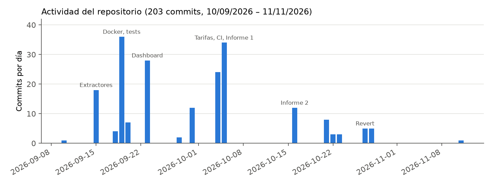

*Figura 1. Actividad del repositorio: commits por día.* Fuente: elaboración propia a partir del historial de Git.

*Tabla 2. Fases del desarrollo.*

| Fase | Fechas | Contenido principal | Commits representativos |
|---|---|---|---|
| 1. Andamiaje y exploración | 10–19/09 | Estructura, extractores de MAGyP y bolsas de cereales, datos crudos, *notebook* exploratorio, Docker, primeras pruebas, diagramas y registro de decisiones | `bd58567`, `668608a`, `97316ca`, `dcf7615` |
| 2. Transformación y tablero inicial | 20–23/09 | Transformadores, servicio programado, scripts de operación, primer tablero, polígonos GADM | `b292d5b`, `d872385`, `1201230` |
| 3. Energía, dinero y tarifas | 30/09 | Primer extractor de tarifas y transformación energética y financiera | `1d271fb`, `5a15866` |
| 4. Validación contra fuentes reales | 4–5/10 | Corrección de errores silenciosos, 28 distribuidoras con historial, parser por puntaje, reintentos, integración continua, Informe de avance 1 | `01dc552`, `12ac70e`, `9b4cb7f`, `5e45227` |
| 5. Refinamiento del modelo | 5–16/10 | Avisos, nuevas distribuidoras, ficha técnica del PP30, supuestos ajustables, Informe de avance 2 | `98ac168`, `63e96ad`, `e8f87a2` |
| 6. Automatización y despliegue | 16–28/10 | Fusión automática, reestructuración en *monorepo*, despliegue continuo y su reversión | `b2f94e2`, `874fefa`, `63cbb88` |
| 7. Documentación | 27–28/10 | Inventario de unidades, informe de tarifas faltantes, fe de erratas del Informe 2 | `84b1ffe`, `e340750` |
| 8. Ajuste operativo | 11/11 | Deduplicación de alertas y ejecución semanal | `aae81eb` |

Fuente: elaboración propia.

La fase 4 se dedicó por completo a **confrontar los resultados con las fuentes originales**. Reveló errores que ninguna prueba unitaria habría detectado por sí sola (Sección 7.5) y justificó incorporar el protocolo de la Sección 2.3. Los informes de avance de esas etapas (Ferro, 2026a, 2026b) son documentos internos del proyecto.

### 2.5 Gestión de la configuración

El código se versionó con Git y se alojó en GitHub (Ferro, 2026c). Hasta fines de septiembre los cambios se integraron directamente en la rama principal. A partir de octubre, los cambios llegaron a `main` mediante ramas temáticas y solicitudes de incorporación (*pull requests*, PR) verificadas por la integración continua. Desde el 16 de octubre, un PR se fusiona automáticamente si las pruebas pasan, sin una revisión humana obligatoria; la protección de la rama `main` no está documentada en el material entregado. La Figura 2 registra 30 *commits* de fusión: 25 corresponden a PR fusionados y 5 a sincronizaciones de `main` hacia ramas de trabajo. Los mensajes siguen mayoritariamente la convención Conventional Commits (Conventional Commits, s.f.): 155 de los 175 *commits* que no son fusiones en el Anexo E usan uno de sus prefijos. Predominan las nuevas funcionalidades (`feat`, 42 % de los commits que no son fusiones), seguidas por refactorizaciones, mantenimiento, correcciones y documentación.

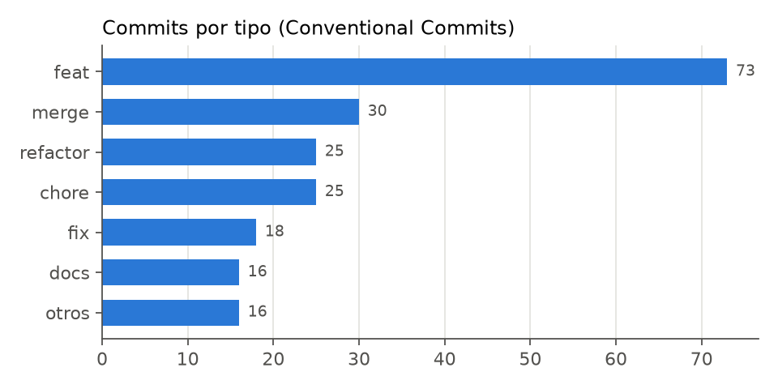

*Figura 2. Distribución de commits por tipo.* Fuente: elaboración propia a partir del historial de Git.

Cada decisión que afecta los resultados se documentó con un identificador `POL-…` en `docs/02_metodologia/decisiones.md`, con su contexto, regla, justificación y consecuencias (Nygard, 2011). La relación es de una sola vía: cada entrada de `decisiones.md` indica el módulo que implementa la regla, pero el código no cita los identificadores (solo un texto de ayuda del tablero menciona `POL-TARIFF-002`). Las diez decisiones se resumen en el Anexo A, que refleja el estado de esta tesis: donde el análisis posterior las corrigió (por ejemplo, el respaldo de *f* = 0,5 en `POL-RECOVERY-001`), el Anexo A lo indica, mientras que `decisiones.md` y el `README.md` del repositorio todavía conservan la redacción y las cifras anteriores (77 TWh, multiplicador 0,917); sincronizarlos es una corrección pendiente (Sección 12.3).

### 2.6 Herramientas utilizadas

*Tabla 3. Herramientas utilizadas.*

| Ámbito | Herramienta | Uso en el trabajo |
|---|---|---|
| Lenguaje | Python 3.11 (imagen Docker; ≥ 3.11 en desarrollo) | Todo el sistema |
| Datos | pandas, NumPy, PyArrow, PyYAML | Transformación, Parquet y configuración |
| Consulta | DuckDB | Lectura de Parquet desde el tablero |
| Extracción | httpx, Beautiful Soup | Descarga y análisis de páginas |
| Documentos | pypdf, openpyxl, xlrd | Lectura de PDF, XLSX y XLS |
| Visualización | Streamlit, Plotly, matplotlib, seaborn | Tablero, mapas y gráficos del *notebook* |
| Exploración | Jupyter | Análisis y verificación de cálculos |
| Calidad | pytest, pytest-cov, ruff | Pruebas (en CI), cobertura (medición manual) y análisis estático (en CI, limitado a errores); mypy está configurado pero no se ejecuta |
| Contenedores | Docker, Docker Compose | Empaquetado y orquestación |
| Planificación | Ofelia | Ejecución semanal del ETL |
| Integración continua | GitHub Actions | Pruebas, construcción de imagen y fusión automática |
| Servidor | VPS Debian, Caddy, ufw, Tailscale, OpenSSH | Operación (Capítulo 8) |
| Asistencia | Claude Code (Anthropic, 2026) | Asistente de programación supervisado |

Fuente: `pyproject.toml` y elaboración propia. Las dependencias declaran versiones mínimas sin archivo de bloqueo, lo que se discute en la Sección 12.3.

### 2.7 Desarrollo asistido por inteligencia artificial

A partir del 4 de octubre de 2026, parte del desarrollo se realizó con un agente de programación basado en un modelo de lenguaje (Claude Code; Anthropic, 2026). La modalidad fue supervisada: el autor definió los objetivos de cada incremento, decidió los supuestos metodológicos y validó los resultados contra las fuentes reales. La supervisión, sin embargo, no quedó documentada de manera sistemática (qué se pidió, qué se revisó y qué se rechazó en cada caso), y desde mediados de octubre las integraciones se fusionaron automáticamente al pasar las pruebas. La Tabla 4 cuantifica la participación según el historial de versiones.

*Tabla 4. Autoría del código según el historial de versiones.*

| Componente | Líneas atribuidas al autor | Líneas atribuidas al agente | Proporción del agente |
|---|---|---|---|
| `etl/` | 3.338 | 4.242 | 56 % |
| `dashboard/` | 276 | 1.416 | 84 % |
| `tests/` | 405 | 1.786 | 82 % |
| **Total** | **4.019** | **7.444** | **65 %** |

Fuente: `git blame` sobre los archivos Python versionados (11/11/2026). La métrica atribuye cada línea a su última modificación, no a su autoría intelectual. Los *commits* del autor con coautoría declarada del agente (11 de 203) se cuentan como del autor, por lo que la proporción del agente está subestimada. La Tabla 4 corresponde al corte del 11/11/2026 y la Tabla 6, al árbol de trabajo final. Las diferencias se deben a cambios posteriores al corte: se retiró el extractor descartado (−147 líneas en `etl/`), se agregó la prueba del ejemplo trazable (+40 en `tests/`) y se agregó el script de sensibilidad (145 líneas en `scripts/`, que no figura en la Tabla 4). De los 203 *commits*, 52 tienen al agente como autor.

La proporción es alta y tiene dos consecuencias metodológicas. La primera es que buena parte de las pruebas fue escrita por la misma herramienta que escribió el código, de modo que podrían compartir sus supuestos erróneos. Por eso las pruebas sobre documentos reales (Sección 2.3) se basan en valores verificados manualmente contra la fuente, y no en la salida del propio código. La segunda es que la responsabilidad sobre el diseño, las decisiones y los resultados es del autor, quien debe poder explicar cada componente. La documentación técnica del repositorio (Ferro, 2026c) cumple esa función de respaldo.

### 2.8 Amenazas a la validez

- **Validez interna.** Los coeficientes agronómicos son valores únicos por cultivo tomados de la bibliografía, algunos de ellos de otros países (Tabla 9). El parser de tarifas es heurístico y puede elegir una categoría equivocada; su verificación cubre 20 de las 25 distribuidoras extraídas mediante pruebas, pero no hubo un muestreo aleatorio con tasa de error. La regla de reconciliación por mayor producción introduce un sesgo positivo, cuantificado en la Sección 6.3.
- **Pruebas y código del mismo origen.** Con fusión automática y un 82 % de las pruebas escritas por el asistente, un error compartido por el código y su prueba podría integrarse sin ser detectado.
- **Validez de la operación.** Las corridas registradas se ejecutaron en un entorno local con Docker; la operación en el servidor de producción no puede verificarse con el material entregado (Capítulo 8).
- **Validez externa.** Los resultados corresponden a un período de cinco campañas y a una tecnología concreta; no se transfieren directamente a otros equipos ni a escenarios de implementación.
- **Validez de constructo.** El potencial técnico y el beneficio bruto no miden factibilidad ni rentabilidad. Se los presenta siempre con ese calificativo.
- **Validez de conclusión.** No existe una estimación nacional independiente con la cual comparar. El contraste se limita al orden de magnitud (Sección 11.2).

### 2.9 Conclusiones del capítulo

El trabajo se condujo como un desarrollo iterativo e incremental, guiado por tres preguntas de investigación y verificado con un protocolo de cinco mecanismos de alcance explícito. Dos prácticas lo vuelven auditable: el registro de cada supuesto con un identificador y el módulo que lo implementa y la integración de cada cambio mediante pruebas automáticas. Las amenazas a la validez se reconocen de entrada; la más importante es la ausencia de una referencia externa independiente.

---

## Capítulo 3. Arquitectura del sistema y decisiones tecnológicas

### 3.1 Requerimientos

**Funcionales.**
- RF1: obtener la producción agrícola por departamento, cultivo y campaña.
- RF2: obtener las tarifas de compra e inyección de cada distribuidora.
- RF3: calcular biomasa, energía, equipos equivalentes y beneficio.
- RF4: expresar los resultados como promedio anual de un período de referencia.
- RF5: mostrar los resultados en mapas, rankings y tablas con filtros.
- RF6: permitir modificar los supuestos más inciertos sin recalcular el ETL.
- RF7: exponer los datos descartados y las alertas para su auditoría.

**No funcionales.**
- RNF1: actualización automática y periódica.
- RNF2: tolerancia a la caída de cualquier fuente individual.
- RNF3: trazabilidad de cada valor hasta su documento de origen.
- RNF4: reproducibilidad del entorno de ejecución.
- RNF5: bajo costo y baja complejidad de operación, con un único desarrollador y un único servidor para todo el sistema (que puede compartirse con otros proyectos).
- RNF6: acceso administrativo seguro.
- RNF7: mantenibilidad, con código probado y documentado.

### 3.2 Vista general

La Figura 3 presenta la arquitectura. El sistema es una **tubería de datos por lotes** con tres componentes desacoplados que se comunican exclusivamente mediante archivos:

1. **Fuentes públicas**: el portal de estimaciones del MAGyP, la planilla de la BCCBA, los sitios de las distribuidoras y de sus entes reguladores, y la base de límites administrativos GADM 4.1.
2. **ETL**: un programa Python con ocho etapas lógicas (el código las implementa en diez pasos numerados) dentro de un contenedor Docker, disparado por un planificador.
3. **Almacenamiento y presentación**: los resultados se escriben en la carpeta `data/`, organizada en capas (Sección 3.4), y un tablero los lee mediante DuckDB.

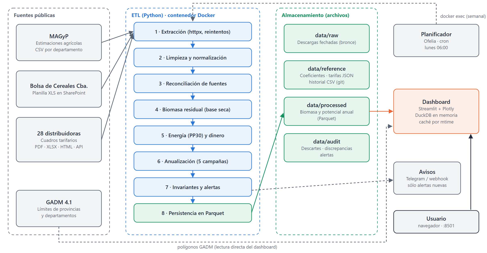

*Figura 3. Arquitectura general de OPTIMIA-HV.* Fuente: elaboración propia.

### 3.3 Decisiones de arquitectura

**Comunicación únicamente por archivos.** El ETL escribe y el tablero lee; ninguno invoca al otro. El tablero detecta datos nuevos por la fecha de modificación del archivo, sin reiniciarse. Un fallo del ETL antes de la publicación no afecta al tablero, que sigue mostrando la última versión válida (RNF2). La escritura final, en cambio, no es atómica: los archivos se sobrescriben en secuencia, por lo que una interrupción durante el paso de publicación podría dejar archivos inconsistentes entre sí; escribir a un archivo temporal y renombrarlo queda como mejora.

**Capa cruda inmutable.** Toda descarga de las fuentes agrícolas se guarda con un prefijo de fecha y hora (`AAAAMMDDhhmmss_`) y nunca se sobrescribe; los documentos tarifarios se guardan con los primeros 16 caracteres de su SHA-256. La carpeta conserva además archivos sin prefijo de una versión anterior del sistema. Así se puede reprocesar sin volver a descargar (opción `--skip-extract`), auditar resultados pasados y usar la última descarga válida si una fuente está caída (RNF2, RNF3).

**Una única imagen para todos los servicios.** El ETL, el trabajador programado y el tablero comparten la misma imagen Docker, lo que garantiza que ejecutan el mismo código y las mismas dependencias (RNF4).

### 3.4 Justificación de las decisiones tecnológicas

Cada tecnología se eligió frente a alternativas concretas con criterios derivados de los requerimientos no funcionales: complejidad de operación (RNF5), reproducibilidad (RNF4), tolerancia a fallos (RNF2), trazabilidad (RNF3) y mantenibilidad (RNF7). La Tabla 5 resume la comparación. A continuación se desarrollan las decisiones menos evidentes.

*Tabla 5. Alternativas evaluadas para cada decisión tecnológica.*

| Decisión | Elegida | Alternativas evaluadas | Criterio determinante |
|---|---|---|---|
| Lenguaje | Python | R; Java o Scala | Un solo lenguaje con ecosistema de datos (pandas, PyArrow), extracción (httpx, Beautiful Soup, pypdf) y visualización |
| Almacenamiento | Parquet + DuckDB embebido | PostgreSQL; SQLite; CSV | Volumen moderado (≈ 110.000 registros), consultas de solo lectura, sin servidor que administrar |
| Organización de los datos | Capas `raw`, `reference`, `processed`, `audit` | Carpeta única; base de datos con un esquema por capa | Reprocesamiento, versionado selectivo y separación entre resultado y auditoría |
| Lectura de cuadros PDF | Texto por líneas (pypdf) + parser por puntaje | Tabula; Camelot; pdfplumber | Un mismo método para PDF y planillas; los cuadros mezclan tablas, texto libre y columnas paralelas |
| Planificación | *cron* mediante Ofelia | Apache Airflow; Dagster; Prefect; *cron* del sistema; temporizadores de systemd | Un único flujo lineal y semanal no justifica un orquestador con servidor y base de metadatos |
| Empaquetado | Docker Compose | Entorno virtual en el servidor; Kubernetes | Reproducibilidad con mínima complejidad en un solo nodo |
| Proxy inverso | Caddy | Nginx con Certbot; Traefik | HTTPS automático por defecto y configuración mínima |
| Tablero | Streamlit + Plotly | Dash; Grafana; Apache Superset; aplicación web propia | Mismo lenguaje que el ETL y recálculo de supuestos en Python |
| Integración continua | GitHub Actions | Jenkins; GitLab CI | El repositorio ya está en GitHub; no requiere servidor propio |
| Infraestructura | VPS propio | Plataforma administrada (PaaS); nube pública | Costo fijo bajo y control del entorno, compartido con otros proyectos |
| Acceso administrativo | SSH sobre Tailscale | Puerto 22 expuesto; WireGuard configurado a mano | Red privada sin administrar claves de VPN manualmente |

Fuente: elaboración propia.

**Organización de los datos en capas.** La carpeta `data/` se divide según el ciclo de vida de cada dato, inspirada en las capas de madurez de las arquitecturas *lakehouse* (Armbrust et al., 2021). No es una correspondencia uno a uno con el esquema bronce–plata–oro, porque dos de las capas no representan niveles de madurez sino funciones:

- `raw/` (equivalente a la capa bronce) conserva cada descarga tal como llegó, fechada y sin sobrescribir. Permite reprocesar, reconstruir resultados pasados y usar la última descarga válida ante caídas. No se versiona en Git por su volumen y porque puede regenerarse.
- `reference/` reúne los **insumos curados** que condicionan el cálculo: coeficientes agronómicos con su fuente, los JSON de tarifas fechados y el historial tarifario. Es la única capa de datos versionada en Git, porque un cambio en ella altera los resultados y debe quedar registrado como un *diff* (diferencia) revisable.
- `processed/` (equivalente a la capa oro) contiene los resultados que consume el tablero. Se regenera en cada corrida y no se versiona.
- `audit/` guarda lo que **no** forma parte del resultado: registros descartados, discrepancias entre fuentes y alertas. Se separa de `processed/` para que ningún consumidor mezcle datos descartados con válidos. Contiene también, por diseño del ETL, una copia de la base de registros válidos, y archivos `*_notebook.parquet` generados por el *notebook* exploratorio, que no forman parte del sistema.
- `interim/` está reservada en la configuración para resultados intermedios, pero la versión actual no la usa: las etapas intermedias se mantienen en memoria. El archivo `processed/database.sqlite`, vacío, es un residuo de la primera estructura del proyecto y no participa del sistema.

Una base de datos con un esquema por capa ofrecería las mismas garantías lógicas, pero agregaría un servidor y dificultaría el versionado de los datos de referencia. SQLite no requiere servidor y podría almacenar el volumen sin dificultad; se prefirió Parquet porque es columnar, más compacto y se lee directamente desde pandas y DuckDB, y porque los archivos fechados se versionan o descartan como unidades. Los cuadros tarifarios de cada corrida se guardan en JSON porque son documentos jerárquicos (parámetros, distribuidoras, campos con estado y documento de origen) que se leen como configuración; el historial, tabular, se guarda en CSV.

**Formato de almacenamiento: evidencia medida.** Sobre la base histórica (110.819 registros y 33 columnas), el archivo Parquet ocupa 8,3 MB, frente a 46,2 MB del mismo contenido en CSV. Su lectura completa con pandas tarda 0,02 s, frente a 0,57 s del CSV, y una agregación por provincia con DuckDB sobre el Parquet tarda 0,13 s (una sola medición, en el equipo de desarrollo, el 12/11/2026, sin control de caché de disco; es un orden de magnitud, no un banco de pruebas). Con estos tiempos, un servidor de base de datos no aportaría una mejora perceptible para el tablero.

**Lectura de cuadros tarifarios.** Las herramientas de extracción de tablas como Tabula, Camelot o pdfplumber reconstruyen tablas a partir de la geometría del PDF. Los cuadros tarifarios, en cambio, combinan tablas, párrafos y columnas paralelas, y además se publican en planillas y páginas web. Se optó por convertir todo formato a líneas de texto con celdas separadas y aplicar un único parser por puntaje (Sección 5.3). La desventaja es que el método depende de heurísticas que deben verificarse por distribuidora.

**Planificación: *cron* en lugar de un orquestador.** Airflow, Dagster y Prefect ofrecen reintentos por tarea, reprocesamiento histórico (*backfill*), interfaz web e historial de ejecuciones. Esas capacidades tienen un costo operativo: una instalación mínima de Airflow requiere un planificador, un procesador de grafos, un servidor de API con interfaz web y una base de datos de metadatos, usualmente PostgreSQL o MySQL (Apache Software Foundation, s.f.-b). El ETL de este trabajo es un único flujo lineal de ocho etapas que se ejecuta una vez por semana durante unos 31 minutos (Anexo E). Los reintentos se resuelven en el código (Sección 4.4), el reprocesamiento se obtiene de la capa cruda y el seguimiento, del registro, los avisos y el cartel de datos desactualizados (Sección 7.4). Entre las variantes de *cron* se eligió Ofelia (Ofelia, s.f.) porque la definición de la tarea vive en el repositorio y se ejecuta dentro del mismo conjunto de contenedores, con lo que viaja con el sistema a cualquier servidor con Docker. Su costo es que necesita acceso al *socket* de Docker, lo que amplía la superficie de ataque (Sección 8.5). Existe una alternativa que conserva la portabilidad sin ese costo: un planificador *cron* dentro de la propia imagen, como supercronic. Se probó en octubre de 2026 junto con el despliegue continuo y se revirtió con él (Sección 8.7), por lo que queda como la mejora preferida (Sección 12.3). La decisión de no usar un orquestador se revisaría si el sistema incorporara varios flujos con dependencias entre sí.

*Tabla 5A. Comparación de alternativas de planificación (valoración cualitativa).*

| Criterio | Airflow | *cron* del anfitrión | Ofelia (elegida) | *cron* dentro de la imagen |
|---|---|---|---|---|
| Servicios adicionales | Cuatro (incluida una base de datos) | Ninguno | Dos (planificador y contenedor trabajador en espera) | Ninguno |
| Definición versionada con el sistema | Sí | No | Sí | Sí |
| Portabilidad entre servidores | Media | Baja | Alta | Alta |
| Privilegios requeridos | Medios | Del anfitrión | *Socket* de Docker (altos) | Ninguno adicional |
| Historial y reintentos por tarea | Sí | No | No | No |

Fuente: elaboración propia a partir de la documentación de cada herramienta.

**Proxy inverso: Caddy.** Nginx es el más difundido, pero obtener y renovar certificados exige un componente adicional (Certbot) y configurar a mano los encabezados de las conexiones WebSocket que usa Streamlit. Traefik está orientado a descubrir contenedores dinámicamente y requiere acceso al *socket* de Docker. Caddy obtiene y renueva certificados TLS de manera automática y por defecto mediante el protocolo ACME (Caddy, s.f.; Aas et al., 2019). En un servidor con pocos sitios y un único administrador, la menor configuración —y, por lo tanto, la menor probabilidad de error— fue el criterio determinante.

**Tablero: Streamlit.** Grafana y Superset están pensadas para consultar bases de datos mediante SQL. No expresan con naturalidad el recálculo de escenarios, que reutiliza la lógica de pandas del ETL, y requerirían un servidor de base de datos. Una aplicación web propia habría duplicado el modelo en un segundo lenguaje. Dash ofrece más control sobre el diseño a costa de definir manualmente las dependencias entre controles mediante funciones de retorno (*callbacks*). Streamlit permite escribir el tablero en el mismo lenguaje que el ETL y construir controles interactivos con poco código (Streamlit, s.f.). Cabe una precisión: el tablero importa algunas funciones del ETL (por ejemplo, el cálculo del cociente de inyección y la selección del período de referencia), pero replica la cadena lineal de energía y dinero en `apply_supuestos`, dentro de `dashboard/data_loader.py`, para recalcular los escenarios; no hay una prueba de equivalencia entre ambas implementaciones, lo que queda como mejora (Sección 12.3). Sus costos —reejecutar el programa ante cada interacción y personalización visual limitada— se mitigaron con una caché (Sección 9.4).

### 3.5 Organización del código

*Tabla 6. Estructura del repositorio y tamaño de cada componente.*

| Directorio | Contenido | Archivos .py | Líneas |
|---|---|---|---|
| `etl/extractors/` | Descargas de MAGyP, BCCBA y tarifas; lector de documentos; parser de cuadros; reintentos | 7 | 3.741 |
| `etl/reference/` | Taxonomía de cultivos, carga de coeficientes, registro de distribuidoras | 3 | 807 |
| `etl/transformers/` | Limpieza, texto, geografía, cultivos, reconciliación, biomasa, energía y finanzas, período de referencia, validación, controles | 10 | 1.947 |
| `etl/loaders/` | Persistencia en Parquet e historial de tarifas | 2 | 265 |
| `etl/pipelines/` | Orquestador `run_etl.py` | 1 | 518 |
| `etl/` (raíz) | Avisos (`notifications.py`) e `__init__.py` | 2 | 155 |
| `dashboard/` | Aplicación Streamlit, carga de datos, gráficos y seis vistas | 10 | 1.692 |
| `tests/` | Pruebas automatizadas (incluye `conftest.py`) | 14 | 2.231 |
| `scripts/` | Análisis de escenarios y sensibilidad | 1 | 145 |
| **Total** | | **50** | **11.501** |

Fuente: `wc -l` sobre los archivos Python del repositorio (12/11/2026). Las Tablas 2 y 4 y las cifras del historial corresponden al corte del 11/11/2026. La documentación técnica (`docs/`, sin los informes) suma además 19 archivos Markdown y 3.209 líneas.

La extracción concentra la mitad del código del ETL (3.741 de 7.433 líneas), y la lectura de tarifas por sí sola —extractor, parser, lector de documentos, registro de distribuidoras e historial— suma 2.906 líneas, el 39 % del ETL.

### 3.6 Cadena de cálculo

El núcleo del dominio es una cadena de transformaciones **lineales** aplicada a cada registro (Figura 4), detallada en el Capítulo 6. La linealidad es deliberada: vuelve transparente la contribución de cada supuesto y permite que el tablero recalcule escenarios multiplicando columnas, sin reejecutar el ETL (RF6).

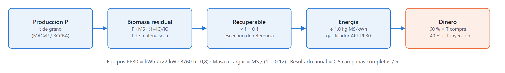

*Figura 4. Cadena de cálculo: de la producción de grano al beneficio económico.* Fuente: elaboración propia. El diagrama muestra el escenario de referencia (*f* = 0,4); el valor por defecto del sistema es 0,5 (Sección 6.5).

### 3.7 Conclusiones del capítulo

La arquitectura privilegia la simplicidad operativa y la trazabilidad: archivos en lugar de bases de datos, comunicación por archivos, capa cruda inmutable y una única imagen de contenedor. Cada tecnología se eligió frente a alternativas concretas con un criterio explícito, casi siempre la menor complejidad de operación compatible con los requerimientos. Esa elección tiene costos reconocidos: sin orquestador no hay historial gráfico de ejecuciones, y el planificador elegido requiere acceso privilegiado a Docker.

---

## Capítulo 4. Extracción de datos agrícolas

### 4.1 Fuentes evaluadas

*Tabla 7. Fuentes de datos agrícolas evaluadas.*

| Fuente | Institución | Formato | Granularidad | Decisión |
|---|---|---|---|---|
| Estimaciones Agrícolas | MAGyP | Formulario web → CSV/XLS | Departamento × cultivo × campaña, desde 1969/70 | Adoptada (principal) |
| Estadística de cultivos | BCCBA | Planilla XLS en SharePoint | Departamento × cultivo × campaña (Córdoba y zonas vecinas) | Adoptada (complementaria) |
| Panorama Agrícola Semanal | Bolsa de Cereales de Buenos Aires | XLSX tras un desafío anti-bot | 14 zonas agroecológicas | Descartada |

Fuente: elaboración propia.

La fuente de la Bolsa de Cereales de Buenos Aires se descartó por dos motivos. Informa por zonas agroecológicas que atraviesan límites provinciales y no pueden asignarse a departamentos. Además, su sitio aplica un desafío anti-bot que solo se superaba imitando la huella TLS de un navegador. El extractor, que nunca formó parte del flujo del ETL, se retiró del repositorio junto con su dependencia (`curl_cffi`) (Sección 4.6).

### 4.2 Extractor del MAGyP

El portal de Estimaciones Agrícolas (Ministerio de Agricultura, Ganadería y Pesca, s.f.) no ofrece una interfaz de programación documentada, sino un formulario web. El extractor (`scrape_estimaciones_agricolas.py`, 966 líneas) automatiza su uso en cinco pasos:

1. Descarga el formulario y obtiene con Beautiful Soup la última campaña disponible y los identificadores de los cultivos.
2. Obtiene los catálogos de provincias y departamentos de los servicios del propio portal y los guarda en caché.
3. Para cada departamento envía una solicitud con los cultivos, las variables (superficie sembrada y cosechada, producción y rendimiento) y el rango de campañas, con una pausa de 1,5 s entre solicitudes.
4. Detecta el formato de la respuesta por su firma binaria (`PK` para XLSX, `D0CF11E0` para XLS) y lee el CSV con separador `;`, coma decimal y codificación Latin-1.
5. Valida que la respuesta tenga las columnas esperadas. El portal puede responder con código HTTP 200 una página de error que, leída como CSV, produciría una tabla de una columna sin generar ningún error.

Si falla más del **5 %** de los departamentos, la extracción se aborta en lugar de guardar un conjunto parcial. El umbral es una decisión de diseño, no un valor calibrado: tolera fallos aislados y rechaza caídas sistemáticas.

### 4.3 Extractor de la Bolsa de Cereales de Córdoba

La planilla se descarga desde un enlace público de SharePoint. El extractor (`scrape_bolsa_cereales_cba.py`, 373 líneas) valida la firma del archivo, porque SharePoint devuelve una página de inicio de sesión con código 200 cuando un enlace deja de ser público. Luego lee las hojas de superficie, rendimiento y producción, y **busca dinámicamente la fila de encabezados**: la celda «PROVINCIA» dentro de las primeras 40 filas. Esta decisión surgió de un fallo real: en 2026 la planilla pasó a tener diez filas de título y el lector con posiciones fijas dejó de funcionar.

### 4.4 Tolerancia a fallos

Las fuentes públicas limitan la tasa de solicitudes, se caen o cambian sin aviso. El módulo común `http_retry.py` realiza hasta seis intentos con espera exponencial de 2, 4, 8… segundos entre ellos, con un tope de 60 s, y respeta el encabezado `Retry-After` cuando indica una cantidad de segundos (no interpreta la forma de fecha HTTP). La espera no incluye la variación aleatoria (*jitter*) que recomienda Brooker (2015) para evitar reintentos sincronizados; con un único cliente por fuente el efecto es menor, pero queda como mejora. Se reintentan los códigos 429, 500, 502, 503 y 504 y los errores de red transitorios (Listado 1).

*Listado 1. Reintentos con espera exponencial (`etl/extractors/http_retry.py`, fragmento).*

```python
delay = initial_delay
for attempt in range(1, max_retries + 1):
    last = attempt == max_retries
    try:
        response = client.request(method, url, **kwargs)
    except RETRYABLE_ERRORS:
        if last:
            raise
        time.sleep(delay)
        delay = min(delay * 2, MAX_RETRY_DELAY)
        continue
    if response.status_code not in retry_status or last:
        response.raise_for_status()
        return response
    time.sleep(_retry_after(response, delay))
    delay = min(delay * 2, MAX_RETRY_DELAY)
```

Si una fuente agota los reintentos, el orquestador espera 60 s y realiza una **segunda pasada** solo sobre las fuentes caídas. Si vuelve a fallar, usa la **última descarga válida** de la capa cruda, lo registra y continúa.

### 4.5 Almacenamiento de los datos crudos

Cada descarga se guarda como `data/raw/AAAAMMDDhhmmss_<fuente>.<ext>`. El módulo `io_utils.py` construye estos nombres y localiza la descarga más reciente de cada fuente. Como ningún archivo se sobrescribe, cada ejecución puede auditarse a posteriori.

### 4.6 Aspectos legales y éticos de la extracción

La extracción automatizada de datos publicados plantea obligaciones de uso responsable. El sistema aplica las siguientes medidas: pausas mínimas entre solicitudes (1,5 s en el MAGyP y 1 s por servidor en tarifas), reintentos acotados, abandono de un servidor que falla de forma reiterada (Sección 5.2) y ejecución semanal en lugar de diaria (Sección 8.3). Los datos descargados son estadísticas oficiales y cuadros tarifarios que las distribuidoras están obligadas a publicar.

El trabajo también presenta límites en este aspecto, que se declaran. No se relevaron de manera sistemática los archivos `robots.txt` ni los términos de uso de cada sitio, ni las licencias de reutilización de los datos. El encabezado *User-Agent* de las descargas tarifarias es el de un navegador Chrome con el sufijo `OPTIMIA-HV-ETL/1.0`: identifica al sistema, pero no es un identificador exclusivamente propio. El extractor descartado de la Bolsa de Cereales de Buenos Aires eludía un desafío anti-bot imitando la huella TLS de un navegador. Esa práctica contradice la intención del sitio de restringir el acceso automatizado, y por eso el extractor y su dependencia (`curl_cffi`) se retiraron del repositorio. Relevar formalmente los términos de uso y las licencias queda como trabajo futuro (Sección 12.3).

### 4.7 Conclusiones del capítulo

La extracción agrícola convirtió dos fuentes pensadas para consulta humana en flujos de datos automatizados. Las lecciones son tres: validar siempre el formato de la respuesta, porque un código 200 no garantiza datos válidos; no depender de posiciones fijas en documentos que cambian, y tratar cada fuente como potencialmente caída. Los umbrales explícitos convierten esas lecciones en comportamientos verificables. Queda pendiente formalizar los aspectos legales del uso de cada fuente.

---

## Capítulo 5. Extracción automática de cuadros tarifarios

### 5.1 El problema

Valorizar la energía exige conocer, para cada lugar del país, el precio al que un usuario compra la electricidad y el precio al que se le reconoce la energía inyectada. Ese dato está disperso en 28 distribuidoras, cada una con su sitio, su formato y su frecuencia de actualización. Algunas publican planillas; otras, PDF con varias tablas lado a lado; otras, páginas construidas con *frameworks* (marcos de desarrollo) de JavaScript que no contienen enlaces visibles; y algunas, solo imágenes escaneadas. La lectura de tarifas —extractor, parser, lector de documentos, registro de distribuidoras e historial— suma 2.906 líneas, el 39 % del código del ETL.

### 5.2 Diseño general

La Figura 5 resume el flujo. El diseño separa la **configuración** (qué distribuidoras existen, dónde publican y qué fila buscar) del **código** (cómo descargar, leer e interpretar un documento). Así, un cambio en un portal se resuelve en general editando el registro y no la lógica.

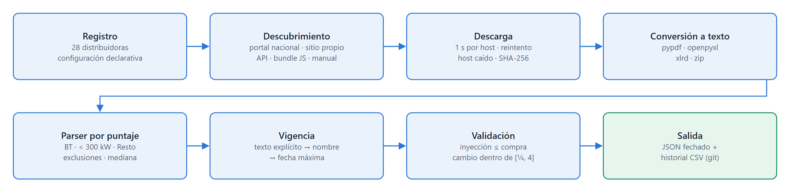

*Figura 5. Flujo del extractor de cuadros tarifarios.* Fuente: elaboración propia.

**Registro declarativo.** `etl/reference/distribuidoras.py` describe las 28 distribuidoras: su página en el portal nacional, sus fuentes propias, plantillas de URL por mes y, cuando hace falta, la fila exacta del cuadro que corresponde a la categoría buscada. También define la asignación geográfica. Cada provincia se asigna a su distribuidora; Buenos Aires se representa con el promedio simple de EDEN, EDEA y EDES, y hay excepciones por departamento: el Gran La Plata corresponde a EDELAP y el este de Mendoza a EDESTE.

**Descubrimiento de documentos.** Para cada distribuidora se combinan tres tipos de fuente: el portal de la Secretaría de Energía, el sitio de la distribuidora o de su ente regulador, y una carpeta de carga manual. Para las cuatro distribuidoras bonaerenses, el portal nacional publica solo un archivo con los componentes de la tarifa y no el cuadro final, por lo que se usa el índice del ente regulador provincial (OCEBA). Algunos casos exigieron técnicas específicas:

- **EPE (Santa Fe):** el sitio no publica enlaces. Los archivos se obtienen de los identificadores serializados en la página y de la interfaz de descarga del propio sitio, que exige una clave pública incluida en el código del propio sitio; el extractor la toma como valor por defecto, reemplazable por la variable de entorno `EPE_API_KEY`.
- **EPEC (Córdoba):** la página es una aplicación Angular; las rutas de los documentos se extraen del paquete JavaScript principal (*bundle*).
- **EJESA (Jujuy):** los cuadros están en tarjetas sin nombre de archivo ni fecha, que se ordenan por el número de resolución del título.
- **APE (La Pampa):** se recorre el índice anual de resoluciones provinciales y se excluyen las resoluciones de tarifa mayorista a cooperativas.

**Descarga prudente.** Se respeta un intervalo mínimo de un segundo por servidor. Ante los códigos 429 y 503, y ante el 403, el extractor reintenta una sola vez, tras 5 s. El reintento ante 403 responde a un comportamiento observado: algunos portales devuelven «acceso denegado» cuando reciben varias descargas seguidas y vuelven a responder poco después, por lo que un 403 aislado no indica necesariamente un bloqueo. Para no insistir frente a un rechazo real, un servidor que devuelve 403 o falla la conexión dos veces seguidas se marca como bloqueado y no se vuelve a consultar en esa corrida; un 404 no cuenta, porque solo indica un archivo inexistente. Este comportamiento está cubierto por pruebas (`test_dead_host_guard_403_sostenido_y_404_no`). Las solicitudes llevan un encabezado de navegador con el sufijo `OPTIMIA-HV-ETL/1.0`; se usa el encabezado de navegador porque algunos portales rechazan clientes sin él, y el sufijo identifica al sistema (Sección 4.6). Cada documento se guarda con el nombre de su resumen SHA-256, lo que evita duplicados y deja constancia inequívoca de qué documento originó cada valor.

**Conversión a texto.** Un módulo común detecta el formato real por firma binaria (PDF, XLSX, XLS o ZIP) y convierte el documento en líneas de texto con celdas separadas. Así, el parser trata igual una planilla que un PDF. Para los cuadros apaisados con tablas lado a lado se usa la extracción de PDF que respeta la posición del texto.

### 5.3 Parser por puntaje

Escribir un lector a medida para cada formato tendría un costo de mantenimiento alto. En su lugar se implementó un **parser heurístico por puntaje** (`tariff_parser.py`) que busca en cualquier cuadro la tarifa representativa definida en `POL-TARIFF-001`: demandas medianas o grandes, **baja tensión**, menos de 300 kW, banda horaria «resto», sin impuestos y cuadro pleno. El equipo de 22 kW se conecta en baja tensión. Además, cada equipo genera unos 154 MWh por año, una potencia media de unos 17,6 kW. La elección de la categoría de demandas medianas o grandes se basa en esa potencia media del equipo; no en el autoconsumo, que es un parámetro de escenario sin respaldo empírico (Sección 6.7).

Cada línea candidata recibe puntos según las palabras de su contexto: +3 por «grandes demandas» o «T3», +1 por la banda «resto» y −2 por categorías de más de 300 kW, entre otras reglas. Se descartan las categorías que no corresponden: residencial, tarifa social, alumbrado público, media y alta tensión, peaje e inyección. Solo se aceptan importes en $/kWh dentro de un rango plausible de 30 a 2.000 $/kWh. Los límites están fijos en pesos corrientes, por lo que deben revisarse con la inflación: la inyección de EDESA (38 $/kWh) ya está cerca del mínimo. El valor final es la **mediana** de los importes de la línea elegida. Es una heurística: cuando la línea contiene columnas de categorías distintas, la mediana coincide con la columna buscada solo si esta ocupa la posición central de los valores, como ocurre en ENERSA (Sección 5.8). Cuando la línea tiene dos importes plausibles, la mediana es su promedio y produce un valor que no figura en el cuadro: es el caso de SECHEEP, cuyo valor de 117,50 $/kWh es el promedio de 115,72 y 119,28. Seleccionar la columna por su encabezado sería más correcto y queda como corrección pendiente. Los puntajes y el rango no se calibraron estadísticamente: se ajustaron sobre los documentos reales de las distribuidoras con pruebas (Sección 2.3), que fijan su comportamiento. Las pruebas no registran el SHA-256 del documento del que se tomó cada fragmento, lo que impide al lector rastrearlo. El Listado 2 muestra el núcleo de la selección.

*Listado 2. Selección de candidatas en el parser de tarifas (`etl/extractors/tariff_parser.py`, fragmento).*

```python
# El equipo se conecta en baja tensión.
if _voltage_level(lines, i) in {"media", "alta"}:
    continue
score = _category_score(context)
if score == 0:
    continue
raw_values = line_kwh_values(line)
if _bt_mt_columns(lines, i) and len(raw_values) >= 2 and len(raw_values) % 2 == 0:
    raw_values = raw_values[: len(raw_values) // 2]
values = _plausible(raw_values)
if not values:
    continue
if RESTO.search(_label(lines, i)):
    score += 1
if BIG_USER.search(nearby):
    score -= 2
cands.append(Candidate(i, score, values, line.strip()))
```

Cuando la heurística es ambigua, el registro fija la fila exacta como excepción documentada. En EDERSA, por ejemplo, la tarifa de compra es la suma del cargo de energía y del cargo de transporte de la categoría T2. En APE es la suma del costo de compra de energía y del valor agregado de distribución del excedente de 4.000 kWh de la categoría T2I.

### 5.4 Determinación de la vigencia

La vigencia de un cuadro se determina por prioridad: (1) una frase explícita en el texto («vigencia a partir del…»); (2) una fecha en el nombre del archivo o de la carpeta; (3) la fecha más alta del encabezado del documento. Esta lógica debió contemplar formatos reales diversos. Entre ellos, las carpetas de OCEBA con formato `ctAAAAMMDD`, los cuadros de EJESA con columnas de meses abreviados («Sept-26») y los **números de expediente** de ocho dígitos que se confundían con fechas (Listado 3).

*Listado 3. Fechas de ocho dígitos frente a números de expediente (`etl/extractors/scrape_tarifas.py`, fragmento).*

```python
# Fechas de 8 dígitos: DDMMAAAA (EPEC) y AAAAMMDD (EPEC hasta 2024).
# Años acotados: los números de expediente de OCEBA
# ("IF-2025-20821026") también tienen 8 dígitos.
for m in re.finditer(r"(?<!\d)(\d{8})(?!\d)", name):
    token = m.group(1)
    d, mo, y = int(token[:2]), int(token[2:4]), int(token[4:])
    if 1 <= d <= 31 and YEAR_MIN <= y <= YEAR_MAX:
        candidates.append(_ym(y, mo) or "")
    y2, mo2, d2 = int(token[:4]), int(token[4:6]), int(token[6:])
    if 1 <= d2 <= 31 and YEAR_MIN <= y2 <= YEAR_MAX:
        candidates.append(_ym(y2, mo2) or "")
```

### 5.5 Validación y estados

Cada valor extraído se somete a dos reglas. La primera: la tarifa de inyección no puede superar la de compra, salvo una milésima de tolerancia por redondeo. La segunda: la variación respecto del último valor extraído debe estar entre un cuarto y cuatro veces. Esta segunda regla solo detecta errores groseros de lectura, como confundir una cantidad con un precio. Con la inflación argentina, aumentos reales de varias veces en pocos meses son posibles, por lo que la detección de saltos más finos se delega en las alertas de calidad (Sección 7.3).

Cada campo termina en uno de tres estados: `extraido` (leído en esta corrida), `fallback_previous` (se conserva el último valor válido) o `sin_dato` (nunca se pudo leer). Por decisión explícita no se usan valores cargados a mano sin respaldo documental: una distribuidora sin cuadro legible queda sin dato antes que con un número inventado. La extracción de tarifas nunca detiene el ETL; si falla, se usa el último JSON válido.

### 5.6 Tarifa de inyección faltante

Quince distribuidoras publican su tarifa de inyección en un formato legible. Para las demás, `POL-TARIFF-002` la estima como la tarifa de compra multiplicada por la **mediana del cociente inyección/compra** observado en las que la publican: 0,913 con los cuadros de noviembre de 2026. El valor queda marcado como estimado. El fundamento es normativo: la reglamentación de la Ley 27.424 remunera la energía inyectada a un precio que excluye el valor agregado de distribución, de modo que la inyección es, por construcción, menor o igual que la compra.

Los cocientes observados van de 0,12 a 1,00. El extremo inferior corresponde a EDESA, cuya fila de balance neto para generación con biomasa vale 38,01 $/kWh frente a 317,78 $/kWh de compra. En el extremo superior están ESJ y EDERSA, cuyos cuadros fijan para el usuario-generador el mismo precio que para la compra. La mediana se calcula sobre las 15 distribuidoras que publican inyección, de las cuales 5 no intervienen en los resultados. No es estable mientras crece el número de cuadros con inyección legible: en las corridas registradas valió 0,752, 0,915, 0,913, 0,766 y 0,913, según qué cuadros se habían podido leer; con el mismo multiplicador de la corrida del 2/11 (0,766), el beneficio total sería un 2 % menor. Tampoco se evaluó el escenario que la ley sugiere como referencia, el precio estacional mayorista, porque no se dispone de su valor en el sistema. Como el beneficio de un registro es proporcional a 0,6 + 0,4 × cociente, si el cociente real de una distribuidora fuera cualquiera de los observados, su beneficio real sería entre un **33 % menor y un 4 % mayor** que el estimado con la mediana. Esos registros representan el 24 % de la energía. Además, los cocientes se agrupan en dos poblaciones según la estructura tarifaria. Las categorías con cargo por potencia separado muestran cocientes de 0,9 a 1. Las categorías con un único cargo de energía muestran cocientes de 0,6 a 0,8. Usar una mediana común mezcla ambas poblaciones. Si se define la segunda población como las distribuidoras cuyo cuadro tiene un único cargo de energía (ENERSA, EJESA, SECHEEP y EDELAR, con mediana 0,734) y se aplica ese cociente a todas las distribuidoras con inyección estimada, el beneficio total baja un 1,8 %. APE (0,54) y EDESA (0,12) no encajan en ninguna de las dos poblaciones. Estimar la inyección por tipo de categoría, o adoptar el precio estacional mayorista que menciona la ley, queda como mejora (Sección 12.3). El tablero permite comparar un escenario conservador (inyección estimada nula), el central y uno alto (igual a la compra).

### 5.7 Historial tarifario

Cada documento procesado se agrega a `data/reference/tarifas_historial.csv`, un archivo de solo agregado que se deduplica por distribuidora y SHA-256. Se eligió CSV en lugar de Parquet para que el historial sea legible y sus cambios aparezcan como diferencias claras en Git. A noviembre de 2026 contiene 933 filas, con vigencias entre julio de 2024 y noviembre de 2026.

### 5.8 Estado de la extracción y auditoría de las tarifas utilizadas

En la ejecución del 11 de noviembre de 2026, **25 de las 28 distribuidoras** se extrajeron automáticamente: 11 desde el portal nacional y 14 desde fuentes propias. Las tres restantes carecen de un documento legible por máquina. SPSE (Santa Cruz) publica enlaces rotos, y DPE (Tierra del Fuego) y EDET (Tucumán) publican documentos escaneados.

Para los resultados interesan 18 distribuidoras, agrupadas en 16 claves tarifarias porque Buenos Aires usa el promedio de EDEN, EDEA y EDES: las que abastecen departamentos con producción en el período de referencia. De ellas, solo EDET carece de tarifa, lo que deja sin valorizar el 0,7 % de la energía. La Tabla 8 detalla qué se leyó y con qué vigencia. El promedio simple de las tres distribuidoras bonaerenses difiere menos de un 1 % de cada una, por lo que no ponderar por área de servicio tiene un efecto despreciable.

*Tabla 8. Auditoría de las tarifas utilizadas en los resultados ($/kWh sin impuestos).*

| Distribuidora | Provincia | Vigencia | Compra | Concepto leído | Inyección | Origen de la inyección |
|---|---|---|---|---|---|---|
| EDEN / EDEA / EDES | Buenos Aires (promedio) | 2026-09 | 135,23 / 136,44 / 137,18 | Cargo variable por energía, banda resto | 124,02 / 124,52 / 124,02 | Publicada |
| EDELAP | Buenos Aires (Gran La Plata) | 2026-09 | 148,72 | Cargo variable resto | 137,70 | Publicada |
| EPEC | Córdoba | 2026-11 | 147,60 | Tarifa 3, baja tensión, horas restantes | 145,20 | Publicada |
| EPE | Santa Fe | 2026-10 | 146,77 | 2 B1, demandas < 300 kW, resto | 134,0 | Estimada |
| EDESE | Santiago del Estero | 2026-10 | 156,66 | T3-BT, cargo variable horas restantes | 143,0 | Estimada |
| ENERSA | Entre Ríos | 2026-05 | 130,84 | Horas restantes (mediana de 57,77 / 130,84 / 131,10) | 93,55 | Publicada |
| APE¹ | La Pampa | 2026-10 | 244,57 | T2I: compra de energía 170,16 + VAD excedente 74,41 | 132,58 | Publicada |
| SECHEEP | Chaco | 2026-06 | 117,50 | Cargo de energía resto | 89,99 | Publicada |
| EDESA | Salta | 2026-10 | 317,78 | BT, medianas demandas > 50 kW, resto | 38,01 | Publicada (balance neto, biomasa) |
| EDESAL | San Luis | 2026-06 | 110,76 | Consumo de energía, horas resto | 101,1 | Estimada |
| EDET | Tucumán | — | — | Documento escaneado | — | Sin dato |
| DPEC | Corrientes | 2026-04 | 109,20 | Horas resto | 99,7 | Estimada |
| ECSAPEM | Catamarca | 2026-05 | 106,29 | Horas resto (columna de baja tensión) | 97,0 | Estimada |
| REFSA | Formosa | 2025-10 | 103,03 | Horas restantes | 94,1 | Estimada |
| EJESA | Jujuy | 2026-09 | 191,58 | Cargo resto del mes más reciente | 121,54 | Publicada |
| EMSA | Misiones | 2026-09 | 283,84 | Industrial 3.b, energía | 259,1 | Estimada |

Fuente: `data/reference/20261111062233_tarifas.json`. ¹ APE figura marcada como aproximada (`es_proxy`) porque su área es parcial: en La Pampa conviven cooperativas, y su tarifa se usa como aproximación del promedio provincial. Por la misma razón se marcan los departamentos bonaerenses valorizados con el promedio de EDEN, EDEA y EDES (964 de 2.421 registros llevan la marca); la marca no altera el cálculo y solo se conserva en la columna `tarifa_es_proxy` de los resultados. Algunos valores son medianas de varios importes de la misma línea y no figuran literalmente en el cuadro: la compra de SECHEEP (promedio de 115,72 y 119,28), la inyección de ENERSA (mediana de cuatro importes) y la compra de EPE (valor central de tres franjas horarias). Las vigencias corresponden al cuadro elegido por el extractor en esa corrida, que no siempre es el más reciente disponible: para REFSA el historial contiene un cuadro de junio de 2026 (135,28 $/kWh) extraído de la fuente propia en octubre, pero en la corrida del 11/11 la fuente propia no aportó un cuadro válido y el extractor prefirió el de octubre de 2025, leído en esa corrida del portal nacional. Ambas filas del historial llevan la fecha de su primera extracción (4/10), porque el historial no duplica documentos ya registrados. Es un defecto de la regla de selección, que prioriza un valor extraído en la corrida sobre uno anterior de vigencia más reciente; afecta al 0,1 % de la energía.

La tabla deja ver tres limitaciones:

- **Las vigencias se extienden de octubre de 2025 a noviembre de 2026.** En un contexto inflacionario, los cuadros más antiguos subestiman el precio actual. Los montos no se indexaron a un mes común.
- **Las tarifas de compra varían entre 103 y 318 $/kWh.** Parte de esa dispersión es real: el valor agregado de distribución y los cargos provinciales difieren entre jurisdicciones. Otra parte proviene de la estructura de cada categoría. APE suma un cargo de distribución por bloque, y EMSA y EDESA usan categorías con un único cargo de energía, mientras otras separan el cargo por potencia, que no se incluye.
- **Los valores no se contrastaron con una fuente tarifaria independiente.**

ENERSA ilustra el funcionamiento de la mediana: en la fila elegida se detectaron tres importes, y el menor (57,77) corresponde a otro concepto, pero la mediana selecciona el valor representativo.

Las otras distribuidoras extraídas no intervienen en los resultados porque sus provincias no registran producción en el período: EDENOR y EDESUR (CABA y conurbano), EDELAR, EDEMSA, EDESTE, EPEN, EDERSA y ESJ. La Figura 6 compara compra e inyección de las distribuidoras con resultados y distingue con rayado las inyecciones estimadas.

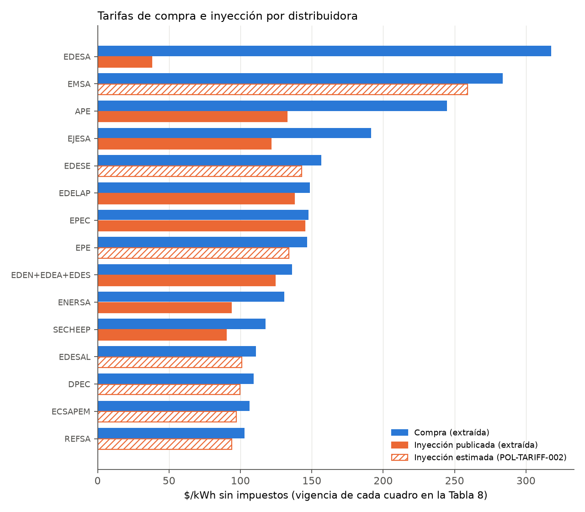

*Figura 6. Tarifas de compra e inyección por distribuidora; las barras rayadas son inyecciones estimadas según POL-TARIFF-002.* Fuente: elaboración propia con datos extraídos de los cuadros tarifarios. «EDEN+EDEA+EDES» es el promedio utilizado para la provincia de Buenos Aires.

### 5.9 Conclusiones del capítulo

La extracción tarifaria mostró que es posible obtener de manera automática y trazable un dato que requería un relevamiento manual de 28 sitios. Hoy se leen 25, y queda sin valorizar el 0,7 % de la energía, con lo que se cumple el criterio de aceptación de P1. Las claves fueron tres:

- separar configuración y código;
- unificar todos los formatos en una representación textual común;
- usar un parser por puntaje con excepciones documentadas.

La auditoría de la Tabla 8 muestra también los límites del enfoque. Hay vigencias de distinta antigüedad, categorías no del todo homogéneas entre distribuidoras y una estimación de la inyección cuyo error puede llegar al −33 % en los casos extremos. Sin reconocimiento óptico de caracteres, además, los cuadros escaneados quedan fuera del alcance automático.

---

## Capítulo 6. Transformación de los datos y modelo de cálculo

Este capítulo describe cómo los datos crudos se convierten en un conjunto consistente y cómo se calculan sobre él la biomasa, la energía y el dinero. El orquestador `etl/pipelines/run_etl.py` encadena las etapas en el orden en que se presentan.

### 6.1 Limpieza

La limpieza (`source_cleaning.py`) resolvió problemas descubiertos al contrastar los resultados con las fuentes:

- **Duplicación por producto cartesiano.** Al combinar las hojas de la planilla de Córdoba, las variantes de un mismo cultivo multiplicaban las filas, y la producción de algunos departamentos aparecía duplicada o cuadruplicada. Esos artefactos se eliminan antes de agrupar.
- **Faltantes que no son ceros.** El MAGyP marca con «SD» los valores desconocidos. Una agregación ingenua los convertía en cero, lo que equivale a afirmar que no hubo producción. `POL-MISSING-001` establece que un faltante se conserva como faltante y que los registros no se eliminan, sino que se marcan.
- **Esquema canónico.** Ambas fuentes se llevan a un esquema común: provincia, departamento, campaña, cultivo, superficie (ha), producción (t), rendimiento (t/ha) y fuente.

### 6.2 Normalización de nombres

Para reconocer como un mismo departamento «Gral. San Martín», «GENERAL SAN MARTIN» y «general san martín», se aplica una normalización en cuatro niveles:

1. Léxica: minúsculas, sin tildes ni eñes y con los espacios colapsados.
2. Eliminación de puntos.
3. Expansión de abreviaturas, palabra por palabra.
4. Alias explícitos acotados por provincia (`POL-GEO-001`), como «J. F. Ibarra» → «Juan Felipe Ibarra» en Santiago del Estero.

Acotar los alias a la provincia evita fusionar departamentos homónimos de provincias distintas. Los cultivos se normalizan con una taxonomía de 48 entradas (`crop_taxonomy.py`) que asigna a cada nombre crudo un nombre canónico e indica si es un agregado. `POL-CROP-001` establece que, si coexisten un total («soja total») y sus componentes, prevalece el total. La taxonomía detiene la ejecución ante un cultivo desconocido en lugar de descartarlo en silencio.

### 6.3 Reconciliación de fuentes

Cuando el MAGyP y la BCCBA informan el mismo departamento, cultivo y campaña, hay que elegir un registro. `POL-SOURCE-001` conserva el de **mayor producción** y, ante empate, el del MAGyP. La justificación registrada en `POL-SOURCE-001` es que las estadísticas oficiales se basan en declaraciones juradas de los productores, que tienden a subestimar la producción. Este trabajo agrega un segundo argumento, no registrado en esa decisión: una cobertura incompleta de una fuente en un departamento produce valores menores. El análisis de las discrepancias del período no respalda claramente esa justificación: de las 1.454 claves con ambas fuentes, la BCCBA informa menos que el MAGyP en 879 casos y más en 574, de modo que elegir el máximo entre dos mediciones con diferencias en ambos sentidos introduce un sesgo positivo por construcción. Las diferencias, además, son grandes: en 385 de las 1.454 claves superan el 100 %, la mediana de la diferencia relativa absoluta es del 46 % y el máximo llega a 834 veces, de modo que la regla toma sin filtro valores atípicos. El sesgo se concentra en Córdoba (+5,3 % de su producción), La Pampa (+11,8 %), Santiago del Estero (+9,4 %), Tucumán (+9,6 %), San Luis (+5,4 %) y Catamarca (+7,1 %). Preferir siempre la fuente oficial reduciría la energía total en un 2,8 % (de 64,1 a 62,3 TWh/año en el escenario de referencia). El efecto sobre el orden de los departamentos es menor: 9 de los 10 departamentos principales se mantienen y Río Cuarto sigue primero, aunque baja de 2,33 a 1,97 TWh/año, cerca de General López (1,90). Estas cifras se reproducen con `scripts/analisis_sensibilidad.py`; cambiar la regla queda como corrección pendiente (Sección 12.3). La implementación usa un ordenamiento estable para que el resultado no dependa del orden de llegada de los datos (Listado 4).

*Listado 4. Reconciliación por mayor producción (`etl/transformers/reconciliation.py`, fragmento).*

```python
sort_cols = key + [prod_col, _PRIORITY_COL]
ascending = [True] * len(key) + [False, True]
work = df.copy()
work[_PRIORITY_COL] = work[FUENTE_COL].map(SOURCE_PRIORITY).fillna(99)
df_sorted = work.sort_values(
    sort_cols, ascending=ascending, na_position="last", kind="mergesort"
)
is_dup = df_sorted.duplicated(subset=key, keep="first")
df_final = df_sorted[~is_dup].drop(columns=[_PRIORITY_COL]).reset_index(drop=True)
```

La regla introduce, por construcción, un **sesgo positivo** respecto de usar solo el MAGyP. En el período de referencia hubo 1.454 claves con información de ambas fuentes. Elegir el mayor valor agrega 20,0 Mt a un total de 708,7 Mt de producción en las cinco campañas, es decir un **2,8 %**. Los 3.298 registros descartados de toda la serie y las discrepancias entre fuentes se conservan en la capa de auditoría.

### 6.4 Biomasa residual

La biomasa residual en base seca se calcula como:

> **Biomasa (t MS) = P × MS × FR**, con **FR = (1 − IC) / IC**

donde *P* es la producción de grano (t), *MS* la fracción de materia seca del producto e *IC* el índice de cosecha. Los coeficientes provienen de `data/reference/ic_fr.csv` (Tabla 9). *FR* se recalcula siempre a partir de *IC*.

*Tabla 9. Coeficientes agronómicos de los cultivos con producción en el período.*

| Cultivo | IC | FR | MS | Fuente del IC (según `ic_fr.csv`) | Observación |
|---|---|---|---|---|---|
| Maíz | 0,47 | 1,128 | 0,855 | Bolsa de Cereales de Buenos Aires (2015) | Argentina |
| Soja | 0,45 | 1,222 | 0,865 | Bolsa de Cereales de Buenos Aires (2015) | Argentina |
| Trigo | 0,35 | 1,857 | 0,860 | Bolsa de Cereales de Buenos Aires (2015) | Argentina |
| Girasol | 0,37 | 1,703 | 0,890 | Raposo (2024) | — |
| Cebada | 0,53 | 0,887 | 0,880 | Cuda (2014) | — |
| Sorgo | 0,35 | 1,857 | 0,850 | Zamer y Chiarelli (s.f.) | Sin año en la fuente |
| Algodón | 0,30 | 2,333 | 0,920 | Estudios regionales de Xinjiang (China) | Coeficiente importado |
| Maní | 0,40 | 1,500 | 0,900 | Haro (2022) | Promedio de cultivares |
| Arroz | 0,45 | 1,222 | 0,860 | Hay (1995) | Revisión internacional |
| Avena | 0,35 | 1,857 | 0,860 | Zubiaga et al. (2023) | — |
| Poroto | 0,45 | 1,222 | 0,850 | Ortega (2001) | — |
| Centeno | 0,22 | 3,545 | 0,860 | Zubiaga et al. (2023) | — |
| Garbanzo | 0,26 | 2,846 | 0,860 | Apáez-Barrios (2017); Ramacciotti (2015) | — |
| Colza | 0,28 | 2,571 | 0,920 | Unkovich et al. (2010); Lu et al. (2016) | Revisión australiana |
| Lino | 0,40 | 1,500 | 0,890 | Estudios ADAS/AHDB (Reino Unido) | Coeficiente importado |

Fuente: `data/reference/ic_fr.csv`. La MS de los granos es la humedad base de comercialización. Los cultivos sin producción en el período (ajo y papa) también tienen coeficientes en el archivo.

La procedencia de los coeficientes es despareja. Los tres cultivos principales, que explican el 85 % de la energía, usan valores de una fuente argentina de literatura técnica (una bolsa de cereales). La documentación metodológica del propio repositorio advierte que los factores de trigo y sorgo (*FR* = 1,86) son altos frente a otras referencias, que indican entre 0,9 y 1,5 para trigos modernos, y los mantiene en revisión. Si el *FR* del trigo fuera 1,2, la energía total bajaría un 7,1 %; si fuera 0,9, un 10,4 %. Para el sorgo, con *FR* = 1,05, la baja sería del 1,1 %. No se reemplazaron porque no se dispone de una fuente local verificable que los sustituya; la variante con *FR* = 1,2 para el trigo se informa como escenario alternativo (escenario de referencia de 59,5 TWh/año en lugar de 64,1). Otros usan revisiones internacionales o estudios de otros países: algodón, lino y colza, con una participación conjunta del 1,5 % de la energía. Las fuentes se listan en las referencias, en el apartado «Fuentes de los coeficientes agronómicos», con la información bibliográfica disponible. Un registro se considera **válido** solo si su cultivo tiene coeficientes, su superficie es positiva y su residuo es un número finito. Los inválidos se marcan con indicadores, no se borran. En la corrida del 11/11/2026, sobre toda la serie histórica, la exclusión dejó fuera el 25,6 % de los registros pero solo el 12,1 % de la producción, porque los registros excluidos son mayoritariamente de cultivos menores sin coeficientes (Anexo E). La exclusión no se desagregó para el período de referencia.

### 6.5 Residuo recuperable

El sistema calcula con una fracción retirable *f* = 0,4 (`POL-RECOVERY-001`). Hasta noviembre de 2026 el valor por defecto era 0,5, que ninguna de las fuentes citadas respalda; se corrigió al cerrar esta tesis. Nunes et al. (2021) consideran sostenible retirar hasta el 40 % de la biomasa aérea del maíz, pero solo con rendimientos superiores a 11 t/ha, mayores que los promedios argentinos. Wilhelm et al. (2007) muestran que conservar el carbono del suelo restringe todavía más la oferta, y el balance oficial argentino considera que, con siembra directa, la mayor parte de los rastrojos no está disponible (FAO, 2009, p. 28). Por eso el análisis adopta *f* = **0,4** como **escenario de referencia**, que coincide con el máximo de Nunes et al. y debe leerse como **cota superior del rango citado**: esa fuente lo admite solo con rendimientos mayores que los argentinos, y su propia cifra de 3,5–4,0 t/ha equivale al 30–35 % del rastrojo; *f* = 0,3 como escenario prudente, y explora *f* = 0,1–0,2 como escenario de disponibilidad restringida por la siembra directa (Sección 10.2). El valor 0,5 se informa solo como comparación. La misma fracción se aplica a todos los cultivos, aunque la evidencia citada es de maíz. Con el valor por defecto corregido, el tablero abre en el escenario de referencia (64,1 TWh/año). Los artefactos se regeneraron con los mismos datos crudos y cuadros de la corrida del 11/11/2026 (`run_etl --skip-extract --skip-tarifas`), y el total coincide con el reescalado anterior (64,09 TWh y 8,99 billones). El control de cambio del total registró la baja del 20 % como alerta, que se explica por este cambio (Sección 7.3). Como el modelo es lineal en *f*, los demás escenarios se obtienen de la misma corrida. El tablero permite variar *f* entre 20 % y 70 %, pero los valores mayores que 40 % están fuera del rango que respalda la bibliografía citada, y el tablero no permite reproducir los escenarios de 10 % ni el consumo de 1,3 kg MS/kWh, que solo se obtienen con el script de la Sección 10.6.

### 6.6 Energía

La energía se calcula con los parámetros de la ficha técnica del PP30 (`POL-ENERGY-001`):

> **kWh = masa seca retirada (kg) / CE**, con **CE = 1,0 kg MS/kWh**
>
> **Masa a cargar (kg) = masa seca / (1 − H)**, con **H = 12 %**
>
> **Equipos PP30 = kWh / (22 kW × 8.760 h × *D*)**, con ***D* = 0,8**

La humedad solo determina cuánto material hay que cargar, pero no altera la energía, porque el consumo específico ya está en base seca. Esta distinción corrigió un error de la primera versión, que descontaba la humedad dos veces.

El consumo específico proviene del fabricante y no se contrastó con mediciones independientes sobre rastrojo. Con un poder calorífico del orden de 17 MJ/kg MS (Sección 1.3) implica un rendimiento eléctrico cercano al 21 %. Para un combustible de menor densidad y mayor contenido de cenizas que los aprobados por el fabricante, el consumo podría ser mayor. Por eso el análisis de sensibilidad incluye 1,3 kg MS/kWh, equivalente a un rendimiento del 16 %. El cálculo no descuenta la energía de densificación del rastrojo ni los consumos auxiliares del equipo. El tablero ofrece 1,0 y 1,1 kg/kWh; el valor de 1,1 corresponde, en la ficha del fabricante, a material con 10 % de humedad, de modo que como escenario en base seca es una aproximación conservadora sin fuente propia. El escenario de 1,3 kg MS/kWh de la sensibilidad se calculó fuera del tablero. La potencia de 22 kW corresponde al equipo conectado a la red; en operación aislada a 50 Hz, la ficha indica 18 kW continuos, lo que aumentaría el número de equipos un 22 % sin cambiar la energía. La disponibilidad *D* = 0,8 es un supuesto que solo afecta el número de equipos, no la energía. Supone además almacenar el rastrojo para operar todo el año, ya que la cosecha es estacional; el costo de ese almacenamiento no se incluye.

### 6.7 Valorización económica

Bajo el balance neto de la Ley 27.424, una fracción *α* de la energía se autoconsume y el resto se inyecta:

> **Ahorro = kWh × α × T_compra**
>
> **Crédito = kWh × (1 − α) × T_inyección**
>
> **Beneficio bruto = Ahorro + Crédito**

El valor *α* = **0,6** es un **parámetro de escenario sin respaldo empírico**: no se dispone de datos de demanda eléctrica por establecimiento rural. La fracción real autoconsumida depende de la demanda del establecimiento. Además, el artículo 4 de la ley limita la potencia instalable a la potencia contratada por el usuario, lo que en la práctica restringe el tamaño de los equipos y la energía inyectable. Como *T_inyección* < *T_compra*, el beneficio crece con *α*. El análisis de sensibilidad muestra que el resultado es poco sensible a *α* entre 0,4 y 0,8 (−3 % a +3 %; Tabla 17); en el caso extremo de no autoconsumir nada (*α* = 0), el beneficio bajaría un 9,6 %. Esa baja sensibilidad depende de que la inyección se pague a un precio cercano al de compra, que es justamente lo que se estima en el 24 % de la energía (Sección 5.6). El ahorro se valoriza solo con el cargo variable de energía, sin cargos fijos ni de potencia.

Conviene precisar la interpretación del beneficio. La Ley 27.424 rige para cada usuario-generador, y un departamento no es un usuario: el beneficio bruto departamental debe leerse como el **valor de la energía potencial a la tarifa vigente**, es decir, la suma de lo que valdría si fuera generada por usuarios con la categoría tarifaria leída. No es el ingreso de un sujeto económico identificable. El límite de potencia del artículo 4 no se modeló, porque requeriría una hipótesis de demanda por establecimiento que no se dispone.

Cada registro recibe su tarifa mediante un resolutor que aplica, en orden, las excepciones por departamento, la distribuidora de la provincia (o el promedio si hay varias) y, si falta la tarifa de inyección, la estimación de `POL-TARIFF-002`. Cada registro conserva el origen de su tarifa y si la inyección fue estimada. El Listado 5 muestra el cálculo.

*Listado 5. Energía del PP30 y balance neto (`etl/transformers/energy_finance.py`, fragmentos).*

```python
residuo = pd.to_numeric(out[residuo_col], errors="coerce")
out[COL_MASA_SECA_KG] = residuo * KG_PER_TON
out[COL_MASA_ALIM_KG] = out[COL_MASA_SECA_KG] / (1.0 - h / 100.0)
out[COL_KWH_TOTALES] = out[COL_MASA_SECA_KG] / ce
out[COL_HORAS] = out[COL_KWH_TOTALES] / pnom
out[COL_EQUIPOS] = out[COL_HORAS] / (HOURS_PER_YEAR * disponibilidad)
# ... valorización (compute_finance_metrics)
out[COL_KWH_AUTO] = kwh * alpha
out[COL_KWH_INY] = kwh * (1.0 - alpha)
out[COL_AHORRO] = out[COL_KWH_AUTO] * out[COL_TARIFA_COMPRA]
out[COL_CREDITO] = out[COL_KWH_INY] * out[COL_TARIFA_INY]
out[COL_BENEFICIO] = out[COL_AHORRO] + out[COL_CREDITO]
```

### 6.8 Anualización y ejemplo trazable

La producción varía mucho entre campañas; la sequía de 2022/23 es el caso extremo reciente. `POL-PERIOD-001` expresa los resultados como **promedio de las cinco últimas campañas completas**. Una campaña se considera incompleta si tiene menos del 80 % de los registros de la mediana de las anteriores. El umbral, elegido como criterio de diseño, excluye la campaña en curso mientras se cargan sus datos.

El promedio se calcula como la suma del período dividida por cinco, de modo que un departamento sin registro en una campaña cuenta como cero. Esta regla parece contradecir `POL-MISSING-001`, pero se aplica a un caso distinto. En el MAGyP, la ausencia de un registro de departamento y cultivo en una campaña indica en general que no hubo siembra, mientras que un valor «SD» dentro de un registro existente indica un dato desconocido. Promediar solo las campañas con registro inflaría los departamentos con siembra ocasional. La regla afecta a 619 de los 2.421 registros anuales, pero solo al 0,5 % de la energía: promediar solo las campañas con dato elevaría el total un 0,4 %. El período incluye una campaña de sequía (2022/23) y una de producción alta (2025/26), que se compensan parcialmente. Con el escenario de referencia, el promedio de tres campañas daría 69,5 TWh/año; el de cinco, 64,1; y el de diez, 63,6. Los promedios de cinco y diez campañas se solapan y son similares, pero el resultado depende de la última campaña: 2025/26 es la de mayor producción de la serie reciente (79,0 TWh en el escenario de referencia, un 19,5 % más que 2024/25) y las estimaciones de la campaña más reciente pueden ser revisadas por la fuente. Sin ella, el promedio de las cuatro campañas anteriores sería de 60,4 TWh/año (−5,8 %).

**Ejemplo trazable.** Sea un departamento abastecido por EDEN, con 10.000 t de maíz y el escenario de referencia (*f* = 0,4) (Tabla 9A):

*Tabla 9A. Ejemplo trazable del cálculo.*

| Paso | Cálculo | Resultado |
|---|---|---|
| Biomasa | 10.000 × 0,855 × 1,128 | ≈ 9.641 t MS |
| Recuperable | × 0,4 | ≈ 3.857 t MS |
| Energía | ÷ 1,0 kg MS/kWh | ≈ 3,86 GWh/año |
| Masa a cargar | 3.857 ÷ 0,88 | ≈ 4.383 t |
| Equipos | 3.856.600 kWh ÷ 154.176 kWh por equipo y año | ≈ 25 |
| Ahorro | 3,86 GWh × 0,6 × 135,23 $/kWh | ≈ $313 millones |
| Crédito | 3,86 GWh × 0,4 × 124,02 $/kWh (inyección publicada) | ≈ $191 millones |
| **Beneficio bruto** | | **≈ $504 millones por año** |

La etapa de energía y dinero del caso está codificada como prueba automatizada en `tests/test_ejemplo_trazable.py`, que ejecuta las funciones de `energy_finance.py` y verifica energía, masa a cargar, equipos y beneficio. La biomasa y las tarifas se introducen como valores fijos en la prueba, por lo que no ejercita la lectura de `ic_fr.csv` ni el resolutor de tarifas.

### 6.9 Persistencia

Los resultados se escriben en Parquet con compresión Snappy:

- `biomasa_validos.parquet`: 110.819 registros históricos y 33 columnas.
- `potencial_energetico_anual.parquet`: 2.421 registros por provincia, departamento y cultivo, con 25 columnas.

Las columnas, con sus unidades, están documentadas como **contratos de artefactos** en `docs/03_datos/contratos_de_artefactos.md`.

### 6.10 Conclusiones del capítulo

La transformación combina reglas de limpieza descubiertas empíricamente con un modelo de cálculo deliberadamente simple. Cada parámetro tiene una fuente o está declarado como supuesto de escenario. Dos principios atraviesan el capítulo: no inventar datos y no ocultar exclusiones. El capítulo también deja expuestas las debilidades del modelo:

- la procedencia despareja de algunos coeficientes;
- la falta de contraste independiente del consumo específico;
- un *α* sin respaldo empírico;
- un sesgo positivo del 2,8 % en la reconciliación.

---

## Capítulo 7. Calidad del software y de los datos

La calidad se abordó en dos planos complementarios. La **calidad del código** se verifica antes de integrar cada cambio y la **calidad de los datos**, en cada ejecución del ETL (`POL-QA-001`).

### 7.1 Pruebas automatizadas

El repositorio contiene **121 funciones de prueba** en 13 archivos; con los casos parametrizados, se ejecutan **157 casos**. La suite completa tarda unos segundos (entre 2 y 6 en las corridas registradas), sin acceso a la red, gracias a respuestas grabadas y fragmentos de documentos reales. En la versión entregada, los 157 casos pasan (Anexo E). Esa corrida, como la medición de cobertura, se hizo en el entorno local de desarrollo (Python 3.13 y pandas 3.0), fuera del rango que declara `pyproject.toml` (pandas < 3,0); la integración continua las ejecuta con Python 3.11 y pandas 2.3.3: en la corrida del 11/11/2026 (Anexo E), anterior a la prueba del ejemplo trazable, pasaron los 156 casos de entonces.

*Tabla 10. Pruebas automatizadas por módulo.*

| Archivo | Funciones de prueba | Qué verifica |
|---|---|---|
| `test_energy_tarifas.py` | 32 | Energía del PP30, asignación de tarifas, período de referencia, descubrimiento y vigencia |
| `test_tariff_parser.py` | 29 | Lectura de fragmentos de cuadros de 20 distribuidoras (algunos adaptados); pruebas de regresión |
| `test_etl_fixes.py` | 16 | Regresiones de errores corregidos |
| `test_dashboard.py` | 8 | Carga de datos, cruce con GADM, escenarios |
| `test_crop_consolidation.py` | 6 | Regla de totales y componentes |
| `test_notifications.py` | 6 | Avisos por mensaje |
| `test_data_checks.py` | 5 | Alertas de calidad y modo estricto |
| `test_geography.py` | 5 | Normalización y alias de departamentos |
| `test_biomass.py` | 4 | Fórmula de biomasa e indicadores de validez |
| `test_string_utils.py` | 4 | Normalización de texto |
| `test_reconciliation.py` | 3 | Elección por mayor producción |
| `test_validation.py` | 2 | Invariantes |
| `test_ejemplo_trazable.py` | 1 | Ejemplo trazable de la Sección 6.8 |
| **Total** | **121** (157 casos ejecutados) | |

Fuente: elaboración propia.

La **cobertura de sentencias**, medida manualmente con pytest-cov (no forma parte de la integración continua), es del **75 %**. Es alta en la lógica de dominio: parser de tarifas 98 %, reconciliación 98 %, controles de calidad 96 %, biomasa 90 % y energía y finanzas 86 %. Es baja en los componentes que dependen de servicios externos o de la interfaz. El extractor del MAGyP tiene 32 % porque su flujo completo requiere el portal real; el orquestador, 41 %; y la aplicación del tablero, 0 %, porque se verifica su carga de datos pero no su interfaz. No hay pruebas de contrato que ejecuten los extractores contra los sitios reales: un cambio de portal se detecta recién en la corrida programada, mediante los avisos de error.

### 7.2 Invariantes

Las invariantes son propiedades que deben cumplirse siempre. Si alguna se rompe, el ETL se detiene **antes de publicar**. Son, sobre todo, controles de implementación —verifican que las reglas se aplicaron como se especificaron—, no de plausibilidad de los datos: no hay, por ejemplo, un control de rendimientos (t/ha) por cultivo ni un filtro de valores atípicos entre fuentes. Se verifican, entre otras:

- que no haya claves duplicadas tras reconciliar;
- que el conjunto de claves de salida sea igual al de entrada;
- que el registro elegido tenga la producción máxima de su clave;
- que superficies y producciones no sean negativas;
- que la biomasa válida no contenga infinitos.

Se implementan con excepciones explícitas, porque la sentencia `assert` de Python se desactiva al ejecutar con optimizaciones.

### 7.3 Alertas de calidad

A diferencia de una invariante, una **alerta** señala algo sospechoso pero posible. Cada ejecución compara sus resultados con los de la anterior (Tabla 11).

*Tabla 11. Controles de calidad que generan alertas.*

| Control | Se dispara cuando | Umbral |
|---|---|---|
| `salto_tarifa` | La tarifa de compra cambia respecto del cuadro anterior | > 50 % |
| `cambio_total` | La energía o el beneficio total cambian respecto de la corrida anterior | > 20 % |
| `cambio_provincia` | La energía de una provincia relevante (≥ 1 % del total) cambia | > 50 % |

Fuente: `etl/transformers/data_checks.py`.

Los umbrales son criterios de diseño y no surgen de una calibración estadística. Se eligieron para que las variaciones esperables entre corridas no los disparen: la energía total solo cambia cuando entra una campaña nueva, y las tarifas suben gradualmente. Un cambio de magnitud mayor, en cambio, suele indicar un error de lectura.

Las alertas se registran, se guardan en `data/audit/alertas_calidad.parquet` y se muestran en el tablero. Con la opción `--estricto`, una alerta también detiene la publicación. La alerta vigente en la corrida entregada ilustra el mecanismo (Figura 7). Informa un salto de la tarifa de ENERSA de 67,28 a 130,84 $/kWh entre los cuadros de diciembre de 2025 y mayo de 2026. Al revisarla se comprobó que el valor anterior, de 67,28, provenía de una fila de media tensión leída por error en los cuadros de noviembre y diciembre de 2025. El valor actual, de 130,84, corresponde a la baja tensión. La alerta se mantiene abierta porque el historial conserva aquel valor erróneo como registro, sin marcarlo como tal (lo que impide usar el modo estricto mientras no se corrija), pero no afecta el cálculo, que usa el cuadro más reciente. Una alerta permanente, sin embargo, impediría publicar con `--estricto` y produce fatiga; las filas erróneas del historial deberían anotarse o corregirse (Sección 12.3). La regeneración de los artefactos con *f* = 0,4 (Sección 6.5) agregó una segunda alerta, de cambio del total (−20 %, igual al umbral): es la respuesta esperada del control a un cambio deliberado de supuesto, no a un problema de las fuentes.

### 7.4 Avisos y detección de datos desactualizados

El ETL envía avisos (`etl/notifications.py`) por Telegram o por cualquier *webhook* (punto de recepción de mensajes) compatible con Slack, Discord, Teams o Google Chat. Lo hace cuando una ejecución falla o produce alertas y, opcionalmente, cuando termina sin problemas. El diseño tiene tres propiedades:

- un aviso que falla nunca hace fallar el ETL;
- las credenciales se leen de variables de entorno y nunca se escriben en el registro;
- solo se notifican las alertas **nuevas**, identificadas por control, entidad y valores, para no repetir cada semana el mismo aviso.

Como complemento, el tablero muestra un cartel de advertencia si los datos tienen más de 192 horas: el intervalo semanal (168 h) más un día de tolerancia.

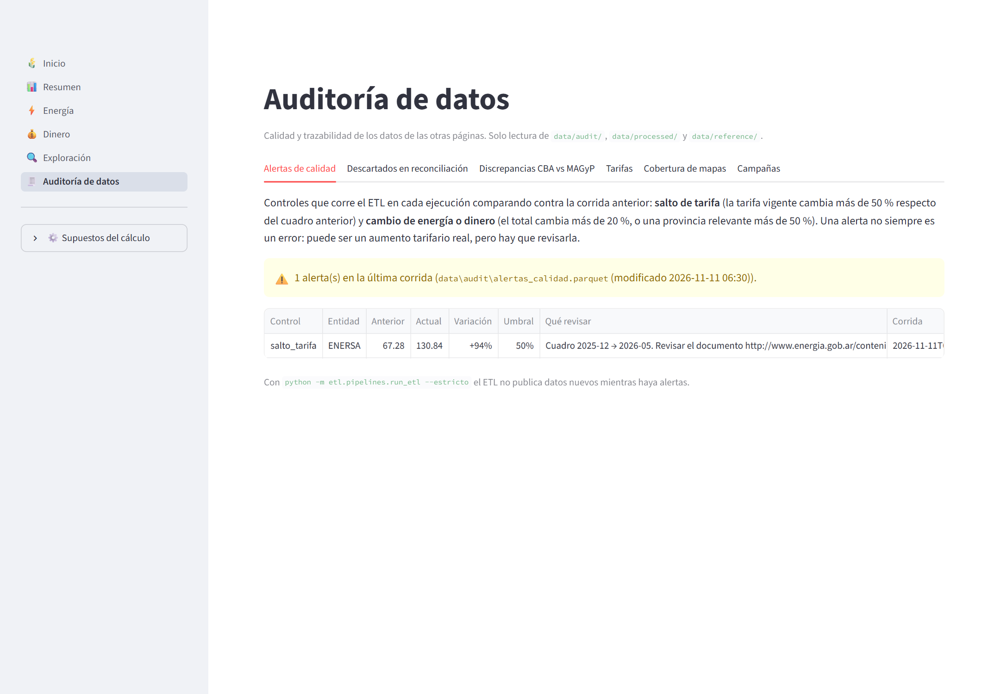

*Figura 7. Página «Auditoría de datos» del tablero, con la alerta vigente de ENERSA.* Fuente: captura del sistema (formato numérico de la interfaz: punto decimal).

### 7.5 Errores detectados y lecciones

La fase de validación contra fuentes reales detectó errores que muestran por qué la calidad de los datos requiere controles específicos (Tabla 12).

*Tabla 12. Errores relevantes detectados y su corrección.*

| Error | Causa | Impacto | Corrección | Lección |
|---|---|---|---|---|
| Producción ×2 o ×4 en Córdoba | Producto cartesiano al combinar hojas | Producción duplicada o cuadruplicada en los registros afectados | Deduplicación previa | Auditar totales contra la fuente |
| Faltantes convertidos en 0 | Agregación ingenua de «SD» | Subestimación no cuantificada | `POL-MISSING-001` | Un faltante no es un cero |
| Humedad descontada dos veces | La masa seca se volvía a corregir por humedad | No cuantificado | Base seca explícita | Declarar la base de cada magnitud |
| Consumo específico sobre material húmedo | 1,1 kg/kWh aplicado sobre material al 12 % de humedad (≈ 0,968 kg MS/kWh) en lugar de 1,0 kg MS/kWh | Energía sobrestimada un 3,2 % | Valor seco de la ficha | Usar el dato en la base del modelo |
| Tarifa de OCEBA demasiado baja | Se leía la tarifa mayorista a distribuidores municipales | 114,98 en lugar de 135,05 $/kWh en EDEN (−15 %) | Exclusión de bloques mayoristas | El contexto semántico importa |
| «800 $/kWh» en EDEMSA | Se leía una cantidad («hasta 800 kWh») como precio | Tarifa unas siete veces mayor | Rango y unidad obligatorios | Validar unidad y plausibilidad |
| Expedientes leídos como fechas | Números de 8 dígitos | Vigencias erróneas en el orden de documentos | Años acotados a 2015–2040 | Las heurísticas de fechas necesitan rangos |
| Datos viejos en el tablero | Caché indexada por ruta y no por fecha | Resultados desactualizados hasta reiniciar | Caché por fecha de modificación | Invalidar la caché por contenido |
| Alertas repetidas cada semana | Sin memoria de alertas previas | Avisos redundantes | Columna `nueva` | Notificar cambios, no estados |

Fuente: elaboración propia a partir del historial de commits.

### 7.6 Conclusiones del capítulo

La calidad se construyó en capas:

- pruebas que protegen el código, con un 75 % de cobertura y lectura verificada de documentos reales;
- invariantes que impiden publicar datos imposibles;
- alertas que señalan datos sospechosos;
- avisos que garantizan que alguien se entere.

Los errores más dañinos fueron los **silenciosos**: los que producen un número verosímil pero incorrecto. La defensa más eficaz fue contrastar con las fuentes y convertir cada hallazgo en una prueba de regresión. Quedan dos debilidades: la baja cobertura de los extractores contra los sitios reales y que buena parte de las pruebas comparte autoría con el código (Sección 2.7).

---

## Capítulo 8. Infraestructura, despliegue y operación

### 8.1 Contenerización

El sistema se empaqueta en una imagen Docker construida en **dos etapas** sobre `python:3.11-slim`:

- La primera etapa compila las dependencias a partir de `pyproject.toml` únicamente. Así, esa capa —la más pesada— se reutiliza mientras las dependencias no cambien.
- La segunda etapa instala esas dependencias, copia el código y crea un usuario sin privilegios (`appuser`), y define como comando por defecto la ejecución del ETL.

El archivo `.dockerignore` excluye los datos que se regeneran (`interim`, `processed`, `audit`), los entornos virtuales, los *notebooks* y la documentación; las carpetas `raw` y `reference` sí se copian a la imagen, lo que aumenta su tamaño y debería revisarse.

Los servicios del ETL se ejecutan también **sin privilegios**, con el usuario y grupo indicados por `ETL_UID` y `ETL_GID` (por defecto 1000, el `appuser` de la imagen). Hasta noviembre de 2026 se ejecutaban como superusuario (`user: "0:0"`) para resolver los permisos de escritura sobre carpetas montadas en Docker Desktop para Windows; al corregirlo se comprobó que el usuario 1000 puede escribir en el volumen montado. En el servidor, las carpetas `data` y `logs` deben pertenecer a ese usuario.

### 8.2 Servicios

`docker-compose.yml` declara cuatro servicios que comparten la misma imagen (Tabla 13).

*Tabla 13. Servicios de Docker Compose.*

| Servicio | Función | Usuario | Volúmenes y puertos |
|---|---|---|---|
| `etl_worker` | Contenedor permanente donde el planificador ejecuta el ETL | Sin privilegios (`ETL_UID`, por defecto 1000) | `data`, `config` (solo lectura), `logs` |
| `etl_pipeline` | Ejecución manual única (perfil `etl`) | Sin privilegios (`ETL_UID`) | Los mismos |
| `scheduler` | Planificador Ofelia (versión 0.3.22, fijada por *digest*) | — | *Socket* de Docker, `schedule.ini` |
| `dashboard` | Tablero Streamlit | Sin privilegios (`appuser`) | `data`, `dashboard` y `config` en solo lectura; publica el puerto 8501 solo en `127.0.0.1` |

Fuente: `docker-compose.yml`.

El tablero monta los datos en solo lectura: aunque se comprometiera el proceso del tablero, no podría modificar los resultados. Las credenciales de los avisos se inyectan como variables de entorno (Wiggins, 2011).

### 8.3 Planificación

Ofelia ejecuta el ETL dentro del contenedor trabajador según una expresión *cron* de seis campos, con segundos (Listado 6). La frecuencia es una decisión de diseño no calibrada con datos: varias distribuidoras mantienen cuadros de muchos meses (Tabla 8), y una corrida semanal solo acota la demora con que se detecta uno nuevo. Inicialmente la ejecución era diaria. En noviembre de 2026 pasó a ser **semanal**, los lunes a las 06:00, por dos razones. Por un lado, en el historial tarifario las distribuidoras publican cuadros nuevos con frecuencia (en el historial del sistema, varias lo hicieron cada uno o dos meses), y las estimaciones agrícolas cambian todavía menos. Por otro, cada ejecución insume entre 28 y 44 minutos (Anexo E), una carga innecesaria sobre servidores públicos si los datos son los mismos. El cambio se incorporó el 11 de noviembre de 2026, después de la última corrida programada con el esquema diario (ese día era miércoles); por lo tanto, la ejecución semanal todavía no se observó en el registro.

*Listado 6. Programación semanal del ETL (`config/schedule.ini`, fragmento con el comentario abreviado).*

```ini
[job-exec "etl-biomasa"]
# Semanal: las tarifas cambian con frecuencia mensual o menor.
schedule = 0 0 6 * * 1
container = biomasa_etl_worker
command = python -m etl.pipelines.run_etl --config config/paths.yaml
```

### 8.4 Servidor de producción

El sistema está preparado para operar en un servidor privado virtual con Debian (2 vCPU y 8 GB de RAM, según la configuración del autor; no verificable con el material entregado), con la topología de diseño de la Figura 8. La configuración del servidor no forma parte de este repositorio. Se administra en un repositorio privado de operaciones del autor, que aloja también otros proyectos, y por lo tanto no puede verificarse desde el material entregado. Se describe a continuación como diseño de la operación:

- **Cortafuegos (`ufw`):** acepta conexiones entrantes solo a los puertos 22 (SSH), 80 y 443, además del tráfico de la interfaz de la red privada Tailscale. El puerto 22 sigue abierto; la red privada permitiría cerrarlo.
- **Proxy inverso:** Caddy recibe las conexiones HTTPS, obtiene y renueva el certificado, y reenvía las solicitudes al tablero.
- **Aplicación:** el conjunto de Docker Compose de la Sección 8.2, en `/opt/optimia`, con los datos en un volumen persistente.

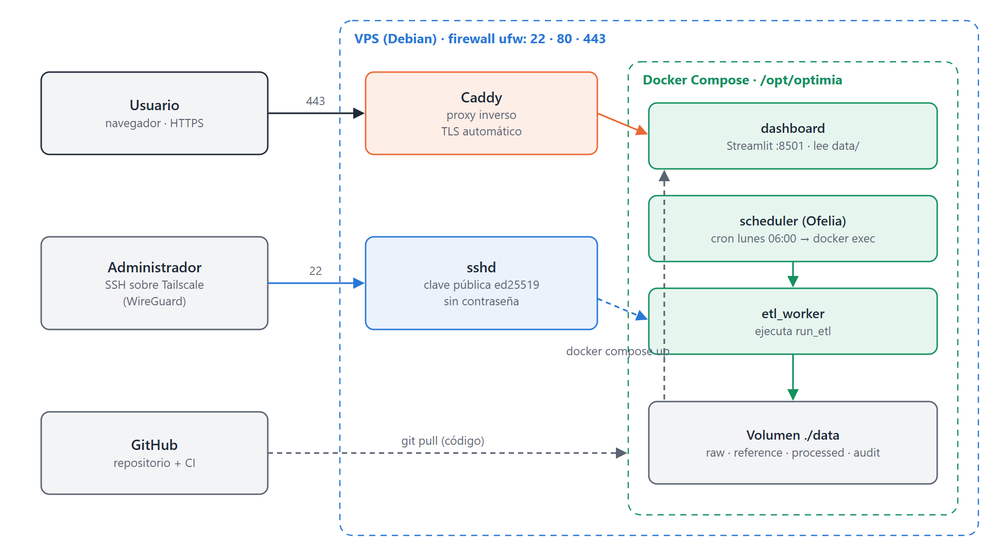

*Figura 8. Topología de despliegue en el VPS (diseño de la operación).* Fuente: elaboración propia.

Este diseño tiene una debilidad que se reconoce. Docker publica los puertos de los contenedores mediante reglas de filtrado propias que se aplican **antes** que las de `ufw`, por lo que el cortafuegos no los bloquea (Docker Inc., s.f.). Hasta noviembre de 2026, el archivo de composición publicaba el puerto 8501 en todas las interfaces, de modo que el tablero quedaba accesible directamente, sin pasar por el proxy ni por TLS. Al cerrar esta tesis se corrigió: el puerto se publica solo en la interfaz local (`127.0.0.1:8501:8501`), y el acceso externo pasa por el proxy inverso o por la red privada.

### 8.5 SSH aplicado a la operación

Los conceptos de la Sección 1.7 y del Anexo D se aplican en la administración del servidor de la siguiente manera:

1. **Autenticación por clave pública.** El administrador se conecta con un par de claves Ed25519: la clave privada permanece en su equipo y la pública está registrada en `authorized_keys`. Como no viaja ninguna contraseña, los intentos de fuerza bruta resultan ineficaces. Deshabilitar por completo la autenticación por contraseña del superusuario figura como tarea pendiente en la documentación de operaciones.
2. **Verificación del servidor.** En la primera conexión, el cliente registra la clave de *host* del servidor; en adelante, un cambio inesperado se advierte como posible ataque de intermediario.
3. **Acceso a través de una red privada.** La administración se realiza sobre Tailscale (Tailscale Inc., s.f.), basado en WireGuard, cuya interfaz está habilitada en el cortafuegos. Esto permitiría cerrar el puerto 22 a Internet sin perder el acceso; hoy no está cerrado.
4. **Claves restringidas y accesos temporales.** El servidor dispone de un usuario de despliegue cuyas claves se registran con un comando forzado (Anexo D, Listado 8): una clave así solo puede ejecutar el despliegue de un proyecto determinado. También admite certificados SSH de dos horas para sesiones de mantenimiento. Ambos mecanismos sirven a otros proyectos alojados en el servidor. Este sistema, en cambio, **se actualiza manualmente**: se ingresa por SSH, se obtiene la última versión (`git pull`) y se reconstruyen los servicios (`docker compose up -d --build`).
5. **Secretos fuera del repositorio.** Las credenciales residen en el servidor con permisos restringidos y nunca se versionan. Como el `Dockerfile` copia el directorio completo, `.dockerignore` excluye `.env`, `logs/` y `.coverage`, para que el token no quede dentro de la imagen; esa exclusión se agregó al cerrar esta tesis.

La operación conserva riesgos reconocidos:

- **El planificador accede al *socket* de Docker.** Montarlo en solo lectura no limita la interfaz de programación del demonio, y quien la controla tiene privilegios equivalentes a los del superusuario del anfitrión.

Figuran como mejoras en la Sección 12.3. Al cerrar esta tesis se aplicaron en el repositorio las correcciones de una línea: el ETL sin privilegios, el puerto del tablero en `127.0.0.1`, la versión fija del planificador y la exclusión de secretos de la imagen. Se validaron localmente (pruebas, `docker compose config` y escritura en el volumen con el usuario 1000), pero su efecto en el servidor no puede verificarse con el material entregado.

### 8.6 Integración continua

Cada PR hacia `main`, y cada *push* a `main`, dispara un flujo de GitHub Actions con tres trabajos (Figura 9):

1. **`tests`:** instala el proyecto, ejecuta un análisis estático limitado a errores reales (`ruff --select E9,F`) y corre la suite de pruebas.
2. **`imagen`:** solo si cambiaron `Dockerfile`, `pyproject.toml` o `.dockerignore`, construye la imagen y verifica que el ETL y el tablero se importen dentro de ella. Construirla en cada cambio consumiría minutos de cómputo sin aportar información.
3. **`automerge`:** si los dos trabajos anteriores pasan, el PR no es borrador, proviene del mismo repositorio y no tiene la etiqueta `no-automerge`, fusiona el cambio (Listado 7). La opción `--match-head-commit` impide fusionar si llegó un *commit* nuevo mientras corrían las pruebas.

*Listado 7. Fusión automática condicionada a la integración continua (`.github/workflows/ci.yml`, fragmento).*

```yaml
automerge:
  needs: [tests, imagen]
  if: >-
    github.event_name == 'pull_request' &&
    github.event.pull_request.base.ref == 'main' &&
    !github.event.pull_request.draft &&
    github.event.pull_request.head.repo.full_name == github.repository &&
    !contains(github.event.pull_request.labels.*.name, 'no-automerge')
  permissions: { contents: write, pull-requests: write }
  steps:
    - run: |
        gh pr merge "${{ github.event.pull_request.number }}" \
          --repo "${{ github.repository }}" --merge \
          --match-head-commit "${{ github.event.pull_request.head.sha }}"
```

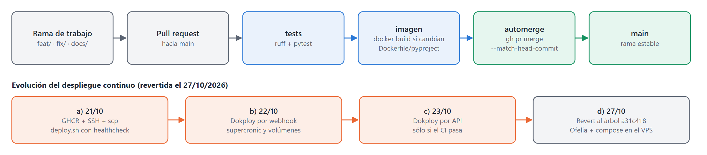

*Figura 9. Integración continua y evolución del despliegue continuo.* Fuente: elaboración propia.

### 8.7 Evaluación del despliegue continuo

Entre el 21 y el 27 de octubre de 2026 se evaluaron tres diseños de despliegue continuo, en el marco de una reestructuración del repositorio que unificaba este trabajo con otro proyecto de energía solar (parte inferior de la Figura 9):

- **(a) Registro de imágenes y SSH.** El flujo construía la imagen, la publicaba en GitHub Container Registry y, con una clave privada guardada como secreto del repositorio, se conectaba por SSH al servidor. Allí ejecutaba un script que actualizaba los servicios y verificaba el chequeo de salud del tablero.
- **(b) Dokploy por *webhook*.** Se reemplazó el script por una plataforma de despliegue autoalojada, con volúmenes con nombre y chequeos de salud. El *webhook* desplegaba aun cuando la integración continua fallaba.
- **(c) Dokploy por API.** El despliegue pasó a dispararse solo tras una integración continua exitosa sobre `main`.

En esos días también se integraron automáticamente tres actualizaciones de dependencias propuestas por Dependabot (versiones de dos acciones de GitHub y el límite superior de pandas), que la reversión del 27 de octubre deshizo junto con el resto. Las tres variantes de despliegue se compararon con tres criterios: que el despliegue quedara condicionado a las pruebas, el número de componentes adicionales que administrar y el privilegio otorgado al sistema de integración. La opción (b) falló el primer criterio. La (c) lo cumplía, pero agregaba una plataforma completa para un sistema que se actualiza pocas veces por mes. La (a) era la más simple, pero entregaba al servicio de integración continua una clave SSH con acceso general.

El 27 de octubre se decidió revertir el conjunto. La reversión se hizo con el *commit* `63cbb88`, que restableció exactamente el árbol de archivos del *commit* `a31c418`, anterior a la reestructuración, y eliminó 5.764 líneas en 161 archivos. Influyeron dos razones: la unificación con el proyecto solar excedía los objetivos de esta tesis y ninguna de las variantes justificaba su complejidad frente a la actualización manual. La alternativa preferida para el futuro combina la simplicidad de (a) con una clave restringida por comando forzado (Sección 12.3).

### 8.8 Recursos y mantenimiento

Las corridas completas registradas duraron entre 28 y 44 minutos; la programada del 11 de noviembre de 2026 comenzó a las 06:00:01 y finalizó a las 06:30:57 (Anexo E). El registro corresponde al entorno local con Docker y muestra corridas en cinco días aislados, por lo que no documenta todavía una operación periódica continua. La documentación de despliegue estima, sin medición sistemática, entre 300 y 600 MB de memoria para el tablero, hasta 1 GB para el ETL y un crecimiento de unos 0,5 GB por año en la capa cruda. La documentación de operación incluye guías de instalación, ejecución, solución de problemas ya ocurridos y la lista de dominios a los que el ETL necesita acceder.

### 8.9 Conclusiones del capítulo

La infraestructura traduce los requerimientos no funcionales en mecanismos concretos:

- Docker, para la reproducibilidad;
- Ofelia, para la actualización periódica;
- un volumen persistente, para la conservación de los datos;
- un proxy inverso con TLS, para el acceso de los usuarios;
- SSH con clave pública sobre una red privada, para el acceso de los administradores.

La revisión de la configuración versionada mostró también debilidades que el diseño declarado no resolvía: el ETL se ejecutaba como superusuario, el planificador accede al *socket* de Docker, la imagen del planificador no fijaba versión y el puerto publicado eludía el cortafuegos. Tres de ellas se corrigieron al cerrar la tesis; el acceso del planificador al *socket* sigue pendiente. La configuración del servidor, además, no forma parte del material verificable de este trabajo.

---

## Capítulo 9. Tablero de visualización

### 9.1 Objetivo y diseño

El tablero presenta los resultados del ETL a usuarios no técnicos: productores, técnicos de extensión, cooperativas eléctricas o responsables de política energética. Se construyó con Streamlit y Plotly y se organiza en seis páginas con navegación explícita. El diseño sigue cuatro criterios:

- indicadores principales arriba, como cifras destacadas;
- barras horizontales para comparar magnitudes;
- mapas coropléticos con escala secuencial de un solo tono (Harrower y Brewer, 2003), con una capa base gris que mantiene visibles las jurisdicciones sin dato;
- colores consistentes en todas las vistas: azul para autoconsumo y naranja para inyección.

Las capturas de este capítulo muestran la interfaz con el formato numérico anglosajón de la biblioteca de gráficos (punto decimal). Las Figuras 11 a 13 y los mapas del Capítulo 10 se generaron con el panel de supuestos en el escenario de referencia (*f* = 0,4), por lo que muestran el aviso de supuestos modificados; la Figura 14 muestra el panel con la fracción retirada en 40 % y el aviso de supuestos modificados (el valor por defecto del sistema es 50 %).

### 9.2 Páginas

**Inicio** (Figura 10). Explica qué calcula el sistema, la cadena de cálculo y la naturaleza de los resultados: potencial técnico y beneficio bruto. Muestra también la fecha de actualización de cada archivo.

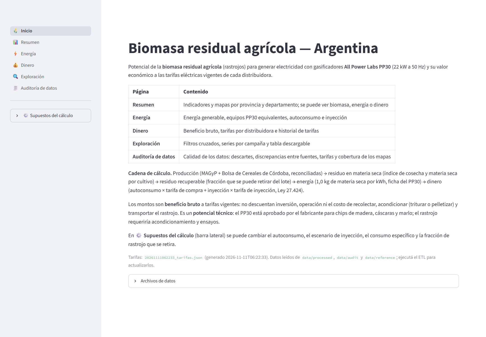

*Figura 10. Página de inicio del tablero.* Fuente: captura del sistema.

**Resumen** (Figura 11). Permite elegir campañas y cultivos y alternar entre biomasa, energía y dinero, con indicadores anuales, rankings y mapas por provincia y departamento.

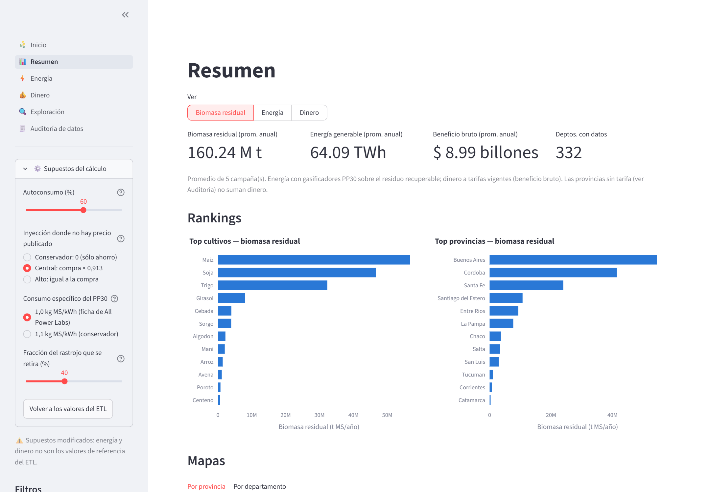

*Figura 11. Página «Resumen».* Fuente: captura del sistema.

**Energía** (Figura 12). Muestra la energía generable, los equipos equivalentes y el residuo recuperable, con barras por provincia y por cultivo y mapas.

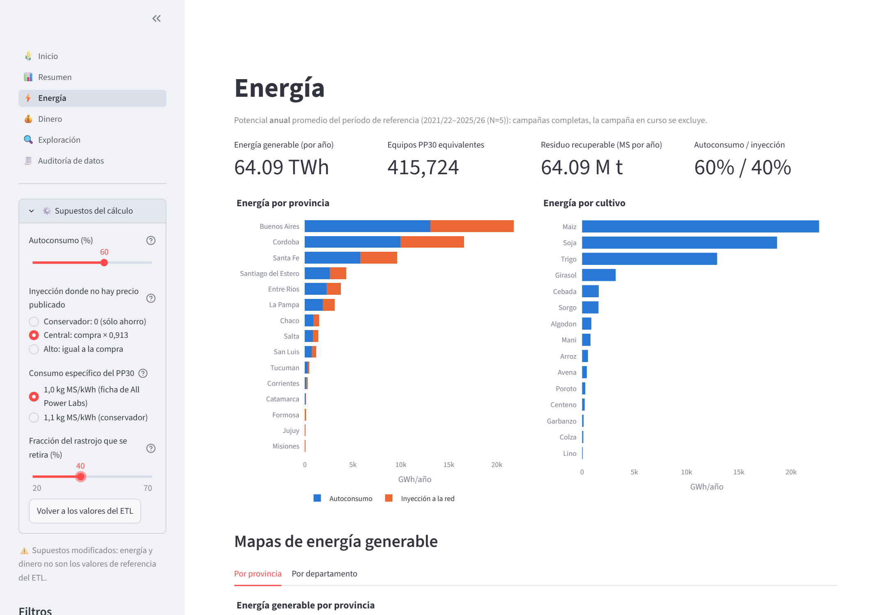

*Figura 12. Página «Energía».* Fuente: captura del sistema.

**Dinero** (Figura 13). Presenta el beneficio bruto, el ahorro, el ingreso por inyección y el porcentaje de energía con tarifa, advierte qué proporción usa una inyección estimada e incluye la tabla de tarifas con su estado e historial.

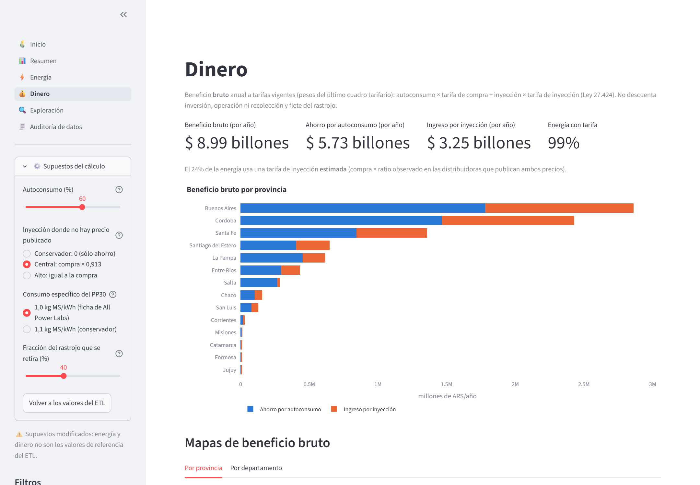

*Figura 13. Página «Dinero».* Fuente: captura del sistema.

### 9.3 Supuestos ajustables y exploración

El panel lateral «Supuestos del cálculo» (Figura 14) permite modificar cuatro supuestos:

- el porcentaje de autoconsumo;
- el escenario de inyección donde no hay precio publicado: conservador, central o alto;
- el consumo específico: 1,0 o 1,1 kg MS/kWh;
- la fracción de rastrojo retirada: entre 20 % y 70 %.

Por la linealidad del modelo, el tablero recalcula energía y dinero multiplicando columnas de los archivos ya calculados, sin reejecutar el ETL. Cuando un supuesto difiere del valor de referencia, lo advierte y ofrece restaurarlo.

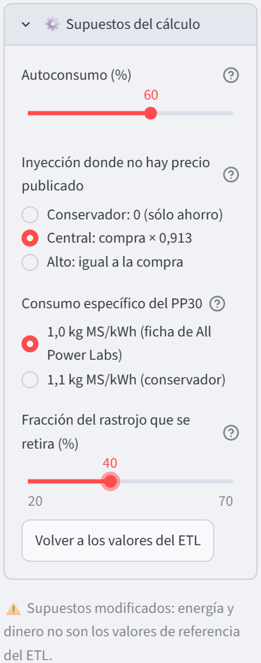

*Figura 14. Panel de supuestos ajustables.* Fuente: captura del sistema.

**Exploración** (Figura 15). Ofrece filtros encadenados por provincia, departamento, cultivo y campaña, una serie temporal y una tabla descargable en CSV. **Auditoría de datos** (Figura 7) expone alertas, registros descartados, discrepancias entre fuentes, estado de las tarifas, cobertura de mapas y campañas consideradas.

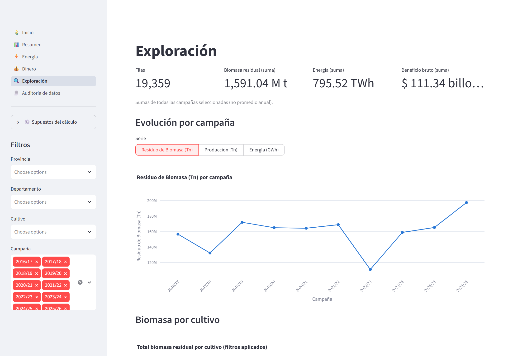

*Figura 15. Página «Exploración».* Fuente: captura del sistema.

### 9.4 Aspectos técnicos

La carga de datos (`dashboard/data_loader.py`) usa una conexión DuckDB en memoria por proceso y una caché cuya clave incluye la fecha de modificación del archivo. Cuando el ETL reescribe un Parquet, el tablero lo relee sin reiniciarse. La caché tiene un número máximo de entradas, porque en una versión anterior cada ejecución del ETL dejaba en memoria otra copia de unos 93 MB. Para cruzar los nombres de departamentos con los polígonos de GADM 4.1 se construyó una clave normalizada `provincia|departamento`, con conversión de números a letras y un diccionario de nombres cambiados. El cruce está cubierto por pruebas.

### 9.5 Conclusiones del capítulo

El tablero cierra la cadena de valor del sistema: convierte archivos técnicos en respuestas visuales a las preguntas del problema. El panel de supuestos permite explorar la incertidumbre del modelo en lugar de ocultarla, y la página de auditoría muestra qué se excluyó y por qué. Dos aspectos quedan por mejorar: el tablero carece de autenticación y su interfaz no está cubierta por pruebas automatizadas.

---

## Capítulo 10. Resultados

Los resultados corresponden a la ejecución del ETL del 11 de noviembre de 2026, con período de referencia **2021/22–2025/26** (cinco campañas completas) y las tarifas de la Tabla 8. Todas las cifras son **promedios anuales** del período y representan un **potencial técnico** y un **beneficio bruto**: no descuentan inversión, operación, densificación ni logística.

### 10.1 Cobertura de los datos

La base histórica reconciliada contiene **110.819 registros válidos** en 57 campañas, de 1969/70 a 2025/26. El resultado anual cubre **332 departamentos de 15 provincias** y **15 cultivos**, sobre una superficie cosechada promedio de **38,0 millones de hectáreas** y una producción de **141,7 millones de toneladas** de grano por año.

Ocho provincias presentes en la serie histórica no tienen registros válidos en el período:

- Chubut, Santa Cruz y Tierra del Fuego: desde 1988/89.
- Neuquén: desde 1989/90.
- Mendoza, Río Negro y San Juan: desde 1997/98.
- La Rioja: desde 2006/07.

La causa más probable es la cobertura de la fuente: en los datos descargados, el portal de estimaciones no tiene registros recientes de los cultivos con coeficientes para esas provincias, y las series de ajo y papa, cultivos con coeficientes que se producen en algunas de ellas, terminan en 1997/98. No se verificó manualmente contra el portal que la ausencia no se deba a la consulta del extractor, por lo que la explicación es una hipótesis. Esas provincias no aportan resultados y tampoco intervienen sus distribuidoras. El resultado «nacional» omite, entonces, la producción de esas provincias que la fuente no informa. La Figura 16 muestra la evolución de la biomasa residual total, con el período de referencia sombreado.

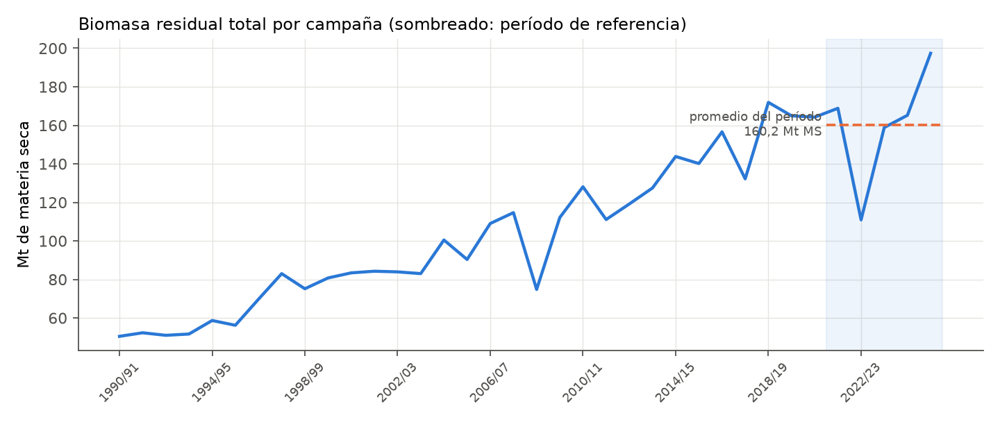

*Figura 16. Biomasa residual total por campaña desde 1990/91; el sombreado indica el período de referencia y la línea discontinua, su promedio.* Fuente: elaboración propia con datos del MAGyP y de la BCCBA.

### 10.2 Escenarios de fracción retirada

La biomasa residual promedio es de **160,2 Mt de materia seca por año**, equivalente a 4,2 t MS por hectárea cosechada. La Tabla 14 presenta los indicadores para los tres valores de la fracción retirada definidos en la Sección 6.5.

*Tabla 14. Indicadores anuales según la fracción de rastrojo retirada (período 2021/22–2025/26).*

| Indicador | *f* = 30 % (prudente) | ***f* = 40 % (referencia)** | *f* = 50 % (valor por defecto del sistema; sin respaldo) |
|---|---|---|---|
| Residuo recuperable (Mt MS/año) | 48,1 | **64,1** | 80,1 |
| Energía eléctrica (TWh/año) | 48,1 | **64,1** | 80,1 |
| Energía por hectárea cosechada (kWh/ha) | 1.264 | **1.686** | 2.107 |
| Proporción de la demanda del MEM 2022 | 35 % | **46 %** | 58 % |
| Equipos PP30 equivalentes a plena carga (no es un inventario) | 311.793 | **415.724** | 519.655 |
| Potencia equivalente (GW) | 6,9 | **9,1** | 11,4 |
| Ahorro por autoconsumo (billones $/año) | 4,30 | **5,73** | 7,17 |
| Crédito por inyección (billones $/año) | 2,44 | **3,25** | 4,07 |
| **Beneficio bruto (billones $/año)** | 6,74 | **8,99** | 11,23 |

Fuente: elaboración propia. La demanda de referencia es la demanda local del Mercado Eléctrico Mayorista de 2022: 138.755 GWh (CAMMESA, 2023). Con una disponibilidad restringida por la siembra directa (*f* = 0,1–0,2), la energía sería de 16,0 a 32,0 TWh/año y el beneficio bruto, de 2,2 a 4,5 billones de pesos. El 99,3 % de la energía tiene tarifa de compra asignada y el 24,3 % usa una tarifa de inyección estimada.

La comparación con la demanda nacional es una referencia de **escala**. No es un escenario de sustitución, porque la generación con rastrojo sería estacional en su abastecimiento y estaría dispersa en zonas rurales. Además, requeriría más de 400.000 equipos en el escenario de referencia, lo que muestra la distancia entre un potencial técnico y un escenario de implementación.

### 10.3 Distribución territorial

*Tabla 15. Resultados anuales por provincia (escenario de referencia, f = 40 %).*

| Provincia | Distribuidora | Biomasa (Mt MS) | Energía (TWh) | % de la energía | Equipos PP30 | Beneficio (miles de millones de $) | Beneficio medio ($/kWh) |
|---|---|---|---|---|---|---|---|
| Buenos Aires | EDEN+EDEA+EDES | 54,4 | 21,77 | 34,0 | 141.191 | 2.862 | 131,5 |
| Córdoba | EPEC | 41,4 | 16,56 | 25,8 | 107.415 | 2.429 | 146,6 |
| Santa Fe | EPE | 24,0 | 9,59 | 15,0 | 62.204 | 1.358 | 141,6 |
| Santiago del Estero | EDESE | 10,7 | 4,29 | 6,7 | 27.821 | 648 | 151,2 |
| Entre Ríos | ENERSA | 9,3 | 3,74 | 5,8 | 24.241 | 433 | 115,9 |
| La Pampa | APE | 7,7 | 3,08 | 4,8 | 19.992 | 616 | 199,8 |
| Chaco | SECHEEP | 3,7 | 1,47 | 2,3 | 9.535 | 157 | 106,5 |
| Salta | EDESA | 3,5 | 1,39 | 2,2 | 8.998 | 286 | 205,9 |
| San Luis | EDESAL | 3,0 | 1,20 | 1,9 | 7.765 | 128 | 106,9 |
| Tucumán | EDET (sin dato) | 1,1 | 0,44 | 0,7 | 2.871 | — | — |
| Otras (5) | — | 1,4 | 0,57 | 0,9 | 3.692 | 70 | — |
| **Total** | | **160,2** | **64,10** | **100** | **415.724** | **8.986** | **141,2** |

Fuente: elaboración propia. «Otras» agrupa Corrientes, Catamarca, Formosa, Jujuy y Misiones. El beneficio medio total se calcula sobre la energía con tarifa. El beneficio medio por provincia no es comparable entre provincias: combina categorías tarifarias distintas y cuadros de distintos meses (Tabla 8).

Buenos Aires, Córdoba y Santa Fe concentran el **74,8 %** de la energía (Figura 17). Los cinco departamentos con mayor potencial, en el escenario de referencia, son:

- Río Cuarto (Córdoba): 2,33 TWh/año.
- General López (Santa Fe): 1,90 TWh/año.
- Marcos Juárez (Córdoba): 1,89 TWh/año.
- Unión (Córdoba): 1,81 TWh/año.
- General Roca (Córdoba): 1,68 TWh/año.

La Figura 18 muestra el mapa departamental. La concentración indica que cualquier análisis de factibilidad debería comenzar por el núcleo pampeano.

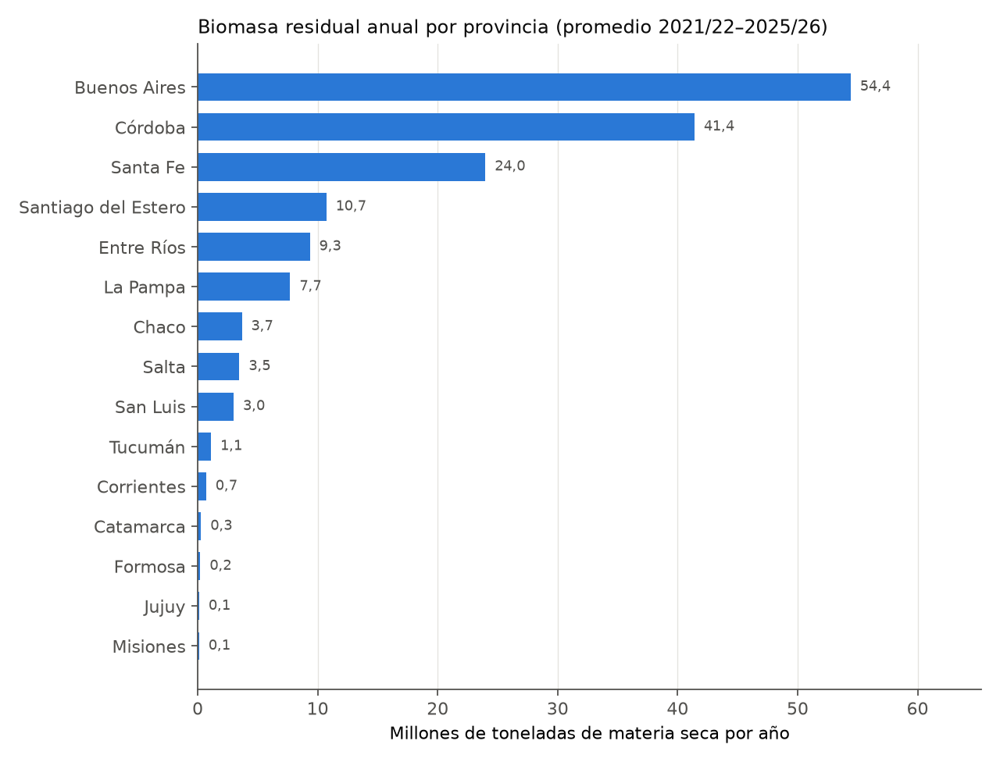

*Figura 17. Biomasa residual anual por provincia.* Fuente: elaboración propia.

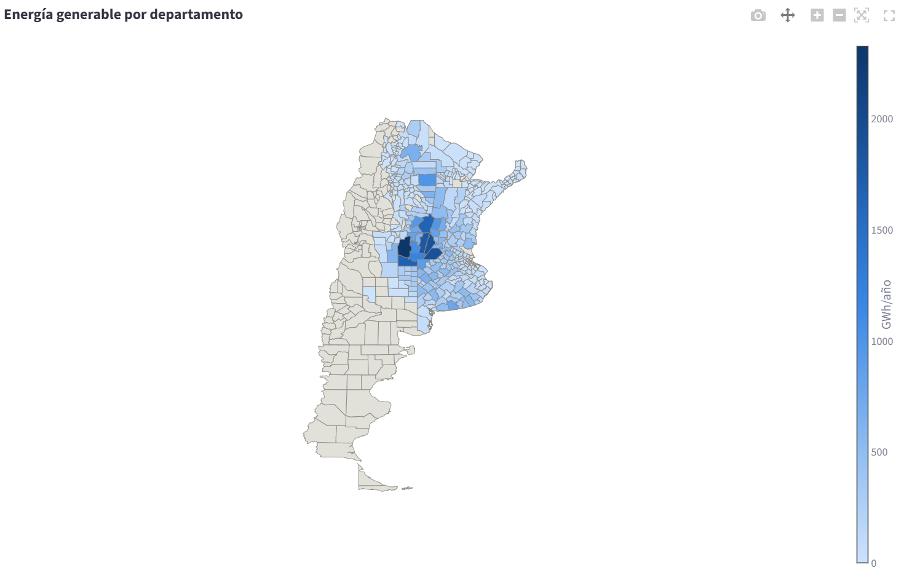

*Figura 18. Mapa de energía generable por departamento (GWh/año, escenario de referencia).* Fuente: captura del tablero con el panel de supuestos en *f* = 0,4.

### 10.4 Distribución por cultivo

*Tabla 16. Participación de cada cultivo en la producción y en la energía (escenario de referencia).*

| Cultivo | Producción (% del total) | Energía (TWh/año) | Energía (% del total) |
|---|---|---|---|
| Maíz | 41,5 | 22,68 | 35,4 |
| Soja | 31,1 | 18,66 | 29,1 |
| Trigo | 14,3 | 12,92 | 20,2 |
| Girasol | 3,7 | 3,21 | 5,0 |
| Cebada | 3,6 | 1,59 | 2,5 |
| Sorgo | 1,8 | 1,57 | 2,5 |
| Algodón | 0,7 | 0,89 | 1,4 |
| Maní | 1,0 | 0,80 | 1,3 |
| Arroz | 0,9 | 0,56 | 0,9 |
| Otros seis | 1,3 | 1,22 | 1,9 |

Fuente: elaboración propia. «Otros seis» agrupa avena, poroto, centeno, garbanzo, colza y lino.

Maíz, soja y trigo explican el **84,6 %** de la energía (Figura 19). El trigo aporta el 20,2 % de la energía con solo el 14,3 % de la producción, porque su índice de cosecha es bajo (0,35) y deja más residuo por tonelada de grano. Con el maíz ocurre lo inverso: aporta el 41,5 % de la producción y el 35,4 % de la energía.

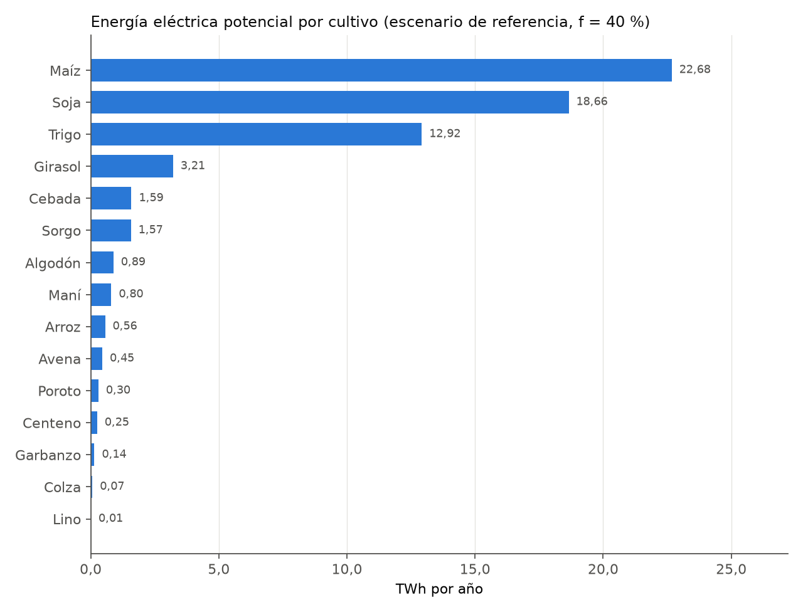

*Figura 19. Energía eléctrica potencial por cultivo (escenario de referencia).* Fuente: elaboración propia.

### 10.5 Valorización económica

El beneficio bruto se distribuye de manera similar a la energía, modulado por las tarifas (Figuras 20 y 21). El beneficio medio es de 141 $/kWh, con extremos, entre las provincias de la Tabla 15, de 106 $/kWh en Chaco y San Luis y de 200–206 $/kWh en La Pampa y Salta (en el grupo «otras», Misiones llega a 274 y Formosa baja a 99). Esas diferencias combinan diferencias reales de precio entre jurisdicciones con diferencias en la categoría tarifaria leída y en la antigüedad de cada cuadro (Sección 5.8), por lo que no deben interpretarse como diferencias de rentabilidad. Del beneficio total, el 64 % corresponde al ahorro por autoconsumo y el 36 % al crédito por inyección.

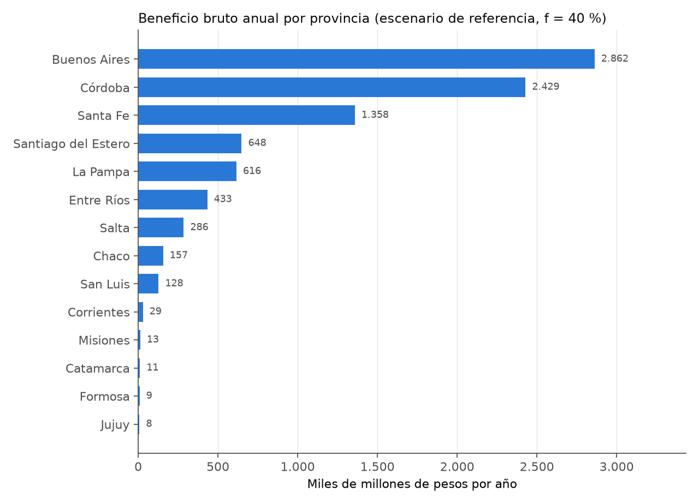

*Figura 20. Beneficio bruto anual por provincia (escenario de referencia).* Fuente: elaboración propia.

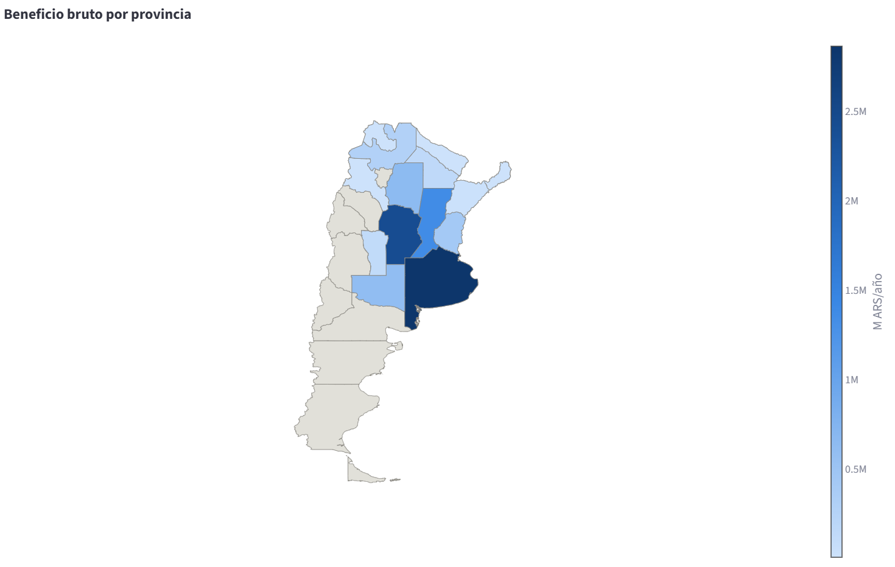

*Figura 21. Mapa de beneficio bruto por provincia (escenario de referencia).* Fuente: captura del tablero con el panel de supuestos en *f* = 0,4.

### 10.6 Análisis de sensibilidad

La sensibilidad se analizó variando un supuesto por vez alrededor del escenario de referencia (Tabla 17 y Figura 22). Los rangos se eligieron así:

- **Fracción retirada:** de 30 % (escenario prudente) a 40 % (máximo de Nunes et al., 2021; Sección 6.5).
- **Índice de cosecha:** ±0,05 en todos los cultivos, una variación compatible con la que documentan Unkovich et al. (2010).
- **Consumo específico:** entre el valor del fabricante y un rendimiento del 16 %.
- **Tarifas:** ±20 %, para reflejar la dispersión de vigencias.
- **Inyección no publicada:** entre nula e igual a la compra.
- **Materia seca:** ±5 %.
- **Autoconsumo:** entre 40 % y 80 %.

*Tabla 17. Sensibilidad del beneficio bruto (billones de $ por año; escenario de referencia = 8,99).*

| Supuesto | Valor bajo | Valor alto | Variación |
|---|---|---|---|
| Fracción retirada *f* (30 % – 40 %) | 6,74 | 8,99 | −25 % / 0 % |
| Índice de cosecha (IC + 0,05 / IC − 0,05) | 7,32 | 11,10 | −19 % / +24 % |
| Tarifas de compra e inyección (± 20 %) | 7,19 | 10,78 | −20 % / +20 % |
| Consumo específico (1,3 / 1,0 kg MS/kWh) | 6,91 | 8,99 | −23 % / 0 % |
| Inyección no publicada (nula / igual a la compra) | 8,16 | 9,07 | −9 % / +1 % |
| Materia seca del grano (± 5 %) | 8,54 | 9,44 | −5 % / +5 % |
| Autoconsumo *α* (40 % / 80 %) | 8,70 | 9,27 | −3 % / +3 % |

Fuente: elaboración propia. La disponibilidad *D* solo afecta el número de equipos y no el beneficio. Dos casos adicionales: sin autoconsumo (*α* = 0), el beneficio sería de 8,13 billones (−9,6 %); con la mediana de las categorías de cargo único (0,734) para la inyección estimada, de 8,82 billones (−1,8 %).

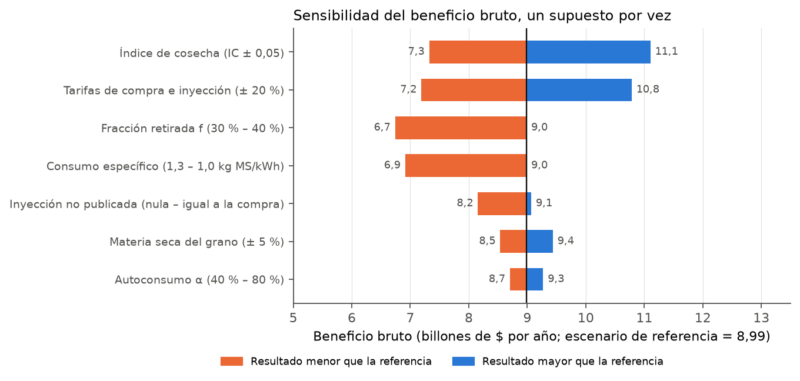

*Figura 22. Sensibilidad del beneficio bruto, un supuesto por vez (diagrama de tornado).* Fuente: elaboración propia.

Cuatro supuestos dominan la incertidumbre, con efectos del mismo orden (20–25 %): la fracción retirada, el índice de cosecha, las tarifas y el consumo específico. En la fracción retirada y en el consumo específico el escenario de referencia está en el extremo favorable del rango, por lo que solo pueden reducir el resultado. El consumo específico puede reducir el resultado en casi un cuarto si el rastrojo se comporta peor que los combustibles aprobados. El efecto del índice de cosecha es asimétrico porque *FR* = (1 − IC)/IC no es lineal en IC. El análisis de un factor por vez no captura combinaciones. Si coincidieran todos los valores desfavorables (*f* = 0,3; IC + 0,05; 1,3 kg MS/kWh; MS − 5 %; tarifas − 20 %), el beneficio sería de 3,2 billones (−64 %); con todos los favorables (*f* = 0,4; IC − 0,05; 1,0 kg MS/kWh; MS + 5 %; tarifas + 20 %), de 14,0 billones (+56 %). Como aproximación a un análisis global (Saltelli et al., 2008), se realizaron dos simulaciones de Monte Carlo de 5.000 iteraciones cada una (semilla 42), con distribuciones uniformes en los rangos de la Tabla 17, el índice de cosecha variando de forma independiente en cada cultivo y la inyección no publicada uniforme entre cero y la tarifa de compra. Solo difieren en el rango de la fracción retirada:

- **30–40 %**, entre el escenario prudente y el máximo que admite Nunes et al. (2021): los percentiles 5 y 95 de la energía son **40 y 61 TWh/año** (mediana 49) y los del beneficio, **4,8 y 8,8 billones** (mediana 6,6).
- **10–40 %**, que incorpora la restricción por siembra directa: **16 y 57 TWh/año** (mediana 35) y **2,1 y 7,9 billones** (mediana 4,6).

Como las distribuciones uniformes son un supuesto, sin información para asignar otras, los percentiles describen el rango de escenarios bajo esos supuestos; no son intervalos de confianza. Las cifras de energía y beneficio de esta sección, los totales de la Tabla 14 y los escenarios de la Sección 6.8 se reproducen con `python scripts/analisis_sensibilidad.py`, que lee los artefactos del ETL sin modificarlos; las cifras por provincia, cultivo y equipo salen de los mismos artefactos, pero el script no las imprime. Los artefactos de `data/processed/` no se versionan: reproducir las cifras exige una corrida del ETL, cuyas fuentes cambian con el tiempo, y la entrega no incluye un paquete de datos congelado (Sección 12.3). La mediana es menor que el escenario de referencia porque este usa los valores más favorables de la fracción retirada y del consumo específico. Ni la mediana ni el escenario de referencia son una «mejor estimación»: la mediana es el centro de un rango de escenarios cuyos límites se fijaron con los argumentos de esta sección, no una magnitud con interpretación probabilística, y el escenario de referencia es el extremo superior de ese rango en los dos supuestos unilaterales. Por eso la respuesta a P2 es el rango, no un valor puntual.

### 10.7 Comparación con el Informe de avance 2

El Informe de avance 2 (Ferro, 2026b) estimó 76,8 TWh/año y un beneficio de 10,5 billones de pesos, corregido luego a 10,7 por su fe de erratas. Usó *f* = 0,5 y el período 2020/21–2024/25. Con *f* = 0,5, la estimación actual es de 80,1 TWh y 11,2 billones. La diferencia combina dos efectos que no se separaron: el desplazamiento del período (salió la campaña 2020/21 y entró la 2025/26, de mayor producción) y la actualización de las tarifas. El sistema recalcula estas cifras sin intervención manual.

### 10.8 Conclusiones del capítulo

Con un retiro del 30–40 %, la simulación ubica el potencial entre 40 y 61 TWh/año (mediana 49) y el valor bruto entre 4,8 y 8,8 billones de pesos; el escenario de referencia, cota superior del rango, da 64 TWh/año y unos 9 billones, y el escenario prudente, 48 TWh/año. El recurso está concentrado en el núcleo pampeano y en tres cultivos. La incertidumbre está dominada por la fracción retirada, el índice de cosecha y las tarifas, junto con el consumo específico, cada uno con un efecto del orden del 20–25 %. Las cifras son útiles para **comparar y priorizar territorios**, que es el uso propio de un potencial técnico, y no para estimar la rentabilidad de una inversión.

---

## Capítulo 11. Discusión

### 11.1 Respuesta a las preguntas de investigación

**P1.** Sí, con límites precisos, y se cumple el criterio de aceptación (99,3 % de la energía con tarifa de compra extraída). La producción agrícola por departamento se obtiene de manera automática desde dos fuentes con respaldo ante caídas. Las tarifas se obtienen para 25 de las 28 distribuidoras, y quedan sin valorizar el 0,7 % de la energía y las distribuidoras que publican documentos escaneados. La trazabilidad queda registrada mediante el resumen criptográfico de cada documento y la capa cruda inmutable; la exactitud de cada valor, en cambio, no se midió con un muestreo.

**P2.** El potencial técnico se ubica entre 40 y 61 TWh/año (mediana 49) con un retiro del 30–40 %, y entre 16 y 57 TWh/año si se incorpora la restricción por siembra directa (percentiles 5 y 95 de las simulaciones). El escenario de referencia, cota superior del rango, da 64 TWh/año. Se concentra en Buenos Aires, Córdoba y Santa Fe (74,8 %) y en maíz, soja y trigo (84,6 %).

**P3.** Con los rangos elegidos en la Sección 10.6 —y el ordenamiento depende de esa elección—, la fracción retirada, el índice de cosecha y las tarifas dominan la incertidumbre, con efectos comparables. No se realizó un análisis global de sensibilidad (por ejemplo, índices de Sobol), que queda como trabajo futuro. El consumo específico tiene un efecto del mismo orden, pero unilateral, como la fracción retirada dentro del rango respaldado (ambas solo pueden reducir el resultado respecto del escenario de referencia). La fracción autoconsumida y la estimación de la inyección faltante tienen efectos menores.

### 11.2 Contraste de orden de magnitud

No se encontró una estimación nacional independiente de los residuos de los cultivos extensivos argentinos con la cual comparar los resultados. WISDOM Argentina, el balance oficial de biomasa con resolución departamental, no cuantifica estos rastrojos como oferta energética, porque considera que, con siembra directa, en la gran mayoría de los casos no están disponibles (FAO, 2009, p. 28). Esa diferencia no es una contradicción numérica, sino de enfoque: este trabajo cuantifica un recurso que el balance oficial trató como no disponible. Es, además, el argumento externo más fuerte a favor del escenario prudente y de interpretar el escenario de referencia como optimista. IRENA (2023) ubica a la Argentina como segundo productor de residuos agrícolas de Sudamérica, pero solo lo muestra en gráficos. A falta de una referencia numérica, se realizaron dos contrastes de orden de magnitud:

1. **Energía contenida en el residuo total por hectárea.** IRENA (2023, p. 32) indica que los cultivos de grano como el maíz y el sorgo producen residuos con un contenido energético de unos 50 a 100 GJ por hectárea y por año. Con 4,2 t MS/ha de residuo total (antes de aplicar la fracción retirada) y unos 17 MJ/kg, el modelo resulta en unos **72 GJ/ha**, dentro de ese rango. El contraste se refiere solo a la magnitud de la biomasa residual, no a la energía eléctrica (unos 6 GJ/ha en el escenario de referencia).
2. **Escala nacional.** El potencial técnico del escenario de referencia equivale al 46 % de la demanda eléctrica del MEM. Es una cifra alta pero del mismo orden que la producción de residuos que IRENA atribuye a la región. Además, resulta de aplicar a 141,7 Mt de grano un factor residuo/producto medio de 1,13 t MS por tonelada.

Estos contrastes son débiles. El primero reutiliza el poder calorífico adoptado y compara una salida del modelo con un rango amplio de otra fuente, sin contrastar la fracción retirada ni el rendimiento del equipo. El segundo solo verifica la escala. Confirman que no hay errores groseros, pero no constituyen una validación: una diferencia sistemática de ±20 % en los coeficientes no se detectaría con ellos.

### 11.3 Interpretación y relevancia

El resultado más robusto no es la cifra nacional, sino su **distribución**. Los supuestos no afectan por igual a todos los departamentos —el índice de cosecha difiere por cultivo y la composición de cultivos, por departamento—, pero el efecto sobre el orden es mínimo: en la simulación de Monte Carlo, con el índice de cosecha variando de forma independiente por cultivo, la correlación de rangos entre el ordenamiento de los departamentos simulado y el de referencia nunca bajó de 0,999, y al menos 9 de los 10 departamentos principales se mantuvieron en todas las iteraciones. Ese resultado vale bajo los supuestos de la simulación —errores del índice de cosecha independientes entre cultivos y un multiplicador de tarifas único para todo el país— y subestima la incertidumbre si los coeficientes de una misma fuente tienen errores correlacionados. Además, buena parte de la estabilidad es consecuencia del diseño: la fracción retirada, el consumo específico, la materia seca, las tarifas y el autoconsumo se varían como escalares globales, que no alteran el orden; solo el índice de cosecha por cultivo puede hacerlo. Por eso la afirmación se limita a esos supuestos. Con la regla de reconciliación alternativa también se mantienen 9 de los 10 departamentos (Sección 6.3). Esa propiedad hace que el sistema sea útil para priorizar dónde estudiar la factibilidad. La cifra nacional, en cambio, debe leerse siempre con su rango.

El beneficio bruto por kWh es del orden de 141 $/kWh. Cualquier proyecto real debería cubrir con ese margen la inversión en equipos, la recolección, el enfardado y el transporte del rastrojo, su densificación y la operación. La diferencia entre el potencial técnico y el económico puede ser grande y es el paso natural siguiente (Sección 12.3).

### 11.4 Comparación con los trabajos comparables

Frente a los antecedentes de la Tabla 1, el método físico de este trabajo es el mismo: factores residuo/producto con restricciones de retiro. La diferencia está en el sistema de información. Los resultados están programados para recalcularse cada semana con datos nuevos (la periodicidad aún no se observó), llegan a una tecnología concreta y se valorizan con tarifas reales trazables. A cambio, los coeficientes son nacionales y la cobertura de cultivos es menor que la de estudios con alcance multisectorial, como WISDOM, que integran biomasa forestal y agroindustrial.

### 11.5 Conclusiones del capítulo

Los resultados responden a las tres preguntas de investigación con un nivel de confianza distinto para cada una. P1 está respondida con evidencia directa. P2 está respondida como orden de magnitud con un rango explícito. P3 está respondida con un análisis local que no captura interacciones. La ausencia de una referencia nacional independiente es la principal limitación de validez y, al mismo tiempo, la mejor justificación del aporte del trabajo.

---

## Capítulo 12. Conclusiones y trabajos futuros

### 12.1 Conclusiones generales

Este trabajo diseñó y construyó OPTIMIA-HV y lo puso en funcionamiento en un entorno local con contenedores; es un sistema de información que estima de manera automática el potencial eléctrico y el beneficio económico bruto de la biomasa residual agrícola de la Argentina, a escala departamental. Se evalúa a continuación cada objetivo específico según su indicador.

1. **Estado del arte.** *Cumplido parcialmente.* Se relevaron los fundamentos del dominio y de las tecnologías y se sistematizaron cuatro trabajos comparables, pero la búsqueda no fue sistemática (Capítulo 1).
2. **Extracción agrícola.** *Cumplido.* La extracción funciona sin intervención manual, con validación de formato, reintentos, segunda pasada y respaldo en la última descarga (Capítulo 4).
3. **Extracción tarifaria.** *Cumplido parcialmente.* Se leen 25 de las 28 distribuidoras y queda valorizado el 99,3 % de la energía. Tres distribuidoras publican documentos que no pueden leerse sin reconocimiento óptico de caracteres, y la inyección se estima en el 24 % de la energía (Capítulo 5).
4. **Modelo de cálculo.** *Cumplido, con limitaciones.* Cada parámetro tiene fuente o está declarado como supuesto, y se realizó un análisis de sensibilidad. Algunos coeficientes son importados y no hubo validación contra una estimación independiente (Capítulos 6 y 10).
5. **Calidad.** *Cumplido con limitaciones.* Hay 157 casos de prueba (156 en la última corrida de integración continua; el restante se agregó después y se ejecutó localmente), invariantes, alertas y avisos, y una cobertura medida del 75 %. La cobertura no se mide en la integración continua, el análisis de tipos no se ejecuta y la cobertura de los extractores contra los sitios reales es baja (Capítulo 7).
6. **Infraestructura.** *No cumplido en su indicador.* El empaquetado en contenedores y la programación están implementados, pero la ejecución periódica, que es el indicador del objetivo, **no se demostró**: el registro solo documenta corridas en un entorno local y en días aislados, y la ejecución semanal todavía no se observó. La configuración versionada presenta debilidades de seguridad identificadas en el Capítulo 8.
7. **Visualización.** *Cumplido.* El tablero recalcula escenarios sin reejecutar el ETL (Capítulo 9).

En cuanto al dominio, el sistema estima, para un equipo equivalente al PP30 alimentado con rastrojo densificado, un potencial técnico de **40 a 61 TWh/año** (mediana 49) con un retiro del 30–40 %, o de **16 a 57 TWh/año** si se incorpora la restricción por siembra directa (percentiles 5 y 95), y un valor bruto de **4,8 a 8,8** y **2,1 a 7,9 billones de pesos corrientes por año**, respectivamente, concentrados en el núcleo pampeano y en maíz, soja y trigo.

El trabajo deja tres aprendizajes de ingeniería:

1. En sistemas que integran fuentes públicas, **la heterogeneidad y la fragilidad de las fuentes concentran el esfuerzo**: la extracción ocupa la mitad del código del ETL, mientras que el modelo de cálculo es comparativamente simple.
2. **Los errores más peligrosos son silenciosos**: producen números verosímiles. La defensa más eficaz fue contrastar con las fuentes y convertir cada hallazgo en una prueba.
3. **La trazabilidad y la explicitación de supuestos son requisitos de diseño.** Identificar cada decisión, conservar cada documento de origen y exponer lo descartado es lo que permite discutir un resultado.

### 12.2 Limitaciones

- El resultado es un **potencial técnico** con **beneficio bruto**: no incluye costos de inversión, operación, recolección, transporte, almacenamiento ni densificación.
- Los coeficientes agronómicos son **constantes nacionales por cultivo**, y algunos provienen de estudios de otros países.
- No se consideran los **usos competidores del rastrojo** —forraje, pastoreo, cama animal y retorno de nutrientes en sistemas mixtos agrícola-ganaderos—, que reducirían la fracción disponible, sobre todo en la región pampeana. Tampoco se distingue la calidad del rastrojo como combustible: la misma fracción se aplica a la soja (29,1 % de la energía), cuyo rastrojo es escaso y se degrada rápido.
- Se excluyen cultivos sin coeficientes publicados (caña de azúcar, yerba mate, frutales), lo que **subrepresenta al NOA, al NEA y a las regiones de riego**.
- No hubo **validación contra una estimación nacional independiente**; solo un contraste de orden de magnitud. El balance oficial (WISDOM) considera que, con siembra directa, la mayor parte de estos rastrojos no está disponible, lo que pone en duda incluso el escenario de referencia.
- El consumo específico es el del fabricante y no se midió sobre rastrojo. No se descuentan consumos auxiliares ni la energía de densificación.
- La fracción autoconsumida es un parámetro de escenario. No se consideraron la demanda de cada establecimiento ni el límite de potencia del artículo 4 de la Ley 27.424.
- Las tarifas tienen **vigencias de distinta antigüedad**, provienen de categorías no del todo homogéneas, no se indexaron a un mes común y no se contrastaron con una fuente independiente. La inyección se estima en el 24 % de la energía, con un error que puede llegar al −33 % en casos extremos.
- No se consideran las **cooperativas eléctricas**, que abastecen buena parte de la población rural en varias provincias.
- La reconciliación por mayor producción introduce un **sesgo positivo del 2,8 %**.
- Los factores residuo/producto de trigo y sorgo están en revisión; con valores más bajos, la energía caería entre un 4 % y un 10 %.
- El resultado depende de la campaña 2025/26, la de mayor producción reciente y sujeta a revisión (−5,8 % sin ella).
- El tablero replica las fórmulas del ETL sin una prueba de equivalencia, y el rango de su control (20–70 %) excede el que respalda la bibliografía citada.
- La selección de cuadros tarifarios puede preferir un cuadro más antiguo cuando una fuente no responde (caso REFSA).
- La búsqueda bibliográfica no fue sistemática.
- El sistema no tiene pruebas de contrato contra las fuentes reales. Su operación autónoma solo está documentada por corridas en un entorno local, en días aislados; la ejecución semanal todavía no se observó.
- La configuración de producción presenta **debilidades de seguridad** (Sección 8.5) y la del servidor no forma parte del material verificable.

### 12.3 Correcciones pendientes y trabajos futuros

Los ítems 7, 13 y 15 no son extensiones, sino **correcciones pendientes** de defectos conocidos del sistema entregado; se listan aquí para que queden registradas, pero deberían resolverse antes de una puesta en producción. El resto son trabajos futuros propiamente dichos.

**Modelo de dominio.**

1. **Evaluación económica completa.** Incorporar costos de inversión y operación del equipo, de recolección, enfardado, transporte y densificación. Calcular el costo nivelado de la energía, el valor actual neto y la tasa interna de retorno (Short et al., 1995; Sapag Chain et al., 2014; IRENA, 2012), para pasar del potencial técnico al económico.
2. **Validación externa.** Contrastar los resultados con estimaciones provinciales o con mediciones de rastrojo, y realizar un análisis global de incertidumbre.
3. **Coeficientes regionalizados.** Usar índices de cosecha y fracciones retirables por región, rendimiento y tipo de suelo, de fuentes locales.
4. **Nuevos cultivos y residuos.** Incorporar caña de azúcar, yerba mate, frutales y residuos agroindustriales como cáscaras y marlos, que además son los combustibles aprobados por el fabricante.
5. **Logística y demanda.** Estimar radios de abastecimiento y contrastar el autoconsumo con la demanda de cada establecimiento y con el límite de potencia de la ley.
6. **Tarifas.** Estimar la inyección por tipo de categoría o con el precio estacional mayorista, indexar los cuadros a un mes común, expresar el beneficio también en moneda estable e incorporar las tarifas de las cooperativas.

**Sistema de información.**

7. **Seguridad de la operación:**
    - evaluar un planificador sin acceso al *socket* de Docker (por ejemplo, *cron* dentro de la propia imagen);
    - deshabilitar la autenticación por contraseña del superusuario.
8. **Despliegue continuo** condicionado a las pruebas, con una clave SSH restringida por comando forzado y verificación del chequeo de salud con reversión automática.
9. **Reconocimiento óptico de caracteres** para los cuadros escaneados de Tucumán y Tierra del Fuego.
10. **Pruebas de contrato con las fuentes**, ejecutadas periódicamente para detectar cambios de formato antes de la corrida programada.
11. **Aspectos legales**: relevar los términos de uso, `robots.txt` y licencias de cada fuente.
12. **Reproducibilidad de dependencias** mediante un archivo de versiones bloqueadas, y retomar las actualizaciones automatizadas (ya probadas con Dependabot en octubre y revertidas) solo con fusión condicionada a las pruebas.
13. **Mantenimiento del repositorio**: eliminar el archivo `database.sqlite` residual, normalizar el nombre y el contacto del proyecto en `pyproject.toml`, excluir `data/raw` de la imagen y sincronizar la documentación con el código.
14. **Autenticación del tablero** y una interfaz de datos abiertos para que otros sistemas consuman los resultados.
15. **Correcciones de la lógica**: seleccionar el cuadro de vigencia más reciente aunque provenga de una corrida anterior, elegir la columna tarifaria por su encabezado y hacer que el tablero reutilice las funciones del ETL o tenga una prueba de equivalencia.
16. **Revisión sistemática de la literatura** en bases bibliográficas e informes del INTA, y revisión de los coeficientes de trigo y sorgo con fuentes locales.
17. **Protocolo de uso de asistentes de IA**, con revisión humana obligatoria de cada PR y registro de lo solicitado y lo rechazado.

### 12.4 Reflexión final

La planificación energética requiere información confiable y actualizada sobre dónde están los recursos. Este trabajo muestra que, con herramientas abiertas y prácticas de ingeniería de software, es posible transformar datos públicos dispersos en una estimación que puede regenerarse automáticamente y cuyos supuestos pueden discutirse uno por uno; demostrar su operación periódica es el paso siguiente. Su valor no está en la precisión de una cifra nacional, que es necesariamente incierta, sino en poner a disposición una base trazable sobre la cual construir los estudios de factibilidad que el potencial técnico no puede reemplazar.

---

## Referencias

*Formato APA, 7.ª edición, en su adaptación al castellano.*

### Bibliografía académica y técnica

- Aas, J., Barnes, R., Case, B., Durumeric, Z., Eckersley, P., Flores-López, A., Halderman, J. A., Hoffman-Andrews, J., Kasten, J., Rescorla, E., Schoen, S. y Warren, B. (2019). Let's Encrypt: An automated certificate authority to encrypt the entire web. En *Proceedings of the 2019 ACM SIGSAC Conference on Computer and Communications Security* (pp. 2473–2487). ACM. https://doi.org/10.1145/3319535.3363192
- Adamantiadis, A., Josefsson, S. y Baushke, M. (2020). *Secure Shell (SSH) key exchange method using Curve25519 and Curve448* (RFC 8731). IETF. https://doi.org/10.17487/RFC8731
- Armbrust, M., Ghodsi, A., Xin, R. y Zaharia, M. (2021). Lakehouse: A new generation of open platforms that unify data warehousing and advanced analytics. En *11th Conference on Innovative Data Systems Research (CIDR)*.
- Barrett, D. J., Silverman, R. E. y Byrnes, R. G. (2005). *SSH, the Secure Shell: The definitive guide* (2.ª ed.). O'Reilly.
- Basu, P. (2018). *Biomass gasification, pyrolysis and torrefaction: Practical design and theory* (3.ª ed.). Academic Press.
- Batidzirai, B., Smeets, E. M. W. y Faaij, A. P. C. (2012). Harmonising bioenergy resource potentials—Methodological lessons from review of state of the art bioenergy potential assessments. *Renewable and Sustainable Energy Reviews, 16*(9), 6598–6630. https://doi.org/10.1016/j.rser.2012.09.002
- Bernstein, D. J. (2006). Curve25519: New Diffie-Hellman speed records. En *Public Key Cryptography – PKC 2006* (LNCS 3958, pp. 207–228). Springer.
- Bernstein, D. J., Duif, N., Lange, T., Schwabe, P. y Yang, B.-Y. (2012). High-speed high-security signatures. *Journal of Cryptographic Engineering, 2*(2), 77–89. https://doi.org/10.1007/s13389-012-0027-1
- Blanco-Canqui, H. y Lal, R. (2009). Crop residue removal impacts on soil productivity and environmental quality. *Critical Reviews in Plant Sciences, 28*(3), 139–163. https://doi.org/10.1080/07352680902776507
- Brooker, M. (2015, 4 de marzo). *Exponential backoff and jitter*. AWS Architecture Blog. https://aws.amazon.com/blogs/architecture/exponential-backoff-and-jitter/
- Chacon, S. y Straub, B. (2014). *Pro Git* (2.ª ed.). Apress. https://git-scm.com/book
- Christen, P. (2012). *Data matching: Concepts and techniques for record linkage, entity resolution, and duplicate detection*. Springer.
- Darghouth, N. R., Barbose, G. y Wiser, R. H. (2011). The impact of rate design and net metering on the bill savings from distributed PV for residential customers in California. *Energy Policy, 39*(9), 5243–5253. https://doi.org/10.1016/j.enpol.2011.05.040
- Diffie, W. y Hellman, M. (1976). New directions in cryptography. *IEEE Transactions on Information Theory, 22*(6), 644–654. https://doi.org/10.1109/TIT.1976.1055638
- Donenfeld, J. A. (2017). WireGuard: Next generation kernel network tunnel. En *Network and Distributed System Security Symposium (NDSS)*. https://doi.org/10.14722/ndss.2017.23160
- Eco, U. (2001). *Cómo se hace una tesis: técnicas y procedimientos de estudio, investigación y escritura* (L. Baranda y A. Clavería, Trads.). Gedisa. (Obra original publicada en 1977).
- Few, S. (2006). *Information dashboard design: The effective visual communication of data*. O'Reilly.
- Fielding, R., Nottingham, M. y Reschke, J. (2022). *HTTP semantics* (RFC 9110). IETF. https://doi.org/10.17487/RFC9110
- Fowler, M. (2006). *Continuous integration*. https://martinfowler.com/articles/continuousIntegration.html
- Harris, B. y Velvindron, L. (2020). *Ed25519 and Ed448 public key algorithms for the Secure Shell (SSH) protocol* (RFC 8709). IETF. https://doi.org/10.17487/RFC8709
- Harrower, M. y Brewer, C. A. (2003). ColorBrewer.org: An online tool for selecting colour schemes for maps. *The Cartographic Journal, 40*(1), 27–37. https://doi.org/10.1179/000870403235002042
- Hay, R. K. M. (1995). Harvest index: A review of its use in plant breeding and crop physiology. *Annals of Applied Biology, 126*(1), 197–216. https://doi.org/10.1111/j.1744-7348.1995.tb05015.x
- Hernández Sampieri, R., Fernández Collado, C. y Baptista Lucio, P. (2014). *Metodología de la investigación* (6.ª ed.). McGraw-Hill.
- Humble, J. y Farley, D. (2010). *Continuous delivery: Reliable software releases through build, test, and deployment automation*. Addison-Wesley.
- Jenkins, B. M., Baxter, L. L., Miles, T. R., Jr. y Miles, T. R. (1998). Combustion properties of biomass. *Fuel Processing Technology, 54*(1–3), 17–46. https://doi.org/10.1016/S0378-3820(97)00059-3
- Kimball, R. y Caserta, J. (2004). *The data warehouse ETL toolkit*. Wiley.
- Lal, R. (2005). World crop residues production and implications of its use as a biofuel. *Environment International, 31*(4), 575–584. https://doi.org/10.1016/j.envint.2004.09.005
- Larman, C. y Basili, V. R. (2003). Iterative and incremental development: A brief history. *Computer, 36*(6), 47–56. https://doi.org/10.1109/MC.2003.1204375
- Lopez, A., Roberts, B., Heimiller, D., Blair, N. y Porro, G. (2012). *U.S. renewable energy technical potentials: A GIS-based analysis* (NREL/TP-6A20-51946). National Renewable Energy Laboratory.
- McKendry, P. (2002a). Energy production from biomass (part 2): Conversion technologies. *Bioresource Technology, 83*(1), 47–54. https://doi.org/10.1016/S0960-8524(01)00119-5
- McKendry, P. (2002b). Energy production from biomass (part 3): Gasification technologies. *Bioresource Technology, 83*(1), 55–63. https://doi.org/10.1016/S0960-8524(01)00120-1
- McKinney, W. (2010). Data structures for statistical computing in Python. En *Proceedings of the 9th Python in Science Conference* (pp. 56–61). https://doi.org/10.25080/Majora-92bf1922-00a
- Melnik, S., Gubarev, A., Long, J. J., Romer, G., Shivakumar, S., Tolton, M. y Vassilakis, T. (2010). Dremel: Interactive analysis of web-scale datasets. *Proceedings of the VLDB Endowment, 3*(1–2), 330–339.
- Menezes, A. J., van Oorschot, P. C. y Vanstone, S. A. (1996). *Handbook of applied cryptography*. CRC Press.
- Merkel, D. (2014). Docker: Lightweight Linux containers for consistent development and deployment. *Linux Journal, 2014*(239), 2.
- Metcalfe, R. M. y Boggs, D. R. (1976). Ethernet: Distributed packet switching for local computer networks. *Communications of the ACM, 19*(7), 395–404. https://doi.org/10.1145/360248.360253
- Mitchell, R. (2018). *Web scraping with Python: Collecting more data from the modern web* (2.ª ed.). O'Reilly.
- Myers, G. J., Sandler, C. y Badgett, T. (2011). *The art of software testing* (3.ª ed.). Wiley.
- Nottingham, M. y Fielding, R. (2012). *Additional HTTP status codes* (RFC 6585). IETF. https://doi.org/10.17487/RFC6585
- Nunes, M. R., De, M., McDaniel, M. D., Kovar, J. L., Birrell, S. y Karlen, D. L. (2021). Science-based maize stover removal can be sustainable. *Agronomy Journal, 113*(4), 3178–3192. https://doi.org/10.1002/agj2.20724
- Nygard, M. (2011). *Documenting architecture decisions*. https://cognitect.com/blog/2011/11/15/documenting-architecture-decisions
- Raasveldt, M. y Mühleisen, H. (2019). DuckDB: An embeddable analytical database. En *Proceedings of the 2019 International Conference on Management of Data (SIGMOD)* (pp. 1981–1984). ACM. https://doi.org/10.1145/3299869.3320212
- Reed, T. B. y Das, A. (1988). *Handbook of biomass downdraft gasifier engine systems* (SERI/SP-271-3022). Solar Energy Research Institute.
- Rescorla, E. (2018). *The Transport Layer Security (TLS) protocol version 1.3* (RFC 8446). IETF. https://doi.org/10.17487/RFC8446
- Rivest, R. L., Shamir, A. y Adleman, L. (1978). A method for obtaining digital signatures and public-key cryptosystems. *Communications of the ACM, 21*(2), 120–126. https://doi.org/10.1145/359340.359342
- Saltelli, A., Ratto, M., Andres, T., Campolongo, F., Cariboni, J., Gatelli, D., Saisana, M. y Tarantola, S. (2008). *Global sensitivity analysis: The primer*. Wiley.
- Sapag Chain, N., Sapag Chain, R. y Sapag Puelma, J. M. (2014). *Preparación y evaluación de proyectos* (6.ª ed.). McGraw-Hill.
- Scarlat, N., Martinov, M. y Dallemand, J.-F. (2010). Assessment of the availability of agricultural crop residues in the European Union: Potential and limitations for bioenergy use. *Waste Management, 30*(10), 1889–1897. https://doi.org/10.1016/j.wasman.2010.04.016
- Short, W., Packey, D. J. y Holt, T. (1995). *A manual for the economic evaluation of energy efficiency and renewable energy technologies* (NREL/TP-462-5173). National Renewable Energy Laboratory.
- Sommerville, I. (2011). *Ingeniería de software* (9.ª ed.). Pearson.
- Stallings, W. (2017). *Cryptography and network security: Principles and practice* (7.ª ed.). Pearson.
- Tufte, E. R. (2001). *The visual display of quantitative information* (2.ª ed.). Graphics Press.
- Tumuluru, J. S., Wright, C. T., Hess, J. R. y Kenney, K. L. (2011). A review of biomass densification systems to develop uniform feedstock commodities for bioenergy application. *Biofuels, Bioproducts and Biorefining, 5*(6), 683–707. https://doi.org/10.1002/bbb.324
- Unkovich, M., Baldock, J. y Forbes, M. (2010). Variability in harvest index of grain crops and potential significance for carbon accounting: Examples from Australian agriculture. *Advances in Agronomy, 105*, 173–219. https://doi.org/10.1016/S0065-2113(10)05005-4
- Vassilev, S. V., Baxter, D., Andersen, L. K. y Vassileva, C. G. (2010). An overview of the chemical composition of biomass. *Fuel, 89*(5), 913–933. https://doi.org/10.1016/j.fuel.2009.10.022
- Wiggins, A. (2011). *The twelve-factor app*. https://12factor.net
- Wilhelm, W. W., Johnson, J. M. F., Hatfield, J. L., Voorhees, W. B. y Linden, D. R. (2004). Crop and soil productivity response to corn residue removal: A literature review. *Agronomy Journal, 96*(1), 1–17. https://doi.org/10.2134/agronj2004.1000
- Wilhelm, W. W., Johnson, J. M. F., Karlen, D. L. y Lightle, D. T. (2007). Corn stover to sustain soil organic carbon further constrains biomass supply. *Agronomy Journal, 99*(6), 1665–1667. https://doi.org/10.2134/agronj2007.0150
- Ylonen, T. (1996). SSH—Secure login connections over the Internet. En *Proceedings of the 6th USENIX Security Symposium* (pp. 37–42). USENIX.
- Ylonen, T. y Lonvick, C. (Eds.). (2006a). *The Secure Shell (SSH) protocol architecture* (RFC 4251). IETF. https://doi.org/10.17487/RFC4251
- Ylonen, T. y Lonvick, C. (Eds.). (2006b). *The Secure Shell (SSH) authentication protocol* (RFC 4252). IETF. https://doi.org/10.17487/RFC4252
- Ylonen, T. y Lonvick, C. (Eds.). (2006c). *The Secure Shell (SSH) transport layer protocol* (RFC 4253). IETF. https://doi.org/10.17487/RFC4253
- Ylonen, T. y Lonvick, C. (Eds.). (2006d). *The Secure Shell (SSH) connection protocol* (RFC 4254). IETF. https://doi.org/10.17487/RFC4254

### Organismos, fabricantes y documentación de software

- All Power Labs. (s.f.-a). *PP30 one sheet* [ficha técnica]. https://www.allpowerlabs.com/wp-content/uploads/2019/08/PP30OneSheet2_1_23-2.pdf
- All Power Labs. (s.f.-b). *PP30 Power Pallet*. https://www.allpowerlabs.com/pp30-power-pallet
- Anthropic. (2026). *Claude Code* [software]. https://www.anthropic.com/claude-code
- Apache Software Foundation. (s.f.-a). *Apache Parquet documentation*. https://parquet.apache.org/docs/
- Apache Software Foundation. (s.f.-b). *Apache Airflow documentation: Architecture overview*. https://airflow.apache.org/docs/apache-airflow/stable/core-concepts/overview.html
- Caddy. (s.f.). *Automatic HTTPS*. https://caddyserver.com/docs/automatic-https
- CAMMESA. (2023). *Informe anual 2022*. Compañía Administradora del Mercado Mayorista Eléctrico. https://cammesa.com
- Conventional Commits. (s.f.). *Conventional Commits 1.0.0*. https://www.conventionalcommits.org/es/v1.0.0/
- Docker Inc. (s.f.). *Packet filtering and firewalls*. https://docs.docker.com/engine/network/packet-filtering-firewalls/
- FAO. (2009). *Análisis del balance de energía derivada de biomasa en Argentina – WISDOM Argentina*. Organización de las Naciones Unidas para la Alimentación y la Agricultura. https://www.fao.org/4/i0900s/i0900s00.pdf
- FAO. (2020). *Actualización del balance de biomasa con fines energéticos en la Argentina – WISDOM Argentina* (Colección Documentos Técnicos N.º 19). FAO.
- GADM. (2022). *GADM database of global administrative areas, version 4.1*. https://gadm.org
- IRENA. (2012). *Renewable energy technologies: Cost analysis series. Volume 1: Power sector, Issue 1/5: Biomass for power generation*. International Renewable Energy Agency.
- IRENA. (2023). *Agricultural residue-based bioenergy: Regional potential and scale-up strategies*. International Renewable Energy Agency. https://www.irena.org/-/media/Files/IRENA/Agency/Publication/2023/Nov/IRENA_Agricultural_residue_bioenergy_2023.pdf
- Ministerio de Agricultura, Ganadería y Pesca. (s.f.). *Estimaciones agrícolas*. https://datosestimaciones.magyp.gob.ar
- Ofelia. (s.f.). *Ofelia: A docker job scheduler* [software]. https://github.com/mcuadros/ofelia
- Streamlit. (s.f.). *Streamlit documentation*. https://docs.streamlit.io
- Tailscale Inc. (s.f.). *Tailscale documentation*. https://tailscale.com/kb
- The OpenBSD Project. (s.f.). *OpenSSH* y *PROTOCOL.certkeys*. https://www.openssh.com

### Normativa

- Ley 27.424 de 2017. Régimen de Fomento a la Generación Distribuida de Energía Renovable Integrada a la Red Eléctrica Pública. *Boletín Oficial de la República Argentina*, 27 de diciembre de 2017. https://www.argentina.gob.ar/normativa/nacional/ley-27424-305179/texto
- Decreto 986 de 2018. Reglamentación de la Ley 27.424. *Boletín Oficial de la República Argentina*.
- Resolución 314 de 2018 [Secretaría de Gobierno de Energía]. Normas de implementación de la Ley 27.424 (texto actualizado). https://www.argentina.gob.ar/normativa/nacional/norma-317996/actualizacion

### Fuentes de datos

Descargadas automáticamente; última descarga utilizada: 11/11/2026. No se relevaron formalmente sus licencias de reutilización (Sección 4.6).

- Ministerio de Agricultura, Ganadería y Pesca. Estimaciones agrícolas por departamento. https://datosestimaciones.magyp.gob.ar
- Bolsa de Cereales de Córdoba. Estadística de cultivos (`BCCBA_ESTADISTICA_CULTIVOS.xls`), enlace público en SharePoint registrado en `scrape_bolsa_cereales_cba.py`.
- Secretaría de Energía de la Nación. Cuadros tarifarios por distribuidora. https://www.argentina.gob.ar/economia/energia/energia-electrica/estadisticas
- Organismo de Control de Energía Eléctrica de la Provincia de Buenos Aires (OCEBA). Cuadros tarifarios. https://oceba.gba.gov.ar
- Sitios de las distribuidoras y entes reguladores provinciales: las direcciones de cada una están registradas en `etl/reference/distribuidoras.py`, y el documento usado para cada valor, con su SHA-256, en `data/reference/20261111062233_tarifas.json`.
- GADM. Límites administrativos de la Argentina, versión 4.1. https://gadm.org

### Fuentes de los coeficientes agronómicos

Fuentes de los índices de cosecha registradas en `data/reference/ic_fr.csv`. El archivo consigna autor y año, pero no los datos bibliográficos completos, que deben recuperarse del relevamiento original del Informe de avance 1 *[pendiente de completar por el autor]*:

- Apáez-Barrios (2017) y Ramacciotti (2015): garbanzo.
- Bolsa de Cereales de Buenos Aires (2015): maíz, soja y trigo.
- Cuda (2014): cebada.
- Haro (2022): maní, promedio de cultivares.
- Lu et al. (2016), junto con Unkovich et al. (2010): colza.
- Ortega (2001): poroto.
- Raposo (2024): girasol.
- Zamer y Chiarelli (s.f.): sorgo.
- Zubiaga et al. (2023): avena y centeno.
- Estudios ADAS/AHDB (Reino Unido): lino.
- Estudios regionales de Xinjiang (China): algodón.
- Para la materia seca: humedad base de comercialización según los estándares de comercialización de granos de la Argentina.

### Documentos del proyecto

- Cátedra de Proyecto Final. (s. f.-a). *Guía de modelado energético de biomasa – APL PP30* [material de cátedra no publicado]. Universidad Nacional de Villa Mercedes.
- Cátedra de Proyecto Final. (s. f.-b). *Módulo tarifario y lógica financiera – PP30* [material de cátedra no publicado]. Universidad Nacional de Villa Mercedes.
- Ferro, M. (2026a). *Informe técnico de avance N.º 1 — OPTIMIA-HV* [informe no publicado]. `docs/informes/informe 1/`.
- Ferro, M. (2026b). *Informe técnico de avance N.º 2 — OPTIMIA-HV* [informe no publicado; fe de erratas del 27/10/2026]. `docs/informes/informe 2/`.
- Ferro, M. (2026c). *OPTIMIA-HV: código fuente y documentación técnica* [repositorio privado; acceso a solicitud del jurado]. GitHub. `github.com/marcoeferro/SYNGAS-OPTIMIA-HV`. El historial de versiones se adjunta en `docs/informes/tesis/anexos/historial_git.txt`.

---

## Anexo A. Registro de decisiones metodológicas

| Código | Decisión |
|---|---|
| POL-CROP-001 | Si coexisten el total de un cultivo y sus componentes, prevalece el total; el trigo candeal no se consolida con el trigo. |
| POL-SOURCE-001 | Entre MAGyP y BCCBA se conserva el registro de mayor producción; ante empate, el del MAGyP. Los descartados se auditan. |
| POL-MISSING-001 | Un faltante («SD») no se convierte en cero; los registros no válidos se marcan, no se borran. |
| POL-GEO-001 | Alias explícitos de departamentos entre fuentes, acotados por provincia. |
| POL-PERIOD-001 | Resultados anuales como promedio de las 5 últimas campañas completas; la ausencia de registro cuenta como cero. |
| POL-ENERGY-001 | 1,0 kg MS/kWh y 22 kW a 50 Hz (ficha del fabricante); la humedad (12 %) solo afecta la masa a cargar. |
| POL-RECOVERY-001 | Fracción retirable del 40 % (cota superior del rango citado; hasta noviembre de 2026, 50 %, sin respaldo). El análisis explora 10–40 %. |
| POL-TARIFF-001 | Tarifa de compra representativa: demandas medianas o grandes, baja tensión, < 300 kW, banda resto, sin impuestos. |
| POL-TARIFF-002 | Inyección faltante = compra × mediana del cociente observado; se marca como estimada. |
| POL-QA-001 | Pruebas en integración continua; invariantes que detienen el ETL; alertas que avisan (y detienen en modo estricto). |

## Anexo B. Notación e inventario de unidades

| Símbolo | Significado | Unidad / valor |
|---|---|---|
| *P* | Producción de grano | t (tonelada = 1.000 kg) |
| *S* | Superficie cosechada | ha |
| *IC* | Índice de cosecha | adimensional |
| *FR* | Factor residuo/producto = (1 − IC)/IC | t residuo / t grano |
| *MS* | Fracción de materia seca del producto | adimensional |
| *f* | Fracción de rastrojo retirada | 0,4 de referencia (0,1–0,5) |
| *CE* | Consumo específico del PP30 | 1,0 kg MS/kWh |
| *H* | Humedad del material a cargar | 12 % |
| *P_nom* | Potencia nominal del PP30 | 22 kW |
| *D* | Disponibilidad anual | 0,8 |
| *α* | Fracción autoconsumida | 0,6 |
| *T_compra*, *T_iny* | Tarifas de compra e inyección | $/kWh, sin impuestos |

Equivalencias: 1 Mt = 10⁶ t; 1 GWh = 10⁶ kWh; 1 TWh = 10⁹ kWh; 1 GW = 10⁶ kW; 1 GJ = 10⁹ J; 1 kWh = 3,6 MJ; 1 billón = 10¹² (en inglés, *trillion*). Comprobación dimensional de la energía: t grano × (t MS de grano / t grano) × (t MS de residuo / t MS de grano) × 1.000 kg/t ÷ (kg MS/kWh) = kWh.

## Anexo C. Comandos de operación

| Tarea | Comando |
|---|---|
| Levantar el sistema | `docker compose up -d --build` |
| Ejecutar el ETL manualmente | `docker compose --profile etl run --rm etl_pipeline` |
| Recalcular sin descargar | `python -m etl.pipelines.run_etl --skip-extract --skip-tarifas` |
| Recalcular con otra fracción retirada | `python -m etl.pipelines.run_etl --fraccion-recuperable 0.4` |
| No publicar si hay alertas | `python -m etl.pipelines.run_etl --estricto` |
| Actualizar solo tarifas | `python -m etl.extractors.scrape_tarifas` |
| Ejecutar las pruebas con cobertura | `pytest --cov=etl --cov=dashboard` |
| Abrir el tablero en desarrollo | `streamlit run dashboard/app.py` |
| Conectarse al servidor | `ssh -i ~/.ssh/id_ed25519 <usuario>@<servidor>` |
| Actualizar el servidor | `git pull && docker compose up -d --build` |

## Anexo D. El protocolo SSH en detalle

### D.1 El problema que resuelve

Antes de SSH, la administración remota se hacía con protocolos como Telnet o `rlogin`, que transmitían todo en texto plano, incluidas las contraseñas: cualquier equipo intermedio podía leerlo o modificarlo. SSH fue diseñado por Tatu Ylönen en 1995 como reemplazo seguro (Ylonen, 1996; Barrett et al., 2005), con tres propiedades sobre una red insegura:

- **Confidencialidad:** nadie más que los extremos puede leer el contenido.
- **Integridad:** cualquier alteración en tránsito se detecta.
- **Autenticación:** el cliente verifica que habla con el servidor correcto, y el servidor verifica la identidad del usuario.

### D.2 Fundamentos criptográficos

SSH combina tres familias de técnicas (Stallings, 2017; Menezes et al., 1996):

1. **Criptografía simétrica.** Ambos extremos comparten una misma clave secreta para cifrar y descifrar, como en AES o ChaCha20. Es rápida, pero exige acordar la clave por un canal inseguro.
2. **Intercambio de claves de Diffie-Hellman.** Dos partes derivan un secreto compartido intercambiando solo valores públicos; un observador del intercambio no puede calcular el secreto (Diffie y Hellman, 1976). La variante moderna usa curvas elípticas, en particular Curve25519 (Bernstein, 2006), adoptada en SSH por el RFC 8731 (Adamantiadis et al., 2020).
3. **Firmas digitales.** Cada parte posee una clave privada, que nunca se comparte, y una pública. Lo firmado con la privada se verifica con la pública, pero no puede falsificarse sin la privada (Rivest et al., 1978). El algoritmo recomendado es Ed25519 (Bernstein et al., 2012), incorporado a SSH por el RFC 8709 (Harris y Velvindron, 2020).

### D.3 Arquitectura y secuencia de una conexión

SSH se organiza en tres capas sobre TCP (Ylonen y Lonvick, 2006a):

- **Transporte** (RFC 4253): negocia algoritmos, intercambia claves, autentica al servidor y cifra el tráfico.
- **Autenticación de usuario** (RFC 4252).
- **Conexión** (RFC 4254): multiplexa canales para terminales, comandos, reenvío de puertos y transferencia de archivos.

La Figura 23 muestra la secuencia de una conexión:

1. El cliente abre una conexión TCP al puerto 22 e intercambia versiones con el servidor.
2. Ambos negocian los algoritmos.
3. Mediante el intercambio ECDH derivan el mismo secreto, sin transmitirlo.
4. El servidor firma los datos del intercambio con su clave de *host*; el cliente verifica la firma contra el registro `known_hosts` para descartar un intermediario.
5. Desde el mensaje `NEWKEYS`, todo el tráfico viaja cifrado.
6. El usuario firma un desafío con su clave privada.
7. El servidor verifica la firma contra `authorized_keys`.
8. Se abre un canal de sesión.

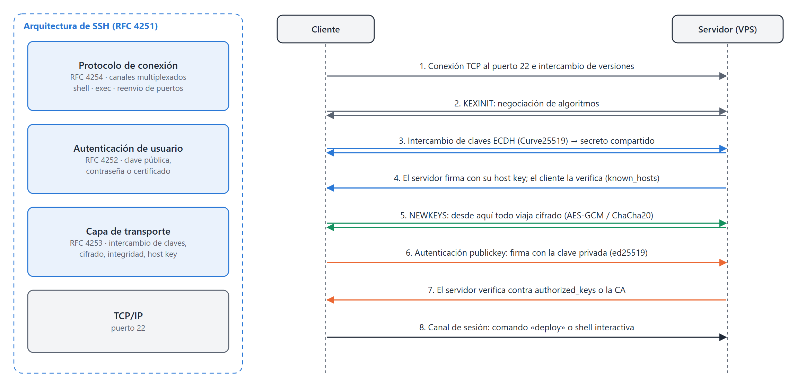

*Figura 23. Arquitectura en capas de SSH y secuencia de una conexión con autenticación por clave pública.* Fuente: elaboración propia a partir de Ylonen y Lonvick (2006a–d).

### D.4 Prácticas de endurecimiento

- **Comandos forzados.** En `authorized_keys` puede asociarse a una clave la opción `command="…"` junto con `restrict`, de modo que solo pueda ejecutar un comando, sin terminal ni reenvío de puertos (Listado 8).
- **Certificados SSH.** El servidor confía en una autoridad certificante (`TrustedUserCAKeys`) que firma claves de usuario con vigencia acotada, y así los accesos caducan solos (The OpenBSD Project, s.f.).
- **Red privada y cortafuegos.** Acceder a SSH por una red privada como WireGuard (Donenfeld, 2017) permite cerrar el puerto público.

*Listado 8. Clave de despliegue con comando forzado en `authorized_keys` (valores ilustrativos).*

```text
command="/opt/ops/bin/deploy-gate <proyecto>",restrict ssh-ed25519 AAAAC3Nza... deploy@<proyecto>
```

## Anexo E. Evidencia de pruebas y de ejecución

**Ejecución de las pruebas** (`pytest --cov=etl --cov=dashboard`, entorno local con Python 3.13; cobertura medida el 11/11/2026 y conteo de casos el 12/11/2026, tras agregar la prueba del ejemplo trazable):

```text
157 passed in 2.86s  (corrida del 12/11/2026, con la prueba del ejemplo trazable)
TOTAL                                              2708    686    75%
etl\extractors\tariff_parser.py                     321      6    98%
etl\transformers\reconciliation.py                   42      1    98%
etl\transformers\data_checks.py                      83      3    96%
etl\transformers\biomass.py                          52      5    90%
etl\extractors\scrape_tarifas.py                    605     80    87%
etl\transformers\energy_finance.py                  163     23    86%
etl\pipelines\run_etl.py                            173    102    41%
etl\extractors\scrape_estimaciones_agricolas.py     217    147    32%
dashboard\app.py                                     36     36     0%
```

**Integración continua.** Corrida 42998794294 de GitHub Actions (11/11/2026, rama `fix/avisos-y-frecuencia`): Python 3.11, pandas 2.3.3; «All checks passed!» (ruff) y «156 passed in 1.99s» (pytest).

**Corridas completas del ETL con extracción** (registro `logs/pipeline.log`):

| Inicio | Fin | Duración |
|---|---|---|
| 31/10/2026 08:43:15 | 09:11:36 | 28 min |
| 02/11/2026 01:23:55 | 01:53:51 | 30 min |
| 02/11/2026 16:35:40 | 17:19:19 | 44 min |
| 11/11/2026 06:00:01 (programada, esquema diario) | 06:30:57 | 31 min |

Las corridas de octubre de 2026 anteriores a esas fechas corresponden a la etapa de desarrollo. Todas se ejecutaron en el entorno local con Docker. La del 11 de noviembre fue la última del esquema diario: ese día era miércoles y la programación semanal (lunes) se incorporó después. El registro no contiene corridas entre el 3 y el 10 de noviembre, porque el entorno no estuvo en funcionamiento continuo.

**Impacto de la exclusión de registros** (corrida del 11/11/2026, toda la serie histórica): 38.117 registros excluidos (25,6 %), con el 12,1 % de la producción y el 2,4 % de la superficie; 110.819 registros válidos.

**Historial de versiones.** La lista completa de *commits* (fecha, autor y mensaje) se adjunta en `docs/informes/tesis/anexos/historial_git.txt`, generada con `git log --format="%h %ad %an %s" --date=short`. Contiene 205 entradas: las 203 descriptas en el Capítulo 2 más dos *commits* posteriores (fechados el 11/11/2026, hora local) que agregan datos de tarifas y una primera versión de este documento. La prueba del ejemplo trazable y el script de sensibilidad se agregaron después del corte del anexo.

## Anexo F. Extractos de las fuentes normativas y técnicas citadas

**Ley 27.424, artículo 4.** «Todo usuario de la red de distribución tiene derecho a instalar equipamiento para la generación distribuida […] hasta una potencia equivalente a la que éste tiene contratada con el distribuidor para su demanda».

**Ley 27.424, artículo 12, inciso a).** «El precio de la tarifa de inyección será establecido por la reglamentación de manera acorde al precio estacional correspondiente a cada tipo de usuario que deben pagar los distribuidores en el Mercado Eléctrico Mayorista».

**Ley 27.424, artículo 12, inciso c).** El valor a pagar resulta del «cálculo neto entre el valor monetario de la energía demandada y el de la energía inyectada antes de impuestos».

**FAO (2009, p. 28).** Sobre los residuos de cosechas anuales: «en la gran mayoría de los casos, estos residuos no están disponibles para usos energéticos» por la siembra directa.

**Nunes et al. (2021), resumen.** El retiro de rastrojo de maíz puede ser sostenible si los rendimientos superan 11 Mg/ha, si el retiro no excede el 40 % de la biomasa aérea (3,5–4,0 Mg/ha por año) y si se monitorean los nutrientes, especialmente el potasio.

**IRENA (2023, p. 32).** Cultivos como el maíz, el sorgo y otros granos producen residuos del orden de 50 a 100 GJ por hectárea.

Textos legales tomados de https://www.argentina.gob.ar/normativa/nacional/ley-27424-305179/texto (consulta: 12/11/2026).
